# 91. 프로젝트 종합 보고서

> 대상 독자: 본 연구를 처음 접하는 평가자(학부 신호처리 및 기초 기계학습 지식 전제).
> 본 보고서는 설계의 근거와 결과의 해석을 다룬다. 실행 방법은 `README.md`, 단계별 절차는
> `docs/02_procedure.md`, 자동 생성 결과표는 `docs/90_results_d0.md`(합성 ECG) · `docs/90_results_d1.md`(MIT-BIH)에 있다.

---

# 0. 문서 구성

본 보고서는 연구 문서 전체의 유일한 종합 문서이다[^D-22]. 종합 문서가 둘이면 어느 쪽이 최신인지
판단할 수 없으므로 두 번째 종합 문서는 두지 않고, 각 절에서 아래 표의 세부 문서를 참조한다.
`*` 표시 문서는 스크립트가 생성하므로 직접 수정하면 다음 실행에서 덮어쓰인다[^O-11][^O-12].

| 분류 | 문서 | 내용 |
|---|---|---|
| 설계·절차 | `00_review` · `01_design` · `02_procedure` · `36_related_work` | 초기 검토와 그 정정, 확정 설계안, STEP 별 실행 절차, 선행 연구와 우리 위치(DRUNet·NAFNet·Restormer — 미검증) |
| 기록 | `20_findings`(F) · `21_decisions`(D) · `22_incidents`(O) · `23_ai_review`(R) | 발견 · 설계 결정 · 운영 사고 · AI 협업 검토. 기각한 가설과 틀린 예측이 지워지지 않고 남아 있다 — 6 장이 그 요약이다 |
| | `19_record_keeping` · `17_checklists` · `18_glossary` | 기록 규약 · 작업 직전에 보는 체크리스트 · 용어와 지표 사전 |
| | `24_cli_reference`\* | 실행 스크립트의 옵션 전부 — 각 절차서는 자주 쓰는 것만 적고 여기를 가리킨다 (O-35) |
| 실험 상세 | `03_metric_floor`\* · `04_snr_estimator_calibration`\* · `05_swt_tuning`\* · `06_sameni_diagnosis`\* · `07_safety_probe`\* · `10_loss_ablation` — 여섯 다 두 축 짝이 있다(D0 판은 접미사가 없는 것도 있다) | 본문이 한 문단으로 요약한 것의 전문. 축이 다르면 값도 결론도 다르다(F-16 · F-17) |
| | `11_loss_by_noise`\* · `12_causal_fe`\* · `13_lookahead_fe`\* · `14_median_vs_zerophase`\* · `15_reference_and_training` · `16_fe_metric_audit` | EXP-G, 실시간 front-end 후보 네 판, 참조 정의 검토, 채점 기준 감사 |
| 산출물·운영 | `90_results_d0`\* · `90_results_d1`\* · `92_axis_gap`\* | 모든 방법 × 모든 지표의 자동 생성 결과표 (본문은 여기서 골라 싣는다) |
| | `30_realtime_demo` · `31_demo_design_review` · `32_metric_cards`\* · `33_card_design_samples` · `93_slides`\* · `34_visual_plan` · `94_panel_plan` · `96_visual_proposal` · `97_research_figs`\* · `38_exhibition_story_plan` | 시연 화면 · 지표 카드 · 발표 그림(8 장에 정리). 전시 판넬 · 브로셔 기획은 `94_panel_plan`, 대외 글의 학술 서술 규칙은 `95_academic_style`, 새 시각화 후보와 사전 점검표는 `96_visual_proposal`, 서브 프로젝트 두 개(전시 GUI · 실시간 측정)의 정리와 브로셔 개편 계획은 `38_exhibition_story_plan`, 그 후보를 그린 연구 과정 그림의 색인은 `97_research_figs` |
| | `08_acquisition` · `09_data_upload` · `35_external_compute` · `37_seed_replication` · `99_status` | 실측 수집 절차 · PhysioNet 데이터 공유 · 외부 GPU에서 산포를 측정하는 판의 실행 안내(F-40 · 5.10.7) · 판넬 그림 7 판정의 시드 10 개 재실험 지시(D-44) · 현재 상태와 인수인계 |

지표 정의, 약어, 본 연구에서 특정한 뜻으로 쓰는 용어는 `docs/18_glossary.md`에 정리되어 있다.

---

# 1. 문제 정의

## 1.1 연구 배경

자체 제작한 아날로그 취득 회로(Arduino Uno, AD8232)로 ECG를 취득하였으나, 아날로그 단의 잡음
저감 이후에도 잔여 잡음이 남았다. 오실로스코프에서는 광대역 잡음과 순간적인 큰 spike가 함께
관측되었다.

초기에 적용한 Sameni의 모델 기반 Kalman filtering은 기대한 만큼 SNR을 개선하지 못하였다. 당시에는
취득 신호의 SNR을 약 15 dB로 보고, 선행 연구의 개선 효과가 0~10 dB에서 두드러진다는 점을 근거로
다른 기법을 탐색하려 하였다. 이 판단의 전제는 1.2 절에서 검토한다.

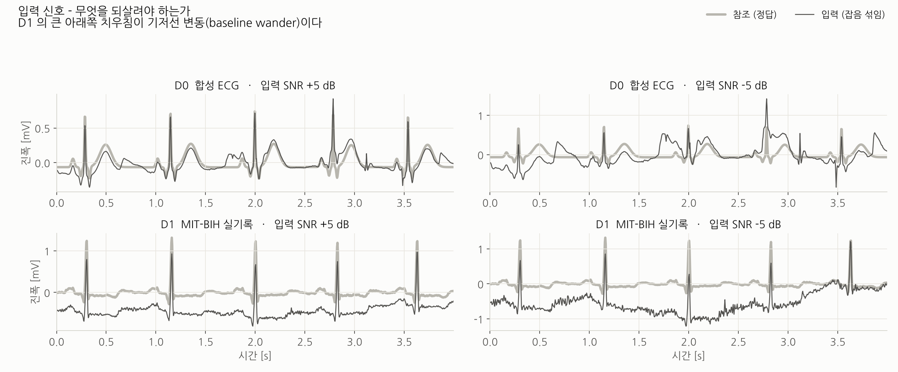

> 그림 1.1. 본 연구에서 사용한 두 데이터의 입력 신호. 위 행은 합성 ECG(D0), 아래 행은 MIT-BIH 실측
> 기록(D1)이며(정의는 4.3 절), 왼쪽 열은 입력 SNR +5 dB, 오른쪽 열은 −5 dB이다. 회색 굵은 선은 기준
> 신호, 가는 선은 입력이다. 자체 취득 장치의 신호는 아직 평가하지 않았다(7.3 절). MIT-BIH 입력에서
> 파형 전체가 완만하게 이동하는 성분은 기저선 변동이며, 5.2 절에서 공통 전처리로 대부분 제거됨을 보인다.
> 두 데이터의 잡음 특성 차이는 5.8 절 재검증의 출발점이다.

## 1.2 문제의 재정의

1.1 절의 판단에는 검증되지 않은 전제가 세 가지 있었다.

표 1.1. 1.1 절 판단의 전제와 검토 결과

| 전제 | 검증 여부 | 검토 결과 |
|---|---|---|
| 취득 신호의 SNR은 약 15 dB이다 | 미검증 | 기준 신호가 없으면 SNR을 직접 계산할 수 없으므로, 추정 방법의 정의가 먼저 필요하다 |
| Sameni 기법은 취득 조건에 맞지 않는다 | 미검증 | 구현의 정확성을 먼저 확인해야 한다 |
| SNR이 높을수록 좋은 출력이다 | 미검증 | 과도한 평활화도 SNR을 높일 수 있어, 목표(파형 보존)와 지표가 어긋날 수 있다 |

이에 따라 연구 목표를 다음과 같이 재정의하였다.

> ECG 파형(morphology)을 보존하면서 취득 잡음을 줄이는 디지털 후처리 기법들을 동일한 조건에서
> 정량적으로 비교하고, 실제 취득 환경의 잡음 조건에 적합한 기법을 규명한다.

본 연구는 다음을 주장하지 않는다.
- 임상 진단에 쓸 수 있는 수준의 ECG 복원: 검증할 수 없고 의료 규제 대상인 주장이다.
- 의료기기 개발: 본 연구의 결과물은 연구용 신호처리 시스템이다.

## 1.3 연구 질문

표 1.2. 연구 질문과 해당 실험

| RQ | 연구 질문 | 해당 실험 |
|---|---|---|
| RQ1 | 입력 SNR에 따라 어떤 기법이 유리한가? 특히 실측 조건에서는? | EXP-A |
| RQ2 | 잡음 종류별로 기법의 강약이 갈리는가? | EXP-B |
| RQ3 | 각 기법은 깨끗한 신호에 해를 끼치는가? | EXP-C |
| RQ4 | wavelet을 전처리로 쓰는 것과 신경망의 표현공간으로 쓰는 것 중 무엇이 나은가? | EXP-D |
| RQ5 | 딥러닝이 없는 파형을 만들어내지는 않는가? 부정맥을 훼손하지 않는가? | EXP-E |
| RQ6 | 공개 데이터로 학습한 모델이 자체 장비로 전이되는가? | EXP-F (실측 대기) |
| RQ7 | U-Net의 downsampling이 QRS를 뭉개는가? 해상도를 유지하면 나아지는가? | EXP-A (M10 추가) |
| RQ8 | 긴 문맥이 도움이 되는가? 그것을 쓸 구조(attention)가 필요한가? | EXP-D3 (window 2×2) |

---

# 2. 설계 원칙

구현에 앞서 네 가지 원칙을 정하였고, 이후의 모든 설계 결정은 이 원칙에 따랐다.

## 원칙 1. 평가 체계의 선행 확정

평가 코드를 기법 구현 뒤에 만들면, 이미 얻은 결과를 보면서 자기 기법에 유리한 지표와 조건을 무의식적으로
고르게 된다. 이를 막기 위해 평가 체계를 먼저 완성하도록 작업 순서를 고정하였다.

```
PHASE 2 (평가 엔진)  →  PHASE 3 (고전 기법)  →  PHASE 4 (모델 기반)  →  PHASE 6-7 (딥러닝)
```

## 원칙 2. 충분히 강한 비교 기준(baseline)

특정 기법이 비교 기준 X보다 우수하다는 주장은 X가 올바르게 구현되었을 때만 성립한다. 초기 관찰이
「Sameni 기법이 기대만큼 동작하지 않는다」였으므로, Sameni 기법을 비교 실험에 넣기 전에 6 항목의 자가진단을
통과하는 것을 착수 조건으로 두었다(`docs/06_sameni_diagnosis.md`).

이 절차로 구현 오류 2 건이 발견되었고, 수정 후 입력 5 dB 에서의 SNR 개선량이 +5.9 dB에서 +16.2 dB로
높아졌다. 이 검증이 없었다면 Sameni 기법이 본 연구의 조건에 맞지 않는다는 잘못된 결론을 내렸을 것이다.

## 원칙 3. 이상적 상한의 병기

어떤 기법의 SNR 개선량이 +8 dB라는 값만으로는 그 크기를 해석할 수 없다. 개선의 여지가 얼마나 남았는지
판단하려면 도달 가능한 최대치가 함께 필요하다.

표 2.1. 이상적 상한의 정의

| 상한 | 정의 | 답하는 질문 |
|---|---|---|
| `B01` 이상적 웨이블릿 상한 | 기준 신호의 웨이블릿 계수를 알고 각 계수의 유지 · 제거를 최적으로 결정 | 웨이블릿 임계값 처리로 더 개선할 수 있는가 |
| `B02` 이상적 Wiener 상한 | 참 전력 스펙트럼 밀도를 알고 `H(f)=Sx/(Sx+Sn)` 적용 | 선형 시불변 필터로 충분한가 |
| `M00` identity | 아무 처리도 안 함 | 처리가 도움이 되긴 하는가? |

두 이상적 상한(oracle)은 기준 신호를 참조하므로 실제로는 적용할 수 없다. 이를 구분하기 위해 코드에서
이름이 `oracle_`로 시작하는 기법만 기준 신호를 입력으로 받을 수 있도록 제한하였다.

## 원칙 4. 재현 가능성

- 난수는 전역 seed가 아니라 실험 · 기록 · 분석 창의 조합에서 결정론적으로 유도한다.
- 실험 하나는 설정 파일(YAML) 하나로 정의한다.
- 모든 산출 디렉터리에 실행 기록(git hash, 패키지 버전, 설정 사본)을 남긴다.
- 표와 그림은 산출물(`results/`)만 읽어 다시 생성하며, 원본 데이터에는 다시 접근하지 않는다.

---

# 3. 평가지표

평가지표의 선택은 이후 모든 실험의 해석을 좌우하므로, 본 장에서 지표의 구성과 그 근거를 상세히 다룬다.

## 3.1 잡음 제거의 두 목표와 그 충돌

기준 신호(무잡음 ECG)를 x(t), 잡음이 섞인 관측을 y(t) = x(t) + n(t), 알고리즘의 출력을 x̂(t)로 둔다.

- 목표 A(잡음 제거): x̂ 에서 잡음 n의 성분이 제거되어야 한다.
- 목표 B(신호 보존): x̂ 가 x의 형태를 유지해야 한다.

두 목표는 서로 충돌한다. 극단적으로 x̂ = 0은 잡음을 완전히 제거하지만 신호도 함께 없애고, x̂ = y는
신호를 완전히 보존하지만 잡음도 그대로 남긴다.

ECG에서 이 충돌은 구체적으로 나타난다. QRS 군은 ECG에서 가장 높은 주파수 성분이므로, 고주파 성분을 잡음으로
가정하는 순간 QRS가 먼저 손상된다. 실제로 Savitzky-Golay 필터는 무잡음 신호에 적용했을 때에도 R파 진폭을
24.8 % 감소시켰다.

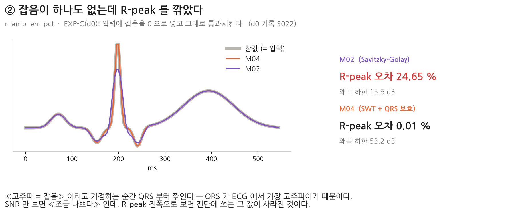

> 그림 3.1. 무잡음 입력에 대한 기법별 출력(무잡음 입력 실험, EXP-C). 입력에 잡음이 없으므로 출력과 입력의 차이는
> 모두 해당 기법이 만든 왜곡이다. Savitzky-Golay 필터(M02)는 R파 정점을 눈에 띄게 낮추며, 그 크기가 R파 진폭
> 오차로 표시되어 있다. 이 왜곡은 SNR에는 거의 나타나지 않으며, 이것이 본 장에서 지표를 네 층으로 나누는
> 이유이다.

따라서 지표를 하나로 요약하지 않고, 서로 다른 질문에 답하는 네 개의 층으로 나누어 설계하였다.

```
층 1. 재구성 오차   — x̂ 가 x 에서 수치적으로 얼마나 벗어났는가
층 2. 형태 보존     — ECG 로서 중요한 구조가 유지되었는가
층 3. 후속 분석 과제 — 이 신호로 실제 분석(심박 검출)이 가능한가
층 4. 주파수 구조   — 어떤 주파수 성분을 없앴는가
```

---

## 3.2 층 1: 재구성 오차

### 3.2.1 직류 성분 처리 규약(모든 지표 공통)

모든 지표는 x와 x̂ 양쪽에서 평균을 제거한 뒤 계산한다.

그 이유는 두 가지이다. (1) ECG의 절대 전위 기준은 임의의 값이며, 공통 전처리의 고역통과 필터가 이미 직류 성분을
제거한다. (2) 평균을 제거해야 SNR · RMSE · PRDN · 상관계수의 정의가 서로 일관된다. 느린 기저선 변동의 잔차는
평균 제거로 사라지지 않으므로, 지표의 평가력은 유지된다.

### 3.2.2 SNR 지표의 세 갈래 분리

표준적인 정의는 다음과 같다.

```
SNR_in  = 10 log10( P(x) / P(y − x) )
SNR_out = 10 log10( P(x) / P(x̂ − x) )
SNR improvement = SNR_out − SNR_in
```

그러나 다음 세 종류의 기법은 구조적으로 출력 진폭을 줄인다.

표 3.1. 구조적으로 출력 진폭을 줄이는 기법과 그 이유

| 방법 | 진폭이 줄어드는 이유 |
|---|---|
| soft threshold | `sign(d)·max(|d|−λ, 0)` — 살아남은 계수에서도 항상 `λ`만큼을 뺀다 |
| Kalman/EKS | process noise `Q` 설정에 따라 상태가 평균 쪽으로 눌린다 |
| MSE 학습 DL | 불확실한 구간에서 조건부 평균으로 수축한다 |

이 상태에서 위 식을 그대로 쓰면, 파형은 정확하고 크기만 3 % 작은 출력이 파형이 3 % 왜곡된 출력과 같은 값으로
평가된다. 실제로 이 차이 때문에 기법 간 순위가 바뀌는 경우가 있었다.

따라서 다음 세 값을 항상 함께 보고한다.

표 3.2. 함께 보고하는 세 가지 SNR 값

| 이름 | 정의 | 답하는 질문 |
|---|---|---|
| `snr_out_strict` | `x̂` 그대로 | 그대로 써도 되는가 (실사용 기준) |
| `snr_out_scaled` | 최적 이득 `α* = ⟨x,x̂⟩/⟨x̂,x̂⟩` 보정 후 | 파형 구조 자체는 맞는가 (알고리즘 기준) |
| `gain_bias` | `α*` 값 자체 | 진폭이 얼마나 눌렸는가 |

진폭 이득 편향 α* 가 1.04이면 출력이 기준 신호보다 약 4 % 작다는 뜻이다(출력을 4 % 키울 때 오차가 최소가
되므로). 1보다 작으면 출력이 기준보다 크다.

이 분리는 단위 시험으로 확인한다. x̂ = 0.5x 일 때 보정 없는 출력 SNR은 10 log10(4) = 6.02 dB, 진폭 보정 출력
SNR은 무한대, 진폭 이득 편향은 2.0 이어야 한다.

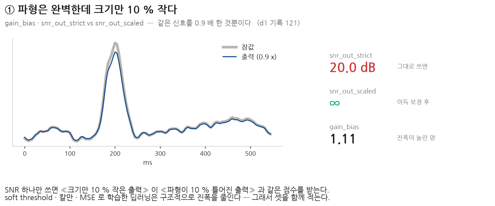

> 그림 3.2. 위 단위 시험과 같은 조건을 그림으로 나타낸 것이다. 출력은 기준 신호의 0.9 배로, 형태는 같고
> 크기만 작다. 보정 없는 출력 SNR은 이를 크게 감점하고, 진폭 보정 출력 SNR은 거의 감점하지 않는다. 두 값은
> 서로 다른 질문에 답하므로 어느 한쪽이 옳은 값이 아니며, 그래서 항상 함께 보고한다.

#### 분리로 확인된 사례

진폭 이득 편향(1보다 크면 출력이 기준보다 작다):

표 3.3. 기법별 진폭 이득 편향

| 입력 SNR | `M00` 무처리 | `M02` Savitzky-Golay | `M05` 칼만 필터 | `M04` SWT | `M07` |
|---|---|---|---|---|---|
| −5 dB | 0.241 | 0.723 | 0.832 | 0.692 | 1.014 |
| 20 dB | 0.990 | 1.035 | 1.043 | 1.000 | 1.004 |

- 20 dB에서 Savitzky-Golay 필터의 출력은 3.5 %, 확장 칼만 필터(EKS)의 출력은 4.3 % 작다. 체계적인 진폭 축소가
  실제로 존재한다.
- SWT 임계값 처리(M04, garrote)는 1.000으로, garrote thresholding을 선택한 근거가 여기서 확인된다.
  (soft thresholding을 쓴 초기 설정에서는 진폭 이득 편향이 1.6까지 커졌다.)

무처리(M00)의 진폭 이득 편향이 −5 dB에서 0.241인 것도 중요한 정보이다. 잡음이 신호보다 훨씬 크므로, 관측
신호를 0.24 배로 줄이는 것만으로 오차가 감소한다. 이는 스칼라 Wiener 이득에 해당하며, 그 결과 무처리의 SNR
개선량(진폭 보정)이 −5 dB에서 0이 아니라 +6.2 dB로 계산된다.

> 해석 시 유의점: SNR 개선량(진폭 보정)은 무처리에도 양의 값을 준다. 그 크기는 10 log10(1 + ρ) − SNR_in
> (ρ 는 선형 SNR)으로 정확히 계산되며, SNR이 높을수록 0에 수렴한다(20 dB에서 +0.045 dB). 따라서 모든 곡선은
> 무처리 곡선을 기준선으로 두고 해석해야 한다.

### 3.2.3 RMSE와 PRDN

```
RMSE = sqrt( mean( (x − x̂)² ) )                            [mV]
PRDN = 100 · sqrt( Σ(x − x̂)² / Σ(x − x̄)² )                 [%]
```

- RMSE는 물리 단위(mV)라 해석이 쉽지만 신호 진폭에 의존한다. 진폭이 큰 기록과 작은 기록을 함께 평균하면
  진폭이 큰 기록의 영향이 커진다.
- PRDN은 신호 에너지로 정규화하여 이 문제를 없앤다. ECG 압축 · 재구성 문헌의 표준 지표이다.

문헌에는 원신호 기준의 PRD1과 평균 제거 기준의 PRDN이 함께 쓰인다. MIT-BIH 원신호에는 ADC 오프셋이 포함되어
있어 PRD1은 실제 오차를 항상 과소평가한다. 본 연구는 PRDN만 사용하고 표기도 고정하였다.

PRD는 흔히 형태(morphology) 지표로 소개되지만 이는 정확하지 않다. PRD는 정규화된 전체 재구성 오차이며, 형태
왜곡은 그 오차에 반영될 뿐 직접 측정되지 않는다. 따라서 별도의 형태 지표가 필요하다(층 2).

---

## 3.3 층 2: 형태 보존

형태 보존을 별도의 층으로 두는 이유는 부정맥 박동에서 가장 분명하게 드러난다.

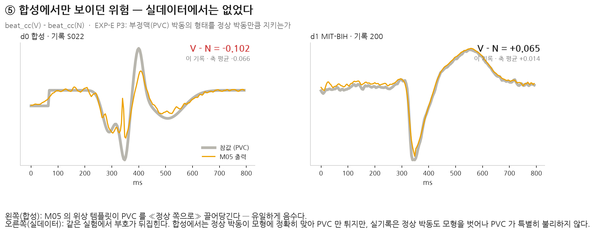

> 그림 3.3. 정상 박동(N)과 심실조기수축(V)의 평균 박동 상관계수를 각각 측정한 뒤 그 차이를 비교한다. 하나의
> 평균으로 합치면 소수인 V 박동의 훼손이 다수인 N 박동에 가려진다. 이 지표에는 한계도 있다. 합성 ECG에서
> 관찰된 위험이 MIT-BIH에서는 재현되지 않았다[^F-8][^F-28]. 합성 데이터에서 관찰된 결과를 실측 데이터에서 다시
> 검증해야 한다는 본 연구의 원칙이 여기서도 적용된다.

### 3.3.1 전체 파형 상관계수

```
cc = Pearson correlation( x − x̄ , x̂ − x̂̄ )
```

상관계수는 RMSE와 상호 보완적이다.

- RMSE는 값의 정확성을 측정한다(진폭이 절반이면 오차가 크다).
- 상관계수는 형태의 유사성을 측정한다(x̂ = 0.5x이어도 상관계수는 1.0이다).

두 지표를 함께 보면 형태는 같고 크기가 다른 경우와, 크기는 같고 형태가 다른 경우를 구분할 수 있다.

### 3.3.2 평균 박동 파형 상관계수와 정렬 기준

전체 파형의 상관계수는 기저선 같은 저주파 성분의 영향이 커서 개별 박동의 형태 손상을 놓친다. 따라서 R파를
기준으로 박동을 잘라 평균한 평균 박동 파형(template)끼리 비교한다.

이때 정렬 기준의 선택이 결과를 좌우한다.

표 3.4. 평균 박동 파형의 정렬 기준과 문제점

| 정렬 기준 | 문제 |
|---|---|
| 출력 x̂ 에서 검출한 R파 | 타이밍 오차가 상쇄되어 드러나지 않는다 |
| 기준 신호의 R파 (채택) | 타이밍 오차가 상관계수에 반영된다 |

본 연구는 항상 기준 신호의 R파 위치로 양쪽 신호를 자른다.

### 3.3.3 R파 진폭 오차

R파 전후 ±40 ms에서 부호를 고려한 극값을 x와 x̂ 에서 각각 구해 상대 오차를 계산한다. ±40 ms 창을 쓰는 것은
미세한 타이밍 이동과 진폭 감쇠를 분리하기 위해서이다(타이밍은 R파 위치 오차로 따로 평가한다).

이 지표는 과도한 평활화를 가장 직접적으로 드러낸다.

### 3.3.4 QRS 폭 오차

생체 신호 분석 라이브러리 NeuroKit2의 이산 웨이블릿 변환(DWT) 기반 파형 분할(delineation)로 QRS의 시작점과
끝점을 찾아 폭을 비교한다. QRS는 ECG에서 가장 빠르게 변하는 구간이므로, 과도한 필터링이 QRS를 평활하면 폭이
넓어지거나 좁아진다.

다만 이 지표에는 검출 알고리즘 자체의 불안정성이 포함된다. 따라서 3.6 절의 지표 분해능을 먼저 측정한 뒤에
해석해야 한다.

---

## 3.4 층 3: 후속 분석 과제(downstream task)

### 3.4.1 도입 배경

층 1 · 2의 지표는 모두 기준 신호를 필요로 하지만, 실측 신호에는 기준 신호가 없다. 또한 최종 목적은 지표 값이
좋은 파형이 아니라 실제 분석에 쓸 수 있는 파형이다.

따라서 잡음 제거 결과에 심박 검출기를 적용하여 검출 성능을 측정한다.

```
Se  = TP / (TP + FN)      실제 심박을 얼마나 놓치지 않았는가
PPV = TP / (TP + FP)      검출한 것 중 진짜가 얼마나 되는가
```

### 3.4.2 공정성 규약

모든 기법의 출력에 같은 검출기(`wfdb.processing.xqrs_detect`)를 적용한다. 기법마다 다른 검출기를 쓰면 최종
차이가 잡음 제거 때문인지 검출기 때문인지 구분할 수 없다.

검출 R파와 기준 R파의 대응은 허용 오차 ±75 ms 안에서 1 : 1 최소 비용 매칭(Hungarian 알고리즘)으로 정한다.
탐욕적(greedy) 매칭은 허용 오차 안에 검출이 둘 들어올 때 지표를 과대평가한다.

### 3.4.3 심박수 오차

RR 간격의 중앙값으로 심박수를 구해 비교한다(평균은 이상치에 취약하다). 의미를 직관적으로 이해하기 쉬운 지표이다.

---

## 3.5 층 4: 주파수 구조

```
psd_logdist = mean( | 10log10 PSD(x) − 10log10 PSD(x̂) | )    [1–100 Hz]
band_power_err : 대역별 상대 파워 오차
```

ECG는 0.5~40 Hz이고 그 위는 잡음이라는 식으로 대역을 임의로 잘라 판정하지 않는다. QRS에는 상당한 고주파
성분이 있으므로, 항상 기준 신호의 전력 스펙트럼 밀도(PSD)와 비교한다.

PSD는 시간 영역에서 보이지 않는 차이를 보여 준다. 예를 들어 어느 기법이 60 Hz 성분을 제거했는지, 어느 기법이
QRS의 고주파 성분까지 함께 제거했는지를 확인할 수 있다.

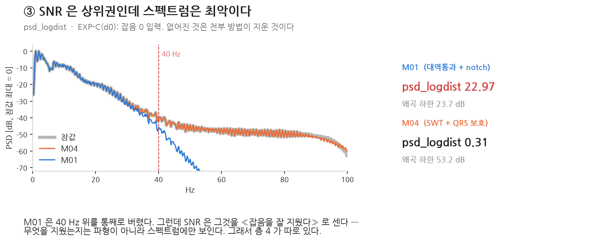

> 그림 3.4. 무잡음 입력에 대한 세 기법의 출력과 스펙트럼. 시간 영역 파형은 비슷해 보이지만, 스펙트럼에서는 각
> 기법이 어느 대역을 얼마나 제거했는지가 드러난다. 제거된 성분은 시간 영역이 아니라 스펙트럼에서만 확인되며,
> 이것이 층 4를 따로 둔 이유이다.

---

## 3.6 지표의 분해능

기법 간 차이가 지표 자체의 변동보다 작으면 결과표는 기법의 우열을 보여 주지 못한다.

따라서 기법을 구현하기 전에, 무잡음 신호에 무시할 수준의 교란(40 dB 백색 가우시안 잡음)을 난수 시드 10 개로
더하고 각 지표가 이상값에서 얼마나 변동하는지 측정하였다(`docs/03_metric_floor.md`).

표 3.5. 지표별 분해능(판별 하한)

| 지표 | 분해능(판별 하한, 95 백분위) | 해석 |
|---|---|---|
| R파 위치 오차 | ≈ 0 | 타이밍 계열 지표는 분해능이 높다 |
| 심박수 오차 | 0 | 위와 같음 |
| QRS 폭 오차 | 0.64 ms | 이보다 작은 차이는 파형 분할 알고리즘의 불안정성이다 |
| 상관계수 | 5.0e-05 | 값이 1에 가까워 소수 넷째 · 다섯째 자리까지 보아야 한다 |
| 평균 박동 상관계수 | 3.6e-07 | 매우 민감하다 |
| PSD 로그 거리 | 6.45 dB | 분해능이 매우 낮다 |

PSD 로그 거리의 분해능이 6.45 dB로 크다는 점은 중요한 발견이다. ECG 전력이 거의 없는 주파수 구간에서
로그 PSD 차이가 매우 커지기 때문이다. 따라서 이 지표는 절대값이 아니라 기법 간 상대 비교로만 해석하며, 주로
그림으로 확인한다.

결과표에서는 분해능보다 작은 값에 `*`를 붙여 구분할 수 없음을 표시한다.

> 위 표는 합성 ECG의 값이다. 같은 지표의 분해능이 MIT-BIH에서는 최대 44 배 달라진다(QRS 폭 오차 0.64 ms →
> 28.07 ms). 데이터별 전체 표는 `docs/03_metric_floor.md`와 `docs/03_metric_floor_d1.md`에 있고, 이 차이를
> 고려하지 않았을 때의 잘못된 결론은 F-16에 기록되어 있다.

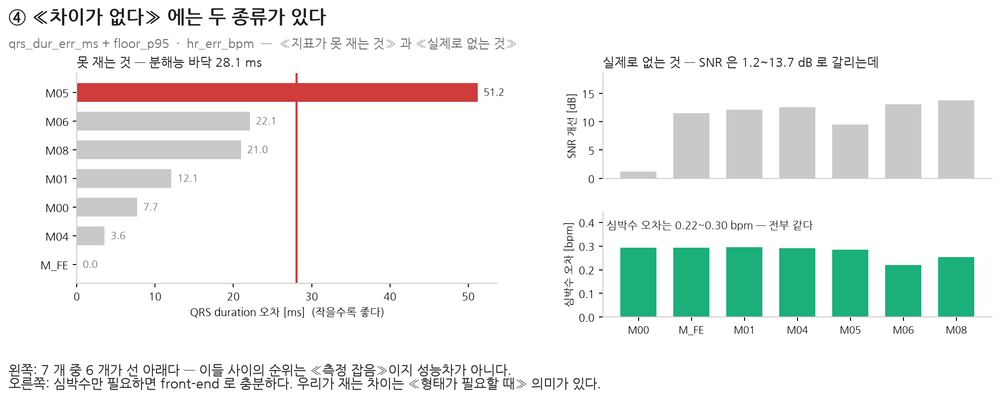

> 그림 3.5. 차이가 관찰되지 않는 두 경우. 왼쪽은 기법 간 차이가 실제로 없는 경우이고, 오른쪽은 지표의 분해능이
> 차이보다 커서 측정할 수 없는 경우이다. 표에서는 두 경우가 똑같이 비슷한 수치로 보이므로, 이를 구분하지 않으면
> 유의한 차이가 없다는 결과를 차이가 없다는 결론으로 잘못 해석하게 된다.

---

## 3.7 기준 신호가 없는 실측 신호용 지표

자체 취득 장치(Arduino)의 실측 신호에는 기준 신호가 없다. 그러나 취득 신호의 SNR이 실제로 약 15 dB 인지는
확인해야 한다. 이를 위해 박동의 반복성을 이용한 추정기를 사용한다.

### 3.7.1 세 가지 추정기

표 3.6. 기준 신호 없는 SNR 추정기

| 기호 | 방법 | 핵심 가정 |
|---|---|---|
| (A) | 박동 평균 잔차: 평균 박동 m을 신호로, 각 박동과 m의 차이를 잡음으로 본다 | 박동 형태가 반복되고, 잡음이 박동 간에 무상관이다 |
| (B) | 반분 일관성: 홀수 번째 박동 평균과 짝수 번째 박동 평균의 상관 | (A)와 같음(잡음 스펙트럼에 대한 가정은 없음) |
| (C) | 등전위(T-P) 구간 분산 | T-P 구간이 평탄하고, 잡음이 정상(stationary) 과정이다 |

(B)는 다음과 같이 유도된다. 두 평균 박동을 m + e_O, m + e_E 라 하면(e_O ⊥ e_E, P(e) = Pn / (N/2))

```
corr = Ps / (Ps + Pn')  = r' / (1 + r')      →   r' = corr / (1 − corr)
단일 beat SNR  r = r' / (N/2)
```

### 3.7.2 필수 전처리: sub-sample 정렬

표본화율 250 Hz에서 1 표본은 4 ms이다. QRS의 폭(σ)이 10 ms 수준이므로, 1 표본의 정렬 오차만으로도 박동
잔차가 커져 SNR을 6 dB 이상 과소평가한다. 실측 예로, 참 SNR 20 dB인 신호를 14 dB로 추정하였다.

따라서 4 배 업샘플링 후 평균 박동과의 교차상관으로 정렬하는 단계를 필수로 넣었다. 수정 후 같은 신호의 추정값은
20.5 dB이다.

### 3.7.3 가정 위반의 진단

(A)와 (B)는 잡음이 박동 간에 무상관이라고 가정한다. 근전도 burst나 전극 움직임처럼 여러 박동에 걸쳐 상관을
갖는 잡음에서는 SNR을 크게 과대평가한다.

따라서 다음 두 진단 지표를 함께 계산한다.

표 3.7. SNR 추정의 진단 지표

| 진단 | 의미 |
|---|---|
| 인접 박동 잔차의 상관(lag-1) | 0.15를 넘으면 (A) · (B)의 추정이 낙관적이다 |
| 잡음 박동 비율 | 형태가 이상한 박동의 비율. 크면 burst · 임펄스형 잡음이므로 SNR을 하나의 값으로 보고하지 않는다 |

실측 검증 결과(`docs/04_snr_estimator_calibration.md`), 전극 움직임 잡음에서 인접 박동 잔차 상관은 0.42, 기저선
변동에서 0.27로 진단 지표가 실제로 동작하였다. 백색 가우시안 잡음에서는 0.00이다.

또한 잡음이 전혀 없어도 추정치는 무한대가 되지 않는다. RR 간격 변동에 따라 P · T파 위치가 실제로 움직이므로
약 22 dB에서 포화하며, 이 경우 포화 경고(`ceiling_warning`)를 표시한다.

### 3.7.4 교정표의 사전 작성

참 SNR을 아는 합성 데이터로 각 추정기의 편향을 미리 측정해 두었다. 이 교정표가 있어야 실측 추정값(약 15 dB)을
편향을 고려해 해석할 수 있다. 공통 전처리 적용 후 백색 가우시안 잡음 조건에서 편향은 0.9 dB이다.

---

## 3.8 최종 지표 구성

주 지표 5 개(결과표 본문)

표 3.8. 최종 지표 구성

| 지표 | 방향 | 측정 대상 |
|---|---|---|
| SNR 개선량(진폭 보정) | ↑ | 잡음 제거량 |
| RMSE | ↓ | 기준 신호와의 수치적 차이 |
| 상관계수 | ↑ | 파형 형태의 유지 |
| R파 위치 오차 | ↓ | 심박 타이밍의 유지 |
| QRS 폭 오차 | ↓ | QRS 형태의 유지 |

보조 지표 8 개: SNR 개선량(보정 없음), 진폭 이득 편향, PRDN, R파 진폭 오차, 평균 박동 상관계수, 심박수 오차,
PSD 로그 거리, 실시간 계수(RTF)

종합 점수는 만들지 않았다. 0.4 · SNR + 0.3 · 상관계수 + 0.3 · QRS 같은 가중합은 가중치의 근거를 제시할 수 없기
때문이다. 대신 여러 지표를 동시에 보는 Pareto 관점으로 비교한다(4.4 절).

---

# 4. 실험 설계

## 4.1 신호 규격의 사전 고정

표 4.1. 사전 고정한 신호 규격

| 항목 | 값 | 근거 |
|---|---|---|
| 표본화율 | 250 Hz | Nyquist 주파수 125 Hz. 취득 회로가 그 이상의 대역을 담지 못하며, 계산량 대비 적절하다 |
| 분석 창(window) | 1,024 표본 = 4.096 s | 정상 심박에서 4~6 박동을 포함한다. 2^10이므로 SWT 5 단계 분해가 가능하다 |
| 창 이동(hop) | 512 표본(50 % 겹침) | 제곱근 Hann 창으로 정확히 재구성된다 |
| 단위 | mV | R파 진폭 지표를 물리적으로 해석하기 위해서이다 |

## 4.2 공정성 규약 5개

### (1) 동일 입력

모든 기법이 완전히 같은 입력 y를 받는다. 평가 데이터는 고정 시드로 미리 생성해 공유한다.

### (2) 입력 SNR 단계별 잡음 표본의 고정

하나의 (기록, 구간, 잡음 조건)에 대해 잡음 표본을 한 번만 생성하고 크기만 바꾼다. SNR 단계마다 다른 잡음을
생성하면, 입력 SNR에 따른 성능 곡선이 잡음 구성의 변화와 섞여 해석할 수 없게 된다.

### (3) 공통 전처리(front-end)

```
FE1  zero-phase Butterworth HPF, 4차, 0.5 Hz     (baseline wander)
FE2  zero-phase Butterworth LPF, 4차, 100 Hz     (대역 제한)
FE3  IIR notch 60/120 Hz                          ← PSD로 PLI 존재를 판정한 뒤에만
```

- 양방향 필터링(`filtfilt`, zero-phase)을 쓰므로 위상 왜곡이 없고, R파 시점이 이동하지 않는다(실측 편향
  0.2 ms 미만).
- 60 · 120 Hz notch(FE3)는 항상 적용하지 않는다. 59~61 Hz 대역 전력이 인접 대역 중앙값의 10 배 이상일 때만
  적용하며, 무잡음 ECG의 고조파 성분에는 동작하지 않음을 확인하였다(합성 ECG에서 비율 1.0~1.6).

### (4) guard band: 실측에 근거한 결정

양방향 고역통과 필터는 신호 경계에서 수 초간 과도 응답(ringing)을 보이고, 칼만 필터는 수렴 시간이 필요하며,
웨이블릿 · 중첩 합성(OLA) 처리는 패딩 경계 효과가 있다. 이를 고려하지 않으면 무잡음 신호에 공통 전처리만
적용해도 왜곡이 11.9 dB로 측정된다.

표 4.2. 경계 제외 구간에 따른 공통 전처리의 무잡음 입력 출력 SNR

| 경계 제외 구간 [s] | 공통 전처리의 무잡음 입력 출력 SNR [dB] |
|---|---|
| 0 | 11.5 |
| 1 | 25.9 |
| 3 | 40.9 |
| 5 | 41.9 (포화) |
| 10 | 41.7 |

이에 따라 평가 구간 60 s 중 양 끝 5 s를 지표 계산에서 제외하였다. 기법에는 전체 구간을 입력하고, 지표만
내부 구간에서 계산하며, 모든 기법에 같게 적용한다.

### (5) 동일한 R-peak 검출기

모든 기법의 출력에 같은 검출기를 적용한다(3.4.2 절).

## 4.3 데이터 설계

표 4.3. 사용 데이터

| 데이터 | 구성 | 용도 |
|---|---|---|
| D0 합성 ECG | McSharry · Sameni 동역학 모델, 기록마다 다른 박동 형태 | 파이프라인 검증, 확장 칼만 필터의 정답 검증, 외부 데이터 없이 전 실험 수행 |
| D1 MIT-BIH + NSTDB | DS1 · DS2 환자 간 분할 | 주 평가 데이터 |
| D2 MIT-BIH 무잡음 구간 + Arduino 잡음 | 장치 고유 잡음 합성 | 장치 적응 실험 |
| D3 Arduino 실측 | 기준 신호 없음 | 최종 실측 평가(진행 중) |

결과는 합성 ECG(5.1~5.7 절)와 MIT-BIH(5.8 절 이후)의 두 데이터에서 보고한다. 자체 장치 실측 데이터(D3)의 평가는
아직 수행하지 않았다(7.3 절).

### 합성 데이터(D0)의 생성 모델: McSharry 동역학 모델

```
θ̇ = ω
ż = −Σᵢ (αᵢω/bᵢ²) Δθᵢ exp(−Δθᵢ²/2bᵢ²)
```

이 모델은 Sameni 확장 칼만 필터(EKF)의 상태 방정식과 같은 매개변수화를 쓴다. 따라서 생성에 쓴 참 매개변수를
EKF에 그대로 주면 EKF는 이론적 최적에 도달해야 하며, 도달하지 못하면 구현 오류이다. 즉 합성 ECG는 EKF의
정답 검증 사례 역할을 한다.

### 데이터 분할(split) 설계

- 기록 단위로 분할한다. 분석 창 단위로 나누면 같은 환자의 같은 박동 형태가 학습 · 평가 양쪽에 들어간다.
- 잡음도 시간축에서 겹치지 않게 분할한다. NSTDB의 기저선 변동 · 근전도 · 전극 움직임 잡음은 각각 30 분 길이의
  기록 하나뿐이어서, 무작위로 잘라 쓰면 학습과 평가가 같은 잡음 파형을 공유한다(잡음 누설).

## 4.4 실험 매트릭스

표 4.4. 실험 매트릭스

| ID | 목적 | 규모 | 답하는 RQ |
|---|---|---|---|
| EXP-A | 입력 SNR 단계별 비교(주 실험) | 22 기록 × 2 구간 × 6 SNR = 264 구간 × 12 기법 | RQ1 |
| EXP-B | 잡음 종류별 비교 | 22 × 2 × 7 조건 = 308 구간 × 12 기법(SNR 10 dB 고정) | RQ2 |
| EXP-C | 무잡음 입력의 왜곡 하한 | 22 × 2 = 44 구간, 잡음 없음 | RQ3 |
| EXP-D | 웨이블릿 결합 위치 비교 | EXP-A에서 M06 · M07 · M08 추출 | RQ4 |
| EXP-E | 가성 파형 생성 검증 | 22 구간 × 3 조건 | RQ5 |
| EXP-D2 | 시간 해상도 비교 | EXP-A에서 M06 · M10 추출(파라미터 수 · 수용영역 정합) | RQ7 |
| EXP-D3 | 분석 창 길이 × 구조 2×2 | M06 · M09 × 창 1,024 · 4,096 표본, 총 표본 수 정합 | RQ8 |

### 무잡음 입력 실험(EXP-C)의 역할

무잡음 ECG를 그대로 각 기법에 통과시킨다.

```
snr_distortion = 10 log10( P(x) / P(method(x) − x) )
```

이 값이 낮은 기법은 잡음이 없어도 신호를 왜곡한다. 이 실험에는 세 가지 의미가 있다.

1. 파형 분할 알고리즘에 의존하지 않는 형태 보존 지표이다.
2. 출력 SNR의 이론적 상한이다. 왜곡 하한이 15 dB인 기법은 입력이 아무리 깨끗해도 출력 SNR이 15 dB를 넘지
   못한다.
3. 가로축 SNR 개선량, 세로축 왜곡 하한의 산점도가 곧 Pareto 경계이다.

### 가성 파형 생성 검증(EXP-E) 설계

표 4.5. 가성 파형 생성 검증의 조건

| 프로브 | 조작 | 실패 조건 |
|---|---|---|
| P1 박동 삭제 | 기준 신호에서 박동 하나(R ± 200 ms)를 등전위선으로 지우고 잡음을 더한다 | 그 위치에 QRS를 생성하면 실패 |
| P2 무수축 | 3 s 구간을 등전위선으로 바꾼다 | 박동이 없어야 할 구간에 박동을 생성하면 실패 |
| P3 이소성 박동 | PVC 박동의 형태 보존을 정상 박동과 비교한다 | PVC가 정상 QRS 형태로 바뀌면 실패 |

가성 파형 에너지는 지운 구간에서 출력이 만든 에너지를 원래 그 구간의 에너지로 나눈 값이며, 낮을수록 안전하다.

## 4.5 통계 처리

- 집계 단위는 기록이다(분석 창은 서로 독립이 아니므로 창 단위로 집계하면 p 값이 과소 추정된다).
- 같은 기록에 여러 기법을 적용했으므로 대응 Wilcoxon 부호 순위 검정을 쓴다.
- 다중 비교는 Holm-Bonferroni 방법으로 보정한다.
- 효과 크기(rank-biserial)를 함께 보고한다. p 값만 보고하면 통계적으로는 유의하지만 0.2 dB에 불과한 차이를
  의미 있는 차이처럼 주장하게 된다.

## 4.6 비교 대상과 선정 근거

선정 기준은 2 장의 원칙 2이다. 각 계열에서 그 계열이 낼 수 있는 최선의 기법을 하나씩 두었다. 비교 기준이
약하면 딥러닝의 우위가 기법의 차이가 아니라 매개변수 탐색의 차이를 반영하게 된다. 따라서 고전 계열에는
매개변수를 탐색한 SWT 임계값 처리를, 모델 기반 계열에는 Sameni 기법을 두고, 각 계열의 이상적 상한도 함께
제시하였다(원칙 3).

표 4.6. 비교 기법

| 코드 | 계열 | 기법 | 비교에서의 역할 |
|---|---|---|---|
| `M00` | — | 처리 없이 입력을 그대로 출력(무처리) | 하한 기준. 공통 전처리 자체가 신호를 바꾸는 양의 기준이기도 하다(5.3 절) |
| `M_FE` | 공통 전처리 | 공통 전처리만 적용 | 각 기법의 개선량 중 공통 전처리의 기여분을 분리한다(F-10) |
| `M01` | 고전 필터 | 0.5–40 Hz 대역통과 필터 + 자동 notch | 최소 비교 기준. 필터 한 번으로 얻을 수 있는 성능 |
| `M02` | 고전 필터 | Savitzky-Golay 다항 평활(40 ms, 3 차) | 저비용 형태 보존형. 창 안을 다항식으로 근사해 정점 감소를 줄인다 |
| `M03` | 시간-주파수 | DWT soft thresholding(sym4, 5 단계) | 교과서적 웨이블릿 임계값 처리 |
| `M04` | 시간-주파수 | SWT 적응 임계값 처리(전역 σ · 단계별 k · QRS 보호 · garrote) | 고전 계열의 대표 기법 |
| `M04np` | 시간-주파수 | M04에서 QRS 보호만 제외 | QRS 보호의 효과만 분리하는 비교 |
| `M05` | 모델 기반 | Sameni 확장 칼만 필터(순방향 추정 뒤 역방향 평활, EKS). ECG를 위상 공간의 가우시안 함수 합으로 모델링하고 칼만 필터로 추정 | 모델 기반 계열의 대표 기법 |
| `M06` | 딥러닝 | 잔차 학습 1D U-Net(파라미터 976 K) | 딥러닝 계열의 대표 기법 |
| `M07` | 혼합 | SWT로 먼저 잡음을 제거한 뒤 U-Net에 입력 | 웨이블릿을 전처리로 사용 |
| `M08` | 혼합 | SWT 부대역 6 개를 채널로 두고 대역별로 처리한 뒤 역변환(파라미터 993 K) | 웨이블릿을 신경망의 표현 공간으로 사용 |
| `M09` | 딥러닝 | CNN-Transformer(파라미터 768 K) | 긴 문맥의 효용 검증(5.10 절) |
| `M10` | 딥러닝 | Dilated ResNet, downsampling 없음(파라미터 980 K) | 시간 해상도의 효용 검증(5.9 절) |
| `B01` · `B02` | 이상적 상한 | 기준 신호를 알고 고른 최적 임계값 처리 / 최적 Wiener 필터 | 각 계열의 상한 |

### 웨이블릿 기법으로 SWT를 택한 근거

이산 웨이블릿 변환(DWT)은 단계마다 신호를 1/2로 줄인다(데시메이션). 따라서 같은 QRS 라도 표본 격자의 어느
위치에 놓이는지에 따라 계수가 달라지고, 임계값 처리 결과가 R파 위치에 따라 달라진다. ECG에서 R파 위치는
임의이므로 이는 직접적인 문제가 된다.

SWT는 데시메이션 대신 필터를 확장하여(à trous) 모든 단계에서 원래 길이를 유지한다. 신호가 이동하면 계수도
같은 만큼 이동한다. 따라서 엄밀하게는 이동 불변(shift-invariant)이 아니라 이동 등변(shift-equivariant)이 정확한
표현이다(`docs/00_review.md` A-11의 용어 정정). 대신 단계 수 × 신호 길이만큼 계수가 생겨 DWT보다 연산량이
많다. 250 Hz · 1,024 표본 규모에서는 이 연산량이 문제가 되지 않으므로(5.6 절, 실시간 계수 0.0012) SWT를 고전
계열의 대표 기법으로 두었다.

구현상 제약으로, `pywt.swt`는 신호 길이가 2^단계 의 배수여야 한다. 1,024 = 2¹⁰ 이므로 5 단계까지 분해할 수
있지만, 실측 신호를 통째로 입력할 때에는 패딩이 필요하다.

임계값 규칙도 교과서 기본값과 다르다(`docs/00_review.md` B-1). 잡음 표준편차 σ 를 최고주파 대역 하나에서만
추정하고(단계별 중앙절대편차는 D3 이상의 단계에서 잡음이 아니라 ECG 성분을 반영한다, F-5), QRS 구간에서
임계값을 낮추며, soft thresholding 대신 garrote thresholding을 쓴다. 검증 데이터에서 교과서 기본값은 −3.47 dB,
매개변수 탐색 후의 설정은 11.39 dB로 14.9 dB 차이가 났다(`docs/05_swt_tuning.md`).

> 매개변수 탐색은 데이터마다 따로 수행하였고, 실행 시 해당 데이터의 값을 자동으로 적용한다[^D-9]. MIT-BIH의
> 결과는 `docs/05_swt_tuning_d1.md`에 있다. 한 데이터에서 정한 값을 다른 데이터에 그대로 적용하면 F-16 · F-17과
> 같은 유형의 오류가 된다.

> 한계: DWT 임계값 처리(M03)는 데시메이션만 다른 대조군이 아니다. M03은 교과서적 설정(soft thresholding, QRS
> 보호 없음)이고 M04는 위의 세 가지를 모두 바꾼 설정이다. 따라서 5.3 절의 39.80 대 53.15 dB는 데시메이션의
> 효과가 아니라 네 요인이 섞인 차이이다. 이 비교에서 한 요인만 분리한 것은 QRS 보호뿐이다(QRS 보호 미적용
> SWT(M04np) 50.89 dB, M04 53.15 dB). 데시메이션의 효과만 측정하려면 같은 임계값 규칙의 DWT 기법이 하나 더
> 필요하지만, 본 연구에서는 구현하지 않았다.

### 딥러닝 세 기법: 웨이블릿 결합 위치의 세 가지 설계

- 잔차 U-Net(M06): 웨이블릿을 사용하지 않고 원래 파형을 그대로 입력받는다.
- SWT 직렬 결합 U-Net(M07): 웨이블릿을 전처리로 사용한다. SWT로 먼저 잡음을 제거하고 그 출력을 U-Net에
  입력한다.
- 웨이블릿 부대역 U-Net(M08): 웨이블릿을 표현 공간으로 사용한다. SWT 계수 6 대역을 채널로 두고 대역별로 처리한
  뒤 미분 가능한 역변환으로 복원한다.

세 기법은 같은 backbone을 공유하므로 차이는 웨이블릿의 결합 위치 하나이다. 따라서 결과의 방향과 무관하게
결합 위치의 효과로 해석할 수 있다. 결과는 5.4 절에 있다.

### backbone 으로서의 잔차 학습 U-Net

- 출력을 x̂ = y − n̂ 으로 둔다. 모델이 잡음을 추정하고 이를 입력에서 빼는 구조이다. 신호를 직접 생성하지 않으므로
  진폭 편향이 적고, 신호가 없는 구간에서는 뺄 성분도 없다. 5.5 · 5.8.4 절의 가성 파형 생성 결과는 학습으로 얻은
  성질이라기보다 이 구조에서 비롯된 것으로 해석된다.
- 정규화는 BatchNorm 대신 GroupNorm을 쓴다. 분석 창마다 진폭 분포가 달라 배치 통계가 불안정하기 때문이다.
- 파라미터 수를 1 M 이하로 제한하였다. 딥러닝 기법들의 파라미터 수가 768 K~993 K 범위에 있어야 구조의 차이를
  크기의 차이와 구분할 수 있다.

CNN-Transformer(M09, 전역 attention)와 Dilated ResNet(M10, 시간 해상도 유지)은 대표 기법이 아니라 각각 하나의
가설을 검증하기 위한 대조군이다. 검증하는 질문은 5.10.1 · 5.9.1 절에, 설계 근거는 D-14 · D-11에 있다.

## 4.7 손실 함수의 구성과 각 항의 목적

```
L1 = MSE
L2 = L1 + 0.5 · MAE
L3 = L2 + 0.3 · L_diff       # 1 차 차분의 MSE
L4 = L3 + 0.2 · L_band       # subband 오차, D3·D4 에 2 배 (M08 전용)
```

표 4.7. 손실 함수의 구성 항

| 항 | 목적 | 도입 근거 |
|---|---|---|
| MSE | 전체 오차 | 기본 항. 큰 오차를 제곱으로 크게 반영하므로 저 SNR 분석 창이 학습에 큰 영향을 준다. 이 편향이 이후 L5의 도입 근거가 되었다(5.8.8 절) |
| MAE | 작은 오차 | 제곱 오차에서 거의 반영되지 않는 작은 편차에 같은 비중을 준다. 이미 잘 처리된 구간의 잔여 오차도 학습에 반영된다 |
| L_diff | 기울기 | 파형의 급한 변화. MSE는 R파 정점이 완만해져도 값 차이가 작으면 거의 반영하지 않으므로, 1 차 차분을 함께 맞추어 QRS의 급한 변화를 보존한다 |
| L_band | 대역별 오차 | M08 전용. 부대역 영역에서 오차를 직접 계산하고, QRS가 집중된 대역(D3 · D4 단계)에 2 배 가중치를 준다 |

손실 항은 한 번에 모두 넣지 않고 하나씩 추가하며 각각 학습하였다(`docs/01_design.md` §4.2). 한꺼번에 넣으면
개선 여부는 알 수 있어도 어느 항이 기여했는지 구분할 수 없기 때문이다. 이 순서는 실제로 유용하였다. 5.4 절의
ablation에서 잔차 U-Net은 개선의 대부분이 MAE 항에서 나왔고 미분 항의 추가 개선은 작았으며, 웨이블릿 부대역
U-Net의 대역 오차 추가 손실(L4)은 SNR 개선량을 높이는 대신 평균 박동 상관계수를 낮췄다. 한꺼번에 넣었다면 두
결과 모두 드러나지 않았을 것이다.

> 명목 가중치는 실제 기여와 다르다. MSE · MAE · 미분 손실(L3)에서 0.5 · MAE 항은 손실의 89~90 %를 차지한다.
> 오차가 1보다 작으면 제곱 값이 더 작아지기 때문이다. 이를 고려하지 않은 첫 구현에서 SNR 층 균등 손실(L5)은
> 손실의 10 %, 무잡음 입력 보존 손실(L6)은 1~4 %만 차지하였다[^F-21]. 손실 항을 추가할 때는 명목 가중치가
> 아니라 실제 기여를 측정해야 한다.

L5 · L6은 위의 네 손실과 성격이 다르다. 네 손실은 설계 단계에서 순서를 정했고, L5 · L6은 결과를 분석한 뒤
특정 문제를 해결하기 위해 설계하였다. 기각한 후보 네 가지와 함께 5.8.8 절에서 다룬다.

---

# 5. 결과와 해석

> 5.1~5.7 절은 합성 ECG(D0)의 결과이다. TEST 분할 22 기록에서, 공통 전처리를 모든 기법에 같게 적용한
> 조건이다. 자동 생성 표와 그림은 `docs/90_results_d0.md`, 원자료는 `results/d0/`에 있다.
>
> 5.8 절 이후는 MIT-BIH 실측 기록과 NSTDB 실측 잡음(D1)의 결과이며, 같은 기법을 다시 학습하고 다시 측정하였다.
> 합성 ECG의 결론 중 일부는 MIT-BIH에서 재현되지 않으며, 그 항목과 원인은 5.8 절에서 다룬다.
>
> 초기 측정에서는 딥러닝 기법에만 공통 전처리가 적용되지 않았다[^F-10]. 본 장은 이를 수정하고 모든 모델을 다시
> 학습한 뒤 측정한 결과이며, 수정 전의 주요 결론 두 가지가 바뀌었다. 바뀐 내용과 원인은 5.7 절에 정리하였다.

## 5.0 비교 대상

표 5.1. 비교 기법의 코드와 분류

| 코드 | 분류 | 기법 |
|---|---|---|
| `M00` | — | 무처리(하한 기준) |
| `M_FE` | 공통 전처리 | 공통 전처리만 적용(고역통과 0.5 Hz + 저역통과 100 Hz + 조건부 notch) |
| `M01` | 고전 필터 | 0.5–40 Hz 대역통과 필터 + 자동 notch |
| `M02` | 고전 필터 | Savitzky-Golay 필터(40 ms, 3 차) |
| `M03` | 시간-주파수 | DWT soft thresholding |
| `M04` | 시간-주파수 | SWT 적응 임계값 처리(전역 σ + 단계별 k + QRS 보호 + garrote) |
| `M04np` | 시간-주파수 | M04에서 QRS 보호만 제외한 비교 |
| `M05f` · `M05` | 모델 기반 | Sameni 확장 칼만 필터(EKF, `M05f`) · 역방향 평활을 더한 확장 칼만 필터(EKS, `M05`) |
| `M06` | 딥러닝 | 잔차 학습 1D U-Net(파라미터 976 K) |
| `M07` | 혼합 | SWT → 잔차 U-Net(직렬) |
| `M08` | 혼합 | 웨이블릿 부대역 잔차 U-Net(파라미터 993 K) |
| `M09` | 딥러닝 | CNN-Transformer(파라미터 768 K, 전역 attention, 긴 문맥 검증용) |
| `M10` | 딥러닝 | Dilated ResNet(파라미터 980 K, downsampling 없음, M06과 파라미터 수 · 수용영역 정합) |
| `B01` · `B02` | 이상적 상한 | 이상적 웨이블릿 임계값 처리 / 이상적 Wiener 필터(각 계열의 상한) |

공통 전처리 단독(M_FE)을 모든 결과표의 필수 행으로 넣은 것이 본 장의 주요 발견 대부분의 근거가 되었다. 각
기법의 개선량 중 공통 전처리의 기여분을 표에서 바로 확인할 수 있기 때문이다.

> 각 기법의 정의와 선정 근거는 4.6 절에 있다. 계열마다 최선의 기법을 하나씩 둔 원칙, SWT를 고전 계열의 대표로
> 둔 근거와 DWT 대조군(M03)의 한계, 잔차 U-Net · SWT 직렬 결합 U-Net · 웨이블릿 부대역 U-Net이 웨이블릿 결합
> 위치의 세 가지 설계라는 점, 잔차 구조가 5.5 절의 가성 파형 생성 결과와 연결되는 경로를 다룬다. 전체 사양은
> `docs/01_design.md` §4에 있다.

## 5.1 RQ1: 입력 SNR에 따른 최적 기법의 변화

표 5.2. SNR 개선량(진폭 보정) [dB]. 주 실험(EXP-A) 264 구간, 기록 단위 평균

| 입력 SNR | `M00` | `M_FE` | `M01` | `M04` | `M05` | `M06` | `M07` | `M08` | `B01` |
|---|---|---|---|---|---|---|---|---|---|
| −5 | 6.16 | 9.12 | 9.95 | 10.46 | 11.17 | 17.25 | 17.17 | 17.02 | 13.42 |
| 0 | 3.00 | 7.18 | 8.03 | 8.98 | 9.39 | 15.57 | 15.33 | 15.55 | 12.07 |
| 5 | 1.19 | 6.18 | 6.56 | 8.21 | 7.47 | 13.46 | 12.74 | 13.65 | 11.06 |
| 10 | 0.41 | 5.64 | 4.99 | 7.71 | 5.22 | 10.80 | 9.58 | 11.37 | 10.11 |
| 15 | 0.14 | 5.09 | 2.88 | 7.03 | 1.84 | 7.63 | 6.00 | 8.71 | 8.91 |
| 20 | 0.04 | 4.26 | −0.04 | 5.86 | −2.27 | 3.86 | 1.91 | 5.51 | 7.31 |

표 5.2의 해석은 다음과 같다.

1. 합성 ECG에서는 입력 SNR −5~15 dB의 전 구간에서 웨이블릿 부대역 U-Net(M08)의 SNR 개선량이 비교 기법 중 가장
   높다. 15 dB에서 M08은 8.71 dB로 SWT 임계값 처리(M04)의 7.03 dB보다 1.68 dB 높다. 자체 취득 장치의 입력
   SNR은 아직 측정되지 않았으므로(7.3 절), 이 구간이 장치 조건에 해당하는지는 판단하지 않는다.
2. 20 dB 에서만 SWT 임계값 처리가 더 높다(5.86 dB, 웨이블릿 부대역 U-Net 5.51 dB). 잡음이 거의 없을 때에는
   신경망이 신호에 가하는 변형이 제거하는 잡음보다 커지기 시작한다. 이는 딥러닝 자체의 특성이 아니라 학습 방식의
   특성이다(5.10.10 절)[^F-43]. 같은 모델을 15~20 dB 데이터만으로 학습하면 그 대역에서 SNR 개선량이 4.41 dB
   높아진다. 원인은 −5~20 dB 전체를 하나의 가중치 집합으로, 입력 SNR 정보 없이 학습한 데 있다.
3. 딥러닝 기법은 −5~10 dB에서 이상적 웨이블릿 상한(B01)보다 높다. B01은 웨이블릿 임계값 처리 계열의 상한이며
   모든 기법의 상한이 아님을 보여 준다. 따라서 이상적 상한과의 차이는 DWT · SWT 임계값 처리처럼 같은 계열의
   기법에만 적용할 수 있다.
4. 대역통과 필터(M01, 0.5–40 Hz)는 20 dB에서 −0.04 dB로 무처리보다 낮다. 40 Hz 저역통과 필터가 QRS의 고주파
   성분을 제거하여 생기는 손실이 잡음 제거로 얻는 개선보다 크기 때문이다.

### 통계 검정(기준: 대역통과 필터 M01, 대응 Wilcoxon 검정 · Holm 보정, 기록 22 개)

표 5.3. 대역통과 필터(M01) 대비 SNR 개선량(진폭 보정)의 차이

| 기법 | 평균 Δ [dB] | p(Holm) | 효과 크기 r | 판정 |
|---|---|---|---|---|
| `M08` | +6.57 | 6e−6 | 1.000 | 유의 |
| `M06` | +6.03 | 9e−6 | 0.992 | 유의 |
| `B01` | +5.08 | 6e−6 | 1.000 | 유의 |
| `M07` | +5.06 | 9e−6 | 0.992 | 유의 |
| `B02` | +3.71 | 6e−6 | 1.000 | 유의 |
| `M04` | +2.65 | 6e−6 | 1.000 | 유의 |
| `M_FE` | +0.85 | 0.83 | 0.23 | n.s. |
| `M05` | +0.07 | 0.83 | −0.08 | n.s. |
| `M02` | −2.14 | 2e−5 | −0.97 | 유의하게 나쁨 |

효과 크기 r = 1.000은 22 개 기록 모두에서 같은 방향의 차이가 났다는 뜻이다(rank-biserial 상관의 최댓값).

입력 SNR 구간별로도 검정하였다(78 개 비교 중 55 개 유의). 15 dB에서는 웨이블릿 부대역 U-Net이 +5.83 dB
(p < 1e−4)로 가장 높고, 20 dB에서는 SWT 임계값 처리(+5.90 dB)가 웨이블릿 부대역 U-Net(+5.55 dB)보다 높다.

칼만 필터(M05, Sameni EKS)가 대역통과 필터와 통계적으로 구분되지 않는다는 점(+0.07 dB, p = 0.83)도 의미
있는 결과이다. 구현 오류를 두 차례 수정한 뒤[^F-6] 진단 데이터에서 +16.2 dB를 얻은 기법이지만, 공통 전처리가
이미 적용된 입력에서는 추가 개선이 없었다.

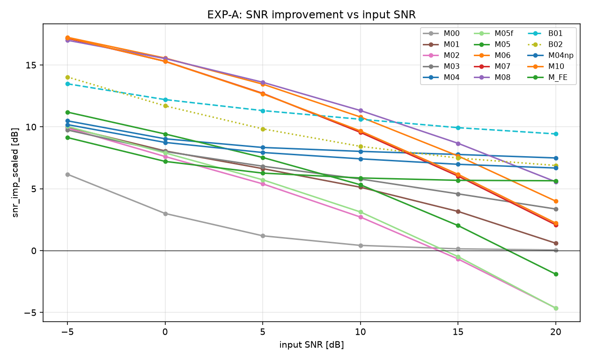

> 그림 5.1. 표 5.2의 입력 SNR 별 SNR 개선량. 곡선들이 고 SNR 쪽에서 교차하며, 이것이 입력 SNR에 따라 최적
> 기법이 달라진다는 본 절의 결론을 보여 준다. 저 SNR 쪽에서는 딥러닝 곡선이 뚜렷이 위에 있고, 입력 SNR이 높을수록
> 간격이 좁아지다가 20 dB에서 SWT 임계값 처리가 더 높아진다. 한 입력 SNR의 결과만 보고했다면 반대의 결론을
> 얻을 수도 있었다.

같은 조건의 파형을 직접 비교하면 표 5.2의 의미가 더 분명해진다.

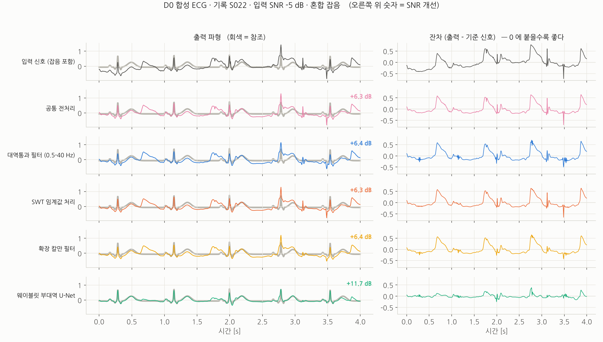

> 그림 5.2. 기법별 출력(왼쪽 열)과 잔차(출력 − 기준 신호, 오른쪽 열). 잔차는 같은 세로축을 공유한다. 출력만
> 보면 여섯 기법이 비슷하게 잡음이 제거된 것처럼 보이지만, 잔차에서는 기법마다 남은 오차가 다르다. 잡음 제거
> 정도와 파형 보존 정도는 출력 파형만으로 구분되지 않으며, 3 장에서 지표를 층으로 나눈 이유가 여기에 있다.
>
> 그림에는 기법을 6 개만 실었다. 모든 기법의 전체 파형(F1)과 QRS 확대(F2)는 `docs/90_results_d0.md`에 있다.

## 5.2 RQ2: 잡음 종류에 따른 최적 기법의 변화

표 5.4. 잡음 종류별 SNR 개선량(진폭 보정) [dB], 입력 SNR 10 dB

| method | bw | ma | em | pli | awgn | impulse |
| 기법 | 기저선 변동 | 근전도 | 전극 움직임 | 전원선 | 백색 | 임펄스 |
| `M_FE` | 19.13 | 0.96 | 7.44 | 17.76 | 1.43 | 0.45 |
| `M04` | 19.13 | 7.62 | 7.44 | 19.55 | 8.00 | 0.45 |
| `M06` | 14.57 | 12.42 | 11.70 | 15.06 | 9.17 | 11.24 |
| `M08` | 16.78 | 12.78 | 12.56 | 17.46 | 8.88 | 11.98 |
| `B01` | 19.13 | 13.92 | 7.51 | 22.38 | 9.67 | 8.66 |

같은 결과를 공통 전처리 단독(M_FE) 대비 기여분으로 다시 정리하면 다음과 같다(표 5.5).

표 5.5. 공통 전처리 단독(M_FE) 대비 기여분 [dB], 입력 SNR 10 dB

| 기법 | 기저선 변동 | 근전도 | 전극 움직임 | 전원선 | 백색 | 임펄스 |
|---|---|---|---|---|---|---|
| `M04` | −0.00 | +6.66 | −0.00 | +1.80 | +6.57 | +0.00 |
| `M06` | −4.56 | +11.47 | +4.26 | −2.70 | +7.74 | +10.79 |
| `M08` | −2.35 | +11.82 | +5.12 | −0.29 | +7.45 | +11.54 |
| `B01` | −0.00 | +12.96 | +0.07 | +4.62 | +8.24 | +8.21 |

표 5.5에서 세 가지 결과가 확인된다.

(1) 웨이블릿 임계값 처리는 기저선 변동 · 전극 움직임 · 임펄스 잡음에서 구조적으로 기여분이 0이다. SWT 임계값
처리(M04)뿐 아니라 이상적 웨이블릿 상한(B01)도 마찬가지이다(기저선 변동 −0.00, 전극 움직임 +0.07 dB). 이는
구현의 문제가 아니다. 기저선 변동은 근사 계수(A5)에 포함되는데 임계값 처리는 세부 계수에만 적용되므로, 기준
신호를 알아도 제거할 수 없다. 이 조건에서 관측되는 19.13 dB는 모두 공통 전처리의 기여이다.

(2) 딥러닝 기법은 기저선 변동 · 전원선 잡음에서 기여분이 음수이다(−0.29 ~ −4.56 dB). 공통 전처리가 이미
19 dB를 개선한 입력에 신경망이 추가로 처리를 가하면서 신호를 왜곡한다. 이미 잘 처리된 입력을 다시 처리하면
성능이 낮아진다는 것이 수치로 확인된다.

(3) 임펄스 잡음은 딥러닝 기법만 제거한다. 공통 전처리 0.45 dB, SWT 임계값 처리 0.00 dB에 비해 딥러닝 기법은
약 +11.5 dB이다. 웨이블릿 부대역 U-Net(M08)은 이상적 웨이블릿 상한(+8.21 dB)보다도 높으며, 임펄스 잡음의 제거가
웨이블릿 계열로는 다룰 수 없는 문제임을 보여 준다.

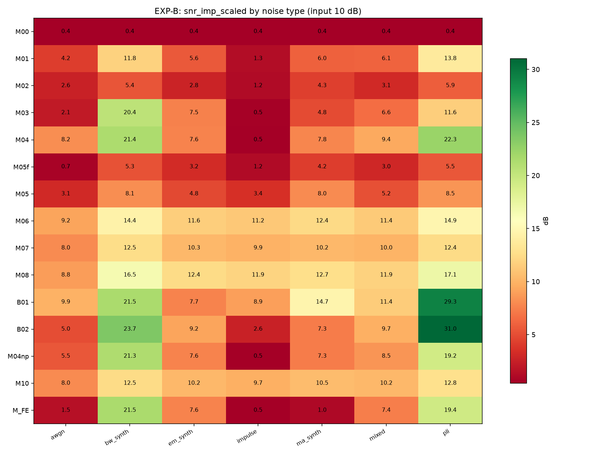

> 그림 5.3. 기법(행) × 잡음 종류(열)의 SNR 개선량. 가로 방향이 아니라 세로 방향의 띠가 보인다는 점이 핵심이다.
> 모든 잡음에서 우수한 기법은 없고, 잡음 종류마다 가장 높은 기법이 다르다. 기저선 변동 열이 전체적으로 밝은 것은
> 공통 전처리가 이미 제거했기 때문이며(그 위에서 기법 간 차이가 거의 없다), 임펄스 열은 딥러닝 행만 밝다. 표 5.5의
> 세 결과가 한 그림에 나타난다.

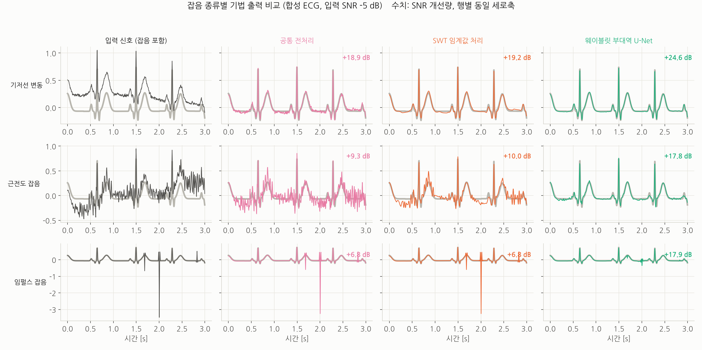

> 그림 5.4. 그림 5.3의 원인을 보여 주는 잡음 종류별 파형. 행은 잡음 종류(기저선 변동 · 근전도 · 임펄스), 열은
> 입력과 세 기법이며, 같은 행의 패널은 세로축을 공유한다. 기저선 변동 행에서는 공통 전처리 단독부터 이미 평탄하여
> 세 기법이 구분되지 않는다. 임펄스 행에서는 스파이크가 공통 전처리 단독과 SWT 임계값 처리의 출력에 그대로 남고,
> 웨이블릿 부대역 U-Net의 출력에서만 제거된다. 표 5.5의 결과 (1) · (3)이 이 두 행에 해당한다.

> 실용적 시사점: 하나의 최선 기법을 고르기보다 잡음 종류에 따라 처리 방식을 선택하는 것이 효과적이다. 전원선
> 잡음(PLI)이 지배적이면 공통 전처리로 충분하고, 임펄스 잡음이 있으면 딥러닝이 필요하며, 광대역 잡음에는 두
> 방식이 모두 유효하다.

## 5.3 RQ3: 무잡음 신호의 왜곡(EXP-C)

무잡음 신호를 그대로 통과시켰을 때의 출력 SNR을 왜곡 하한으로 정의한다. 값이 높을수록 기법이 신호를 덜 왜곡한다.
기준 신호는 공통 전처리를 통과한 무잡음 신호이므로[^D-3], 표 5.6는 각 기법이 공통 전처리 위에 더하는 왜곡을
측정한다.

표 5.6. 기법별 왜곡 하한(무잡음 입력 실험)

| 방법 | 왜곡 하한 [dB] | 비고 |
|---|---|---|
| `M_FE` | 149.20 | 기준 신호 정의에 따른 항등식이며 성능이 아니다(F-15) |
| `B01` | 79.71 | 이상적 웨이블릿 상한 |
| `B02` | 59.18 | 이상적 Wiener 상한 |
| `M04` | 53.15 | SWT 임계값 처리. 실제 적용 가능한 기법 중 최고 |
| `M04np` | 50.89 | QRS 보호를 제외한 SWT |
| `M03` | 39.80 | DWT 임계값 처리 |
| `M00` | 34.12 | 무처리. 공통 전처리 자체가 신호를 바꾸는 양 |
| `M08` | 27.04 | |
| `M06` | 24.64 | |
| `M01` | 23.71 | 40 Hz 저역통과가 QRS 고주파 성분을 제거한다 |
| `M07` | 22.58 | |
| `M10` | 22.37 | |
| `M05` | 18.15 | |
| `M02` | 15.62 | R파 진폭 오차 26.2 %를 동반한다 |
| `M05f` | 15.57 | |

> 지표는 출력 SNR(보정 없음)이며, `90_results_d0.md`와 같다. 진폭 보정 값과의 차이는 0.5 dB 이내이다. 본문의
> 수치는 자동 생성 문서를 기준으로 하며, 일치 여부는 기록 검사로 확인한다[^O-16].

공통 전처리 단독(M_FE)의 149 dB는 성능이 아니다. 기준 신호가 공통 전처리를 통과한 무잡음 신호이고 M_FE의 출력도
같은 신호이므로, 정의상 두 신호가 일치한다. 149 dB는 수치 계산의 한계값일 뿐이다. MIT-BIH 에서의 같은 현상을
F-15로 기록하였으며, 합성 ECG 에도 그대로 적용된다.

무처리(M00)의 34.13 dB는 공통 전처리의 영향이다. 무처리는 신호를 바꾸지 않으므로, 기준 신호와의 차이가 곧
공통 전처리가 신호를 바꾼 양이다. 따라서 표 5.6에서 34.13 dB보다 높은 기법은 공통 전처리보다 신호를 덜
왜곡하고, 낮은 기법은 더 왜곡한다.

핵심은 고전 신호처리와 딥러닝 사이의 큰 격차이다. SWT 임계값 처리(53.15 dB)와 잔차 U-Net(24.64 dB)의 차이는
28.5 dB이다. 딥러닝 기법은 잡음이 없는 신호에도 무처리보다 7~12 dB 더 큰 왜곡을 만든다(잔차 U-Net 9.5 dB,
SWT 직렬 결합 U-Net 11.5 dB). 제거할 잡음이 없는데도 신호의 일부를 변형한다.

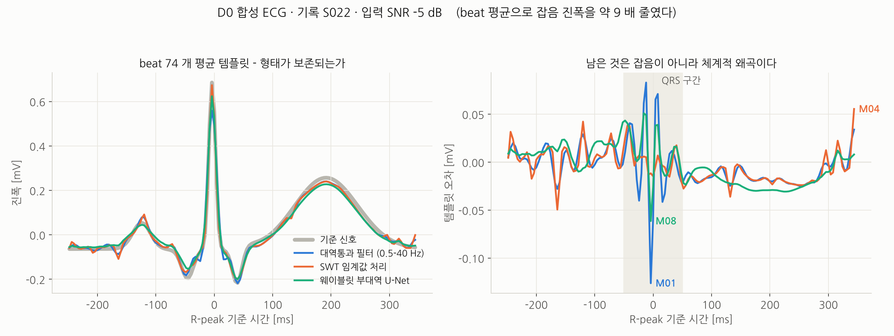

> 그림 5.5. 기법 자체가 만드는 왜곡의 위치. 박동 74 개를 평균하면 잡음 진폭이 약 9 배 줄고 체계적 왜곡만
> 남는다. 왼쪽은 평균 박동 파형, 오른쪽은 기준 신호와의 차이다. QRS 구간(회색 띠)에서 대역통과 필터(M01)의
> 편차가 가장 크고(−0.13 mV) SWT 임계값 처리는 거의 평탄하다. 40 Hz 저역 차단이 QRS 고주파 성분을 제거한 결과이며,
> 표 5.6에서 대역통과 필터(23.71 dB)가 SWT 임계값 처리(53.15 dB)보다 낮은 이유이다.
>
> 이 그림은 표 5.6와 다른 조건이다. 표 5.6는 무잡음 입력의 결과이고, 그림은 입력 SNR −5 dB의 결과이다. 표는
> 잡음이 없을 때 기법이 만드는 왜곡을, 그림은 잡음이 있을 때 평균 후에도 남는 왜곡을 보인다. 경향은 같지만
> 두 값을 서로 바꾸어 해석해서는 안 된다.

> 초기 분석에서는 이 표를 다르게 해석하였다. 기준 신호가 공통 전처리 전의 원신호였을 때에는 이상적 웨이블릿
> 상한(B01) · 이상적 Wiener 상한(B02) · 공통 전처리 단독이 모두 34.13 dB였고, 이를 공통 전처리가 정한 상한으로
> 해석하였다. 기준 신호를 공통 전처리 후의 신호로 바꾸자 그 상한이 사라지고 SWT 임계값 처리의 값이 34.09 dB에서
> 53.15 dB로 바뀌었다. 물리량은 같고(34.13 dB는 현재 무처리의 값이다) 그 값이 배정되는 기법이 바뀐 것이며,
> 상한에 가려져 있던 기법 간 순위가 이때 드러났다. 합성 ECG 산출물은 새 기준으로 다시 생성되었으나 본 절의 서술은
> 그 시점에 갱신되지 않았다[^O-16].

이 결과가 5.8.8 절에서 무잡음 입력 보존 손실(L6)을 선택한 근거이다. 5.8.9 절에서 무잡음 입력 보존 손실로 학습하자
잔차 U-Net의 왜곡 하한이 MIT-BIH 기준 22.22 dB에서 37.35 dB로 높아졌다. 손실이 목표로 한 지표가 개선되었으므로,
개선이 의도한 기제를 통해 나타났다고 판단할 수 있다.

### 입력 SNR에 따른 형태 지표 부호의 역전

표 5.7. QRS 폭 오차(낮을수록 좋음, 지표 분해능 0.64 ms)

| 입력 SNR | `M06-L3` | `M_FE` | 판정 |
|---|---|---|---|
| 0 dB | 15.92 | 18.11 | 딥러닝이 오차를 줄임 |
| 10 dB | 13.06 | 9.31 | 딥러닝이 오차를 키움 |
| 20 dB | 11.83 | 3.79 | 딥러닝이 오차를 크게 키움 |

저 SNR에서는 잡음 자체가 형태 측정을 방해하므로, 딥러닝이 잡음을 제거하면 형태 측정도 정확해진다. 고 SNR
에서는 제거할 잡음이 적어 딥러닝이 가한 변형만 남는다.

전 입력 SNR 평균으로는 공통 전처리 단독(12.43 ms)이 잔차 U-Net(17.48 ms), SWT 직렬 결합 U-Net(M07, 21.52 ms)보다
오차가 작고 웨이블릿 부대역 U-Net(M08, 13.97 ms)과 비슷하다. 칼만 필터(M05)는 30.56 ms로 오차가 가장 크다.

> 정리: 딥러닝은 잡음을 더 많이 제거하지만 파형을 조금씩 변형한다. 잡음이 적은 조건에서는 이 변형의 영향이
> 잡음 제거의 효과보다 크며, 이는 SNR 지표만으로는 드러나지 않는다.

## 5.4 RQ4: 웨이블릿 결합 위치(EXP-D)

표 5.8. 웨이블릿 결합 위치별 SNR 개선량(진폭 보정)

| 결합 위치 | 기법 | 전체 평균 [dB] | −5 dB | 20 dB |
|---|---|---|---|---|
| 사용하지 않음 | `M06` | 11.43 | 17.25 | 3.86 |
| 전처리 | `M07` | 10.46 | 17.17 | 1.91 |
| 표현 공간 | `M08` | 11.97 | 17.02 | 5.51 |

웨이블릿을 표현 공간으로 쓰는 웨이블릿 부대역 U-Net(M08)이 전처리로 쓰는 SWT 직렬 결합 U-Net(M07)보다 1.51 dB
높다. SWT 직렬 결합 U-Net은 잔차 U-Net(M06)보다도 낮다. SWT 전처리가 신경망 입력 전에 정보의 일부를 제거하고,
신경망은 이를 복원하지 못하는 것으로 해석된다. 특히 20 dB에서 격차가 크다(1.91 대 5.51 dB).

> SWT 직렬 결합 U-Net은 손실 함수 ablation에서 제외하였다. 이 기법은 SWT 전처리와 잔차 U-Net의 결합이라 손실
> 함수에 대한 반응이 잔차 U-Net과 겹치고, 표 5.8에서 딥러닝 기법 중 SNR 개선량이 가장 낮다. 웨이블릿 부대역
> U-Net만 입력 표현 자체가 다르며(부대역), 대역 오차 추가 손실(L4)도 이 기법에만 적용할 수 있다. 근거와 사후
> 검증은 D-15에 있다. 두 backbone이 손실 함수에 반대로 반응하므로(5.8.9 절), 한 기법만 비교했다면 데이터에 따라
> 반대의 결론을 얻었을 것이다.

### 손실 함수 ablation(TEST 분할)

> MSE 손실(L1)부터 대역 오차 추가 손실(L4)까지 각 항의 목적과, 항을 하나씩 추가해 각각 학습한 이유는 4.7 절에
> 있다. 데이터별 전체 표는 `docs/10_loss_ablation_d0.md` · `docs/10_loss_ablation_d1.md`에 있다.

잔차 U-Net: MSE · MAE 손실(L2)과 MSE · MAE · 미분 손실(L3)이 MSE 손실보다 모든 지표에서 우수하다(상충 관계 없음).

표 5.9. 잔차 U-Net의 손실 함수별 결과

| | SNR 개선량 20 dB | QRS 폭 오차 | 평균 박동 상관계수 |
|---|---|---|---|
| `M06-L1` (MSE) | 4.37 | 13.99 ms | 0.994 |
| `M06-L2` (+MAE) | 5.92 | 10.50 ms | 0.996 |
| `M06-L3` (+미분) | 6.27 | 11.83 ms | 0.997 |

SNR 개선량이 높아지고 QRS 폭 오차도 줄었다. 개선의 대부분은 MAE 항에서 나오며 미분 항의 추가 개선은 작다.

웨이블릿 부대역 U-Net: 대역 오차 추가 손실은 SNR 개선량을 높이는 대신 파형 형태를 손상시킨다.

M08-L1에서 M08-L4로 바꾸면 20 dB의 SNR 개선량이 6.10 dB에서 7.01 dB로 0.90 dB 높아지지만, 평균 박동
상관계수는 0.997에서 0.978로 낮아진다(분해능 3.6e−7의 약 5만 배). QRS 폭 오차는 오히려 8.75 ms에서 8.07 ms
로 줄어드는데 파형 상관은 낮아지는, 서로 상반된 결과이다. 폭은 맞추면서 형태는 바꾸고 있는 것으로 해석된다.

> SNR 개선량(진폭 보정)만 보았다면 대역 오차 추가 손실이 가장 우수하다고 결론지었을 것이다. 완료 기준에서 형태
> 지표를 함께 요구한 이유가 여기에 있다.

## 5.5 RQ5: 가성 파형 생성(EXP-E)

### 박동 삭제 · 무수축 조건(P1 · P2)

가성 파형 에너지는 삭제한 구간에서 출력이 만든 에너지를 원래 에너지로 나눈 값이며, 낮을수록 안전하다.

표 5.10. 박동 삭제 · 무수축 조건의 가성 파형 에너지(합성 ECG)

| 방법 | P1 (박동 1 개 삭제) | P2 (3 s 무수축) |
|---|---|---|
| `M06` | 0.0329 | 0.0436 |
| `M08` | 0.0370 | 0.0463 |
| `M07` | 0.0435 | 0.0516 |
| `M04` | 0.0650 | 0.1097 |
| `M05` | 0.0799 | 0.0838 |
| `M_FE` | 0.1220 | 0.1591 |
| `M00` | 0.1618 | 0.4009 |

딥러닝 기법의 가성 파형 에너지가 가장 낮다. 3 초 무수축 구간에서 생성한 에너지도 가장 작다. 잔차 구조(출력 =
입력 − 추정 잡음)에서 비롯된 결과로 해석된다. 무처리(M00)와 공통 전처리 단독(M_FE)의 값이 높은 것은 파형을 생성해서가
아니라 잡음이 그대로 남아 있기 때문이므로, 이 지표는 주 실험(EXP-A)의 잡음 제거량과 함께 해석해야 한다.

### 부정맥(PVC) 형태 보존(P3)

V − N은 부정맥 박동과 정상 박동 각각의 평균 박동 상관계수의 차이이다. 크게 음수이면 부정맥 박동의 형태가 손상된 것이다.

표 5.11. 부정맥 박동과 정상 박동의 형태 보존(합성 ECG)

| 방법 | N | V | V − N |
|---|---|---|---|
| `M08` | 0.9871 | 0.9940 | +0.0069 |
| `M06` | 0.9865 | 0.9939 | +0.0074 |
| `M04` | 0.9671 | 0.9867 | +0.0196 |
| `M05` | 0.9744 | 0.9099 | −0.0645 |

칼만 필터(M05, Sameni EKS)만 부정맥 박동의 형태를 손상시킨다. 정상 박동으로 만든 위상 평균 파형이 심실조기수축
(PVC) 박동을 정상 박동의 형태 쪽으로 보정하기 때문으로 해석된다. 이 기법은 5.1 절에서 대역통과 필터(M01)와 차이가
유의하지 않았고 5.3 절에서 왜곡도 컸으며, 가성 파형 생성 검증에서도 유일하게 위험한 결과를 보였다.

> 검증 조건의 설계(어떤 박동을 어떻게 지우고 어떤 잡음을 더하는가)와 전체 표는 `docs/07_safety_probe_d0.md`,
> MIT-BIH 결과는 `docs/07_safety_probe_d1.md`에 있다.

> 가성 파형 생성 결과는 두 데이터를 함께 보아야 해석할 수 있다. 위의 칼만 필터 PVC 형태 손상은 MIT-BIH에서
> 재현되지 않았다(5.8.4 · 5.8.5 절)[^F-28]. 두 데이터와 두 조건을 함께 보인 그림은 5.8.4 절에 있으며, 합성 ECG의
> 결과만으로 그림을 만들면 재현되지 않은 주장을 싣게 된다.

## 5.6 후속 분석 과제와 계산 비용

표 5.12. R파 검출 성능과 실시간 계수(전 입력 SNR 평균)

| 방법 | 민감도 | 양성예측도 | R파 위치 오차 [ms] | RTF |
|---|---|---|---|---|
| `M00` | 0.9865 | 0.9769 | 8.69 | 0 |
| `M04` | 0.9870 | 0.9812 | 8.73 | 0.0012 |
| `M06` | 0.9873 | 0.9957 | 8.56 | 0.0016 |
| `M07` | 0.9888 | 0.9976 | 8.61 | 0.0027 |
| `M08` | 0.9854 | 0.9935 | 8.61 | 0.0019 |
| `M05` | 0.9864 | 0.9796 | 8.81 | 0.0310 |

딥러닝 기법은 양성예측도를 크게 높인다(0.977 → 0.996). 위양성 검출이 줄었다는 뜻이며, R파 위치 오차만으로는
확인되지 않는다(모든 기법이 8.6~8.8 ms로 검출기 자체의 변동 범위 안에 있다). 민감도와 양성예측도를 주 지표로
올린 이유이다.

칼만 필터(M05)의 처리 속도가 가장 느리다. 실시간 계수(RTF) 0.031로 SWT 임계값 처리(M04)의 26 배, 웨이블릿 부대역
U-Net(M08)의 16 배이다. 연산 비용이 가장 크면서 왜곡도 가장 크고, 부정맥 박동의 형태를 손상시킨 유일한 기법이다.

모든 기법의 실시간 계수가 0.04 미만으로 실시간보다 25 배 이상 빠르다. 따라서 본 연구에서 연산 비용은 기법을
구분하는 요인이 아니다.

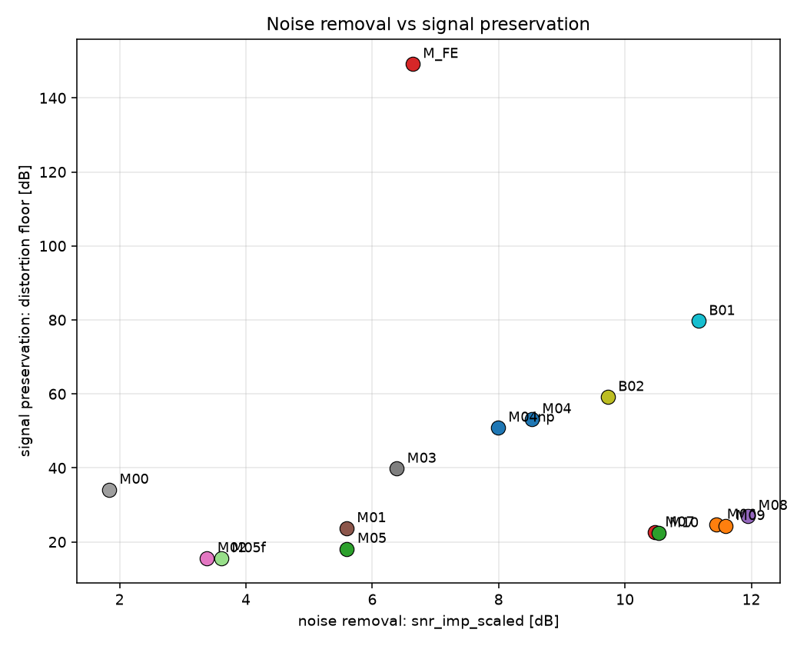

> 그림 5.6. 연산 비용(가로)과 성능(세로)의 관계. Pareto 경계가 평탄하여, 연산 비용을 늘려도 성능이 높아지지
> 않는다. 칼만 필터만 연산 비용이 큰 쪽에 떨어져 있으나 성능은 높지 않다. 따라서 본 연구의 기법 선택은 연산
> 비용이 아니라 어떤 신호 특성을 보존할 것인가에 따라 달라진다.

## 5.7 공통 전처리 적용 오류 수정 전후의 결과 변화

공통 전처리 적용 오류를 수정하기 전(F-10 이전)과 수정 후의 결과를 같은 지표로 비교한다. 바뀐 조건은 딥러닝
기법에도 같은 공통 전처리를 적용한 것 하나이다.

표 5.13. 공통 전처리 적용 오류 수정 전후의 비교

| 항목 | 수정 전 (딥러닝만 공통 전처리 미적용) | 수정 후 (전 기법 공통 전처리) |
|---|---|---|
| 15 dB 최고 | `M04` 7.79 | `M08` 8.71 |
| −5 dB 최고 | `M07` 18.54 | `M06` 17.25 |
| `M06` 대 `M01` 통계 | n.s. (p=0.101) | 유의 (p=9e−6, r=0.99) |
| `M08` 왜곡 하한 | 23.19 dB | 27.04 dB |
| `M06` 왜곡 하한 | 22.33 dB | 24.64 dB |

> 왜곡 하한 두 행은 기준 신호를 공통 전처리 후의 신호로 바꾼 뒤의 값이다(5.3 절)[^O-16]. 수정 전 열은 당시의
> 기준 신호(원신호)로 측정한 값이라 엄밀하게는 같은 평가 방법의 값이 아니므로, 공통 전처리를 적용하면 왜곡 하한이
> 높아진다는 방향만 해석한다.

결론이 두 가지 바뀌었다.

1. 「실측 조건에서는 매개변수를 탐색한 고전 신호처리가 딥러닝보다 우수하다」는 결론은 기각되었다. 15 dB에서
   웨이블릿 부대역 U-Net(M08)이 SWT 임계값 처리(M04)보다 1.68 dB 높고 그 차이는 통계적으로 유의하다. 수정 전의
   결론은 딥러닝이 기저선 변동 제거까지 학습해야 하는 불리한 조건에서 얻은 것이었다.
2. 「딥러닝은 대역통과 필터(M01) 대비 유의한 차이가 없다」는 결론도 기각되었다. 수정 후에는 22 개 기록 모두에서
   딥러닝의 SNR 개선량이 높다(효과 크기 r = 0.99~1.00).

유지된 결론도 있다.

- 20 dB에서는 여전히 SWT 임계값 처리가 더 높다. 잡음이 적으면 신경망의 변형이 잡음 제거의 효과보다 크다.
- SWT 임계값 처리는 무잡음 신호를 거의 손상시키지 않는다. 새 기준으로 53.15 dB이며, 잔차 U-Net(M06, 24.64 dB)보다
  28.5 dB 높다(5.3 절).
- 칼만 필터(M05)는 연산 비용이 가장 크고 왜곡이 가장 크며, 부정맥 박동의 형태를 손상시킨다.

또한 수정 전에는 답할 수 없던 질문에 답할 수 있게 되었다. 공통 전처리 단독(M_FE)을 모든 표의 필수 행으로 넣은
뒤로, 각 기법의 개선량 중 공통 전처리의 기여분을 모든 표에서 확인할 수 있게 되었고, 그 결과 5.2 절의 (1) · (2) ·
(3)과 5.3 절의 이상적 상한에 관한 결과가 드러났다. 수정 전의 잘못된 해석은 단순한 오류가 아니라, 비교 기준선이
없어 구조적으로 확인할 수 없었던 것이다.

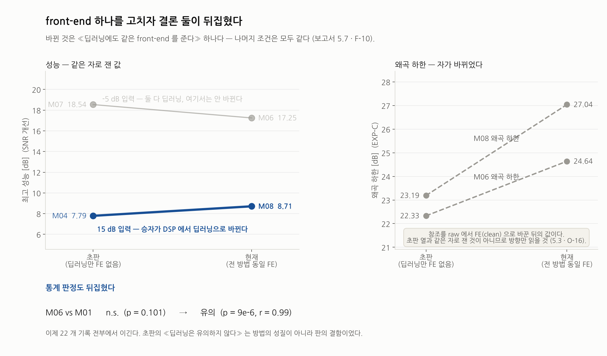

> 그림 5.7. 공통 전처리 적용 오류 수정 전후의 비교. 왼쪽은 같은 평가 방법으로 측정한 값(최고 성능), 오른쪽은
> 기준 신호의 정의가 바뀐 값(왜곡 하한)이며, 단위가 달라 축에 표시할 수 없는 통계 판정은 아래 띠에 두었다. 굵은
> 파란 선과 아래 띠 한 줄이 바뀐 두 결론이고, 옅은 회색 선은 바뀌지 않은 결과이다(−5 dB에서는 수정 전후 모두
> 딥러닝이 최고). 오른쪽 두 선을 파선으로 그린 이유는 위의 인용 상자와 같다. 방향만 해석하는 값이다.

## 5.8 MIT-BIH 실측 데이터(D1)에서의 재검증

5.1~5.7 절은 모두 합성 ECG의 결과이다. 합성 데이터는 기준 신호를 알 수 있어 평가가 정확하지만, 그 평가 결과가
실제 신호에서의 성능을 예측하는지는 별개의 문제이다. 합성 벤치마크가 딥러닝을 12 dB 과대평가한 사례(F-8)가 이미
있었으므로, 본 연구에서 이 검증은 특히 중요하다.

MIT-BIH 데이터는 MIT-BIH 실측 기록과 NSTDB 실측 잡음으로 구성된다. 같은 기법 · 같은 지표 · 같은 절차로 모든 모델을
다시 학습하고 다시 측정하였다. 자동 생성 표는 `docs/90_results_d1.md`, 두 데이터의 대조는 `docs/92_axis_gap.md`
에 있다.

> 기준 신호의 정의가 다르다. MIT-BIH 원본은 무잡음 신호가 아니므로 기준 신호를 공통 전처리를 통과한 원본으로
> 정의하였다[^F-12][^D-3]. 따라서 MIT-BIH 에서의 평가는 원본 복원이 아니라 0.5~100 Hz 대역의 ECG 복원을
> 측정한다. 합성 ECG에서는 두 정의의 차이가 0.02 dB 이하라 다시 실행하지 않았다[^D-4].

### 5.8.1 전 구간 평균의 결과

표 5.14. 대역통과 필터(M01) 대비 SNR 개선량(진폭 보정) 차이, 대응 Wilcoxon 검정 + Holm 보정, 22 기록

| | 합성 ECG Δ | 합성 ECG p(Holm) | MIT-BIH Δ | MIT-BIH p(Holm) |
|---|---|---|---|---|
| `M08` | +6.573 | 6.2e-06 | +1.629 | 0.181 (n.s.) |
| `M06` | +6.033 | 8.6e-06 | +1.338 | 0.492 (n.s.) |
| `M07` | +5.060 | 8.6e-06 | +0.126 | 1.000 (n.s.) |

합성 ECG에서 22 기록 모두에서 높았던(효과 크기 r ≈ 1.0) 딥러닝 기법이 MIT-BIH에서는 Holm 보정 후 유의성을 잃는다.
이 결과만 보면 딥러닝이 합성 데이터에서만 유효하다는 결론이 된다.

그러나 이 결론은 전 구간 평균 하나로 비교한 데서 나온 것이며, 입력 SNR 구간별로 나누면 달라진다.

### 5.8.2 입력 SNR 구간별 결과

기준선을 공통 전처리 단독(M_FE, 기준 신호와 같은 대역)으로 두고, 입력 SNR 구간별로 웨이블릿 부대역 U-Net(M08)의
기여분을 비교한다(표 5.15). 딥러닝이 공통 전처리에 더하는 개선량을 측정하는 적절한 비교이다.

표 5.15. 공통 전처리 단독(M_FE) 대비 웨이블릿 부대역 U-Net(M08)의 입력 SNR 구간별 개선량

| 입력 SNR | 합성 ECG Δ | 합성 ECG 판정 | MIT-BIH Δ | MIT-BIH 판정 |
|---|---|---|---|---|
| −5 dB | +7.895 | 유의 | +7.072 | 유의 |
| 0 dB | +8.373 | 유의 | +6.656 | 유의 |
| 5 dB | +7.464 | 유의 | +4.813 | 유의 |
| 10 dB | +5.726 | 유의 | +2.128 | n.s. |
| 15 dB | +3.625 | 유의 | −0.914 | n.s. |
| 20 dB | +1.258 | n.s. | −4.452 | n.s. |

가장 어려운 −5 dB 조건에서는 두 데이터의 결과가 거의 같다(+7.9 대 +7.1 dB). 따라서 딥러닝의 효과가 실측 데이터에서
약해졌다고 보기는 어렵다.

달라진 것은 딥러닝이 효과를 보이는 입력 SNR 범위이다. 개선량이 0이 되는 지점을 표의 인접한 두 점으로 선형
보간하면 MIT-BIH는 약 13 dB이고, 합성 ECG는 20 dB 에서도 +1.26 dB여서 측정 범위(20 dB) 밖에 있다. 그보다 높은
입력 SNR에서는 공통 전처리만 쓰는 것이 더 낫다. 이 값은 보간으로 얻은 추정치이므로 정확한 교차점이 아니라
대략적인 크기로 해석해야 한다.

전 구간 평균은 여섯 구간에 같은 가중치를 준다. 저 SNR의 +7 dB와 고 SNR의 −4 dB가 상쇄되어 평균 차이가 유의하지
않게 된 것이다.

따라서 실용적 판단의 기준이 달라진다. 딥러닝의 사용 여부가 아니라 입력 SNR이 13 dB 미만인지가 판단 기준이
된다. 합성 ECG만 평가했다면 이 판단 기준은 나오지 않았다.

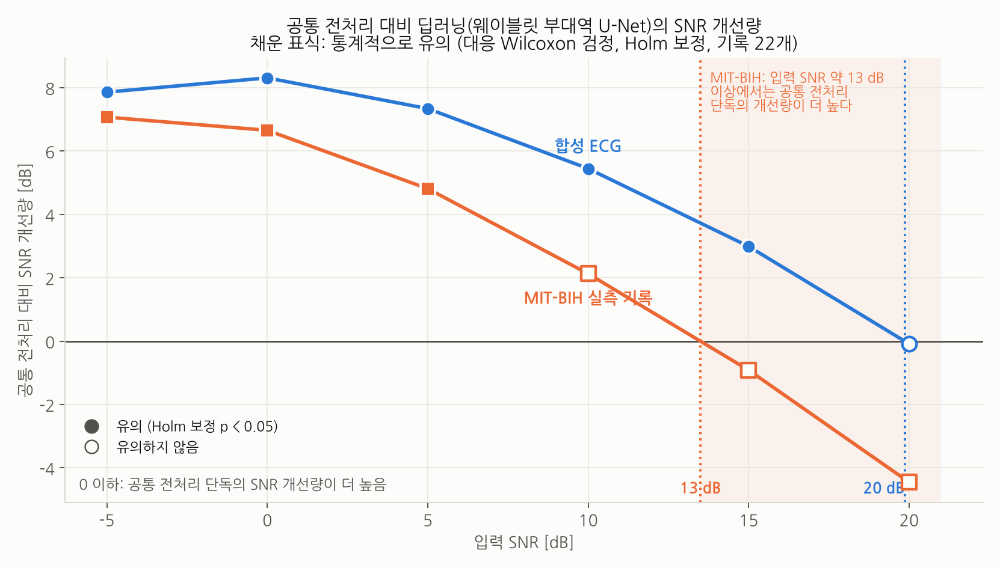

> 그림 5.8. 표 5.15의 두 데이터의 개선량을 함께 나타낸 것이다. 세로축은 공통 전처리 단독 대비 개선량이므로, 0
> 아래는 공통 전처리만 쓰는 것이 낫다는 뜻이다. 두 데이터 모두 저 SNR 쪽에서 크게 양수이고 입력 SNR이 높아질수록
> 감소하며, MIT-BIH 곡선만 측정 범위 안(약 13 dB)에서 0을 지난다. 채운 표식은 유의, 빈 표식은 유의하지 않은
> 결과이며, 저 SNR 쪽 세 점은 두 데이터 모두 유의하다. MIT-BIH에서 딥러닝의 효과가 사라진 것이 아니라 효과를
> 보이는 구간이 좁아졌음을 보여 준다.

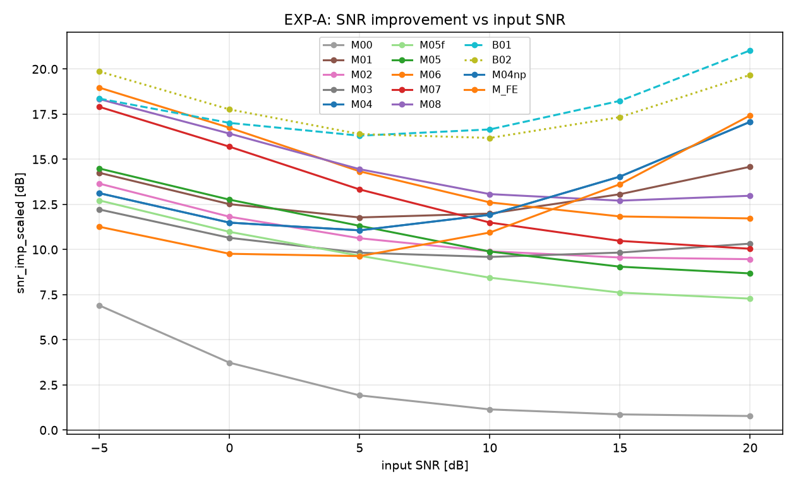

> 그림 5.9. 그림 5.1과 같은 형식의 MIT-BIH 결과. 곡선의 형태는 합성 ECG와 같지만 교차점이 낮은 입력 SNR 쪽으로
> 이동하였다. 합성 ECG에서는 측정 범위(20 dB) 밖에 있던 교차가 MIT-BIH에서는 약 13 dB에서 나타난다.

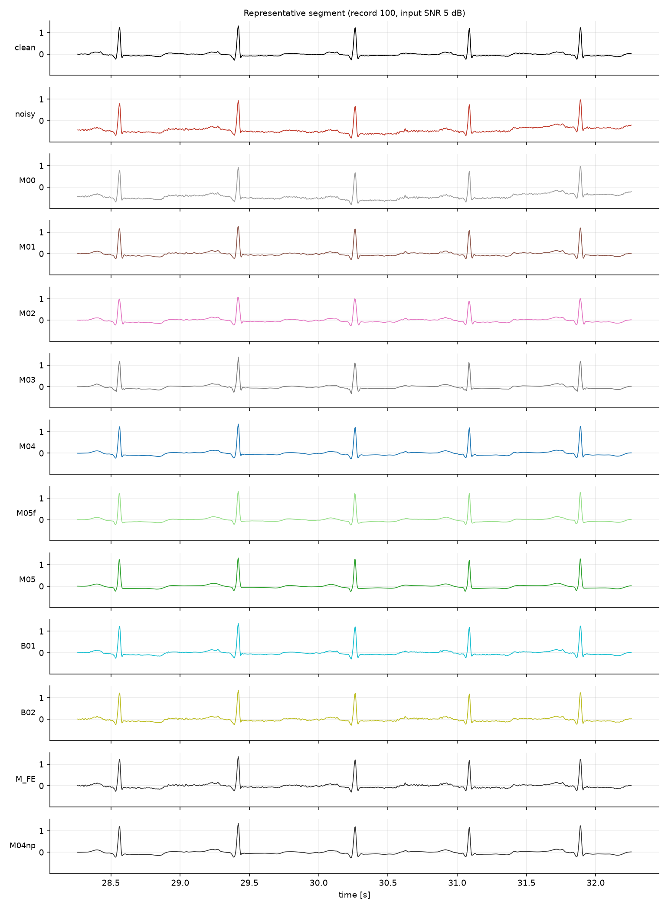

> 그림 5.10. 같은 조건의 MIT-BIH 파형. 합성 ECG의 파형(5.1 절)과 비교하면 잡음의 성격이 다르다. 실측 잡음은 구조가
> 있고 구간마다 특성이 달라진다. 합성 데이터의 결과가 실측 데이터로 그대로 이어지지 않는 원인이 여기에 있다.

> 이 기준점(약 13 dB)을 실제 장치에서 판정하는 데에도 어려움이 있다. 기준 신호가 없는 실측 신호의 SNR은 추정기로
> 측정해야 하는데, 추정기의 상한이 11.9~12.8 dB이다. 판정해야 할 지점이 측정 수단의 상한 근처에 있는 것이다[^F-18].
> 실제로 잡음을 더하지 않은 MIT-BIH 기록에서도 추정치가 12.9 dB로 나온다.
>
> 이 문제는 추정기의 선택으로 해결하였다. 등전위(T-P) 구간 기반 추정기 (C)는 상한이 15.6 dB로 13 dB보다 여유가
> 있고 박동 형태의 변동에 영향을 받지 않는다. 따라서 실측 절차를 추정기 (C) 중심으로 정하였다(7.3 절).

### 5.8.3 형태 · 주파수 지표에서의 딥러닝 우위

표 5.16. 공통 전처리 단독 대비 딥러닝(웨이블릿 부대역 U-Net)의 지표 차이, MIT-BIH 전 구간

| 지표 | Δ | p(Holm) | 효과 크기 r | 의미 |
|---|---|---|---|---|
| 진폭 이득 편향(1에 가까울수록 좋음) | +0.165 | 6.2e-06 | +1.000 | 진폭 보존. 22 기록 모두 |
| 양성예측도 | +0.021 | 2.6e-03 | +1.000 | R파 위양성 검출 감소. 22 기록 모두 |
| 상관계수 | +0.070 | 6.3e-05 | +0.945 | 파형 상관 |
| PRDN | −22.9 | 3.8e-05 | −0.960 | 정규화 오차 |

공통 전처리 단독은 진폭을 15 % 줄이지만(진폭 이득 편향 0.848), 딥러닝은 1.013으로 진폭을 보존한다.

> 딥러닝 기법 중에서는 웨이블릿 부대역 U-Net이 잔차 U-Net(M06)보다 진폭 보존이 약하다. 이상값 1 과의 거리가 0.0068
> 더 크다(p = 1.8e-03). 부호 있는 차이로 비교했을 때는 p = 0.61이라 드러나지 않았고, F-22의 비교 방식 오류를 수정한
> 뒤 확인되었다. 웨이블릿 부대역 U-Net은 5.2 절에서 실용적으로 가장 우수한 기법으로 꼽히므로, 서술의 균형을 위해 이
> 결과를 함께 적는다(공통 전처리 단독과의 격차 −0.131에 비하면 작다).

SNR 개선량(진폭 보정)은 최적 배율(α*)로 진폭을 보정하므로 이 차이를 원리적으로 반영하지 못한다.

> 다만 이것이 5.8.1 절의 비유의 결과를 설명하지는 않는다. 진폭을 보정하지 않는 SNR 개선량(보정 없음)도 전 구간
> 평균에서 유의하지 않다(웨이블릿 부대역 U-Net +1.98 dB, p = 0.109). 5.8.1 절의 원인은 5.8.2 절의 구간별 상쇄이고,
> 진폭 보정은 진폭 이득 편향의 우위가 SNR 표에 나타나지 않는 이유일 뿐이다.

양성예측도는 후속 분석 과제(R파 검출)의 지표이다. 22 기록 모두에서 딥러닝의 위양성 검출이 더 적었으며, 심박 검출을
목적으로 하는 응용에서는 SNR보다 이 지표가 더 중요할 수 있다.

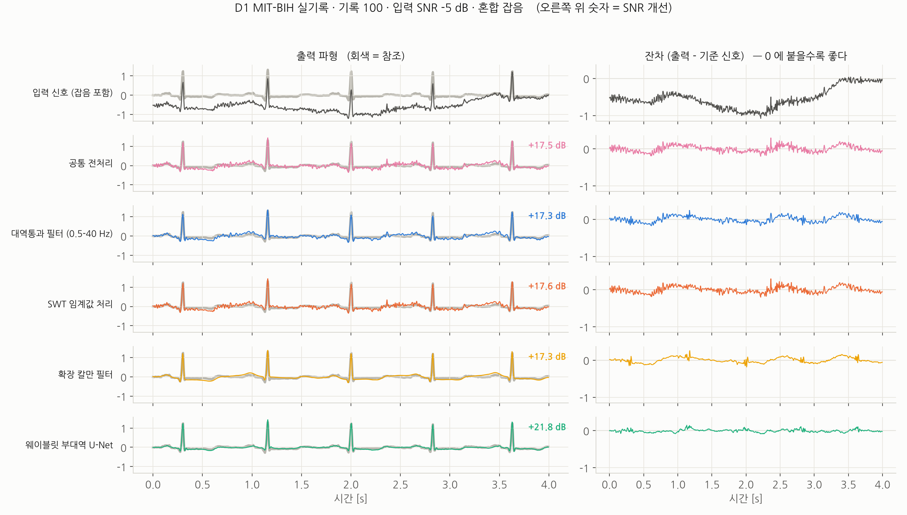

> 그림 5.11. 그림 5.2와 같은 형식의 MIT-BIH 결과. 잔차 열이 핵심인 점은 같으며, 합성 ECG와 달리 웨이블릿 부대역
> U-Net의 잔차만 뚜렷하게 평탄하다. 표 5.16의 상관계수 +0.070과 PRDN −22.9가 파형에서는 이렇게 나타난다. 모든
> 기법의 결과는 `docs/90_results_d1.md`에 있다.

### 5.8.4 가성 파형 생성 검증

가성 파형 생성 검증(EXP-E)은 기준 신호에 없는 파형을 출력이 생성하는지를 측정한다. 박동을 지우고 잡음을 더한 뒤,
출력이 그 구간에 만든 에너지를 원래 에너지로 나눈 값이며 낮을수록 안전하다.

표 5.17. 가성 파형 에너지(MIT-BIH)

| 방법 | P1 박동 삭제 | P2 3 s 무수축 |
|---|---|---|
| `M07` | 0.0113 | 0.0311 |
| `M06` | 0.0137 | 0.0371 |
| `M08` | 0.0158 | 0.0314 |
| `M05` | 0.0366 | 0.0720 |
| `M01` | 0.0437 | 0.0976 |
| `M_FE` | 0.0543 | 0.1247 |

딥러닝 세 기법의 가성 파형 에너지는 대역통과 필터보다 2.8~3.9 배, 공통 전처리 단독보다 3.4~4.8 배 낮다. 잔차
구조(출력 = 입력 − 추정 잡음)에서 비롯된 결과로 해석된다. 모델이 잡음을 추정할 뿐 신호를 직접 생성하지 않으므로,
신호가 없는 구간에서는 뺄 성분도 없다.

> 에너지 지표로는 드러나지 않는 위험이 하나 있다[^F-58]. 표 5.17에서 칼만 필터(M05)는 중간 수준이지만, 위양성
> 검출 위치의 출력 형태를 측정하면 칼만 필터만 박동 형태의 가성 QRS군을 많이 생성한다(MIT-BIH 213 건, SWT의 약
> 24 배). 공통 전처리 출력의 위양성 검출은 잔류 잡음의 형태로 나타나지만, 칼만 필터의 것은 실제 박동과 비슷한
> QRS 형태로 나타난다. 그림 S15, 측정 설계 D-42.

부정맥 박동에 대한 편향도 관찰되지 않았다. PVC 형태 보존 조건(P3)의 V − N(부정맥 박동과 정상 박동의 형태 보존
차이)이 모든 기법에서 양수이다.

이 결과는 의료 신호 처리에서 딥러닝에 대해 흔히 제기되는 우려와 반대된다. 딥러닝이 실제와 비슷한 파형을
생성한다는 우려는 생성형 구조에 해당하며, 본 연구의 잔차 구조에는 해당하지 않는 것으로 나타났다.

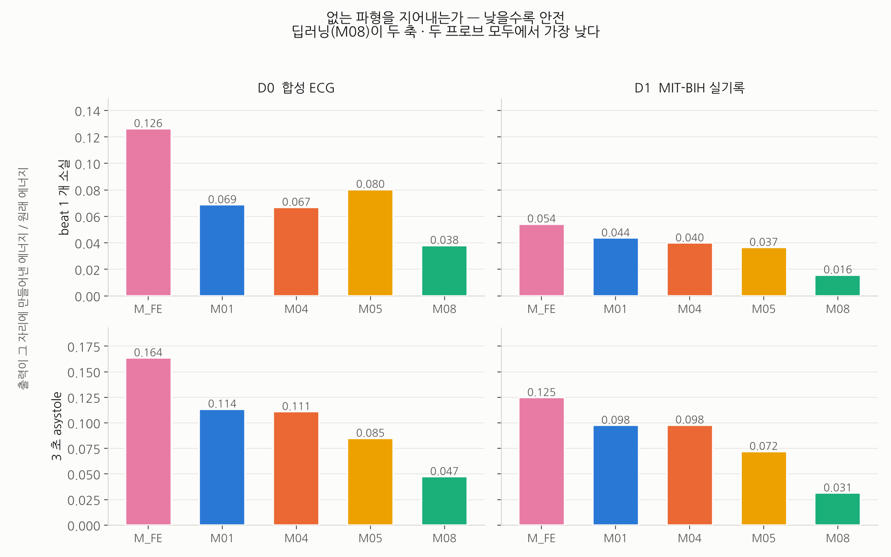

> 그림 5.12. 두 데이터 × 두 조건의 가성 파형 에너지(낮을수록 안전). 네 묶음 모두에서 딥러닝 기법이 가장 낮다.
> 5.5 절의 합성 ECG 결과와 표 5.17의 MIT-BIH 결과가 일치함을 보여 준다. 이 결론은 두 데이터에서 재현되었고,
> 같은 절의 칼만 필터 PVC 형태 손상은 재현되지 않았다(5.8.5 절).

### 5.8.5 합성 데이터 결론의 재현 여부

표 5.18. 합성 ECG 결론의 MIT-BIH 재현 여부

| 합성 ECG의 결론 | MIT-BIH 결과 |
|---|---|
| 저 SNR에서 딥러닝이 공통 전처리보다 크게 높다 | 재현(−5 dB에서 +7.07 dB, p = 1.7e-05) |
| 임펄스 잡음에서 딥러닝이 이상적 상한보다 높다 | 재현(M08 13.69 dB, B01 11.81 dB, B02 6.93 dB) |
| 웨이블릿 임계값 처리는 기저선 변동에서 기여가 없다 | 재현(기저선 변동: M04 23.92 dB < M_FE 24.70 dB) |
| Sameni 기법(M05)은 M01과 차이가 유의하지 않다 | 재현. MIT-BIH에서는 QRS 폭 오차도 커진다(F-14) |
| 고 SNR 에서도 딥러닝이 더 높다 | 재현되지 않음. 약 13 dB에서 역전 |
| M08 > M06 | 재현되지 않음. 합성 +0.540 dB(p = 0.012) → MIT-BIH +0.292 dB(p = 0.70) |
| M05가 PVC 형태를 손상시키는 유일한 기법이다 | 재현되지 않음. V − N이 합성 −0.065 → MIT-BIH +0.014(모든 기법 양수) |
| R파 위치 오차는 판별력이 없다 | 반대 결과. MIT-BIH에서는 M08 · B01이 M01 대비 유의 |

잡음 종류별 강약(RQ2)의 구조가 그대로 재현되었다는 점이 가장 중요한 결과이다. 잡음 종류에 따라 유리한 기법
계열이 달라지는 것은 물리적 근거가 있는 결론이며, 두 데이터에서 모두 확인되었다.

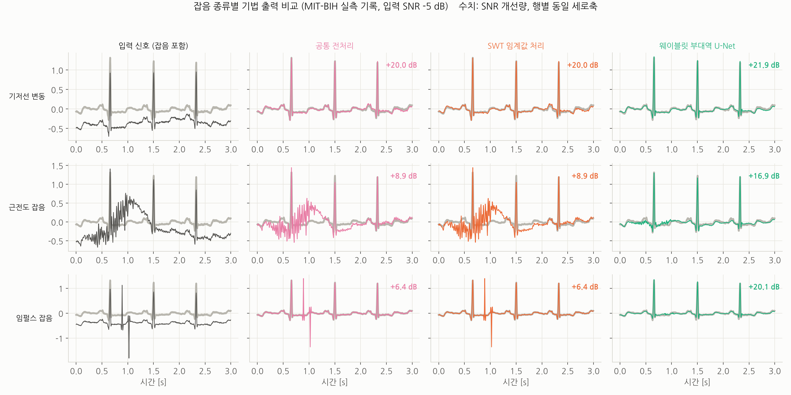

> 그림 5.13. 그림 5.4와 같은 형식의 MIT-BIH 결과. 표 5.18의 둘째 · 셋째 행이 이 그림에 나타난다. 기저선 변동
> 행에서는 공통 전처리 단독부터 이미 평탄하여 세 기법이 구분되지 않고, 임펄스 행에서만 스파이크가 공통 전처리 단독과
> SWT 임계값 처리(M04)의 출력에 남고 웨이블릿 부대역 U-Net의 출력에서 제거된다. 합성 데이터에서 관찰한 구조가 실측
> 잡음(NSTDB)에서도 같은 형태로 나타난다.

칼만 필터의 PVC 형태 손상이 MIT-BIH에서 사라진 것은 F-14와 같은 방향으로 해석된다(추정). 합성 ECG는 McSharry
동역학 모델로 생성되므로 정상 박동은 모델에 정확히 맞고 PVC 박동만 모델에서 벗어난다. 칼만 필터는 모델에서 벗어나는
성분을 잡음으로 보고 제거하므로 PVC 박동이 선택적으로 손상된다. MIT-BIH에서는 정상 박동도 모델에서 벗어나므로 PVC
박동만 특별히 불리하지 않다. 따라서 합성 ECG에서 관찰된 PVC 형태 손상은 기법의 위험이 아니라 합성 데이터의
특성이었을 가능성이 있다. 이를 단정하지 않는 이유는 F-17과 같다. 합성 ECG에서 MIT-BIH로 바뀔 때 생성 모델만
바뀌는 것이 아니기 때문이다.

> 칼만 필터(Sameni 기법)의 자가진단은 데이터마다 다른 결과를 보인다. `docs/06_sameni_diagnosis.md`(합성 ECG)와
> `docs/06_sameni_diagnosis_d1.md`(MIT-BIH)를 비교하면, MIT-BIH에서는 기록에 맞춘 박동 모델이 참 매개변수보다 높은
> 성능을 보이며, 이것이 F-17의 단서였다.

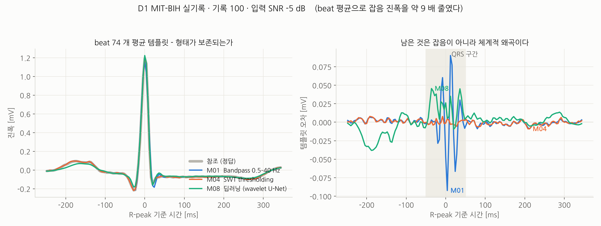

> 그림 5.14. MIT-BIH의 평균 박동 파형(대역통과 필터 · SWT 임계값 처리 · 웨이블릿 부대역 U-Net). 오른쪽 오차 그림에서
> 대역통과 필터는 QRS 구간의 오차가 ±0.09 mV로 가장 크고 SWT 임계값 처리는 거의 평탄하다. 40 Hz 저역 차단에 따른
> 결과이며 합성 ECG(5.3 절)와 같은 경향이다. 웨이블릿 부대역 U-Net은 오차의 크기는 중간이지만 QRS 밖까지 퍼져 있다.
> 고전 기법은 자신이 제거한 대역에서만 오차가 생기고, 신경망은 박동 전체에 걸쳐 작은 오차가 생긴다는 차이가 확인된다.
>
> 칼만 필터는 색 구분을 위해 이 그림에서 제외하였다. 칼만 필터의 QRS 폭 오차 증가의 근거는 F-14에 있다.

### 5.8.6 해석에서 제외한 근거

결과 해석 과정에서 검토한 뒤 근거에서 제외한 두 가지를 기록한다. 둘 다 표에서 유의한 수치로 나타나 그대로
인용하기 쉬운 결과였다.

(a) PSD 로그 거리에서 딥러닝이 대역통과 필터보다 18 dB 낮다는 결과는 근거로 쓰지 않는다. 22 기록 모두에서
유의하지만(p = 6.2e-06, r = −1.000), 대역통과 필터는 0.5–40 Hz이고 기준 신호는 0.5–100 Hz이다. 대역통과 필터는
40~100 Hz 성분을 모두 제거하는데 기준 신호에는 그 대역의 성분이 있으므로, 그 대역에서 로그 PSD 거리가 매우 커진다.
같은 대역의 공통 전처리 단독과 비교하면 두 데이터 모두 유의하지 않다(합성 ECG p = 0.13, MIT-BIH p = 0.68). 잡음 제거
성능이 아니라 차단 주파수의 차이였다.

(b) RMSE · PRDN의 우위를 SNR과 독립된 근거로 쓰지 않는다. MIT-BIH 전 구간에서 RMSE의 차이는 유의하지만
(p = 2.4e-05) SNR 개선량(진폭 보정)의 차이는 유의하지 않다. 두 지표가 다른 것을 측정하는 것처럼 보이지만 구간별로는
결과가 일치한다. 차이는 평균 방식에서 생긴다. MIT-BIH −5 dB의 RMSE(0.220)가 20 dB(0.019)의 12 배이므로 전 구간 선형
평균은 사실상 저 SNR 성능을 나타낸다. 같은 결과를 두 번 근거로 쓰는 셈이 된다.

> 두 사례의 공통점은 통계적으로 유의하고 효과 크기도 크지만 비교의 전제가 달랐다는 점이다. 본 연구에서 반복적으로
> 나타난 유형이다[^F-8][^F-10][^F-11][^F-12][^F-15][^F-16][^F-17]. p 값은 비교의 전제가 잘못되었는지를 알려 주지 않는다.


### 5.8.7 손실 함수 선택과 고 SNR 구간 열세

주 실험(5.8.1~5.8.6 절)의 딥러닝 세 기법은 모두 MSE 손실(L1)로 학습한 체크포인트이다. 손실 함수
ablation(`docs/10_loss_ablation_d1.md`)은 MIT-BIH에서 이 선택이 최선이 아님을 보인다(TEST 분할, M08-L1 기준).

표 5.19. MIT-BIH의 손실 함수별 결과(M08-L1 기준)

| 비교 | 전 구간 Δ | p(Holm) | 효과 크기 r | 0 dB | 10 dB | 20 dB |
|---|---|---|---|---|---|---|
| `M08-L3` | +1.032 | 1.1e-03 | +0.842 | +0.54 | +0.78 | +1.78 |
| `M08-L4` | +0.993 | 1.3e-02 | +0.708 | −0.40 | +0.91 | +2.47 |

개선이 고 SNR 구간에 집중되며, 이는 5.8.2 절에서 딥러닝이 공통 전처리보다 낮았던 구간이다. 20 dB에서 웨이블릿
부대역 U-Net은 공통 전처리 단독보다 4.45 dB 낮은데, MSE · MAE · 미분 손실(L3)을 쓰면 격차가 약 2.7 dB로 줄고 교차점이
13 dB에서 15~16 dB 부근으로 올라갈 것으로 추정된다.

합성 ECG에서는 경향이 다르다. 합성 ECG에서는 잔차 U-Net이 MSE · MAE · 미분 손실로 개선되고(+1.175 dB, p = 1.7e-04)
웨이블릿 부대역 U-Net은 유의한 차이가 없다(+0.070 dB, p = 0.42). 어느 손실 함수가 유리한지가 데이터에 따라 다르다는
것 자체가 하나의 결과이다.

그러나 주 실험을 MSE · MAE · 미분 손실로 다시 실행하지는 않았다. 위 수치는 TEST 분할에서 얻은 것이므로, 이를 보고 주
실험의 설정을 고르면 사후 선택이 된다. TEST 분할을 모델 선택에 쓰면 더 이상 독립 평가가 아니며, 이는 F-8의 데이터
누설과 유형만 다른 같은 문제이다.

따라서 이 결과는 주 표를 고치는 근거가 아니라 주 표의 적용 범위를 한정하는 근거로 쓴다. 5.8 절의 결론은 「딥러닝은
고 SNR에서 성능이 낮다」가 아니라 「MSE 손실로 학습한 딥러닝은 고 SNR에서 성능이 낮고, 손실 함수를 바꾸면 그 격차의
약 40 %가 줄어든다」이다. 손실 함수를 사전에 고정한 뒤 다시 측정하는 것은 향후 과제이다.

### 5.8.8 손실 함수 확장 후보의 선정(L5 · L6)

5.8.7 절의 결론은 손실 함수 선택으로 고 SNR 구간의 열세를 일부 줄일 수 있다는 것이었고, 5.9 절은 구조 변경 가설이
세 번 연속 기각되었음을 보였다. 다음으로 어떤 손실 항을 추가할지 정해야 하는데, 손실 하나당 학습 4 회(모델 2 × 데이터
2, 약 2.5 시간)가 필요하므로 후보를 골라야 한다. 선정 기준은 미리 정하였다. (a) 이미 측정된 약점을 목표로 할 것,
(b) 다른 항이 다루지 않는 오차를 다룰 것, (c) 현재의 지표로 효과를 측정할 수 있을 것.

표 5.20. 손실 함수 확장 후보의 선정

| 후보 | 판정 | 근거 |
|---|---|---|
| `L6` 무잡음 입력 보존 | 채택 | 무잡음 입력 실험(EXP-C)이 이미 측정한 약점이다. 딥러닝은 무잡음 입력을 SWT보다 17 dB 더 왜곡한다(MIT-BIH 22.22 · 23.51 대 40.14 dB, 합성 ECG에서는 28.5 dB 차이). 이를 다루는 손실 항이 없었다 |
| `L5` SNR 층 균등 | 채택 | 성능이 낮은 구간은 고 SNR 인데, 학습 손실은 저 SNR 구간이 3.5~4.8 배 크게 차지한다 |
| SI-SDR | 기각 | 진폭 정보를 무시하는 손실이다. 진폭 이득 편향은 딥러닝이 공통 전처리 단독보다 22 기록 모두에서 우수한 지표이다 |
| 다해상도 STFT | 기각 | L4의 부대역 항이 이미 같은 역할을 한다(MIT-BIH +0.993 대 L3 +1.032) |
| 시간 영역 QRS 가중 | 기각 | L4가 QRS 대역에 이미 2 배 가중치를 준다 |
| 적대적 · 지각(perceptual) 손실 | 기각 | RQ5의 결과와 방향이 반대이다. 딥러닝의 가성 파형 생성이 적은 이유가 잔차 구조인데, 생성형 손실은 이 특성을 약화한다 |
| 2 차 차분 손실 | 기각 | 아래 참조 |

설계 근거 전문은 D-13, 학습 전 검증 과정은 F-21에 있다.

2 차 차분 손실을 기각한 근거는 두 가지 측정이다.

처음에는 1 차 차분(기울기) 대신 2 차 차분(곡률)을 쓰면 과도한 평활화에 더 민감할 것으로 예상하였다. 그러나 두 손실의
파라미터 기울기 사이의 코사인 유사도는 +0.947(합성 ECG) · +0.993(MIT-BIH)으로 거의 같은 방향이었다. 즉 새로운 기제가
아니라 차분 항의 가중치를 1.6~1.9 배 높인 것과 같다.

또한 보완하려는 기제 자체가 MIT-BIH에서는 효과가 없다. L2 → L3(차분 항 추가)의 순효과는 다음과 같다.

표 5.21. 차분 항 추가(L2 → L3)의 순효과

| | 전 구간 | 20 dB |
|---|---|---|
| 합성 ECG `M06` | +0.223 (p = 0.083) | +0.529 (p = 1.3e-03) |
| MIT-BIH `M06` | −0.018 (n.s.) | −0.117 (n.s.) |

차분 항의 고 SNR 개선은 합성 ECG 에서만 나타난다. 같은 코사인 측정이 그 원인도 보여 준다.

표 5.22. 손실 항의 기울기와 1 차 차분 기울기의 코사인 유사도

| 1 차 차분 기울기와의 코사인 | 합성 ECG | MIT-BIH |
|---|---|---|
| MSE | −0.069 (거의 직교) | +0.826 (중복) |
| MAE | −0.294 | +0.640 |

합성 ECG에서는 차분 항이 MSE · MAE가 반영하지 못하는 방향의 오차를 다루어 효과가 있고, MIT-BIH에서는 이미 MSE ·
MAE가 다루는 방향이라 추가 효과가 없다. 실측 기록은 박동마다 형태가 달라 진폭 오차와 기울기 오차가 함께 변하기
때문으로 추정된다. 이 결과는 5.8.5 절의 재현 여부 표에 한 항목을 더한다. 차분 항의 개선은 MIT-BIH에서 재현되지 않는다.

주의: 이 표들은 주 실험의 손실 함수를 바꾸는 근거가 아니다. TEST 분할을 보고 고르면 사후 선택이다(5.8.7 절). SNR 층
균등 손실(L5)과 무잡음 입력 보존 손실(L6)은 ablation 결과로만 보고하며, 주 실험의 손실 함수를 바꾸려면 사전에 고정한
뒤 다시 학습해야 한다.

### 5.8.9 L5 · L6의 결과와 기제

5.8.8 절에서 선정한 두 손실을 두 데이터 · 두 모델로 학습하였다(총 8 회). TEST 분할, 대응 Wilcoxon 검정 + Holm 보정, 기록 단위 n = 22, SNR 개선량(진폭 보정) 기준이다.

표 5.23. 손실 함수별 SNR 개선량 차이(괄호 안은 p(Holm))

| 기준 | 데이터 | `L6` | `L5` | `L3` | `L2` / `L4` |
|---|---|---|---|---|---|
| `M06-L1` | 합성 ECG | +2.426 (2.1e-04) | +1.694 (1.1e-03) | +1.175 (1.7e-04) | +0.952 (2.5e-03) |
| | MIT-BIH | +1.420 (0.020) | +0.853 (0.015) | +0.869 (n.s.) | +0.888 (n.s.) |
| `M08-L1` | 합성 ECG | +1.354 (0.010) | +1.502 (0.012) | +0.070 (n.s.) | +0.003 (n.s.) |
| | MIT-BIH | +0.652 (n.s.) | −0.142 (n.s.) | +1.032 (1.8e-03) | +0.993 (0.023) |

무잡음 입력 보존 손실은 네 조건 중 세 조건에서 유의하고, 잔차 U-Net에서는 두 데이터 모두 가장 높다. 특히 MIT-BIH의
잔차 U-Net에서 유의한 손실은 무잡음 입력 보존 손실과 SNR 층 균등 손실 둘뿐이며, MSE · MAE 손실(L2)과 MSE · MAE · 미분
손실은 유의하지 않다. SNR 층 균등 손실은 합성 ECG에서 두 모델 모두 유의하지만, MIT-BIH의 웨이블릿 부대역 U-Net에서는
차이가 음수(−0.142 dB)였다.

개선은 손실이 목표로 한 조건에서 나타났다. 입력 SNR 별 차이는 다음과 같다(`*`는 Holm 보정 후 유의).

표 5.24. 입력 SNR 별 손실 함수 효과

| | 0 dB | 10 dB | 20 dB |
|---|---|---|---|
| 합성 ECG `M06-L3` | +0.422 | +1.139\* | +1.965\* |
| 합성 ECG `M06-L6` | +0.720\* | +1.917\* | +4.639\* |
| MIT-BIH `M06-L3` | −0.136 | +0.802 | +1.942\* |
| MIT-BIH `M06-L6` | −0.410 | +1.099 | +3.573\* |

20 dB에서 무잡음 입력 보존 손실의 개선량은 MSE · MAE · 미분 손실의 약 두 배이다. 5.8.2 절에서 딥러닝이 공통
전처리보다 낮았던 구간이다. 공통 전처리 단독 대비 격차는 다음과 같다.

표 5.25. 입력 SNR 20 dB에서 공통 전처리 단독(M_FE) 대비 격차 [dB]

| 20 dB, `M_FE` 대비 | `L1` | `L3` | `L6` |
|---|---|---|---|
| 합성 ECG | −1.60 | +0.36 | +3.04 |
| MIT-BIH | −4.84 | −2.90 | −1.27 |

합성 ECG에서는 부호가 바뀌어 20 dB 에서도 딥러닝이 공통 전처리 단독보다 높아진다. MIT-BIH에서는 여전히 낮지만
격차의 74 %가 줄었다.

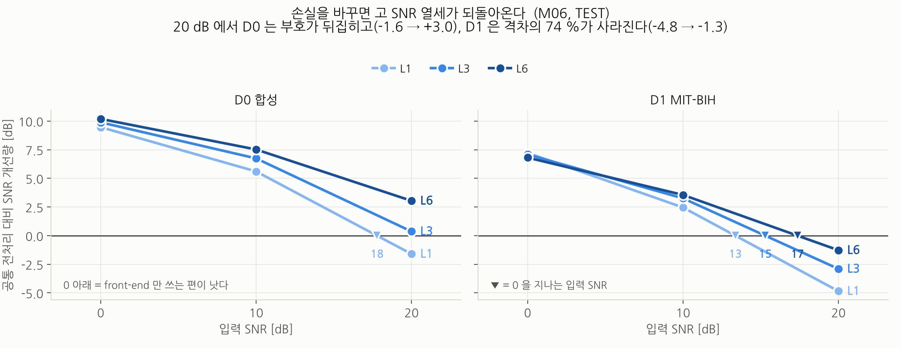

> 그림 5.15. 그림 5.8과 같은 축의 손실 함수별 결과. 세로축은 공통 전처리 단독 대비 격차이며 0 아래는 공통
> 전처리만 쓰는 것이 낫다는 뜻이다. 그림 5.8에서 나타난 고 SNR 구간의 열세가 손실 함수만 바꾸어 줄어든 것을 보여
> 준다. MSE 손실 → MSE · MAE · 미분 손실 → 무잡음 입력 보존 손실의 순서로 색이 진해진다. 구조를 세 차례 바꾸었을 때
> (SWT 직렬 결합 U-Net · 웨이블릿 부대역 U-Net · Dilated ResNet)에는 변하지 않던 격차가 손실 항 하나로 줄었다는 것이
> 핵심이다.

#### 무잡음 입력 실험(EXP-C)에 의한 기제 확인

무잡음 입력 보존 손실의 가설은 모델이 무잡음 입력을 덜 변형한다는 것이며, 이를 측정하는 실험이 무잡음 입력
실험(EXP-C, 5.3 절)이다. 그러나 무잡음 입력 실험의 딥러닝 항목은 MSE 손실 체크포인트뿐이어서 손실 함수에 따른 차이를
측정할 수 없었다. 측정 도구는 있었지만 이 가설의 검증에 적용되어 있지 않았던 것이다. 손실 함수별 체크포인트를 추가해
다시 실행하였다.

표 5.26. 무잡음 입력의 출력 SNR [dB]

| 무잡음 입력의 출력 SNR(보정 없음) | 합성 ECG | MIT-BIH |
|---|---|---|
| `M04` SWT 임계값 처리(기존 최고) | 53.15 | 40.14 |
| `M08-L6` | 44.48 | 38.37 |
| `M06-L6` | 33.45 | 37.35 |
| `M08-L3` | 27.04 | 28.59 |
| `M08` (`L1`) | 27.04 | 23.51 |
| `M06` (`L1`) | 24.64 | 22.22 |

MIT-BIH에서 잔차 U-Net은 22.22 dB에서 37.35 dB 로(+15.1 dB), 웨이블릿 부대역 U-Net은 23.51 dB에서 38.37 dB로
(+14.9 dB) 높아졌다. 5.3 절에서 딥러닝이 SWT보다 무잡음 입력을 17 dB 더 왜곡한다고 보고한 격차가 1.8~2.8 dB로
줄었다. 손실 함수에 넣은 목표가 바로 그 지표에서 개선되었으므로, 무잡음 입력 보존 손실의 개선은 우연이 아니라 의도한
기제를 통해 나타난 것으로 판단된다.

SNR 층 균등 손실도 같은 방향이지만 효과가 훨씬 작다(MIT-BIH 잔차 U-Net 22.22 → 26.21 dB). SNR 층 균등 손실은 무잡음
입력 보존을 목표로 하지 않았으므로 이는 부수적인 효과이다.

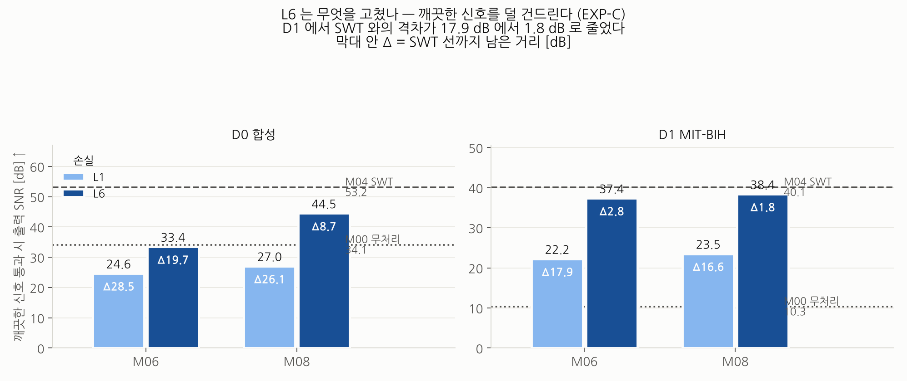

> 그림 5.16. 그림 5.15의 원인을 보여 주는 무잡음 입력의 출력 SNR. 막대는 모델 × 손실 함수이고, 두 가로선은 SWT
> 임계값 처리(기존 최고)와 무처리(공통 전처리 자체의 영향)이다. 해석의 대상은 막대 높이가 아니라 SWT 선까지의 거리이므로
> 각 막대에 그 격차를 표시하였다. MIT-BIH에서 무잡음 입력 보존 손실을 적용하면 SWT 와의 격차가 17.9 dB에서 1.8 dB
> 로 줄어든다. 합성 ECG에서는 격차가 더 크게 남는다(26.1 → 8.7 dB). 방향은 같고 크기가 다르다. 무잡음 입력에서
> 출력이 입력과 같도록 하는 항을 손실에 넣자 바로 그 지표가 높아졌으며, 이것이 개선이 의도한 기제를 통해 나타났다는
> 근거이다.

#### 학습량 차이에 관한 유의점

MIT-BIH의 웨이블릿 부대역 U-Net에 SNR 층 균등 손실 · 무잡음 입력 보존 손실을 적용한 두 학습은 조기 종료가 아니라
60 epoch 상한에서 끝났다(최고 성능 epoch 48 · 50). 같은 데이터의 비교 대상은 38~43 epoch에서 조기 종료하였다. 즉
SNR 층 균등 손실 · 무잡음 입력 보존 손실 쪽이 더 오래 학습되었다. F-19에서 Dilated ResNet에 대해 지적한 것과 같은
유형이며, 이번에는 방향이 반대이다.

그런데 이 조건은 SNR 층 균등 손실 · 무잡음 입력 보존 손실의 개선량이 오히려 낮았던 조건이다(MIT-BIH 웨이블릿 부대역
U-Net: SNR 층 균등 손실 −0.142 dB, 무잡음 입력 보존 손실 +0.652 dB 비유의, MSE · MAE · 미분 손실 +1.032 dB). 학습량이
더 많았는데도 개선량이 낮았으므로 이 결론은 보수적이며, 학습량의 비대칭이 결과를 만든 것은 아니다.

#### 주 실험 설정의 유지

이유는 5.8.7 절과 같다. 위 표는 TEST 분할에서 얻은 것이므로 이를 보고 주 실험의 손실 함수를 고르면 사후 선택이다[^F-9].
무잡음 입력 보존 손실을 주 실험에 쓰려면 사전에 고정한 뒤 전체를 다시 학습해야 한다. 이 결과는 5.8 절 결론의 적용
범위를 다음과 같이 한정한다.

> 5.8 절의 결론은 「딥러닝은 고 SNR에서 성능이 낮다」가 아니라, 「MSE 손실로 학습한 딥러닝은 고 SNR에서 성능이 낮고,
> 무잡음 입력 보존 손실로 학습하면 그 격차가 MIT-BIH에서 74 % 줄고 합성 ECG에서는 사라진다」이다.

5.9 절의 결과와 함께 보면 본 장의 결론이 분명해진다. 구조 변경은 세 차례 모두 유의한 개선을 보이지 않았고(SWT 직렬
결합 U-Net · 웨이블릿 부대역 U-Net · Dilated ResNet), 손실 함수 변경은 유의한 개선을 보였다.

### 5.8.10 무잡음 입력 보존 손실(L6)의 이득과 입력 SNR(EXP-G)

5.8.9 절의 근거인 손실 함수 ablation은 혼합 잡음 조건 하나만으로 실행되었다. 혼합 잡음은 여러 성분의 평균이므로 어느
잡음에서 개선되고 어느 잡음에서 저하되는지 알 수 없다. 따라서 잡음 7 종 × 입력 SNR 7 단계(−5~25 dB, 5 dB 간격)로 다시
측정하였다(`configs/exp_g.yaml`). 체크포인트가 이미 있으므로 학습 없이 평가만 수행하였다. 상세 결과는
`docs/11_loss_by_noise.md`에 있다.

> 측정 범위를 3 단계에서 7 단계로 넓힐 때 기존 조건의 결과가 바뀌지 않는지 먼저 확인하였다. 잡음 표본은 (기록 · 구간 ·
> 조건)마다 한 번 생성하고 SNR에 따라 크기만 바꾸므로 기존 결과가 그대로 재현되어야 한다. 겹치는 288,288 행(시간 지표
> 제외)의 최대 절대 차이는 두 데이터 모두 0.000e+00이었다.

비교는 같은 기록 · 같은 구간 · 같은 잡음 표본의 대응 비교이며, 기록 단위 n = 44이다. Holm 보정은 한 데이터 · 한 backbone
· 한 입력 SNR 안의 잡음 7 종에 적용하였다.

두 데이터 × 두 backbone × 잡음 7 종 × 입력 SNR 7 단계의 196 조건 중 유의한 개선은 124, 유의한 저하는 19, 비유의는
53 조건이다.
유의 이득 124 · 유의 손해 19 · n.s. 53.

표 5.27. 입력 SNR 별 무잡음 입력 보존 손실의 효과(196 조건)

| 입력 SNR | 유의한 개선 | 유의한 저하 | 비유의 | 평균 Δ |
|---|---|---|---|---|
| −5 dB | 8 | 12 | 8 | −0.05 dB |
| 0 dB | 12 | 5 | 11 | +0.64 |
| 5 dB | 16 | 2 | 10 | +1.18 |
| 10 dB | 18 | 0 | 10 | +1.92 |
| 15 dB | 19 | 0 | 9 | +2.93 |
| 20 dB | 24 | 0 | 4 | +4.27 |
| 25 dB | 27 | 0 | 1 | +5.88 |

개선과 저하가 입력 SNR에 따라 단조롭게 변한다. 유의한 개선 조건의 수는 8에서 27로, 평균 차이는 −0.05 dB에서 +5.88
dB로 한 번도 감소하지 않고 증가한다.

> 개선과 저하가 균형을 이루는 지점은 0 dB 근처이다. 초기 측정 범위(0 · 10 · 20 dB)에서는 0 dB가 가장 낮은 점으로만
> 보였으나, −5 dB를 추가로 측정하자 그 지점에서 부호가 바뀌는 것이 확인되었다(개선 8, 저하 12, 평균 0). 측정 범위를
> 넓히지 않았다면 저 SNR에서 성능이 낮아진다는 사실만 보고하고 그 경계는 보고하지 못했을 것이다.

10 dB 이상에서는 196 조건 중 유의한 저하가 하나도 없다.

이 결과는 무잡음 입력 보존 손실의 설계와 일치한다. 무잡음 입력 보존 항은 이미 잡음이 적은 신호를 덜 변형하도록 하는
항이므로, 입력의 잡음이 적을수록 효과가 크고 잡음이 많을수록 오히려 제약이 된다. 5.8.9 절에서 보고한 「목표 조건(20 dB)
에서의 개선」이 잡음 7 종 · 입력 SNR 7 단계 전체에서 확인되었다.

#### 잡음 종류별 이득

표 5.28. 잡음 종류별 무잡음 입력 보존 손실의 효과

| 잡음 | 유의한 개선 | 유의한 저하 | 평균 Δ (12 조건) |
|---|---|---|---|
| 전원선 60 Hz | 12 | 0 | +6.32 dB |
| 기저선 변동 | 10 | 0 | +4.59 |
| 근전도(MA) | 9 | 1 | +1.34 |
| 혼합 | 7 | 1 | +1.46 |
| 전극 움직임 | 7 | 1 | +1.09 |
| 임펄스 | 5 | 0 | +0.86 |
| 백색잡음 | 4 | 2 | +0.26 |

협대역 · 저주파처럼 구조가 뚜렷한 잡음에서 개선이 가장 크고, 광대역 백색 잡음에서 가장 작다. 이는 기제로 설명된다.
잡음이 신호와 분리 가능하면 모델이 신호를 덜 변형할 여지가 있고, 무잡음 입력 보존 손실은 바로 그 방향으로 학습을
유도한다. 광대역 백색 잡음은 신호와 같은 대역에 퍼져 있어 이런 여지가 없다.

> 이 결과는 MSE 손실 대비 무잡음 입력 보존 손실의 차이이며, 기법 간 비교가 아니다. 전원선 잡음에서는 여전히 SWT
> 임계값 처리가 딥러닝보다 크게 높다(5.2 절). 무잡음 입력 보존 손실은 그 격차를 줄일 뿐 역전시키지 않는다.

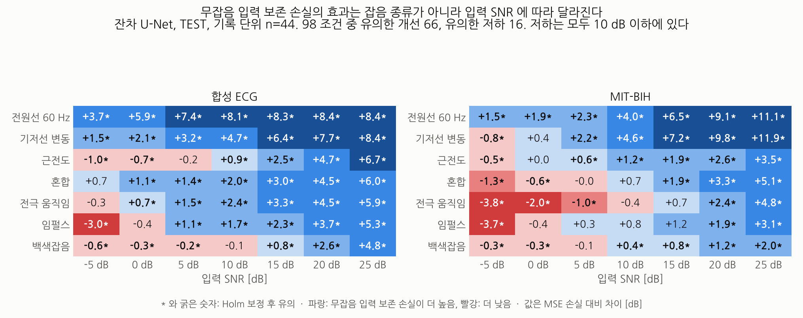

> 그림 5.17. 표 5.27 · 5.28를 하나의 격자로 나타낸 것이다. 행은 잡음 7 종, 열은 입력 SNR 7 단계이며, 파랑은 무잡음
> 입력 보존 손실이 MSE 손실보다 높은 조건, 빨강은 낮은 조건이고 별표는 Holm 보정 후 유의를 뜻한다. 왼쪽 열이 붉고
> 오른쪽으로 갈수록 파래진다. 결과를 결정하는 요인이 잡음 종류(행)가 아니라 입력 SNR(열)임을 색의 변화 방향으로
> 확인할 수 있다. 붉은 조건은 모두 왼쪽 네 열에 있다.
>
> 그림에는 잔차 U-Net의 결과만 나타냈다(98 조건). 본문의 196 조건은 웨이블릿 부대역 U-Net을 포함한 수이다. 그림의
> 부제에 적힌 조건 수와 판정은 격자에서 직접 계산한다. 수기로 적었던 값이 잡음 종류별 손실 효과 실험(EXP-G)의 측정
> 범위를 넓힌 뒤 갱신되지 않은 사례가 있었기 때문이다[^O-27].

#### 분석 경위

이 분석은 시연 자료의 한 구간에서 「무잡음 입력 보존 손실은 전원선 잡음에서 7 dB 낮다」고 해석한 데서 출발하였다.
같은 조건을 대응 비교로 측정한 결과는 +4.00 dB(r = +0.91)였고, 그 구간은 44 개 구간 중 최솟값이었다. 부호가
반대였을 뿐 아니라 분포의 극단값이었다. 경위와 원인은 F-24에 있다.

---

## 5.9 RQ7: 시간 해상도 유지와 QRS 보존(M10)

### 5.9.1 질문과 실험 설계

딥러닝 세 기법(잔차 U-Net(M06) · SWT 직렬 결합 U-Net(M07) · 웨이블릿 부대역 U-Net(M08))은 모두 U-Net 계열이며,
신호를 1/2씩 네 번 축소한 뒤 복원한다. QRS군은 폭 80~100 ms(250 Hz에서 20~25 표본)로 가장 빠른 성분이므로, 1/16
축소 단계에서는 1~2 표본으로 줄어든다. 이 병목이 QRS군의 형태를 손상시키는지를 검증한다.

이 요인만 분리하기 위해 Dilated ResNet(M10)을 구성하였다. downsampling 없이 dilation(1 · 2 · 4 · 8 · 16 · 24)만으로
수용 영역을 넓히는 구조이다. 잔차 U-Net과 파라미터 수를 0.4 %, 수용 영역을 0.9 % 이내로 맞추고, 손실 함수 · 데이터
· 분할 · 학습 일정 · 시드를 같게 하였다. 두 모델의 차이는 시간 해상도 하나이다. 설계 근거와 대안 검토는 D-11에
있다.

> 시간 합성곱 신경망(TCN)과의 관계. 이 구조는 TCN 계열에서 dilation과 해상도 유지만 가져오고 causal masking은
> 의도적으로 제외하였다. 본 연구는 오프라인 후처리이고 다른 기법도 모두 비인과적이므로, 인과 구조를 적용하면 시간
> 해상도가 아니라 인과성의 영향을 측정하게 된다. 따라서 이 절의 결과를 TCN의 평가로 해석해서는 안 된다.

### 5.9.2 결과: 가설 기각과 형태 지표 저하

표 5.29. Dilated ResNet(M10)과 잔차 U-Net(M06)의 지표 차이(주 실험 TEST, 대응 Wilcoxon 검정 + Holm 보정, 기록 단위
n = 22). 판별 하한은 각 데이터의 95 백분위 하한이며, |Δ|/판별 하한 < 1이면 p 값과 무관하게 구분 불가로
판정한다[^F-16][^O-14].

| 지표 | 데이터 | Δ (M10 − M06) | \|Δ\|/판별 하한 | p(Holm) | 판정 |
|---|---|---|---|---|---|
| QRS 폭 오차 [ms] | 합성 ECG | −1.834 | 2.9 | 0.897 | 비유의 |
| | MIT-BIH | −0.072 | 0.0 | 0.992 | 구분 불가 |
| 평균 박동 상관계수 | 합성 ECG | −0.00552 | 15203 | 0.023 | M10 열세 |
| | MIT-BIH | −0.00190 | 4683 | 0.029 | M10 열세 |
| 진폭 이득 편향(1 과의 거리) | 합성 ECG | +0.0020 | 10 | 0.965 | 비유의 |
| | MIT-BIH | +0.0125 | 64 | 0.018 | M10 열세 |
| SNR 개선량(진폭 보정) | 합성 ECG | −0.912 | — | 0.021 | M10 열세 |
| | MIT-BIH | −0.591 | — | 0.211 | 비유의 |
| PSD 로그 거리 | 합성 ECG | +0.320 | 0.1 | 0.181 | 구분 불가 |
| | MIT-BIH | −0.731 | 0.7 | 0.012 | 구분 불가 |
| RMSE | 합성 ECG / MIT-BIH | +0.001 / +0.003 | 0.7 / 0.7 | 1 / 0.217 | 구분 불가 |

> 진폭 이득 편향 행은 이상값 1 과의 거리로 다시 측정한 값이다. 부호 있는 차이로 비교하면 합성 ECG 에서도 p = 6.7e-06
> 으로 열세처럼 보이지만, 잔차 U-Net(0.980)과 Dilated ResNet(1.027)이 1을 사이에 두고 반대편에 있어 거리로는 차이가
> 없다. 비교 방식에 따라 판정이 바뀌는 사례이다(F-22).

첫째, 시간 해상도를 유지해도 QRS 폭 오차는 개선되지 않는다. 합성 ECG는 이 지표로 판정이 가능한 데이터이다. 판별
하한이 0.640 ms이고 관측된 차이는 그 2.9 배이지만 p = 0.897이다. MIT-BIH는 판별 하한이 28.07 ms여서 이 지표로
구분할 수 없다.

둘째, 박동 형태는 오히려 저하되었으며 두 데이터에서 크기가 거의 같다. 평균 박동 상관계수의 차이는 합성 ECG
−0.00552(r = −0.723), MIT-BIH −0.00190(r = −0.715)으로 효과 크기가 사실상 같다. 판별 하한의 4,700~15,000 배이므로
분해능의 문제가 아니다. 평균 박동 상관계수는 진폭 배율에 불변이므로 셋째 결과와 독립된 손상이다.

셋째, 진폭은 MIT-BIH 에서만 저하된다. 진폭 이득 편향은 이상값이 1이고 양쪽으로 벗어날 수 있으므로 1 과의 거리로
비교해야 한다[^F-22]. MIT-BIH에서 Dilated ResNet은 잔차 U-Net보다 1에서 0.0125 더 멀다(p = 0.018). 합성 ECG에서는
잔차 U-Net 0.980, Dilated ResNet 1.027로 1을 사이에 두고 거의 대칭이어서 차이가 없다(p = 0.965).

> 초판에서는 부호 있는 차이로 측정하여 합성 ECG 에서도 p = 7e-06, r = +1.000(22 기록 모두)이라고 기록하였다. 실제로는
> 없는 열세를 보고한 것이다. 같은 오류가 웨이블릿 부대역 U-Net · CNN-Transformer(M09)의 합성 ECG 판정에도 있었고,
> 반대로 웨이블릿 부대역 U-Net이 MIT-BIH에서 진폭을 보존하지 못하는 결과(p = 0.0018)는 드러나지 않았다(F-22).

### 5.9.3 연산 비용

표 5.30. 잔차 U-Net과 Dilated ResNet의 연산 비용

| | `M06` | `M10` | 배수 |
|---|---|---|---|
| 파라미터 수 | 976,489 | 979,926 | 1.00 |
| 연산량(이론 MAC/window) | 95.9 M | 999.6 M | 10.4 |
| 추론 시간(CPU 1 thread, 1024 표본 window) | 11.1 ms | 33.6 ms | 3.0 |

downsampling이 없으므로 모든 블록이 전체 길이에서 연산한다. 본 연구는 임베디드 실시간 처리를 목표로 하므로 연산량
10 배는 결정적인 단점이다. 성능이 같더라도 채택하기 어려운데, 형태 지표는 오히려 낮다.

### 5.9.4 판정 지표의 한정

Dilated ResNet은 합성 ECG에서 18 epoch 만에 조기 종료하였고 최고 성능 epoch은 6이었다. 같은 조건의 잔차 U-Net은
37 epoch 동안 학습되었다. 합성 ECG에서는 학습량 자체가 같지 않으므로, SNR 개선량(진폭 보정)의 열세(−0.912)를 구조의
영향으로 해석할 수 없다.

MIT-BIH에서는 반대이다. Dilated ResNet이 더 오래(52 대 46 epoch) 학습되었고, 수렴 구간의 VAL 중앙값도 Dilated
ResNet이 더 높다(+2.985 대 +2.645). 그런데도 TEST의 평균 박동 상관계수와 진폭 이득 편향의 열세는 두 데이터에서 같게
나타난다. 학습량으로 설명되지 않는 결과는 이 둘뿐이므로 결론도 이 두 지표에 한정하였다. 조기 종료가 학습마다 다르게
작동하는 문제는 F-19에서 별도로 다룬다.

### 5.9.5 잡음 종류별 결과

남은 반론은 특정 잡음에서는 시간 해상도 유지가 유리할 수 있다는 것이다. 이를 잡음 종류별 실험(EXP-B, 잡음 7 종,
입력 SNR 10 dB 고정, 22 기록)으로 확인하였다.

표 5.31. 잡음 종류별 SNR 개선량(진폭 보정) 차이(M10 − M06, 대응 Wilcoxon 검정 + Holm 보정)

| 잡음 | 합성 ECG Δ | 합성 ECG p | MIT-BIH Δ | MIT-BIH p |
|---|---|---|---|---|
| `awgn` 백색 | −1.155 | 6.7e-06 | −0.972 | 0.010 |
| `bw_synth` 기저선 변동 | −1.930 | 4.5e-05 | −1.194 | 0.086 |
| `em_synth` 전극 움직임 | −1.391 | 3.0e-05 | +0.196 | 1 |
| `impulse` 임펄스 | −1.456 | 2.7e-05 | −1.046 | 0.011 |
| `ma_synth` 근전도 | −1.863 | 6.7e-06 | −1.073 | 0.004 |
| `mixed` 혼합 | −1.120 | 0.001 | −0.756 | 0.516 |
| `pli` 전원선 | −2.100 | 3.3e-05 | −1.523 | 0.042 |

합성 ECG에서는 잡음 7 종 모두 Dilated ResNet이 유의하게 낮다. 백색 잡음과 근전도 잡음은 rank-biserial r = −1.000
으로 22 기록 모두에서 낮다. MIT-BIH에서는 4 종이 유의하게 낮고 나머지 3 종은 유의하지 않다.

어느 데이터, 어느 잡음에서도 Dilated ResNet이 유의하게 높은 조건은 없다. 부호가 바뀌는 유일한 조건은 MIT-BIH의 전극
움직임 잡음(+0.196)이지만 p = 1이어서 근거가 되지 않는다. 전극 움직임 잡음은 스펙트럼이 ECG와 가장 많이 겹쳐 가장
제거하기 어려운 잡음이므로, 이 조건에서의 부호 변화는 두 모델의 차이가 사라지는 지점으로 해석하는 것이 타당하다.

합성 ECG의 유의성이 MIT-BIH보다 일관되게 강한 것은 5.9.4 절의 학습량 불균형과 같은 방향이다. 따라서 합성 ECG
결과만으로 강한 주장을 하지 않으며, 결론은 두 데이터에 공통인 항목에 한정하였다.

### 5.9.6 관측의 종합: 신호 진폭의 억제

서로 어긋나 보이는 결과가 세 가지 있다. 시간 해상도를 유지하는 Dilated ResNet은 가성 파형 생성 검증의 박동 삭제
조건(P1)에서 가성 파형 에너지가 비교 기법 중 가장 낮다(합성 ECG 0.0182, 잔차 U-Net 0.0337; MIT-BIH 0.0109, 0.0137.
낮을수록 안전하다). 그러나 진폭을 보정하지 않은 무잡음 입력의 출력 SNR은 딥러닝 기법 중 가장 낮고(MIT-BIH 20.59
dB, 잔차 U-Net 22.22 dB, 웨이블릿 부대역 U-Net 23.51 dB), 잡음 제거량도 더 작다.

세 결과는 Dilated ResNet이 신호를 더 억제한다고 보면 하나로 설명된다.

표 5.32. Dilated ResNet의 관측 결과와 신호 억제에 의한 해석

| 관측 | 신호 억제로 본 해석 |
|---|---|
| 진폭 이득 편향 1.027 / 1.029(잔차 U-Net 0.980 / 1.010) | 출력 진폭이 기준 신호와 다르다 |
| 가성 파형 에너지 최저 | 신호가 없어야 할 구간에 에너지를 덜 생성한다 |
| SNR 개선량(진폭 보정) 열세 | 잡음과 함께 신호도 감쇠시킨다 |
| 평균 박동 상관계수 열세, 무잡음 입력 실험 최하위 | 그 감쇠가 형태 왜곡으로 나타난다 |

따라서 가성 파형 생성 검증의 1 위를 성능의 우위로 해석해서는 안 된다. `docs/07_safety_probe_d0.md`의 해석 지침에
적었듯이 가성 파형 에너지는 잡음 제거량과 함께 보아야 한다. Dilated ResNet의 낮은 값은 가성 파형을 생성하지 않아서가
아니라 신호를 덜 변경해서 나타난 것이다. 아무 처리도 하지 않는 무처리(M00)가 안전한 것과 같은 방향이며 정도의
차이일 뿐이다.

PVC 형태 보존 조건(P3)에서는 Dilated ResNet의 V − N이 +0.0142(합성 ECG) / +0.0178(MIT-BIH)로 정상 범위이다. 즉
신호 억제가 박동 종류에 따라 다르게 일어나지는 않으며, 부정맥 박동의 형태를 손상시키지 않는다.

### 5.9.7 구조 변경 가설의 연속 기각과 자원 배분

이로써 「구조를 바꾸면 성능이 개선된다」는 가설이 세 차례 기각되었다.

표 5.33. 구조 변경 시도와 결과

| 시도 | 변경 내용 | 결과 |
|---|---|---|
| `M07` | SWT를 앞단에 직렬 결합(RQ4) | `M06` 대비 열세 |
| `M08` | 웨이블릿 부대역 분해(RQ4) | `M06` 대비 비유의 |
| `M10` | 시간 해상도 유지(RQ7) | 비유의, 형태 지표 열세, 연산량 10 배 |

반면 손실 함수 변경은 유의한 개선을 보였다. 다만 어느 모델에서 효과가 나타나는지는 데이터마다 다르다.

표 5.34. 손실 함수 변경(MSE 손실 → MSE · MAE · 미분 손실)의 효과

| | 합성 ECG | MIT-BIH |
|---|---|---|
| `M06` L1→L3 | +1.175(p = 1.7e-04) | +0.869(p = 0.051) |
| `M08` L1→L3 | +0.070(p = 0.420) | +1.032(p = 1.1e-03) |

어느 데이터에서도 유의한 구조 변경은 없었고, 두 데이터 모두에서 유의한 손실 함수 변경이 하나씩 있다. 따라서 이후의
연구 자원은 구조가 아니라 손실 함수에 배분하는 것이 타당하다.

> 다만 이 「기각」의 의미는 5.10.7 절에서 한정된다. 세 차례의 구조 비교는 모두 학습을 한 번씩만 실행한 것이며, 이후에
> 측정한 학습 반복 간 표준편차(0.741 dB, 범위 1.43 dB)가 위의 구조 효과보다 크다[^F-40]. 따라서 결론은 「효과가 없다」가
> 아니라 「이 실험 규모로는 판정할 수 없다」이다. 손실 함수 쪽 결론이 유지되는 이유는 그 효과가 학습 반복 간 변동보다
> 크기 때문이며, 5.10.9 절에서 고정 평가 집합으로 이를 확인하였다(무잡음 입력 보존 손실(L6) +1.707, p = 0.006).

## 5.10 RQ8: 긴 문맥의 효용(M09, window 2×2 설계)

### 5.10.1 두 질문의 분리

분석 창 길이 1,024 표본(250 Hz에서 4.096 s)은 연구 초기에 정한 뒤 재검토하지 않은 파라미터이다. 또한
CNN-Transformer(M09)는 설계 단계부터 긴 문맥의 효용을 검증할 모델로 등록되어 있었지만 학습되지 않은 상태였다.

두 문제를 한 실험으로 묶었다. 잔차 U-Net(M06)의 합성곱 수용 영역은 887 표본(3.5 s)이므로, 분석 창을 늘려도 그
너머의 정보를 사용할 수 없다. CNN-Transformer는 전역 attention을 쓰므로 긴 문맥을 사용할 수 있다. 따라서 두 요인을
2×2로 배치하면 두 질문을 분리할 수 있다.

표 5.35. 모델과 분석 창 길이의 2×2 설계

| | 분석 창 1,024 표본(4.1 s) | 분석 창 4,096 표본(16.4 s) |
|---|---|---|
| `M06`(수용 영역 887 표본, 국소) | 기준 | 문맥만 확장 |
| `M09`(전역 attention) | 구조만 변경 | 둘 다 변경 |

행 효과는 긴 문맥의 효용을, 열 효과는 긴 문맥을 활용할 구조의 필요성을, 교호작용은 두 요인이 함께 필요한지를
나타낸다.

> 표본화율을 높이는 조건은 의도적으로 제외하였다. 아두이노 ADC가 1 kHz까지 표본화할 수 있음을 확인하여
> 「표본화율 1,000 Hz, 분석 창 4,096 표본(4.1 s를 4 배 해상도로)」 조건도 검토하였다. 그러나 MIT-BIH와 NSTDB의
> 원본은 360 Hz이므로 1 kHz는 보간에 불과하고, 원본의 Nyquist 주파수 180 Hz 위에는 정보가 없다. 어떤 결과가
> 나와도 해석할 수 없는 실험이므로 자체 장치 측정 단계로 넘겼다. 근거는 D-14에 있다.

분석 창 효과와 데이터량 효과가 섞이지 않도록 다음을 통제하였다. 기록당 표본 수 상한 160 → 40(epoch 당 총 표본 수
유지), 배치 크기 64 → 16(step 당 표본 수 유지), 창 이동 간격 512 → 2,048(겹침 50 % 유지).

### 5.10.2 결과: 8 조건 모두 유의하지 않음

표 5.36. 분석 창 길이에 따른 SNR 개선량(진폭 보정) [dB](TEST, 대응 Wilcoxon 검정 + Holm 보정, 기록 단위 n = 22)

| | 분석 창 1,024 표본 | 분석 창 4,096 표본 | 행 효과 |
|---|---|---|---|
| 합성 ECG `M06` | 10.464 | 10.872 | +0.408(p = 0.075) |
| 합성 ECG `M09` | 10.637 | 10.519 | −0.118(p = 0.744) |
| MIT-BIH `M06` | 13.081 | 12.549 | −0.532(p = 1) |
| MIT-BIH `M09` | 12.980 | 12.705 | −0.275(p = 1) |

열 효과(잔차 U-Net → CNN-Transformer)도 네 조건 모두 유의하지 않다. 합성 ECG에서 분석 창 1,024 표본 +0.173(p =
0.58), 4,096 표본 −0.353(p = 0.12), MIT-BIH에서 1,024 표본 −0.100(p = 1), 4,096 표본 +0.156(p = 1)이다.

행 효과 네 조건과 열 효과 네 조건, 모두 여덟 조건 중 유의한 결과는 하나도 없다. 행 효과의 부호도 데이터마다
반대이다(합성 ECG +0.408, MIT-BIH −0.532). 교호작용도 없으므로 「긴 분석 창을 활용할 수 있는 구조가 필요하다」는
가설도 지지되지 않는다.

형태 지표의 결과도 같다. 유의한 조건은 합성 ECG 잔차 U-Net의 진폭 이득 편향 하나뿐이며(+0.0129, p = 0.034), 긴 분석
창 쪽이 오히려 낮은 방향이다. 평균 박동 상관계수는 네 조건 모두 유의하지 않다.

### 5.10.3 주 실험에서의 CNN-Transformer(M09)

2×2 설계와 별도로 CNN-Transformer를 주 실험(EXP-A) 전체에서 평가하였다.

표 5.37. 주 실험의 딥러닝 기법별 SNR 개선량(진폭 보정) [dB]

| 기법 | 합성 ECG | MIT-BIH |
|---|---|---|
| `M08` | 11.95 | 14.66 |
| `M06` | 11.45 | 14.37 |
| `M09` | 11.59 | 14.21 |
| `M10` | 10.54 | 13.78 |
| `M07` | 10.47 | 13.16 |

잔차 U-Net 대비 차이는 합성 ECG +0.140(p = 0.74), MIT-BIH −0.157(p = 1)로 두 데이터 모두 유의하지 않다. 잡음 7 종으로
나누어도 MIT-BIH에서는 모두 유의하지 않다(−0.407 ~ +1.022). 무잡음 입력 실험(EXP-C)의 결과도 합성 ECG 24.30 dB /
MIT-BIH 23.35 dB로 잔차 U-Net(24.64 / 22.22 dB)과 비슷하다.

전 구간 평균 · 잡음 종류별 · 분석 창 길이 · 무잡음 입력 보존의 네 관점이 모두 같은 결론을 보인다.

### 5.10.4 수용영역과 분석 창 길이의 관계

결과는 D-14를 작성할 때 예상한 것과 같다. 잔차 U-Net의 합성곱 수용 영역은 887 표본으로 분석 창 1,024 표본의 87 %를
포함한다. 또한 세 모델 모두 GroupNorm이 시간축 전체의 평균과 분산을 사용하므로, 정규화 통계를 통한 약한 결합이
분석 창 전체에 걸친다(`ecgdn/models/README.md`). 즉 잔차 U-Net도 이미 분석 창 전체의 정보를 사용하고 있다.

분석 창을 4 배로 늘려도 변화가 없었다는 것은 4 초 밖에 활용할 정보가 없다는 뜻이다. 잡음 제거에 필요한 문맥은 박동
하나와 인접 박동(약 1~2 s)이며, 4 초 구간에는 이미 3~5 개 박동이 포함된다. 기저선 변동은 더 긴 구조이지만 공통
전처리가 이미 제거한다(5.7 절).

### 5.10.5 연산 비용과 지연

표 5.38. 분석 창 길이별 연산 비용

| | `M06` 1,024 표본 | `M09` 1,024 표본 | `M06` 4,096 표본 | `M09` 4,096 표본 |
|---|---|---|---|---|
| 추론 시간(CPU 1 thread) | 10.0 ms | 14.4 ms | 35.4 ms | 69.3 ms |
| 실시간 계수(RTF) | 0.0024 | 0.0035 | 0.0022 | 0.0042 |
| 학습 시간(MIT-BIH) | 50.9 min | 57.4 min | 29.9 min | 47.8 min |

실시간 계수로는 네 조건 모두 실시간보다 200 배 이상 빠르므로 연산 비용은 구분 요인이 아니다(5.6 절과 같은 결론).
다만 분석 창 하나의 처리 시간은 CNN-Transformer 4,096 표본 모델이 잔차 U-Net 1,024 표본 모델의 6.9 배이고, 16.4 s
분석 창은 그 자체로 16.4 s의 지연을 만든다. 실시간 처리에서는 분석 창 길이가 곧 지연이므로 이 점이 결정적이다.

### 5.10.6 소결: 구조 변경 가설 4 건의 기각

표 5.39. 구조 변경 시도 네 건의 결과

| 시도 | 변경 내용 | 결과 |
|---|---|---|
| `M07`(5.4 절) | SWT를 앞단에 직렬 결합 | 유의한 열세(−1.211, p = 7e-03) |
| `M08`(5.4 절) | 웨이블릿 부대역을 특징 공간으로 사용 | 비유의(+0.292, p = 1) |
| `M10`(5.9 절) | 시간 해상도 유지 | 비유의, 평균 박동 상관계수 열세, 연산량 10 배 |
| `M09` · 분석 창(5.10 절) | 긴 문맥과 전역 attention | 8 조건 모두 비유의 |

네 차례의 구조 변경 중 유의한 차이를 보인 것은 SWT 직렬 결합 U-Net(M07)뿐이며, 그 방향은 열세이다. 반면 손실 함수
변경은 유의한 개선을 보였다(5.8.9 절). 무잡음 입력 보존 손실(L6)은 20 dB에서 MSE · MAE · 미분 손실(L3)의 두 배를
개선하였고, 무잡음 입력 보존에서 SWT 와의 격차를 17.9 dB에서 1.8 dB로 줄였다.

> 이 대비가 본 장에서 가장 실용적인 결론이다. 같은 연구 자원이라면 구조가 아니라 손실 함수에 배분해야 한다.

### 5.10.7 기각의 의미: 판정 해상도의 한계(F-40)

위의 네 차례 비교와 5.9 절의 판정은 모두 학습을 한 번씩만 실행한 결과이다. p 값은 체크포인트 한 쌍을 잡음 격자
위에서 대응 비교한 것이므로, 「두 체크포인트가 다른가」에는 답하지만 「두 구조가 다른가」에는 답하지 않는다. 후자를
판정하려면 학습을 반복했을 때의 변동이 포함되어야 하는데, 그 항이 빠져 있었다.

이 변동을 이후에 측정하였다[^F-40]. 잔차 U-Net + MSE 손실(L1)의 설정 · 데이터 · 코드를 모두 고정하고 시드만 0 · 1 · 2
로 바꾸어 세 번 학습한 결과는 3.437 / 4.864 / 4.493 dB이다. 평균 4.265, 표본 표준편차 0.741, 범위 1.428 dB이다.
또한 이 값은 하한이다(세 학습이 잡음 표본을 공유한다).

표 5.40. 학습 반복 간 변동과 구조 효과의 크기

| 항목 | 크기 [dB] |
|---|---:|
| 학습 반복 간 변동 범위(하한) | 1.43 |
| `M07`(위 표에서 유일하게 유의한 조건) | −1.21 |
| `M10` · `M08` · `M09` · 분석 창 | 0.1 ~ 0.4 |

유의하다고 판정한 조건조차 이 변동 범위 안에 있다. 따라서 이 절의 표는 「구조를 바꿔도 효과가 없다」가 아니라
「학습 1 회로는 구조 효과를 판정할 수 없었다」로 해석해야 한다.

다만 평가 방법을 한 번 더 수정해야 한다. 같은 실험에서 CNN-Transformer도 시드 0 · 1 · 2로 학습하였는데, 두 구조의
성능이 시드에 따라 거의 같이 변하였다.

표 5.41. 시드별 검증 성능(최고 성능 체크포인트) [dB]

| | 시드 0 | 시드 1 | 시드 2 | 평균 | 표준편차 |
|---|---:|---:|---:|---:|---:|
| 잔차 U-Net + MSE 손실 | 3.437 | 4.864 | 4.493 | 4.265 | 0.741 |
| CNN-Transformer + MSE 손실 | 3.440 | 4.288 | 4.169 | 3.966 | 0.459 |
| M09 − M06 | +0.004 | −0.576 | −0.324 | −0.299 | 0.291 |

두 구조의 상관계수는 ρ = +0.99이다. 변동의 대부분은 구조별 성질이 아니라 시드에 따른 공통 성분이다. 따라서 차이의
표준편차는 0.291로 약 1/3이며, 0.25 dB 차이를 판정하는 데 필요한 학습 횟수는 조건당 11 회(독립 표본이면 96 회)가
된다.

이 절의 비교는 이미 대응 비교였다(모두 시드 0 학습). 따라서 위 표에 빠져 있던 변동 항의 크기는 ±1.43 dB가 아니라
±0.29 dB이다. 구조 효과 0.1~0.4 dB는 여전히 그 범위 안에 있으므로 「판정할 수 없다」는 결론은 유지된다. 이 판정은
5.10.9 절에서 시드 4 개 × 아홉 조건으로 확정되었다. 세 구조는 판정 불가이고, SWT 직렬 결합 U-Net은 유의하게 낮다.
차이의 표준편차 자체가 n = 3의 추정치(95 % 신뢰구간 0.152~1.829)이므로, 다른 조건 쌍에서도 ρ 가 이만큼 높은지는
D-24에서 확인한다.

이후 이 높은 상관의 원인이 밝혀졌다[^F-41]. 두 구조가 시드에 따라 같이 변한 것은 같은 시드가 같은 검증용 잡음
표본을 만들기 때문이었다. 같은 세 체크포인트를 공통 잡음 표본으로 다시 측정하면 표준편차가 0.557에서 0.198로 2.82
배 줄고, 그 값은 하드웨어 재현 하한(0.184)에 가깝다. 1.43 dB 변동의 대부분은 모델의 차이가 아니라 평가 잡음의
차이였다. 따라서 0.25 dB 차이를 판정하는 데 필요한 학습 횟수는 조건당 10 회로 줄어든다(위의 96 회도, F-40의 138
회도 아니다).

변하지 않는 결론도 있다. 「구조가 아니라 손실 함수에 자원을 배분해야 한다」는 결론은 그대로이다. 무잡음 입력 보존
손실의 효과(20 dB에서 +2.65 dB, 무잡음 입력 보존 격차 17.9 → 1.8 dB)가 변동보다 크기 때문이다. 다만 그 근거가
「구조는 효과가 없다」에서 「손실 함수의 효과는 이 실험 규모로 측정할 수 있고 구조의 효과는 측정할 수 없다」로
바뀐다.

네 차례의 기각 기록은 지우지 않는다. 「이 실험 규모와 데이터 규모에서 구조를 네 번 바꾸었지만 측정 가능한 개선이
나타나지 않았다」는 진술은 여전히 실무적으로 유효하며, 본 연구가 실제로 처한 조건이기도 하다.

### 5.10.8 용량 · 데이터 · 학습 step의 4 배 확장(D-23)

구조가 아니라면 무엇이 성능을 제한하는지를 한 요인씩 바꾸어 확인하였다. 잔차 U-Net + MSE 손실을 고정하고 모델
용량(B) · 데이터 다양성(C1) · 학습 step 수(C2)를 각각 늘렸다.

표 5.42. 용량 · 데이터 · 학습 step 수의 확장 결과

| 변경 요인 | 설정 | 최고 성능 [dB] | Δ | 대응 변동 기준 |
|---|---|---:|---:|---:|
| 없음(기준) | 기록당 표본 160 · 2,700 step · 976 K | 3.437 | — | — |
| 파라미터 ¼ | 245 K | 2.399 | −1.038 | −3.6 sd |
| 파라미터 ½ | 490 K | 2.888 | −0.549 | −1.9 sd |
| 데이터 4 배(학습 step 고정) | 기록당 표본 640 · 2,700 step | 3.578 | +0.141 | +0.48 sd |
| 데이터 4 배 + 학습 step 4 배 | 기록당 표본 640 · 10,800 step | 3.727 | +0.290 | +1.00 sd |
| 시드만 변경 | 같은 설정, 시드 1 · 2 | 4.864 · 4.493 | +1.43(범위) | — |

학습 데이터를 MIT-BIH의 18 %에서 72 %로 늘려도 +0.141 dB이고, 학습 step 수까지 4 배로 늘려도 +0.290 dB이다. 두
결과 모두 시드 하나를 바꾼 것보다 작다.

> 부수적으로 관찰된 결과가 있다. 최고 성능 체크포인트가 나타나는 시점이 epoch이 아니라 step 수로 거의 일정하다
> (1,530 / 1,260 / 1,980 step). epoch 당 표본 수를 4 배로 늘려도, 학습 step 수를 4 배로 늘려도 최적점은 약 1,500 step
> 부근이다. 「데이터를 늘리면 과적합이 늦어진다」는 예상과 다르며, 이 모델의 수렴은 학습한 데이터의 양이 아니라 step
> 수로 결정되는 것으로 보인다.

> 이 표의 「용량」은 모두 폭의 변화이다. 세 학습 모두 해상도 단계 5 개 · 단계당 잔차 블록 1 개이고 수용 영역은 887
> 표본으로 같다. 전체 망은 합성곱 34 층(stem 1 · encoder 8 · downsampling 4 · bottleneck 4 · upsampling 4 · decoder 12
> · head 1)이지만, 해상도 단계마다 잔차 블록이 하나이므로 잔차 구조의 대표적 이점(깊은 망의 학습 가능성)을 활용하지
> 않는다. 깊이의 영향은 D-27에서 별도로 측정한다.

> 용량에 따른 곡선의 해석은 이후 폐기하였다[^F-42]. 위의 ¼ · ½ 결과는 시드 0 학습 1 회의 값이다. 시드 4~7로 네 번씩
> 다시 측정한 결과 ½ 용량은 원래 용량과 사실상 같았고(Δ +0.102, p = 0.81), ¼ 용량도 판정 해상도 안이었다(Δ −0.519, p =
> 0.18). 「용량 2 배당 +0.5 dB씩 증가한다」는 곡선은 실제 경향이 아니라 시드 0의 결과였다. 따라서 용량을 2 배로 늘리는
> 실험도 근거를 잃었다. 용량을 절반으로 줄여도 차이를 판정할 수 없으므로 두 배로 늘릴 근거가 없다. 위 표의 용량 세
> 행은 기록으로 남기되 결론의 근거로 쓰지 않는다.

판정 기준은 실험 전에 정해 두었다(D-23 「되돌려야 하는 조건」). 「C1의 차이가 ±0.4 dB 이내이면 데이터 다양성은
병목이 아니다」, 「C2가 C1보다 크게 높으면 병목은 학습 step 수이다」. 두 조건 모두 해당하지 않았으며, 사후에 고른
기준이 아니다[^F-9]. 세 번째 조건(주 실험 전체를 기록당 표본 640으로 재실행, 약 12 시간)도 필요하지 않게 되었다.

따라서 이 절의 결론은 다음과 같다. 구조 · 용량 · 데이터 · 학습 step 수를 모두 바꾸어 보았고, 네 요인 모두 학습 반복
간 변동 범위 안에 있다. 이 실험 환경에서 측정 가능한 차이를 만든 요인은 시드뿐이다. 성능을 높이기 위한 다음
단계는 모델을 키우는 것이 아니라 차이를 측정할 수 있는 평가 방법을 마련하는 것이다.

### 5.10.9 고정 평가 집합에 의한 재측정(F-42)

D-24에 따라 아홉 조건을 같은 시드 집합(4~7)으로 학습하였다. 기준인 잔차 U-Net + MSE 손실의 평균은 3.723 dB(표준편차
0.425)이다. 아래 값은 모두 고정 평가 집합(시드와 무관한 공통 잡음 표본, F-41)에서 측정한 대응 차이이며, 아홉 조건에
같은 평가 방법을 적용하였다.

표 5.43. 고정 평가 집합에 의한 아홉 조건의 재측정

| 변경 내용 | 평균 Δ [dB] | Δ 의 표준편차 | 판정 해상도 | p | 판정 |
|---|---:|---:|---:|---:|---|
| 손실 함수 L1 → `L6` | +1.707 | 0.496 | 0.50 | 0.006 | 유의 |
| 손실 함수 L1 → `L3` | +1.029 | 0.539 | 0.54 | 0.032 | 유의 |
| 구조 → `M07` SWT 직렬 결합 | −1.827 | 0.350 | 0.35 | 0.002 | 유의(열세) |
| 구조 → `M08` 웨이블릿 부대역 특징 공간 | +0.286 | 0.297 | 0.30 | 0.149 | 판정 불가 |
| 구조 → `M09` CNN-Transformer | +0.309 | 0.476 | 0.48 | 0.285 | 판정 불가 |
| 구조 → `M10` 시간 해상도 유지 | +0.389 | 0.617 | 0.62 | 0.297 | 판정 불가 |
| 용량 ½(489,936) | +0.102 | 0.780 | 0.78 | 0.810 | 판정 불가 |
| 용량 ¼(245,461) | −0.519 | 0.595 | 0.60 | 0.179 | 판정 불가 |

「같은 연산 자원이라면 구조보다 손실 함수에 투입한다」는 결론은 이 절에서 처음으로 대칭적인 근거를 얻는다.
5.9.7 · 5.10.6 절의 「구조 변경은 비유의, 손실 변경은 유의」는 서로 다른 절차로 측정한 비교였다. 아홉 조건을
같은 평가 방법(고정 평가 집합, 동일 시드 대응 비교)으로 비교한 결과, 유의한 차이가 유지된 것은 손실 함수를
바꾼 두 조건뿐이었다(두 조건 모두 8 건의 차이가 양수였고, 크기는 판정 해상도의 2~3 배였다).

SWT 직렬 결합 U-Net의 열세도 확인되었으며, 크기는 −1.211이 아니라 −1.827 dB이다. 학습 1 회의 결과가 오히려 열세를
과소평가하고 있었다. 나머지 세 구조는 시드에 따라 부호가 달라진다(3+/1−, 3+/1−, 2+/2−). 따라서 정확한 진술은 「효과가
없다」가 아니라 「+0.3 dB 근처이지만 이 실험 규모로는 판정할 수 없다」이다.

> F-41에서 제시한 「대응 비교로 학습 횟수를 1/9로 줄일 수 있다」는 추정은 과대하였다. 조건 쌍마다 상관계수 ρ 가
> 다르다(웨이블릿 부대역 U-Net(M08) +0.95, CNN-Transformer −0.04, Dilated ResNet(M10) −0.45). 뒤의 두 쌍은 대응 비교의
> 이득이 없거나 오히려 불리하다. 고정 평가 집합이 이미 평가 잡음을 공통으로 만들었으므로, 남은 변동은 실제 학습의
> 변동이며 구조마다 독립이다. 같은 잡음 성분을 줄이는 두 방법의 효과는 곱해지지 않는다. 0.25 dB 차이를 판정하려면
> 여전히 조건당 22~46 회의 학습이 필요하다.

전체 기록은 6 장 F-42, 실험 설계는 `docs/21_decisions.md` D-24, 산출물은 `results/ext/structure/`에 있다.

### 5.10.10 성능 정체의 원인: 학습 목표의 설정(F-43)

5.10.9 절까지의 결과로 「어떤 요인을 키워도 성능이 개선되지 않는다」는 사실은 확인되었지만 그 원인은 밝혀지지
않았다. 두 가지 비교 기준으로 원인을 분석하였다.

첫째, 용량 가설은 배제된다. 폭을 4 배로 늘려도 학습 데이터에 대한 적합도조차 개선되지 않는다. 최고 성능 epoch의
학습 손실은 ¼ 용량 0.00132, ½ 용량 0.00113, 원래 용량 0.00125로 변하지 않는다. 용량이 병목이라면 학습 손실이
낮아져야 한다.

> 학습 데이터는 epoch마다 잡음을 새로 생성하므로(`set_epoch()`) 암기가 불가능하다. 최고 성능 epoch에서 검증 손실과
> 학습 손실의 비가 1.04인 것이 그 근거이다. 이 학습은 유한 표본을 암기하는 문제가 아니라 잡음 분포에 대한 추정
> 문제이며, 용량으로 넘을 수 없는 하한이 있다.

둘째, 그런데도 개선의 여지는 크며 고 SNR 구간에 집중되어 있다. 선형 시불변 필터의 이상적 상한인 Wiener 필터(B02)와
비교하면 20 dB에서 7.95 dB 낮고, 공통 전처리 단독보다도 5.7 dB 낮다(5.1 절의 표와 F-43). 신경망의 가설 공간은 선형
시불변 필터를 포함하는데도 그 해를 찾지 못한다. 즉 학습 목표 설정의 문제이다.

셋째, 입력 SNR 대역 전용 모델은 그 여지를 회수한다. 「하나의 모델이 전 대역을 학습하면서 대역 사이에서 절충한다」는
가설을 세우고 대역 전용 모델로 검증하였다. 예측은 사전에 등록하였으며[^D-26], 두 예측의 방향이 반대이므로 한 번의
실험으로 반증될 수 있는 설계이다.

표 5.44. 학습 대역별 모델의 입력 SNR 구간별 SNR 개선량 [dB]

| 학습 대역 | −5~0 | 0~5 | 5~10 | 10~15 | 15~20 |
|---|---:|---:|---:|---:|---:|
| 전 대역 모델(−5~20 dB) | 8.680 | 6.426 | 4.052 | 1.250 | −2.002 |
| 고 SNR 전용 모델(15~20 dB) | 5.500 | 4.954 | 4.629 | 3.976 | +2.409 |
| 저 SNR 전용 모델(−5~0 dB) | 8.923 | 5.658 | 2.358 | −1.388 | −5.482 |

표 5.45. 자기 대역에서 전용 모델과 전 대역 모델의 차이

| 비교 | 평균 | 표준편차 | p | 사전 예측 | 결과 |
|---|---:|---:|---:|---|---|
| 고 SNR 전용 모델(15~20 dB 구간) | +4.410 | 0.994 | 0.017 | 크게 높다 | 일치 |
| 저 SNR 전용 모델(−5~0 dB 구간) | +0.243 | 0.510 | 0.497 | 거의 차이 없다 | 일치 |

전 대역 모델의 곡선(8.68 → −2.00)은 저 SNR 전용 모델(8.92 → −5.48)에 가깝고 고 SNR 전용 모델(5.50 → +2.41)과는
다르다. 전 대역 모델은 사실상 저 SNR 전용 모델처럼 학습되었으며, 고 SNR 구간에서는 개선량이 음수여서 처리하지 않는
것보다 낮다.

따라서 다음 단계는 모델을 키우는 것이 아니라 모델에 동작 조건(입력 SNR)을 알려 주는 것이다. 회수 가능한 개선량의
상한은 +4.41 dB(표준편차 0.994이므로 약 3~5 dB 범위)이다. 이 설계는 영상 복원 분야의 DRUNet이 잡음 수준 지도(noise
level map)를 입력으로 사용하는 것과 같은 착상이다(`docs/36_related_work.md`). 실행 계획은 D-28에 있다.

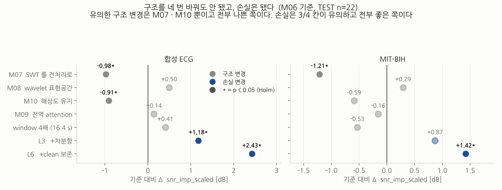

> 그림 5.18. 일곱 가지 변경의 효과를 같은 기준(잔차 U-Net 대비 Δ)으로 한 행씩 나타낸 것이다. 회색은 구조 변경(모델
> 네 개와 분석 창 4 배), 진한 파랑은 손실 함수 변경이다. 파란 점 네 개는 모두 0의 오른쪽에 있고, 회색 점 중 유의한
> 것(SWT 직렬 결합 U-Net · Dilated ResNet)은 모두 0의 왼쪽에 있다. 구조 변경이 유의한 차이를 만든 경우는 있었지만
> 모두 열세 방향이었다. 막대 대신 점을 쓴 이유는 해석의 대상이 0 으로부터의 거리이고 음수 값도 의미가 있기
> 때문이다.
>
> 네 구조 변경을 함께 나타낸 것이 이 그림의 논거이다. 하나만 나타내면 「그 구조가 부적합했다」는 해석과 구분되지
> 않는다.

## 5.11 실시간 처리를 위한 공통 전처리

5.1~5.10 절은 모두 오프라인 처리의 결과이다. 기록 전체를 미리 가지고 있으므로 `filtfilt`(정방향과 역방향으로 한
번씩 필터링)를 적용할 수 있고, 위상 왜곡이 0이다. 실시간 처리에서는 미래 표본을 알 수 없으므로 이 방식을 쓸 수
없다.

### 5.11.1 인과 필터에 의한 QRS 직후 파형 왜곡

인과 고역통과 필터는 QRS군처럼 급격한 변화 뒤에 언더슈트를 남긴다. 이 언더슈트가 S 파 골에 더해져 S 파 부근의
파형이 왜곡되어 보인다. 필터 차수와 차단 주파수를 바꾸어도 이 상충 관계는 해소되지 않는다.

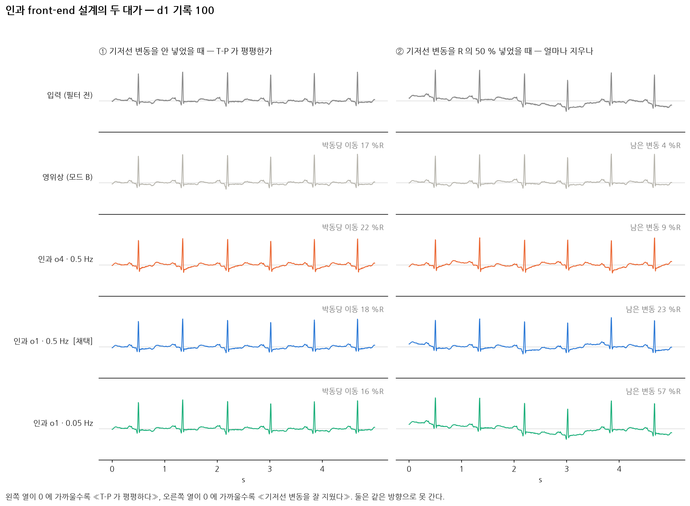

> 그림 5.19. 인과 무한 임펄스 응답(IIR) 필터의 차수와 차단 주파수를 변화시킨 결과. 왼쪽으로 갈수록 기저선 변동을 잘
> 제거하고 오른쪽으로 갈수록 파형을 덜 왜곡하지만, 두 조건을 동시에 만족하는 설정은 없다. 이 상충 관계가 D-19의
> 결론이었으며, 따라서 필터의 형태 자체를 바꾸어야 했다.

> 탐색한 차수 · 차단 주파수 전체와 두 비용을 같은 단위로 비교하는 방법은 `docs/12_causal_fe.md`, 경위는 F-27, 결정은
> D-19에 있다.

### 5.11.2 대안 방식: 미리보기 블록 영위상 필터와 중앙값 필터

미래 표본을 일정 시간 기다린 뒤 그 구간에 `filtfilt`를 적용하면 위상 왜곡은 원리적으로 0이다. 필요한 대기 시간을
측정하였다(`docs/13_lookahead_fe.md`, MIT-BIH 기록 100).

표 5.46. 실시간 공통 전처리 방식별 지연과 왜곡 [%R]

| 방식 | 추가 지연 | 준위 산포 | QRS 직후 준위 이동 | 잔류 변동 |
|---|---:|---:|---:|---:|
| 영위상(오프라인, 실시간 적용 불가) | — | 2.4 | 0.0 | 4.0 |
| 인과 1 차 · 0.5 Hz(기존) | 0 ms | 4.7 | 5.7 | 20.8 |
| 블록 영위상 · 미리보기 0.25 s | 442 ms | 10.1 | 1.3 | 4.7 |
| 블록 영위상 · 미리보기 0.5 s | 692 ms | 1.9 | 0.5 | 4.9 |
| 블록 영위상 · 미리보기 4 s | 4192 ms | 2.3 | 0.2 | 4.1 |
| 중앙값 필터 200 + 600 ms | 496 ms | 1.0 | 4.7 | 2.5 |

미리보기 0.5 s가 경계이다. 0.25 s에서는 역방향 필터링이 안정되지 않아 인과 필터보다 낮고, 0.5 s를 넘으면 더
기다려도 거의 개선되지 않는다.

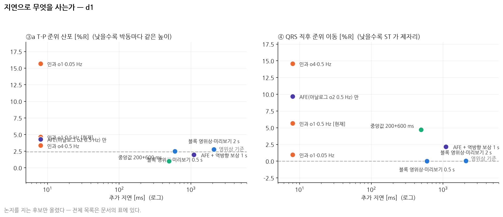

> 그림 5.20. 지연(가로축)과 왜곡(세로축)의 관계. 미리보기 0.5 s에서 곡선이 꺾인다. 그 이전에는 지연을 조금 늘려도
> 왜곡이 크게 줄고, 그 이후에는 지연을 많이 늘려도 거의 줄지 않는다. 필요한 대기 시간이 이 한 점으로 결정된다.

> 후보 전체의 표는 `docs/13_lookahead_fe.md`, 중앙값 필터 캐스케이드와 블록 영위상 필터의 차이는
> `docs/14_median_vs_zerophase.md`에 있다. 두 방식은 평탄도가 나타나는 원리가 다르다.

중앙값 필터 캐스케이드는 다른 측면에서 우수하다. 준위 산포가 1.0 %R로 오프라인 영위상 필터(2.4 %R)보다도 평탄하지만,
QRS 직후 준위를 4.7 %R 이동시킨다.

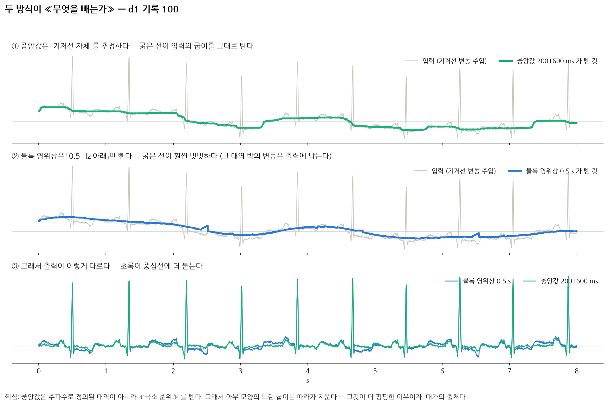

> 그림 5.21. 두 방식이 신호에서 빼는 성분의 비교. 중앙값 필터는 고역통과 필터가 아니라 기저선을 추정하여 빼는
> 방식이다. 따라서 평탄한 구간에서는 기준 신호(회색 선)에 더 가깝지만, 같은 이유로 QRS군 부근에서는 추정값이 S 파와
> ST 분절 쪽으로 치우친다.

### 5.11.3 세 방식의 실시간 전환

어느 왜곡을 더 중요하게 볼지는 사용자가 판단할 문제이므로, 세 방식을 실행 중에 전환할 수 있도록 구현하였다
(`docs/30_realtime_demo.md`). 직류 성분만 제거하고 나란히 나타내면 다음과 같다.

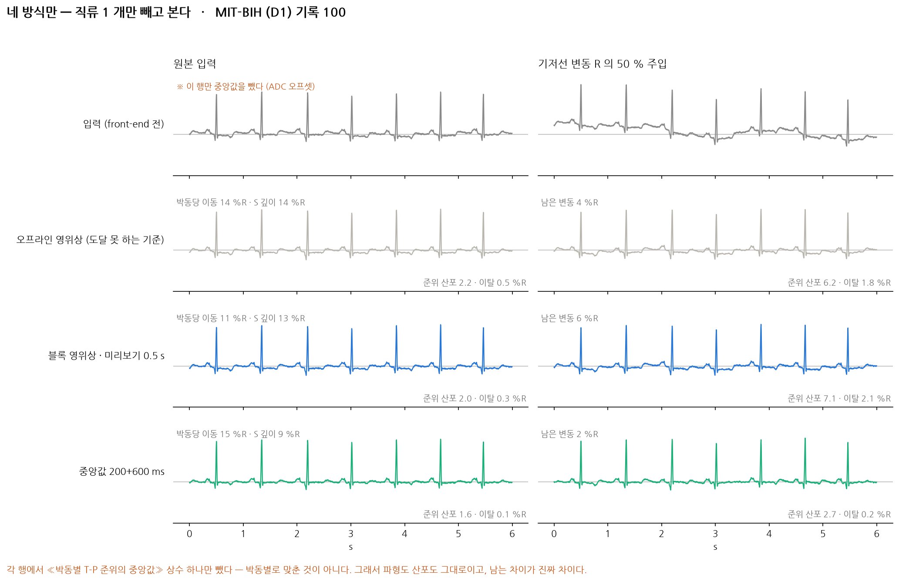

> 그림 5.22. 각 행에서 박동별 T-P 준위의 중앙값 하나만 상수로 뺀 결과. 박동마다 따로 맞추면 준위 산포가 정의상 0이
> 되어 비교하려는 양이 사라지므로 상수 하나만 뺐다. 따라서 파형과 준위 산포는 그대로이며, 남는 차이가 실제 차이이다.
> 세 방식 모두 기준 신호(회색 선)에 가깝고, 차이는 박동 사이의 변동에서만 나타난다.

### 5.11.4 평가 기준의 편향(F-35)

세 방식을 오프라인 기준 총 왜곡으로 비교하였는데, 그 기준 신호가 오프라인 영위상 필터의 출력 자체였다. 블록
영위상 필터는 미리보기를 늘리면 오프라인 영위상 필터로 수렴하도록 정의된 방식이다. 즉 이 지표는 「더 우수한가」가
아니라 「기준 방식과 더 닮았는가」를 측정하고 있었다.

합성 데이터에는 참값이 있으므로 이를 직접 측정할 수 있다. 세 방식이 공통으로 쓰는 40 Hz 저역통과 필터만 적용한
원본을 참값으로 두고(공통 부분은 어느 방식에도 유리하거나 불리하지 않다), 8 개 기록에 50 %R의 기저선 변동을
주입하였다.

표 5.47. 기준 신호에 따른 실시간 공통 전처리 방식의 평가

| | 참값 기준 [dB] | 오프라인 영위상 기준 [dB] | ST 준위 오차 [%R] | 준위 산포 [%R] |
|---|---|---|---|---|
| 인과 1 차 · 0.5 Hz | −22.67 | −23.80 | +0.87 | 21.56 |
| 블록 영위상 0.5 s | −29.78 | −34.98 | −0.20 | 11.18 |
| 중앙값 필터 200 + 600 ms | −30.56 | −28.93 | −2.20 | 4.58 |

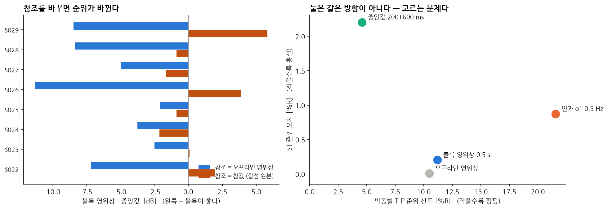

> 그림 5.23. 왼쪽은 기록별 「블록 영위상 − 중앙값 필터」의 차이를 두 기준으로 나타낸 것이다. 파란 막대(오프라인
> 영위상 기준)는 8 개 기록 모두 왼쪽(블록 영위상 우위)이지만, 주황 막대(참값 기준)는 절반이 오른쪽이다. 기준 신호를
> 바꾸면 순위가 바뀐다. 오른쪽은 평탄도와 ST 충실도가 같은 방향으로 변하지 않음을 보여 준다. 둘 중 하나를 선택해야
> 하는 문제이다.

F-33과 같은 유형이지만 한 단계 더 깊은 문제이다. F-33은 기준 신호가 후보와 함께 변하는 문제였고, 이를 고정하여
오프라인 기준 총 왜곡을 정의하였다. 그런데 고정한 기준 신호가 후보 한 계열의 극한이었다. 기준 신호는 고정되어야 할
뿐 아니라 후보 집합의 밖에 있어야 한다.

같은 검토에서 지표 이름 하나의 오류도 확인되었다. 「S 골 오차」는 「그 박동의 T-P 준위 중앙값 − R 파 후 80 ms의
최저점」으로 정의되어 기준 준위가 포함되어 있다. 기준 준위가 필요 없는 R − S 진폭 차로 측정하면 네 방식이 사실상
같다(MIT-BIH 112.2~113.0 %R). 즉 S 파 골 자체를 왜곡하는 방식은 없으며, 측정하던 것은 ST 분절의 이동이었다. 따라서
지표 이름을 「QRS 직후 준위 이동」으로 수정하였다.

그렇다면 무엇을 기준으로 선택해야 하는가. 「평탄할수록 좋다」는 기준은 쓸 수 없다. 합성 ECG 원본에서 인과 방식의
준위 산포가 오프라인 방식보다 작으므로(0.90 대 2.60), 왜곡이 가장 큰 방식이 평탄도 1 위가 된다. 따라서 ECG 판독에서
실제로 쓰이는 양으로 비교하였다. 합성 데이터 8 개 기록에 크기를 아는 10 %R의 ST 상승을 삽입하고 보존율을 측정한
결과, 블록 영위상 필터는 101 ± 2 %, 중앙값 필터는 84 ± 15 %였다. 중앙값 필터가 평탄해 보이는 이유와 ST 분절을
보존하지 못하는 이유는 같다. 200 ms 창이 QRS 직후에서 S 파와 ST 분절 쪽으로 치우치기 때문이다.

### 5.11.5 화면 관찰로 확인된 결함 두 가지(F-36 · F-37)

기존 지표는 모두 신호의 위치(준위)를 측정했고 연속성을 측정하는 지표는 없었다. 그 결과 화면에서만 보이는 결함
두 가지가 남아 있었다.

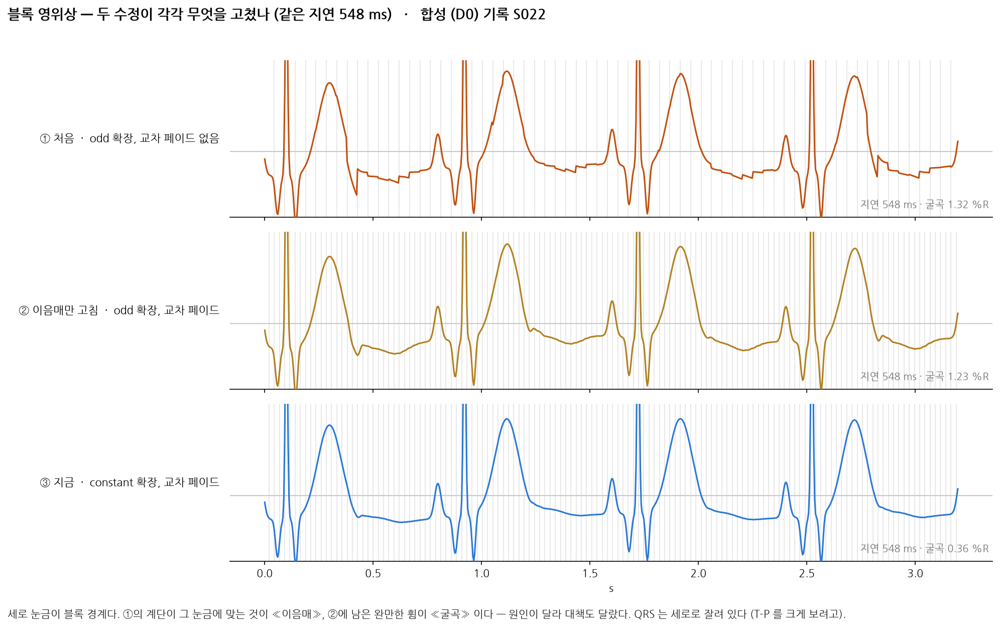

> 그림 5.24. 세로 눈금은 블록 경계이다(세 조건 모두 지연 548 ms로 같다). ①의 계단이 눈금과 일치하는 것이 블록 경계
> 불연속이고, ②에 남은 완만한 휘어짐이 굴곡이다. 두 결함은 원인이 달라 대책도 달랐다. T-P 구간을 확대하기 위해
> QRS군은 세로축 범위 밖으로 잘랐다.

표 5.48. 블록 영위상 필터의 두 결함과 대책

| 결함 | 원인 | 대책 | 결과 |
|---|---|---|---|
| 블록 경계 불연속 | 창마다 유한 구간이 달라, 창이 이동 간격만큼 이동하면 같은 표본의 `filtfilt` 결과가 달라진다 | 겹친 구간에 교차 페이드를 적용하고, 이동 간격을 48 → 24 ms로 줄여 늘어난 지연을 상쇄하였다 | 경계 / 내부 차분 비 23.0 → 0.65 |
| 굴곡 | `filtfilt`의 `odd` 확장이 창 끝의 기울기를 연장하여 가성 경사를 만든다 | 확장 방식을 `constant` 1 s로 변경 | 굴곡 1.231 → 0.366 %R(하한 0.209) |

두 대책 모두 부작용이 거의 없다. 블록 경계 불연속의 수정은 이동 간격을 줄여 지연을 이전과 같게(548 ms) 유지하였고,
굴곡의 수정은 네 지표(굴곡 · 잔류 변동 · ST 차이 · 오프라인 대비 차이)를 모두 개선하였다. 부수적으로 오프라인 기준 총
왜곡의 24 조건 평균이 −2.57 → −1.21 dB로, 공통 전처리 왜곡 비중이 19.8 → 26.2 / 25.9 dB로 높아졌다. 실시간 공통
전처리가 그만큼 오프라인 처리에 가까워졌다는 뜻이다.

> 굴곡 문제에서는 원인을 정확히 찾아도 그것이 곧 대책이 되지 않을 수 있음을 확인하였다. 「미리보기가 짧아 역방향
> 필터링이 안정되지 않는다」는 원인 진단은 옳았지만(미리보기 4 s이면 하한과 구분되지 않는다), 미리보기 시간이 곧
> 지연이므로 그 대책은 쓸 수 없었다. 원인을 확정한 뒤에도 이를 우회하는 다른 조정 수단(창 확장 방식)을 별도로 찾아야
> 했다.

### 5.11.6 소결: 평평함과 ST 충실도의 선택

표 5.49. 실시간 공통 전처리 세 방식의 비교

| | 평탄도(준위 산포) | ST 충실도 | 추가 지연 |
|---|---|---|---|
| 인과 1 차 · 0.5 Hz | 낮음(21.6) | 낮음(+0.9) | 0 ms |
| 블록 영위상 0.5 s | 보통(11.2) | 가장 높음(−0.2) | 548 ms |
| 중앙값 필터 200 + 600 ms | 가장 높음(4.6) | 낮음(−2.2) | 424 ms |

인과 방식이 3 위라는 점은 어느 기준에서도 같다. 1 · 2 위는 기준 신호의 선택에 따라 달라지므로, 세 방식을 화면에서
전환할 수 있도록 하였다. 본 연구는 진단 기기가 아니므로 ST 준위를 반드시 보존해야 할 양으로 규정할 근거는 없으며,
무엇을 보존할지는 사용 목적에 따른 판단이다.

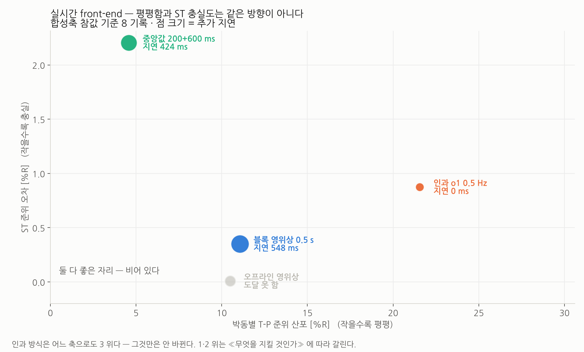

> 그림 5.25. 표 5.49를 한 장으로 나타낸 것이다. 가로축은 평탄도(준위 산포, 작을수록 평탄), 세로축은 ST 충실도
> (오차, 작을수록 충실)이고 점의 크기는 추가 지연이다. 왼쪽 아래가 두 조건을 모두 만족하는 영역인데 그 영역이 비어
> 있다는 것이 핵심이다. 평탄도와 ST 충실도는 같은 방향으로 변하지 않는다. 인과 방식은 어느 데이터에서도 3 위이고,
> 1 · 2 위는 무엇을 보존할 것인가에 따라 달라진다. 오프라인 영위상 필터는 지연이 없는 점이 아니라 실시간으로 도달할
> 수 없는 점이다.

## 5.12 공통 전처리를 제외한 딥러닝 학습(F-34 · F-38 · F-39)

5.11 절은 어떤 공통 전처리를 쓸 것인가의 문제였다. 이 절은 공통 전처리를 쓰지 않고 모델이 전처리까지 학습하도록
하면 어떻게 되는지를 검토한다. 입력에서만 공통 전처리를 제외하고(`frontend: false`) 학습 목표는 그대로 공통 전처리를
거친 기준 신호로 두었다. 학습 목표까지 원신호로 두면 MIT-BIH의 기준 신호가 원본 기록이 되어 F-12의 문제가 다시
발생하기 때문이다.

> 기준 신호의 선택과 공통 전처리 없는 학습을 함께 검토한 문서는 `docs/15_reference_and_training.md`이다. 직접 작성한
> 문서이며 인용한 수치는 모두 `docs/13_lookahead_fe.md` · `docs/14_median_vs_zerophase.md`에서 가져왔다. 이 절의 실험
> 설계는 그 문서에서 나왔다.

### 5.12.1 학습 기록 비교의 한계

표 5.50. 학습 기록의 검증 SNR 개선량

| | 검증 SNR 개선량 |
|---|---|
| 잔차 U-Net + MSE 손실(공통 전처리 적용) | +3.44 dB |
| 잔차 U-Net + MSE 손실(공통 전처리 제외) | +9.56 dB |

학습 기록상의 개선량은 세 배 차이가 나지만, 이는 기법 간 차이가 아니라 개선량 계산의 기준 입력이 다르기 때문이다.
SNR 개선량은 각 학습에 주어진 입력을 기준으로 계산된다. 공통 전처리를 적용한 학습의 입력은 이미 기저선 변동이
제거되어 있으므로, 적용하지 않은 학습의 개선량에는 기저선 변동 제거분이 더해진다. F-10이 같은 유형의 오류였다.

### 5.12.2 동일 기준의 2×2 비교

평가 집합은 이미 공정하게 구성되어 있다. 입력은 원본 + 잡음, 기준 신호는 공통 전처리를 거친 무잡음 신호로 둘 다
기법과 무관하며, 공통 전처리는 각 기법의 내부에 있다. 모델 2 종 × 손실 함수 2 종으로 네 쌍을 학습하였다.

표 5.51. 공통 전처리를 제외했을 때의 SNR 개선량 감소 [dB]

| 조합 | −5 | 0 | 5 | 10 | 15 | 20 |
|---|---|---|---|---|---|---|
| 잔차 U-Net + MSE 손실 | +1.51 | +1.67 | +1.99 | +2.54 | +3.19 | +3.80 |
| 잔차 U-Net + 무잡음 입력 보존 손실 | +1.10 | +1.42 | +1.87 | +2.80 | +4.42 | +6.45 |
| 웨이블릿 부대역 U-Net + MSE 손실 | +1.08 | +1.48 | +2.15 | +2.92 | +3.90 | +4.83 |
| 웨이블릿 부대역 U-Net + 무잡음 입력 보존 손실 | +1.44 | +1.54 | +1.94 | +2.73 | +4.12 | +5.98 |

네 쌍 모두 모든 입력 SNR에서 공통 전처리를 적용한 학습이 더 높다. 또한 입력의 잡음이 적을수록 격차가 커진다. 잡음
제거 능력의 부족이 아니라 체계적인 차이라는 뜻이다.

### 5.12.3 손실 함수 요인의 분리

잔차 U-Net + MSE 손실과 웨이블릿 부대역 U-Net + 무잡음 입력 보존 손실의 두 쌍만 비교하면 「용량이 큰 모델일수록
공통 전처리를 제외했을 때 손실이 크다」로 해석될 수 있다. 그러나 두 쌍은 모델과 손실 함수가 동시에 달라 두 요인을
분리할 수 없었다. 나머지 두 조합을 학습하여 2×2 설계로 분해한 결과는 다음과 같다(입력 SNR 20 dB).

표 5.52. 공통 전처리 제외에 따른 감소량의 요인 분해(입력 SNR 20 dB)

| 요인 | 결과 |
|---|---|
| 손실 함수 효과(`L6` − `L1`, 같은 모델) | 잔차 U-Net +2.65, 웨이블릿 부대역 U-Net +1.15. 둘 다 양수 |
| 모델 효과(`M08` − `M06`, 같은 손실 함수) | MSE 손실 +1.03, 무잡음 입력 보존 손실 −0.47. 부호가 다르다 |

손실 함수의 효과가 약 7 배 크고 방향도 일정하다. 격차가 가장 큰 조건은 웨이블릿 부대역 U-Net + 무잡음 입력 보존
손실이 아니라 더 작은 모델인 잔차 U-Net + 무잡음 입력 보존 손실(+6.45 dB)이다.

무잡음 입력 보존 손실 `L6 = L3 + λ‖model(clean) − clean‖²`의 둘째 항은 무잡음 입력에서 출력이 입력과 같도록 하는
항이며, 입력과 학습 목표가 같은 대역일 때만 타당하다. 공통 전처리를 제외한 학습에서는 입력이 원신호이고 학습 목표가
공통 전처리를 거친 신호이므로, 이 항의 전제가 성립하지 않는다.

### 5.12.4 공통 전처리 제외 시 설계 간 차이의 축소

표 5.53. 입력 SNR 20 dB에서 네 조합의 SNR 개선량 [dB]

| | 값 [dB] | 범위 |
|---|---|---|
| 공통 전처리 적용 | 11.72 · 15.34 · 12.98 · 14.88 | 3.61 dB |
| 공통 전처리 제외 | 7.93 · 8.89 · 8.15 · 8.90 | 0.97 dB |

모델과 손실 함수를 바꾸어 얻는 차이가 3.6 dB에서 1.0 dB로 줄어든다. 성능의 병목이 설계에서 「전처리를 스스로
근사하는 능력」으로 옮겨 가며, 그 능력은 네 조합이 비슷하다. 모델과 무관한 오차 하한이 있다는 뜻이다.

QRS 폭 오차에서 이 경향이 가장 분명하다(20 dB). 공통 전처리를 적용한 무잡음 입력 보존 손실(L6) 학습만 10.3 / 12.7
ms로 다른 조합의 절반 이하이지만, 공통 전처리를 제외하면 23.5 / 26.8 ms로 MSE 손실(L1) 수준(22.6~26.7 ms)이 된다.
MSE 손실 학습은 원래 이 장점이 없으므로 감소 폭도 작다(+1.7, +2.9 ms).

> 목적이 기법 간 우열의 판정(공정성 규약)이든 달성 가능한 최고 성능이든, 두 경우 모두 공통 전처리를 유지하는 것이
> 타당하다. 실용적 규칙은 「큰 모델일수록 공통 전처리가 중요하다」가 아니라(처음에 그렇게 해석했다가 2×2 설계로
> 수정하였다) 「무잡음 입력 보존 손실처럼 입력과 학습 목표가 같은 대역임을 전제하는 손실 함수를 쓸 때는 공통
> 전처리를 제외해서는 안 된다」이다. 이 체크포인트들은 공정성 규약 4.2를 의도적으로 위반하는 조건이므로 주 결과표에는
> 넣지 않는다(별도 경로 `results/d1/exp_nofe`).

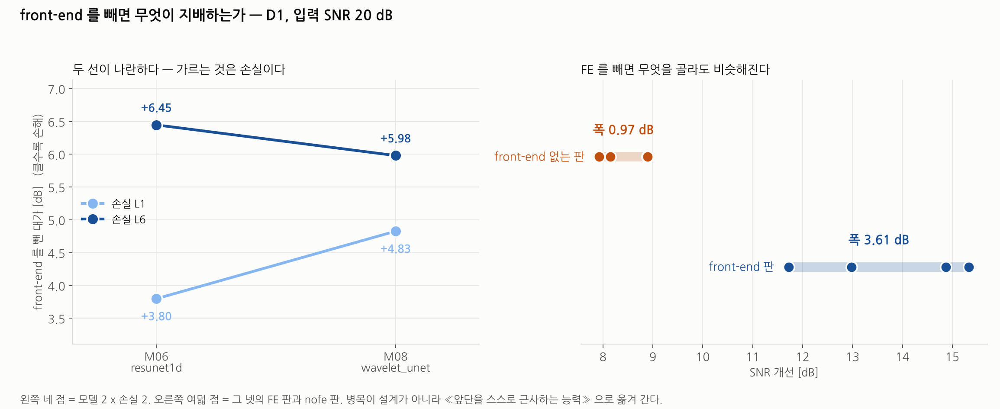

> 그림 5.26. 왼쪽은 2×2 설계의 네 조합을 점으로 나타낸 것이다. 가로축은 모델, 세로축은 공통 전처리 제외에 따른
> 감소량이며 같은 손실 함수끼리 선으로 이었다. 두 선이 위아래로 나란히 놓이므로, 결과를 가르는 요인은 모델(가로축)이
> 아니라 손실 함수(선의 높이)이다. 오른쪽은 20 dB에서 여덟 학습의 결과를 두 띠로 나타낸 것이다. 공통 전처리를 적용한
> 학습의 띠는 넓고(3.61 dB) 제외한 학습의 띠는 좁다(0.97 dB). 공통 전처리를 제외하면 어떤 설계를 선택해도 결과가
> 비슷해진다는 것이 띠 폭으로 나타난다.

# 6. 연구 과정의 방법론적 발견

이 장의 내용은 방법론 측면에서 결과 자체보다 더 중요할 수 있다. 모든 항목에 측정 근거와 회귀 시험이 있다. 번호
역순(나중에 발견한 것부터)으로 싣는다. 여기에는 요약만 싣고, 전체 기록은 `docs/20_findings.md`에 있다. 전체 기록에는
각 항목의 발단(무엇이 이상해 보였는가), 먼저 의심했다가 배제한 가설, 결정적 측정, 이 검증이 없었다면 보고되었을
결과가 정리되어 있다. 결과를 바꾸지 않은 운영 사고는 `docs/22_incidents.md`, 설계 결정은 `docs/21_decisions.md`에
있다.

F-35 · F-33 · F-17 · F-16 · F-15 · F-12 · F-11 · F-10 · F-8은 성격이 같다. 기법이 아니라 측정의
틀이 잘못된 경우이며, 이 아홉 건은 모두 정상으로 보이는 결과표를 만들었고 표만으로는 오류가 드러나지
않았다. 8 장 끝의 방법론적 요약에서 이 유형을 따로 정리하였고, 그림 S14가 아홉 건과 각 오류를 발견한
단서를 한 장에 보인다.

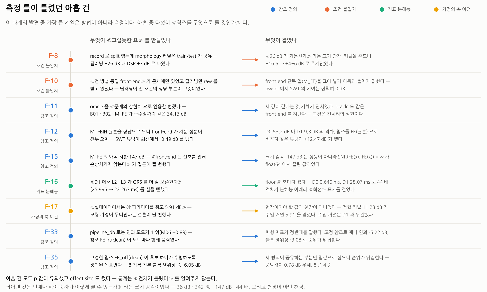

> 그림 6.1. 아홉 항목을 개별 요약이 아니라 하나의 유형으로 정리한 것이다. 왼쪽은 그럴듯한 결과표를 만든 조건,
> 오른쪽은 그 오류를 발견한 단서이며 색은 오류의 유형이다. 아홉 건 중 다섯 건이 기준 신호의 정의에 관한
> 것이다(`F-11` · `F-12` · `F-15` · `F-33` · `F-35`). 본 연구에서 가장 자주 오류가 발생한 부분은 기법이나 모델이
> 아니라 비교 기준의 설정이었다. 각 항목의 전체 기록은 아래 해당 절과 `docs/20_findings.md`에 있다.

## F-58. 칼만 필터의 가성 QRS군 생성: 위양성 검출 수는 공통 전처리와 같으나 출력 파형이 박동 형태를 띤다

가성 파형 생성 검증의 에너지와 잡음 종류별 손실 효과 실험(EXP-G)의 위양성 검출 수로는 칼만 필터(M05)가 중간
수준이었다. 그러나 두 지표는 잔류 잡음과 박동 형태의 가성 파형을 구분하지 않는다. 위양성 검출 위치 ±200 ms의 출력이
그 출력의 평균 박동 파형과 얼마나 닮았는지를 측정한 결과(D-42, 저 SNR · 백색 잡음 · 혼합 잡음 · 22 기록), MIT-BIH에서
박동 형태의 가성 파형은 칼만 필터 213 건, SWT 임계값 처리(M04) 9 건, 잔차 U-Net(M06) 20 건, 공통 전처리 단독(M_FE)
0 건이었다. 판정 임계값을 0.7 또는 0.9로 바꾸어도 순위가 같고, 22 기록 중 21 기록에서 나타난다. 원인은 입력에서
검출한 R파 위치에 위상을 맞추는 구조에 있다. 검출이 틀린 위치에 평균 박동 파형의 QRS군이 그려진다. 그림은
`S15_kalman_phantom`이다.

> 이 측정이 없으면 칼만 필터는 가성 파형 생성 검증의 에너지 지표만으로 평가되어 중간 수준으로 보고된다.
> 칼만 필터의 오류는 실제 박동과 구분하기 어려운 형태로 나타나며, 에너지와 검출 수로는 드러나지 않는다.
> 상세 기록은 `docs/20_findings.md` F-58.

---

## F-57. 선행 연구 처방 두 가지의 미적용: 정규화의 최적화 기여와 검증 성능 변동의 무영향

선행 연구 대조(`docs/36_related_work.md` §6)에서 두 가지 처방을 골라 측정하였다(D-41, 시드 0~3). EDSR처럼
GroupNorm을 제거하면 MSE 손실(L1)의 전 구간 합이 −1.35 dB, 15~20 dB 구간이 −1.56 dB 였고(네 시드 모두 감소), 무잡음
입력 보존 손실(L6)도 전 구간 합이 −0.64 dB였다. 학습 손실이 더 높은 값에서 수렴하였으므로, 정규화는 정보 전달을
방해한 것이 아니라 최적화를 돕고 있었다. 가중치 지수이동평균(EMA, decay 0.995)은 검증 성능의 epoch 간 변동을 1/6
로 줄였지만, 고정 평가 집합의 결과는 같은 환경 기준 ±0.06 dB 이내였다.

> 이 검증이 없었다면 「정규화 제거와 가중치 지수이동평균으로 성능을 더 높일 수 있다」가 향후 과제로 보고되었을 것이다.
> 또한 검증 성능의 변동[^F-19]은 최고 성능 epoch을 잘못 선택해 잃는 성능이 아니라 측정 쪽의 잡음이었다. 전체 기록은
> `docs/20_findings.md` F-57, 설계는 `docs/21_decisions.md` D-41에 있다.

---

## F-56. L6이 유효한 세 조건: 무잡음 입력, MAE 오차 측정, 출력단 잔차 연결

5.8.9 절은 무잡음 입력 보존 손실(L6)의 개선을 「무잡음 입력을 덜 변형하도록 학습시켰다」로 설명하였다. D-40은 이
설명을 세 요인으로 분해하였다(무잡음 입력의 출력 SNR: 무잡음 구간을 입력했을 때의 출력 SNR).

표 6.1. 무잡음 입력 보존 손실의 구성 요인별 무잡음 입력의 출력 SNR [dB]

| | 출력단 잔차 연결 있음 | 출력단 잔차 연결 없음 |
|---|---:|---:|
| `L1` | 약 26.7 | 약 23.9 |
| `L1` + MSE 무잡음 항(`L1C`) | 약 31 | — |
| `L6`(MAE를 포함한 무잡음 항) | 약 47.8 | 약 30.9 |

무잡음 입력을 추가하는 것만으로는 +4 dB이고, 그 작은 오차를 평균절대오차(MAE)로 측정해야 +21 dB가 된다. 출력단
잔차 연결을 제거하면 같은 무잡음 입력 보존 손실이 +7 dB에 그친다. MSE는 작은 오차에서 기울기가 거의 0이어서
출력을 입력과 완전히 같게 만들 만큼 학습을 유도하지 못하고, 잔차 연결이 없으면 입력을 그대로 내보내는 것이 단순한
출력이 아니다. 출력단 잔차 연결을 제거하면 입력 SNR 15~20 dB 구간에서 SNR 개선량이 1.6~2.2 dB 감소하였으며, 이는 본
연구에서 측정한 구조 변경 중 가장 큰 감소 폭이다.

> 이 검증이 없었다면 「무잡음 입력으로 항등 사상을 학습시켰다」가 설명으로 남았을 것이다. 또한 손실 함수의 항등 항과
> 잔차 연결은 선택의 문제가 아니었다. 잔차 연결이 있어야 손실 함수의 항이 효과를 낸다. 입력 SNR 대역별 지표에서의
> 상호작용은 사전 규칙에 따라 판정 불가이다. 전체 기록은 `docs/20_findings.md` F-56, 설계는 `docs/21_decisions.md`
> D-40에 있다.

---

## F-55. 용량 증가의 효과와 참조 신호의 순도

폭 · 깊이 · 블록 수를 늘려도 성능이 변하지 않았고, 학습 손실도 모델 크기와 무관하게 0.0012~0.0013에서 수렴하였다.
원인을 구분하기 위해 두 가지 시험을 수행하였다[^D-38].

첫째, 암기 시험이다. 256 개 분석 창에 잡음을 한 번만 생성하여 고정하면 입력이 학습 목표를 완전히 결정한다. 이
조건에서 ¼ 용량 모델(245 K)도 MSE 0.00008, 원래 용량 모델은 0.00003까지 학습 데이터를 암기한다. 정상 학습 하한의
1/16 ~ 1/40이다. 같은 ECG에 잡음만 새로 생성하면 오차가 27~55 배로 증가한다. 즉 용량과 최적화는 병목이 아니며,
하한은 잡음을 새로 생성할 때 생기는 입력으로 예측할 수 없는 성분이다. 예외가 하나 있다. 잔차 블록을 4 배로 쌓은
모델(1.85 M)은 같은 학습량에서 원래 모델보다 암기 성능이 낮다. 따라서 깊이 방향의 판정 불가 결과에는 학습 부족의
영향이 섞여 있을 수 있다.

둘째, 무잡음 기준 신호에서의 용량 효과이다. 같은 MIT-BIH Noise Stress Test Database(NSTDB) 잡음을 쓰고 기준 신호만
합성 신호(잡음 없음)로 바꾸면, 원래 용량 − ¼ 용량의 차이가 +1.342 dB(네 시드 모두 양수, p = 0.012)이며 모든 입력
SNR 구간에서 양수이다(−5~0 dB +0.87 … 15~20 dB +1.82). MIT-BIH 기준 신호에서는 +0.519 dB(p = 0.18)였다.

> 이 검증이 없었다면 「ECG 잡음 제거 딥러닝은 파라미터 1 M에서 포화한다」가 모델의 한계로 보고되었을 것이다. 모델
> 용량을 늘려도 오차는 줄지 않았으나, 기준 신호를 무잡음 합성 신호로 바꾸자 용량 증가의 효과가 나타났다(+1.342 dB).
> 따라서 성능의 상한을 정한 요인은 기준 신호의 정의로 판단된다.
>
> 확정하지 않는 부분도 있다. 두 데이터의 차이(+0.822 dB)는 사전 기준(0.7 dB)을 넘었지만 그 자체의 p 값은 0.079이다.
> 또한 합성 ECG와 MIT-BIH는 기준 신호의 순도뿐 아니라 ECG 형태도 다르며, 이 교란 요인은 사후에 발견하였다. 전체
> 기록은 `docs/20_findings.md` F-55, 설계와 사전 예측은 `docs/21_decisions.md` D-38에 있다.

순도만 바꾸어 확인한 결과 주요 요인은 ECG 형태였다(D-39 E2′). 합성 ECG 기록에 20 dB의 고유 잡음을 넣어 기준 신호에
잡음이 포함되도록 해도 원래 용량 − ¼ 용량의 차이는 +1.113 dB(p = 0.002)로 유지된다. 무잡음일 때(+1.342 dB)보다
시드 대응 차이로 +0.228 dB만 줄었다(p = 0.37). 사전 규칙(감소 < 0.25 dB)에 따라 기준 신호의 잡음은 주원인이 아니며,
합성 데이터와 실측 데이터의 차이는 대부분 ECG 형태 분포의 차이에서 비롯된다. 15~20 dB 구간에서만 개선량이 +1.82
→ +1.22 dB로 뚜렷하게 줄어, 순도의 영향은 방향은 맞지만 크기가 작다. 사전 예측(감소 ≥ 0.5 dB)은 틀렸다.

---

## F-54. 보드 표본화율 설정(--board-fs)이 적용되지 않을 때의 시간축 오류

브리지의 `--board-fs 250` 옵션은 보드에 1 바이트(`'2'`)를 보내는 동작만 수행하며, 보드가 실제로 그 표본화율로
동작하는지는 확인하지 않았다. 이 명령을 처리하지 못하는 스케치가 설치된 보드를 가상 아두이노로 재현하여 연결한
결과, 손실 0 · 오류 0 · 재동기화 0으로 20 초 분량을 처리하면서 화면에는 39.6 초 분량을 표시하였다. R-R 간격이 두
배가 되어 심박수가 절반으로 보인다. 통신 계층에는 이상이 없었다. 프레임은 정상이고 일련번호(`seq`)도 연속이다. 틀린
것은 표본들의 시간 길이 하나였다.

브리지가 보드의 실측 표본화율을 계산하여 `--board-fs`와 5 % 이상 다르면 경고하도록 수정하였다. 전체 기록과 회귀
시험은 `docs/20_findings.md` F-54에 있다.

---

## F-53. 겹쳐 그리기 화면에서 입력 신호가 보이지 않은 원인: 세로축 범위 설정

`live.html`의 겹쳐 그리기 화면에서 잡음이 섞인 입력만 표시되지 않았고, 다른 기법을 모두 꺼야 표시되었다. 원인은
그리기가 아니라 세로축 범위였다. 입력의 중심은 +2.32 mV(AD8232가 출력을 전원 전압의 중간에 두는 것을 전극 전압으로
환산한 값)인데 출력들은 0 부근에 있었고, 겹쳐 그리기의 세로축은 출력만으로 범위를 정해 반높이가 0.42 mV였다. 입력의
중심은 이 축에서 반높이의 +4.6 배 위치로 화면 밖에 있었다. 진폭은 같았다(MAD 0.090 대 0.085).

이득은 그대로 두고 신호별 중심만 뺐다. 같은 단위의 신호를 이득으로 나누면 잡음이 얼마나 제거되었는지를 눈으로
비교할 수 없는데, 그 비교가 겹쳐 그리기의 목적이다. 중심의 차이는 신호가 아니라 회로의 기준 전위이므로 빼도 잃는
정보가 없다.

같은 축이라는 조건은 같은 이득과 같은 중심의 두 가지로 이루어진다. 둘을 하나로 다루면 하나만 필요할 때 나머지까지
포기하게 된다. 전체 기록은 `docs/20_findings.md` F-53에 있다.

## F-52. 공통 전처리 전환 후 화면 갱신 중단과 신호 표시 위치 오류

두 결함이 함께 나타났다. 공통 전처리를 전환한 뒤 화면이 다시 갱신되지 않아 창을 새로 열어야 했고, 새 창에서는
스크롤 모드인데도 신호가 오른쪽 끝이 아니라 화면 중간에서 나타나 잠시 뒤 오른쪽과 합쳐졌다. 원인은 두 가지였다.

첫째, 전환 알림만 `Hub.publish`에 이미 직렬화된 JSON 문자열로 전달되어, 전송 단계에서
`data: "{\"reset\": true, …}"`처럼 이중으로 직렬화되었다. 브라우저가 해석한 결과가 객체가 아니라 문자열이어서 전환
처리 전체가 실행되지 않았고, 이어서 `cap`이 `NaN`이 되며 예외가 발생하였다. 둘째, 버퍼는 절대 인덱스의 나머지로
기록하는데 유효성은 받은 표본의 개수로 판정하였다. 스트림 중간에서 시작하면 둘이 어긋난다. 인덱스 `i₀`에서 창을
열면 받은 개수가 `i₀ mod cap`을 넘을 때까지 아무것도 표시되지 않고, 그 뒤에는 화면 위치 `cap − (i₀ mod cap)`에서
왼쪽으로 자란다. 관측된 화면과 일치한다. 전환 시 브리지가 인덱스를 다시 시작하므로(측정: `i`가 9160 → 1024) 최대
10 초 동안 화면이 빈다.

브리지는 dict를 그대로 전달하도록 수정하고, dict가 아니면 즉시 오류를 내도록 하였다. 화면은 유효성 판정의 기준을
개수에서 절대 인덱스로 바꾸었다(`demo/live_axis.js`).

개수와 위치를 같은 변수로 다루면 시작점이 0 일 때만 올바르게 동작한다. 또한 직렬화는 한 번만 수행해야 한다. 이중
직렬화는 예외를 내지 않고 조용히 잘못된 결과를 만든다. 전체 기록은 `docs/20_findings.md` F-52에 있다.

## F-51. 세로축 이득의 재진동: 단계 간격이 히스테리시스 폭보다 넓은 문제

F-32를 수정한 뒤 같은 증상이 다시 보고되었다. F-32의 조치는 「1-2-5 단계 + `+10 %/−45 %` 허용 범위」였는데, 두
값은 서로 모순된다. 단계의 최대 간격은 `2 → 5`, 즉 2.5 배인데 허용 범위의 폭은 `1.10/0.55` = 2.0 배이다. 단계
간격이 허용 범위보다 넓으면 한 단계 올라간 직후에 내려가는 조건을 만족한다. 예를 들어 `r.s = 2.3`이면 2에서 5로
올라가지만, 새 단계에서 `2.3 < 5 × 0.55`이므로 곧바로 내려가는 조건이 된다. 그 결과 이득이 `2 ↔ 5`를 2.5 배씩
반복해서 오가고, 중심값이 폭의 1/4 격자에 맞춰져 있어 위아래로 함께 흔들린다.

먼저 불변 조건(허용 범위 > 단계 간격)을 정하고 상수를 선택하였다. 단계를 1 · 1.5 · 2 · 3 · 5 · 7.5(간격 1.67 배),
허용 범위를 `[0.42, 1.00]`(폭 2.4 배)로 두고, 재설정 시 1.25 배의 여유와 최소 유지 시간 2 초를 추가하였다. 진폭이
±12 %로 변하는 160 s 신호에서 이득 변경이 71 회에서 0 회로 줄었다(`tests/test_live_axis.py`). 단계를 촘촘히 한
부수적 효과도 있다. 1-2-5 단계에서는 필요한 폭의 2.5 배까지 범위를 잡아 파형이 화면의 40 %만 사용했지만, 수정 후에는
48~80 %를 사용한다.

양자화와 히스테리시스는 허용 범위가 단계 간격보다 넓을 때만 의도대로 동작한다. 두 값을 따로 정하면 오류가 드러나지
않고, 진폭이 어느 단계 부근에 있는지에 따라 정상으로 보이는 경우도 있어 오래 발견되지 않는다. 상수를 정하기 전에
불변 조건을 먼저 적고 그것을 시험으로 남겨야 한다. 전체 기록은 `docs/20_findings.md` F-51에 있다.

---

## F-47. SNR 조건화와 L6의 효과 중첩

F-45의 SNR 조건화(15~20 dB 구간 +1.778 dB)와 무잡음 입력 보존 손실(L6, MSE · MAE · 미분 손실(L3)에 무잡음 입력의
보존 항을 더한 것)은 각각 측정하면 둘 다 효과가 크다. 그런데 두 방법이 모델에 전달하는 정보는 같다. 무잡음 입력
보존 손실은 손실 함수로, SNR 조건화는 입력으로 「현재 입력의 잡음이 적다」는 정보를 전달한다. 따라서 둘을 함께
적용했을 때 효과가 더해지는지를 2×2 설계로 측정하였다(4 조건 × 시드 0~5 = 24 회 학습).

표 6.2. SNR 조건화와 무잡음 입력 보존 손실의 2×2 설계 결과 [dB]

| 조건 | 손실 함수 | SNR 조건화 | 전 구간 합 | 15~20 dB |
|---|---|---|---:|---:|
| `m06_l1` | `L1` | 없음 | 3.853 | −1.878 |
| `m06_l6` | `L6` | 없음 | 5.375 | +1.640 |
| `m06_cond` | `L1` | 있음 | 4.141 | +0.003 |
| `m06_cond_l6` | `L6` | 있음 | 5.343 | +1.833 |

어느 한쪽만 적용해도 15~20 dB 구간의 개선량이 0 부근까지 올라오고, 둘 다 적용해도 더 높아지지 않는다. 같은
시드끼리 대응 비교하면 무잡음 입력 보존 손실 단독은 +3.518 dB(p = 0.0002), SNR 조건화 단독은 +1.881 dB(p = 0.0008)
이지만, 무잡음 입력 보존 손실에 SNR 조건화를 더해 얻는 개선은 +0.193 dB(p = 0.14)이고 전 구간 합에서는 −0.033 dB(p
= 0.75)이다. 효과 중첩의 크기는 15~20 dB 구간의 상호작용 −1.688 dB(95 % 신뢰구간 [−2.407, −0.969])이며, 0과 사전에
정한 ±0.5 dB 범위를 모두 벗어난다.

즉 두 방법은 독립된 두 가지 개선이 아니라 같은 문제에 대한 두 가지 해결책이다. 그 문제는 F-43에서 규명한 것으로,
하나의 모델이 전 대역을 학습하여 고 SNR 입력을 과도하게 변형하는 것이다.

> 이 검증이 없었다면 「손실 함수로 +1.5 dB, SNR 조건화로 +1.8 dB를 개선하며 둘을 함께 쓰면 더 높아진다」가 보고되었을
> 것이다. 두 개선을 각각 측정했고 둘 다 유의하므로 자연스러운 추론이지만, 실제로는 함께 적용해도 무잡음 입력 보존
> 손실 단독과 구분되지 않는다. 따로 측정한 효과는 더할 수 없다.
>
> 전 구간 합에서는 동등성을 주장할 수 없다. 전 구간 합의 상호작용 −0.320 dB는 허용 범위 안이지만 95 % 신뢰구간이
> [−0.803, +0.163]이고 TOST(±0.5 dB)의 p 값이 0.192로 동등성이 성립하지 않는다. p > 0.05는 동등성의 증거가 아니라는
> 원칙을 사전에 적어 두었는데도 이 오류를 범할 뻔하였다. 전체 기록과 다중 비교에 관한 단서는 `docs/20_findings.md`
> F-47, 실험 설계는 `docs/21_decisions.md` D-28 3 번에 있다.

---

## F-46. 조건 SNR 오차의 비대칭 비용(과소 추정 쪽이 약 6 배 크다)

F-45의 SNR 조건화는 실제 입력 SNR을 사용했지만, 추론 시에는 실제 값을 알 수 없다(이상적 조건이다). 추정값으로
바꾸었을 때의 손실을 그대로 측정하면 추정기의 오차와 잘못된 조건값의 비용이 섞인다. 추정기의 오차는 F-13에서 이미
측정했으므로(편향 +7.59 dB, 과대 추정), 잘못된 조건값의 비용만 측정하였다. 같은 가중치에서 조건값만 바꾸었다.

표 6.3. 조건 SNR 오차에 따른 SNR 개선량의 변화(시드 0~5, 6 회 학습) [dB]

| 조건 SNR 오차 [dB] | −8 | −5 | −2 | 0 | +2 | +5 | +8 |
|---|---:|---:|---:|---:|---:|---:|---:|
| 전 구간 합 Δ | −1.033 | −0.620 | −0.218 | — | +0.140 | +0.144 | −0.135 |
| 15~20 dB Δ | −2.082 | −1.219 | −0.402 | — | +0.210 | +0.119 | −0.392 |
| 감소한 시드 수 | 6/6 | 6/6 | 6/6 | — | 0/6 | 1/6 | 5/6 |

같은 8 dB의 오차에서 조건값을 낮게 주면 −1.033 dB, 높게 주면 −0.135 dB로 7.6 배 비대칭이다. 음의 방향 세 조건은
모두 6/6 · p ≤ 0.0005로 결과가 확실하며, 목표 대역(15~20 dB)이 가장 민감하다. F-45의 개선이 이 대역에 집중되어
있으므로 손실도 이 대역에서 가장 크다.

방법론적으로 중요한 부분은 측정 범위를 넓힌 것이다. 처음 ±5 dB로 측정했을 때는 +5 dB에서 개선이 나타나 「과대
추정은 비용이 없으므로 F-13의 +7.59 dB 편향은 무해하다」로 해석될 뻔하였다. 그러나 +5 dB의 개선이 더 커지지 않아
곡선이 꺾이는 중이었다. ±8 dB로 범위를 넓혀 다시 측정하자 `+8 − +5` = −0.279 dB(95 % 신뢰구간 [−0.372, −0.186],
6/6)로 꺾임이 확정되었다. 외삽했다면 인용하려던 바로 그 지점에서 틀렸을 것이다.

다만 「+8 dB에서 부호가 음으로 바뀐다」는 시드 6 개에서도 주장할 수 없다. −0.135 dB의 p 값이 0.176이다. 주장할 수
있는 것은 곡선의 꺾임까지이며, 시드 2 개일 때 「부호가 바뀐다」고 적었던 것을 여기서 한정한다.

또한 +2 dB는 실제 값보다 높다. 전 구간 합 +0.140 dB(감소 0/6, p = 0.0036), 15~20 dB +0.210 dB(0/6, p = 0.0052)이며
저하된 대역은 없다. 시드 2 개일 때는 「양의 방향 대역값은 시드 간 변동을 넘지 못한다」고 판단해 해석하지 않았던
결과가 +2 dB에서는 성립한다(+5 dB 이상은 여전히 변동을 넘지 못한다). 조건화된 모델도 자기 동작 조건에서 입력을 아직
조금 과도하게 변형한다는 뜻이다. 크기는 구조 효과(0.29~0.39 dB)보다 작아 성능 개선으로 보고하지 않으며, 의미가 있는
것은 방향이다.

> 측정 범위 밖은 측정하지 않은 영역이다. 인용하려는 지점이 측정 범위 안에 있는지부터 확인해야 한다. 실제 결론은
> 「무해하다」가 아니라 「작지만 0은 아니다」(+7.59 dB에서 전 구간 합 약 −0.10 dB)이며, 같은 크기의 과소 추정보다 비용이
> 7.6 배 작다는 것이다. 전체 기록과 답할 수 없는 문제(상수 편향, 백색 가우시안 잡음(AWGN) 조건의 편향, MIT-BIH 한
> 데이터에 한정)는 `docs/20_findings.md` F-46, 실험 설계는 `docs/21_decisions.md` D-28 4 번에 있다.

## F-45. SNR 조건화의 효과: 목표 대역의 개선과 다른 대역의 저하

F-43은 고 SNR 구간의 열세가 하나의 모델이 전 대역을 학습하기 때문이라고 보았고, D-26의 대역 전용 모델이 회수
가능한 상한을 15~20 dB 구간에서 +4.41 dB로 측정하였다. 이를 하나의 모델로 회수하기 위해 스칼라 SNR 값을 FiLM(γ,
β)으로 각 잔차 블록에 입력하였다. 파라미터 수는 같게 유지하였다.

시드 0~5 × 2 조건 = 12 회 학습, 고정 평가 집합의 대응 차이는 15~20 dB 구간에서 +1.778 dB(표준편차 0.704, p = 0.0016,
6/6 양수)였다. F-42 이후 손실 함수 외의 변경으로 유의한 결과를 얻은 첫 사례이다. 구조 · 폭 · 깊이 · 파라미터 수의
변경은 모두 판정 불가였다.

그러나 전 구간 합은 +0.275 dB(p = 0.21)로 판정 불가이고, 0~5 dB 구간은 −0.431 dB(p = 0.043)로 유의하게 낮다. 전 구간
합은 다섯 구간의 합계이므로 한 구간의 개선이 다른 구간의 저하로 상쇄된다. SNR 조건화는 모델 용량을 늘린 것이 아니라
용량을 어느 구간에 쓸지를 바꾼 것이며, 실제로 그렇게 작용하였다. 깊이 증가[^F-44]와 비교하면 차이가 분명하다. 깊이
4 배 모델은 −0.66 dB의 저하를 대가로 +0.35 dB(판정 불가)를 얻었고, SNR 조건화는 −0.43 dB의 저하를 대가로 +1.78
dB(유의)를 얻었다.

사전 예측과 비교하면 방향은 맞고 크기는 틀렸다. 예측은 +3~+5 dB 였으나 결과는 +1.778 dB로 범위보다 작았다(대역 전용
모델의 40 % 회수). 「대역 전용 모델이 상한이다」는 예측은 맞았다.

> 이 검증이 없었다면 시드 2 개만 보았을 때의 결과(전 구간 합 +0.801 dB, 다섯 구간 모두 양수)가 보고되었을 것이다.
> 당시 기록에는 「SNR 조건화는 저하되는 구간이 없다」고 적었으며, 두 진술 모두 틀렸다. 수치가 3 배 과대평가된 것보다
> 기제에 대한 잘못된 설명이 더 큰 문제였을 것이다. 대가가 없다면 추정 SNR의 오차가 왜 비용이 되는지 설명할 수 없다.
> 전체 기록은 `docs/20_findings.md` F-45, 실험 설계는 `docs/21_decisions.md` D-28에 있다.

## F-44. 동일 파라미터 수에서 깊이 증가의 효과: 저 SNR 구간의 유의한 저하

F-42의 용량 실험은 폭만 바꾸었다는 한계가 있었다. 이를 보완하기 위해 파라미터 수를 976 K로 고정하고 폭을 줄이는
대신 깊이를 늘렸다(해상도 단계당 잔차 블록 1 → 2 → 3 → 4 개, 수용 영역 887 → 1,607 표본). 시드 0~5 × 4 조건 = 24 회
학습이다.

세 조건 모두 기준보다 낮고 모두 판정 불가이다. 깊이 2 배 모델 −0.352 dB(p = 0.24), 깊이 3 배 모델 −0.181 dB(p =
0.08), 깊이 4 배 모델 −0.197 dB(p = 0.33)이다. 입력 SNR 구간별로 보면 저하만 유의하게 검출된다. 저 SNR 두 구간에서
깊이 3 배 모델 −0.50 / −0.41 dB(p = 0.004), 깊이 4 배 모델 −0.66 / −0.47 dB(p = 0.007 / 0.017)이지만, 고 SNR 구간의
개선(+0.17~+0.35 dB)은 판정할 수 없다. 구간 간 상충은 실제로 존재하지만 전체적으로 이득이 없다.

중간 결과의 해석 오류도 기록한다. 시드 4 · 5의 학습만 끝난 시점에서는 세 조건의 차이가 모두 양수였고(+0.386 ·
+0.054 · +0.269), 입력 SNR 구간이 높을수록 차이가 단조롭게 커졌다. 나머지 네 시드가 더해지자 세 조건 모두 음수가
되었다. 원인은 세 조건의 차이가 같은 기준 학습을 공유한다는 데 있다. 시드 4 · 5의 기준값이 여섯 시드 중 가장 낮은
두 값이었으므로 세 조건의 차이가 함께 양수가 되었다. 여러 조건의 부호가 일치한다는 것은 독립된 여러 증거가 아니라
기준 학습 한 번의 우연이 여러 번 반영된 결과일 수 있다.

> 대응 비교에서 여러 조건이 하나의 기준을 공유하고 그 기준의 변동이 가장 크면(여기서는 기준의 표준편차 0.398이 세
> 조건보다 모두 크다), 부호의 일치는 증거가 되지 못한다. 기준의 시드별 값을 먼저 확인해야 한다. 전체 기록은
> `docs/20_findings.md` F-44, 실험 설계는 `docs/21_decisions.md` D-27에 있다.

## F-43. 고 SNR 구간 딥러닝 열세의 원인: 단일 모델의 전 대역 학습

F-42에서 용량 · 데이터 · 학습 step 수 · 구조의 네 요인이 모두 학습 반복 간 변동 범위 안에 있음을 확인한 뒤, 그
원인을 이상적 상한과 비교하여 분석하였다.

먼저 용량 가설을 배제하였다. 폭을 4 배로 늘려도 학습 데이터에 대한 적합도조차 개선되지 않는다. 최고 성능 epoch의
학습 손실은 ¼ 용량 0.00132, ½ 용량 0.00113, 원래 용량 0.00125로 변하지 않는다. 용량이 병목이라면 학습 손실이
낮아져야 한다. 학습 데이터는 epoch마다 잡음을 새로 생성하므로(`set_epoch()`) 암기가 불가능하며, 최고 성능 epoch
에서 검증 손실과 학습 손실의 비가 1.04인 것이 그 근거이다.

그러나 개선의 여지는 크다. 선형 시불변 필터의 이상적 상한인 Wiener 필터(B02)와 비교한 결과는 다음과 같다.

표 6.4. 입력 SNR 별 공통 전처리 단독 · 잔차 U-Net · 이상적 Wiener 상한의 SNR 개선량 [dB]

| 입력 SNR | `M_FE`(공통 전처리 단독) | `M06`(976 K) | `B02` 이상적 Wiener 상한 | B02 − M06 |
|---:|---:|---:|---:|---:|
| −5 | 11.26 | 18.97 | 19.86 | 0.90 |
| 15 | 13.62 | 11.83 | 17.34 | 5.50 |
| 20 | 17.43 | 11.72 | 19.67 | 7.95 |

신경망의 가설 공간은 선형 시불변(LTI) 필터를 모두 포함하는데도, 20 dB에서 선형 필터보다 7.95 dB, 공통 전처리
단독보다 5.7 dB 낮다. 가설 공간에 포함된 해를 찾지 못하는 것은 모델 크기의 문제가 아니라 학습 목표의 문제이다.
이상적 Wiener 상한은 절대적 상한이 아니라 선형 시불변 필터 계열의 상한이다. 저 SNR에서 본 연구의 딥러닝 기법은 이미
이상적 웨이블릿 상한(B01)보다 높다. 따라서 여기서의 개선 여지는 선형 필터로 도달할 수 있는 지점까지의 거리를
뜻한다.

가설은 다음과 같다. 하나의 가중치로 −5~20 dB 전 구간을 동작 조건을 모르는 채 처리하므로 구간 사이에서 절충한다.
이를 입력 SNR 대역 전용 모델로 검증하였다. 동작 조건마다 별도의 모델을 두는 것은 「완벽하게 조건화된」 극한이므로,
대역 전용 모델이 개선되지 않으면 SNR 조건화로도 개선할 수 없다. 예측은 사전에 등록하였다[^D-26]. 고 SNR 전용 모델은
크게 개선되고, 저 SNR 전용 모델은 거의 개선되지 않는다는 것이다. 두 예측의 방향이 반대이므로 한 번의 실험으로 반증될
수 있다.

표 6.5. 학습 대역별 모델의 입력 SNR 구간별 SNR 개선량(진폭 보정, 고정 평가 집합, 시드 4~6 평균) [dB]

| 학습 대역 | −5~0 | 0~5 | 5~10 | 10~15 | 15~20 |
|---|---:|---:|---:|---:|---:|
| 전 대역 모델(−5~20 dB) | 8.680 | 6.426 | 4.052 | 1.250 | −2.002 |
| 고 SNR 전용 모델(15~20 dB) | 5.500 | 4.954 | 4.629 | 3.976 | +2.409 |
| 저 SNR 전용 모델(−5~0 dB) | 8.923 | 5.658 | 2.358 | −1.388 | −5.482 |

표 6.6. 자기 대역에서 전용 모델과 전 대역 모델의 차이

| 비교 | 평균 | 표준편차 | p | 사전 예측 | 결과 |
|---|---:|---:|---:|---|---|
| 고 SNR 전용 모델(15~20 dB 구간) | +4.410 | 0.994 | 0.017 | 크게 높다 | 일치 |
| 저 SNR 전용 모델(−5~0 dB 구간) | +0.243 | 0.510 | 0.497 | 거의 차이 없다 | 일치 |

「학습 대역을 좁히면 단순히 문제가 쉬워진다」는 해석은 배제된다. 그렇다면 저 SNR 전용 모델도 개선되었어야 한다.
기제도 표에 나타난다. 전 대역 모델의 곡선(8.68 → −2.00)은 저 SNR 전용 모델(8.92 → −5.48)에 가깝고 고 SNR 전용
모델(5.50 → +2.41)과는 다르다. 전 대역 모델은 사실상 저 SNR 전용 모델처럼 학습되었다. MSE 손실(L1)이 오차의 절댓값이
큰 저 SNR 분석 창에 지배되어 잡음을 강하게 제거하는 해로 수렴하고, 그 대가로 무잡음 신호를 감쇠시킨다. 그 결과 고
SNR 구간의 개선량은 음수이며, 처리하지 않는 것보다 낮다.

이 결과는 5.1 절의 해석을 바꾼다. 「20 dB 에서만 SWT 임계값 처리(M04)가 더 높다」는 것은 딥러닝의 성질이 아니라 학습
절차의 성질이다. 같은 모델을 그 대역만으로 학습시키면 4.4 dB를 회수한다. 이 검증이 없었다면 「딥러닝은 잡음이 적을
때 성능이 낮다」는 잘못된 일반화가 남았을 것이고, F-42 이후의 다음 단계는 「모델을 더 키운다」가 되었을 것이다.

성능 개선이 정체될 때에는 모델 용량보다 학습 목표의 정의를 먼저 점검할 필요가 있다. 본 연구에서 원인 규명에 기여한
것은 새 모델이 아니라 두 비교 기준, 곧 표현력이 더 낮은 이상적 선형 필터(개선 여지의 크기)와 입력 SNR 대역별 전용
모델(그 여지의 회수 가능성)이었다. 또한 한 모델이 여러 입력 SNR 조건을 함께 학습하면 손실에 크게 기여하는 조건
쪽으로 해가 치우친다. 이 현상은 ECG에 한정되지 않을 것으로 추정된다. 전체 기록은 `docs/20_findings.md` F-43, 실험
설계와 사전 예측은 `docs/21_decisions.md` D-26, 선행 연구와의 관계는 `docs/36_related_work.md`에 있다.

## F-42. 고정 평가 집합에 의한 재측정: 손실 함수 효과만 유의, 용량 곡선은 재현되지 않음

F-40에서 구조 변경 네 건의 기각을 「판정 불가」로 수정하고 F-41에서 그 측정 비용을 8 배 줄인 뒤, D-24에 따라 아홉
조건을 같은 시드 집합으로 학습하였다. 본 연구의 연산 환경에서 수행한 36 회 학습(시드 4~7 × 9 조건)의 결과이다.
기준인 잔차 U-Net + MSE 손실의 평균은 3.723 dB(표준편차 0.425)이며, 아래 값은 모두 고정 평가 집합의 대응 차이이다.

표 6.7. 고정 평가 집합에 의한 아홉 조건의 재측정

| 변경 내용 | 평균 Δ [dB] | Δ 의 표준편차 | 판정 해상도 | p | 판정 |
|---|---:|---:|---:|---:|---|
| 손실 함수 L1 → L6 | +1.707 | 0.496 | 0.50 | 0.006 | 유의 |
| 손실 함수 L1 → L3 | +1.029 | 0.539 | 0.54 | 0.032 | 유의 |
| 구조 → `M07`(SWT 직렬 결합) | −1.827 | 0.350 | 0.35 | 0.002 | 유의(열세) |
| 구조 → `M08`(웨이블릿 부대역 특징 공간) | +0.286 | 0.297 | 0.30 | 0.149 | 판정 불가 |
| 구조 → `M09`(CNN-Transformer) | +0.309 | 0.476 | 0.48 | 0.285 | 판정 불가 |
| 구조 → `M10`(시간 해상도 유지) | +0.389 | 0.617 | 0.62 | 0.297 | 판정 불가 |
| 용량 ½(489,936) | +0.102 | 0.780 | 0.78 | 0.810 | 판정 불가 |
| 용량 ¼(245,461) | −0.519 | 0.595 | 0.60 | 0.179 | 판정 불가 |

결과는 세 가지로 정리된다.

첫째, 손실 함수의 효과는 유지되었다. MSE · MAE · 미분 손실(L3)과 무잡음 입력 보존 손실(L6) 모두 8 건의 차이가 양수이고
크기가 판정 해상도의 2~3 배이다. 5.8.9 절의 결론이 학습 반복 간 변동을 포함한 같은 평가 방법으로 처음 확인되었으며,
기존 MIT-BIH 결과(무잡음 입력 보존 손실 +1.420 dB)와 크기도 일치한다.

둘째, 「같은 연산 자원이라면 구조보다 손실 함수에 투입한다」는 결론이 대칭적인 근거를 얻었다. 이전의 「구조 변경은
비유의, 손실 변경은 유의」는 서로 다른 절차로 측정한 비교였다. 아홉 조건을 같은 평가 방법으로 비교한 결과, 유의한
차이가 유지된 것은 손실 함수 변경뿐이었다. SWT 직렬 결합 U-Net(M07)의 열세도 확인되었으며, 크기는 −1.21 dB가 아니라
−1.83 dB이다. 학습 1 회의 결과가 오히려 열세를 과소평가하고 있었다.

셋째, 용량에 따른 곡선은 폐기한다. ½ 용량은 원래 용량과 사실상 같고(+0.10 dB, p = 0.81), ¼ 용량도 판정 해상도 안에
있다. D-23 B가 시드 0 학습 1 회에서 관찰한 「용량 2 배당 +0.5 dB씩 증가하는 곡선」(2.399 → 2.888 → 3.437)은 네
시드에서 재현되지 않았다. 실제 경향이 아니라 시드 0의 결과였다. F-40은 외삽만 철회하였으나, 이제 곡선 자체가
성립하지 않는다. 따라서 용량을 2 배로 늘리는 실험도 근거를 잃었다. 절반으로 줄여도 차이를 판정할 수 없으므로 두
배로 늘릴 근거가 없다.

F-41에서 제시한 「대응 비교로 학습 횟수를 1/9로 줄일 수 있다」는 추정은 과대하였다. 조건 쌍마다 상관계수 ρ 가
다르다(웨이블릿 부대역 U-Net(M08) +0.95, CNN-Transformer(M09) −0.04, Dilated ResNet(M10) −0.45). 뒤의 두 쌍은 대응
비교의 이득이 없거나 오히려 불리하다. 이유는 분명하다. 고정 평가 집합이 이미 평가 잡음을 공통으로 만들었으므로 남은
변동은 실제 학습의 변동이며, 이는 구조마다 독립이다. F-41에서 관찰한 ρ = 0.99는 고정 평가 이전의 최고 검증 성능에서
나온 값이었고, 그 상관의 원인이 검증용 잡음 표본이었다. 같은 잡음 성분을 줄이는 두 방법의 효과는 곱해지지 않는다.
0.25 dB 차이를 판정하는 데 실제로 필요한 학습 횟수는 조건당 22~46 회이다.

비교하는 두 항은 같은 평가 방법으로 측정해야 한다. 「A는 유의하고 B는 유의하지 않다」가 A와 B를 다른 절차로
측정해 얻은 진술이라면 그것은 비교가 아니다. 이 실험의 가치는 대부분 새로운 측정이 아니라 같은 평가 방법을 아홉
조건에 동일하게 적용한 데서 나왔다. 이 검증이 없었다면 D-23 B를 근거로 1.95 M 파라미터 모델을 58 시간 학습한 뒤에도
판정을 내리지 못했을 것이다. 전체 기록은 `docs/20_findings.md` F-42, 실험 설계는 `docs/21_decisions.md` D-24에 있다.

## F-41. 난수 시드 간 변동 1.43 dB의 주원인: 검증용 잡음 표본의 차이

F-40에서 측정한 변동은 최고 검증 성능 값에서 얻은 것인데, 그 값은 시드마다 다른 검증용 잡음 표본(`salt=("val",
seed)`)에서 선택된 것이다. 따라서 D-24의 실행 스크립트에 학습 후 시드와 무관한 공통 잡음 표본으로 다시 측정하는
경로를 추가하고, 외부 T4 GPU에서 실행하였다.

같은 세 체크포인트를 두 가지 평가 방법으로 측정하였다.

표 6.8. 평가 방법에 따른 시드 간 변동 [dB]

| 평가 방법 | 시드 0 | 시드 1 | 시드 2 | 평균 | 표준편차 | 범위 |
|---|---:|---:|---:|---:|---:|---:|
| 최고 검증 성능(시드별 검증 잡음) | 3.644 | 4.725 | 4.418 | 4.262 | 0.557 | 1.081 |
| 고정 평가 집합(공통 잡음) | 4.308 | 3.932 | 4.015 | 4.085 | 0.198 | 0.376 |

표준편차가 2.82 배 줄었으며, 필요한 학습 횟수로는 8 배 차이이다. 모델은 같고 바뀐 것은 평가 방법 하나이다.

같은 실험에서 하드웨어 재현 하한도 얻었다. 같은 시드 · 같은 코드를 T4 GPU와 CPU에서 실행한 차이는 +0.207 /
−0.139 / −0.075 dB로 평균 −0.002 dB(편향 없음), 표준편차 0.184 dB이며, 최고 성능 epoch(34 · 37 · 27)과 조기 종료
epoch도 세 시드 모두 일치하였다. 학습 과정은 혼돈적이지 않으며, 어느 시드가 좋은 결과를 내는지는 하드웨어가 달라도
재현된다.

그런데 고정 평가 집합의 표준편차 0.198 dB는 이 하한 0.184 dB에 거의 같다. 즉 세 시드의 모델은 공통 평가 방법으로
측정하면 사실상 구분되지 않는다. 1.43 dB는 모델의 차이가 아니라 각각 다른 평가 잡음으로 평가한 결과였다.

이로써 0.25 dB 차이를 판정하는 데 필요한 학습 횟수가 조건당 78 회에서 10 회(독립 표본)로 줄어든다. F-40의 정정
부분에서 관찰한 ρ = +0.99의 원인도 이것이다. 두 구조가 시드에 따라 같이 변한 것은 같은 시드가 같은 검증용 잡음
표본을 만들기 때문이었다. 대응 비교는 그 차이를 차분으로 제거하는 사후 처리이고, 고정 평가 집합은 처음부터 같은
평가 잡음을 쓰는 사전 처리이다. 후자는 조건 쌍마다의 ρ 에 의존하지 않으므로 더 적합하다.

이 결과는 n = 3에 근거하므로 표준편차의 추정이 불안정하고, 세 학습 모두 잔차 U-Net + MSE 손실 한 설정이다. 다른
구조나 다른 손실 함수에서도 같은 비율로 줄어드는지는 아직 확인하지 않았다.

변동을 관찰하면 그것이 측정 대상의 변동인지 측정 방법의 변동인지부터 구분해야 한다. 구분하는 방법은 같은 대상을
다른 방법으로 측정해 보는 것이다. 이 검증이 없었다면 D-24를 조건당 78 회 학습으로 설계하여 5 조건 × 78 회 학습을
진행하다 중간에 포기했을 것이고, 그러면 어떤 판정도 얻지 못했을 것이다. 보고서에는 「이 학습 설정은 학습마다 1.43 dB
변동한다」가 모델의 성질로 보고되었을 것이다. 실제로는 측정 방법의 성질이었다.
전문은 `docs/20_findings.md` F-41.

## F-40. 난수 시드에 따른 학습 반복 간 변동(1.43 dB)과 구조 비교의 판정 한계

D-23에서 용량을 줄인 결과의 곡선이 용량 2 배당 +0.5 dB씩 일정하게 증가하였는데, 그 크기가 F-19에서 경고한 학습
반복 간 변동 범위 안에 있다는 점이 문제였다. 비교를 더 진행하기 전에 측정 방법의 변동을 먼저 측정하였다. 잔차 U-Net
+ MSE 손실의 설정 · 데이터 · 코드를 모두 고정하고 시드만 0 · 1 · 2로 바꾸어 세 번 학습하였다.

표 6.9. 시드별 최고 검증 성능

| 시드 | 0 | 1 | 2 | 평균 ± 표준편차 | 범위 |
|---|---:|---:|---:|---:|---:|
| 최고 검증 성능 [dB] | 3.437 | 4.864 | 4.493 | 4.265 ± 0.741 | 1.428 |

같은 설정을 세 차례 학습한 결과의 최대–최소 차이는 1.43 dB였다. 세 학습은 학습용 잡음 표본을 공유하고
초기 가중치 · 배치 순서 · 검증용 잡음만 달랐으므로, 이 값은 학습 반복 간 변동의 하한이다.

이 변동을 기존 결론과 비교하면 크기 관계가 뒤바뀐다. 시드 변동 1.43 dB > 용량 2 배의 효과 0.49 · 0.55 dB(D-23 B) >
구조 변경의 효과 0.1~0.4 dB(5.9 · 5.10 절)이다. 두 설정을 구분하는 데 필요한 학습 횟수는 `n ≈ 2·(2.8·sd/Δ)²`로
추정되며, 독립 표본으로 0.25 dB 차이를 판정하려면 조건당 약 100 회(약 170 시간)의 학습이 필요하다.

그런데 이어서 CNN-Transformer(M09)도 같은 세 시드로 학습하면서 이 추정이 바뀌었다. 두 구조의 성능이 시드에 따라 거의
같이 변하였다(ρ = +0.99, 시드 0에서 3.437과 3.440). 변동의 대부분이 시드에 따른 공통 성분이므로, 같은 시드 집합으로
학습한 뒤 차분을 보면 표준편차가 1/3(차이의 표준편차 0.291)로 줄고 필요한 학습 횟수는 조건당 11 회로 줄어든다.

표 6.10. 판정하려는 차이에 따른 필요 학습 횟수

| 판정하려는 Δ | 독립 표본 | 대응 설계 |
|---:|---:|---:|
| 0.50 dB | 24 | 3 |
| 0.25 dB | 96 | 11 |

5.9 · 5.10 절의 비교는 이미 대응 설계였다(모두 시드 0 학습). 따라서 그 표들에 빠져 있던 변동 항은 ±1.43 dB가 아니라
±0.29 dB이다. 구조 효과 0.1~0.4 dB는 여전히 그 범위 안에 있으므로 결론(「판정할 수 없었다」)은 유지되지만 여유가
크지 않으며, 보완에 드는 비용은 230 시간이 아니라 9 시간이다.

따라서 5.9 · 5.10 절의 「구조를 네 번 바꾸어도 유의하지 않았다」는 「효과가 없다」가 아니라 「학습 1 회로는 판정할 수
없었다」로 해석해야 하며, 이 보고서는 그렇게 수정하여 서술하였다. 같은 이유로 D-23 B의 용량 곡선도 그 형태를
주장하지 않는다. 그 곡선의 976 K 점은 세 학습 중 가장 낮은 값이고, 나머지 두 점은 여전히 학습 1 회의 결과이다.

표준편차 0.741 dB 자체가 n = 3(자유도 2)의 추정치라는 점에 주의해야 한다. 95 % 신뢰구간은 0.39 ~ 4.66 dB로, 「약 0.74
dB」 이상의 정밀한 주장은 할 수 없다. 다만 하한 0.39 dB를 적용해도 구조 효과 0.25 dB보다 크므로 결론의 방향은 바뀌지
않는다.

비교하기 전에 측정 방법의 변동을 먼저 측정해야 한다. 「A와 B가 다른가」는 A와 B를 측정해서 답하는 질문이 아니라,
같은 대상을 두 번 측정했을 때의 차이를 먼저 알아야 답할 수 있는 질문이다. 또한 최고 검증 성능은 최댓값이므로 평균보다
불안정하다. 최댓값 선택 규칙은 잡음을 평균하지 않고 그대로 선택한다. 이 검증이 없었다면 「이 문제에서는 구조가 중요하지
않다」는 일반적 주장이 학습 1 회의 근거로 보고되었을 것이고, 「용량 2 배당 +0.5 dB」를 근거로 1.95 M 파라미터 모델을
58 시간 학습한 뒤에도 그 결과를 판정하지 못했을 것이다. 전체 기록은 `docs/20_findings.md` F-40, 실험 설계는
`docs/21_decisions.md` D-23에 있다.

## F-39. 2×2 설계에 의한 F-38 해석의 수정: 손실 함수 요인의 확인

F-38은 잔차 U-Net + MSE 손실 쌍과 웨이블릿 부대역 U-Net + 무잡음 입력 보존 손실 쌍을 비교하여 「성능이 높은 모델일수록
공통 전처리를 제외했을 때 손실이 크다」는 결론을 얻었다. 그러나 두 쌍은 모델과 손실 함수가 동시에 다른 대각선 위의
두 점이어서 두 요인이 완전히 교란되어 있었다. 나머지 두 조합(잔차 U-Net + 무잡음 입력 보존 손실, 웨이블릿 부대역
U-Net + MSE 손실)을 학습하여 2×2 설계를 완성하였다.

20 dB에서 요인을 분해하면 손실 함수 효과(무잡음 입력 보존 손실(L6) − MSE 손실(L1), 같은 모델)는 잔차 U-Net +2.65 dB,
웨이블릿 부대역 U-Net +1.15 dB로 둘 다 양수이지만, 모델 효과(웨이블릿 부대역 U-Net − 잔차 U-Net, 같은 손실 함수)는
MSE 손실 +1.03 dB, 무잡음 입력 보존 손실 −0.47 dB로 부호가 다르다. 손실 함수의 효과가 약 7 배 크고 방향이 일정하다.
「성능이 높은 모델일수록 손실이 크다」는 해석은 틀렸으며, 격차가 가장 큰 조건은 오히려 더 작은 모델인 잔차 U-Net +
무잡음 입력 보존 손실(+6.45 dB)이다.

이로써 추론으로만 제시했던 설명이 측정으로 확인되었다. 무잡음 입력 보존 손실의 둘째 항 ‖model(clean) − clean‖² 은
무잡음 입력에서 출력이 입력과 같도록 하는 항이며, 입력과 학습 목표가 같은 대역일 때만 타당하다. 공통 전처리를
제외한 학습에서는 입력이 원신호이고 학습 목표가 공통 전처리를 거친 신호이므로 이 항의 전제가 성립하지 않는다.

더 분명한 관측도 함께 얻었다. 20 dB에서 공통 전처리를 적용한 네 학습의 범위는 3.61 dB이지만 제외한 네 학습의
범위는 0.97 dB이다. 공통 전처리를 제외하면 모델과 손실 함수의 선택이 거의 의미를 잃는다. 성능의 병목이 설계에서
「전처리를 스스로 근사하는 능력」으로 옮겨 가며 그 능력은 네 조합이 비슷하다는 뜻이고, F-38에서 수정한 기제
설명(모델과 무관한 오차 하한)이 네 조건에서 지지된다. QRS 폭 오차에서 가장 분명하다. 공통 전처리를 적용한 무잡음
입력 보존 손실 학습만 10.3 / 12.7 ms로 다른 조합의 절반 이하이지만, 공통 전처리를 제외하면 23.5 / 26.8 ms로 MSE 손실
수준이 된다.

두 요인이 동시에 다른 두 점을 비교하면 차이를 어느 요인에도 귀속시킬 수 없다. 대각선 위의 두 점은 격자가 아니라
선분이며, 요인이 둘이면 실험 조건도 넷이어야 한다. 또한 추론에 의한 근거는 가설일 뿐 측정이 아니다. 무잡음 입력 보존
손실을 원인으로 지목한 추론은 결과적으로 맞았지만, 그 사이 「성능이 높은 모델」이라는 잘못된 결론이 같은 문서에 함께
실려 있었다. 이 검증이 없었다면 「큰 모델을 쓸 때 특히 공통 전처리를 유지하라」는 부정확한 지침이 남았을 것이다. 실제
규칙은 「무잡음 입력 보존 손실처럼 입력과 학습 목표가 같은 대역임을 전제하는 손실 함수를 쓸 때 공통 전처리를
제외해서는 안 된다」로 훨씬 좁고 정확하다. 전체 기록은 `docs/15_reference_and_training.md` §11에 있다.

## F-38. 두 번째 조합에 의한 F-34 기제 설명의 수정

F-34는 「공통 전처리를 제외한 학습이 모든 입력 SNR에서 낮다」는 결과를 잔차 U-Net + MSE 손실(L1) 한 조합에서만
관찰하고, 그 기제를 「같은 용량으로 대역 제한 · notch 필터링 · 잡음 제거를 한꺼번에 수행하므로 파형 재현이 나빠진다」로
기록하였다. 이 설명이 맞다면 성능이 높은 모델은 손실이 더 작아야 한다. 이를 웨이블릿 부대역 U-Net + 무잡음 입력 보존
손실(L6)로 검증하였으며, 예측은 실험 설정 파일에 먼저 기록하였다.

결과는 예측과 반대였다. 20 dB에서 잔차 U-Net 쌍은 +3.80 dB, 웨이블릿 부대역 U-Net 쌍은 +5.98 dB의 손실을 보였다.
저 SNR에서는 거의 같고(−5 dB에서 +1.51 대 +1.44 dB), 입력의 잡음이 적을수록 성능이 높은 모델의 손실이 더 크다.

같은 표를 다른 기준으로 나누면 원인이 드러난다. 모델을 바꾸어 얻는 개선은 공통 전처리를 적용한 학습에서는 20 dB에서
+3.15 dB이지만 제외한 학습에서는 +0.97 dB이다. 공통 전처리를 제외한 두 학습의 절댓값도 7.93 대 8.90 dB로 거의 같다.
즉 공통 전처리를 제외하면 모델 선택이 거의 의미를 잃는다. 성능의 병목이 모델이 아니라 「전처리를 스스로 근사하는
능력」으로 옮겨 가며, 그 능력은 두 모델이 비슷하다. QRS 폭 오차에서 가장 분명하다. 웨이블릿 부대역 U-Net + 무잡음 입력
보존 손실은 공통 전처리를 적용했을 때만 12.7 ms로 다른 조합의 절반 이하이고, 제외하면 26.8 ms로 잔차 U-Net(26.7
ms)과 같아져 장점이 모두 사라진다.

무잡음 입력 보존 손실의 손실이 특히 큰 이유는 그 손실 함수의 전제가 성립하지 않기 때문이다. `L6 = L3 +
λ‖model(clean) − clean‖²`의 둘째 항은 무잡음 입력에서 출력이 입력과 같도록 하는 항이며, 입력과 학습 목표가 같은
대역일 때만 타당하다. 공통 전처리를 제외한 학습에서는 입력이 원신호이고 학습 목표가 공통 전처리를 거친 신호이므로,
입력을 그대로 내보내라는 학습 목표 자체가 틀린 것이 된다. MSE 손실로 학습하면 격차가 작을 것으로 추정되나 확인하지
않았다.

따라서 F-34의 기제 설명을 수정하였다. 「용량이 여러 기능에 나뉜다」에서 「공통 전처리는 기준 신호와 정확히 같은 대역
제한을 비용 없이 제공한다. 이를 모델의 근사로 대체하면 모델과 무관한 오차 하한이 생긴다」로 바꾸었다. F-34의
결론(공통 전처리를 적용한 학습이 더 높다)은 그대로이다.

하나의 조합에서 얻은 결론이 옳아도 기제 설명은 틀릴 수 있다. 결론은 그 조합의 관측이지만 기제는 일반화된 주장이므로
검증 범위가 다르다. 요인 하나를 바꾸어 보는 것이 그 차이를 드러낸다. 「용량이 병목」이라는 설명이 남았다면 「모델을
키우면 공통 전처리 없이도 된다」는 잘못된 지침으로 이어졌을 것이다. 실제로는 모델 성능이 높을수록 공통 전처리를
제외하는 비용이 커진다. 전체 기록은 `docs/15_reference_and_training.md` §11에 있다.

## F-37. 블록 경계 불연속 수정 후 확인된 굴곡: filtfilt 창 확장 방식의 영향

F-36에서 블록 경계 불연속을 제거하자 그 아래에 있던 다른 결함이 드러났다. 블록 영위상 필터에서만 평탄한 구간이
완만하게 휘어진다. 블록 경계 불연속과 다른 양이므로 별도의 지표(평탄 구간에서 직선을 뺀 잔차의 RMS)를 정의하였다.
측정 결과 블록 영위상 필터만 하한(오프라인 영위상 필터 0.209 %R)의 5.9 배(1.231 %R)이고, 중앙값 필터와 인과 필터는
하한과 같았다. 교차 페이드는 이 결함에 거의 영향을 주지 않았다(1.32 → 1.23 %R). 같은 방식의 두 결함이지만 원인이
다르다.

처음 의심한 원인은 옳았지만 대책으로 쓸 수 없었다. 미리보기를 늘리면 굴곡이 단조롭게 줄고 4 s에서 하한과 구분되지
않는다(0.206 %R). 4 차 0.5 Hz 필터의 역방향 필터링이 안정되는 데 그만큼 걸린다는 뜻이다. 그러나 미리보기 시간이 곧
지연이므로 4 s는 화면 표시에 쓸 수 없다. 차수와 차단 주파수도 대책이 되지 않았다. 차수를 낮추면 오히려 나빠지고(1 차
2.216 %R), 차단 주파수를 0.7 Hz로 높이면 굴곡은 줄지만 ST 준위가 3.5 %R 변형된다.

결정적 측정은 창 확장 방식이었다. `scipy`의 `filtfilt`는 창 밖을 확장하여 계산하는데, 기본값이자 사용하던 `odd`는
끝점을 중심으로 점대칭 확장하므로 끝점의 기울기가 그대로 연장된다. ECG는 창 끝이 어디에 놓이든 기울기가 있으므로 항상
가성 경사가 붙고, 이 경사는 저주파 성분이 커서 0.5 Hz 고역통과 필터가 이를 과도 응답으로 바꾼다. 확장 방식을
`constant`(끝값 유지, 1 s)로 바꾸면 굴곡 1.229 → 0.366 %R, 잔류 변동 6.7 → 5.6 %R, ST 차이 +1.61 → +0.80 %R, 오프라인
대비 차이 6.19 → 4.88 %R로 네 지표가 모두 개선되며 지연과 연산량은 같다.

처음의 기제 설명은 틀렸다. 「기저선 변동이 있을 때 경사가 생긴다」고 기록했다가, 주입하는 기저선 변동을 0~100 %R로
바꾸어도 비가 3.3~3.4로 일정한 것을 확인하고 폐기하였다. 기저선 변동이 0이어도 `odd` 확장이 3.4 배 나쁘다. 원인은
기저선이 아니라 ECG 자체의 기울기이다. 회귀 시험에서도 같은 사실이 확인되었다. 시험 신호에 QRS군만 넣으면 `odd` 확장의
굴곡이 오히려 작게 나왔고, T 파를 넣자 결과가 바뀌었다. 창 끝이 완만한 경사 위에 놓일 수 있어야 결함이 재현된다.

창 가장자리 처리는 보통 기본값을 그대로 쓰는 설정이지만, 짧은 창을 쓰는 실시간 경로에서는 가장자리가 결과의 상당
부분을 차지한다. 오프라인 처리에서는 창이 기록 전체이므로 가장자리가 0.1 %에 불과하지만, 실시간 경로에서는 미리보기
0.5 s 전체가 가장자리이다. 또한 원인을 정확히 찾아도 그것이 곧 대책이 되지 않을 수 있다. 「미리보기가 짧다」는 진단은
옳았지만 미리보기 시간이 곧 지연이어서 쓸 수 없었고, 원인을 확정한 뒤에도 이를 우회하는 다른 조정 수단(창 확장 방식)을
별도로 찾아야 했다. 전체 기록은 `docs/16_fe_metric_audit.md` §7에 있다.

## F-36. 블록 영위상 필터의 T-P 구간 계단: 블록 경계 불연속과 교차 페이드에 의한 해소

블록 영위상 필터의 출력이 T-P 구간에서 주기적으로 튄다는 관찰이 보고되었다. 기존 지표는 이를 측정하지 않았다. 준위
산포 · 잔류 변동 · ST 오차는 모두 신호의 위치를 측정하는 지표이고, 연속성을 측정하는 지표는 없었다.

블록 경계(이동 간격 96 ms)에서의 1 차 차분을 블록 내부와 비교하면 T-P 구간에서 23 배였다(2.220 대 0.097 %R). 오프라인
영위상 필터에서는 나타나지 않으므로(0.93 배) 블록 처리 자체가 원인이다. T-P 구간에서 특히 크게 보이는 이유는 그 구간이
원래 평탄하여 계단이 상대적으로 크게 보이기 때문이다.

처음 의심한 「필터가 충분히 안정되지 않았다」는 원인은 틀렸다. 과거 구간을 4 s에서 8 · 16 · 32 s로 늘려도 23.9 /
24.2 / 24.2 배로 변하지 않았다. 미리보기를 늘리면 오히려 나빠지고(1.0 s에서 44.6 배), 패딩을 짧게 하면 훨씬 나빠졌다
(131.1 배. 기존 설정이 이미 완화책이었다). 원인은 안정화가 아니라 창마다 다른 유한 구간이다. 0.5 Hz 고역통과 필터의
임펄스 응답은 수 초에 걸쳐 있으므로 유한한 창으로는 원리적으로 정확한 결과를 얻을 수 없고, 창이 이동 간격만큼 이동하면
같은 표본의 출력이 미세하게 달라진다.

대책은 겹친 구간을 평균하는 것이며, 지연을 늘리지 않고도 가능하다. 블록마다 이동 간격보다 넓은 구간을 계산하고
raised-cosine 가중치로 섞으면 창 위치에 따른 변동이 상쇄된다. 교차 페이드 길이를 이동 간격과 같게 두면 이동 간격을
절반으로 줄여 늘어난 지연을 상쇄할 수 있다. 브리지의 공통 전처리 이동 간격을 48 → 24 ms로 바꾸면 총 지연은 548 ms로
이전과 같으면서 경계 / 내부 차분 비가 15.0 → 0.65 배(즉 불연속 소멸)가 되고, 오프라인 처리와의 차이도 8.55 → 6.19
%R(28 %) 줄어든다. 공통 전처리의 연산 시간은 블록당 0.57 ms로 이동 간격 24 ms의 2 %이며, 공통 전처리의 이동 간격을
딥러닝 추론의 이동 간격과 분리했으므로 딥러닝의 CPU 사용량도 늘지 않는다. 이는 `dl_wrapper`의 `Hann²` 중첩 합산과
같은 원리이며, 공통 전처리에서는 미리보기 창이 이미 미래 표본을 가지고 있으므로 실시간으로도 적용할 수 있다. 중앙값
필터 방식에는 필요하지 않다. 국소 연산이므로 창이 이동해도 결과가 변하지 않으며(비 0.95), 이 대조가 기제를 확인해
준다.

이 사례에서 세 가지를 확인하였다. 첫째, 기존 지표가 모두 신호의 위치를 측정했고 연속성을 측정하는 지표는 없었다. 새
방식을 도입할 때는 그 방식이 새로 만들 수 있는 결함도 함께 검토해야 한다. 둘째, 중간 단계에서 가려진 결함이 다음
단계에서 드러날 수 있다. MIT-BIH 실측 기록의 공통 전처리 출력에서는 잡음에 가려 경계 / 내부 차분 비가 1.50에 불과하지만,
잔차 U-Net(M06)을 통과시키면 2.33으로 커진다. 화면에 표시되는 것은 최종 출력이므로 처리 사슬의 끝에서 측정해야 한다.
셋째, 회귀 시험은 수정 후 통과하는 것만으로는 부족하며, 수정을 해제했을 때 실패하는지도 확인해야 한다. 시험을 작성할
때 평탄 구간을 「차분이 작은 하위 60 %」로 선택했다가, 불연속이 큰 표본이 선택 과정에서 제외되어 결함이 있는데도
통과하는 시험을 만들 뻔하였다.

## F-35. 평가 기준이 후보 방식 한 계열의 극한인 문제: 참조 변경에 따른 순위 역전

F-33에서 「기준 신호가 후보와 함께 변하는」 문제를 수정하여 고정된 기준 신호로 오프라인 기준 총 왜곡을 정의하였다.
그런데 고정한 기준 신호가 오프라인 영위상 필터의 출력이었고, 후보 중 하나인 블록 영위상 필터는 미리보기를 늘리면 그
출력으로 수렴하도록 정의된 방식이다. 즉 이 지표는 「더 우수한가」가 아니라 「기준 방식과 더 닮았는가」를 측정하고
있었다.

합성 데이터에는 참값이 있으므로 이를 직접 측정할 수 있다. 세 방식이 공통으로 쓰는 40 Hz 저역통과 필터만 적용한 원본을
참값으로 두고(공통 부분은 어느 방식에도 유리하거나 불리하지 않다), 8 개 기록에 50 %R의 기저선 변동을 주입하였다. 그
결과 순위가 바뀌었다. 오프라인 영위상 기준으로는 블록 영위상 필터가 6.05 dB 높고 8 개 기록 모두에서 우위였지만, 참값
기준으로는 중앙값 필터가 0.78 dB 높고 8 개 중 4 개 기록에서 우위였다.

같은 검토에서 지표 이름 하나의 오류도 확인되었다. 「S 골 오차」는 「그 박동의 T-P 준위 중앙값 − R 파 후 80 ms의
최저점」으로 정의되어 기준 준위가 포함되어 있다. 기준 준위가 필요 없는 R − S 진폭 차로 측정하면 네 방식이 사실상
같다(MIT-BIH 112.2~113.0 %R). 즉 S 파 골 자체를 왜곡하는 방식은 없으며, 10 %R 차이가 나는 것은 QRS군 옆의 기준 준위,
곧 ST 분절이다. 따라서 지표 이름을 「QRS 직후 준위 이동」으로 수정하였다.

그렇다면 무엇을 기준으로 선택해야 하는가. 준위 산포와 ST 준위 오차는 반대 방향을 가리킨다. 「평탄할수록 좋다」는 기준은
쓸 수 없다. 합성 ECG 원본에서 인과 방식의 준위 산포가 오프라인 방식보다 작으므로(0.90 대 2.60), 왜곡이 가장 큰 방식이
평탄도 1 위가 된다. 따라서 ECG 판독에서 실제로 쓰이는 양으로 비교하였다. 합성 데이터 8 개 기록에 크기를 아는 10 %R의
ST 상승을 삽입하고 보존율을 측정한 결과, 블록 영위상 필터는 101 ± 2 %, 중앙값 필터는 84 ± 15 %였다. 중앙값 필터가
평탄해 보이는 이유와 ST 분절을 보존하지 못하는 이유는 같다. 200 ms 창이 QRS 직후에 놓이면 창 안의 값이 S 파와 ST
분절 쪽으로 치우쳐 있어 기저선 추정이 그쪽으로 끌린다.

기준 신호는 고정되어야 할 뿐 아니라 후보 집합의 밖에 있어야 한다. 또한 지표 이름은 단순한 설명이 아니라 해석의
틀이다. 「S 골 오차」라고 부르는 동안에는 그림과 표가 서로 모순되어 보이는 이유를 찾지 못했고, 이름을 수정하자 파형의
외관 문제로 보이던 것이 ST 충실도라는 선택 기준을 가진 축이 되었다. 전체 기록은 `docs/16_fe_metric_audit.md`에
있다.

## F-34. 공통 전처리를 제외한 학습의 성능 저하와 원인 해석의 수정

실시간 처리에서 달성 가능한 최고 성능을 확인하려면 딥러닝에서 공통 전처리를 제외하고 학습시켜 보는 것이 타당하다.
입력만 원신호로 주고 학습 목표는 공통 전처리를 거친 기준 신호로 두었다. 학습 목표까지 원신호로 두면 MIT-BIH의 기준
신호가 원본 기록이 되어 F-12의 문제가 다시 발생한다.

학습 기록은 반대 결과를 보였다. 검증 SNR 개선량이 공통 전처리를 적용한 학습 +3.44 dB, 제외한 학습 +9.56 dB였다.
그러나 두 값은 기준이 다르다. SNR 개선량은 각 학습에 주어진 입력 대비 개선량인데, 공통 전처리를 적용한 학습의 입력은
이미 기저선 변동이 제거되어 있고 제외한 학습의 입력은 원신호이므로 기저선 변동 제거분까지 개선량에 포함된다. F-10과
같은 유형의 오류이다.

같은 기준(고정된 평가 집합)으로 측정하면 결과가 반대가 된다. 22 기록 × 2 구간 × 6 입력 SNR에서 공통 전처리를 적용한
학습이 모든 구간에서 높고, 입력의 잡음이 적을수록 격차가 커진다(−5 dB에서 +1.5 dB, 20 dB에서 +3.8 dB). 잡음 제거
능력의 차이가 아니라 체계적인 차이라는 근거이다.

처음 세운 가설은 틀렸다. 「분석 창 1,024 표본(4.096 s)은 주기 2~20 s의 기저선 변동에 비해 짧아 절대 준위를 원리적으로
추정할 수 없다」고 예측했지만, T-P 준위 산포는 입력 31.5 %R에서 공통 전처리를 제외한 학습 3.6 %R(적용한 학습 4.3 %R,
기준 신호 4.0 %R)로 오히려 더 평탄하였다. 창마다 직류 성분을 빼고 중첩 합산으로 연결하면 평탄 구간이 0에 가까워진다.

결정적 측정은 오차의 주파수 대역 분해였다. 오차 전력이 2.2 배(3.4 dB, 표의 격차와 일치)이고 그 초과분이 신호
대역(0.5~40 Hz) 안에 있었다. 기저선 변동도 전원선 잡음도 아니었다. 같은 97만 파라미터로 대역 제한 · notch 필터링 ·
잡음 제거를 한꺼번에 수행하므로 파형 재현이 나빠진다(평균 박동 상관계수 0.985 대 0.992, QRS 폭 오차 29.2 대 26.1 ms).
즉 직접 설계한 4 차 필터 하나가 모델 용량을 절약해 준다. 이 기제 설명은 이후 F-38에서 수정되었다.

부수적으로, 전원선 잔류 성분은 오차 에너지의 0.5 %여서 dB 값에는 거의 영향을 주지 않지만, 「전원선 잡음(PLI) 있음」
판정을 받는 구간은 공통 전처리를 제외한 학습에서 11~30 %(적용한 학습 2.3 %, 공통 전처리 단독 0 %)였다. 평균은 소수의
큰 값에 영향을 받고 중앙값은 그 소수를 가리므로, 임계값 초과 비율로 보아야 드러난다. 지표의 값이 작다는 것과 사람이
보기에 깨끗하다는 것이 일치하지 않는 사례이다.

학습 조건이 다르면 학습 기록의 개선량은 비교할 수 없다. 기준을 맞추어야 하는 곳은 학습이 아니라 평가 집합이다. 또한
가설이 틀려도 실험은 가치가 있다. 예측을 기록해 두었기 때문에 무엇이 틀렸는지 알 수 있었고, 그 과정에서 더 일반적인
결론을 얻었다. 이 체크포인트들은 공정성 규약 4.2를 의도적으로 위반하는 조건이므로 주 결과표에는 넣지 않는다(별도
경로 `results/d1/exp_nofe`).

## F-33. 후보와 함께 변하는 참조(pipeline_db)에 의한 모드 비교 오류

세 가지 실시간 공통 전처리를 평가할 때, 당시 사용하던 실시간 경로 기준 왜곡으로는 MIT-BIH에서 인과 방식이 가장
우수하였다(잔차 U-Net(M06) +0.89 대 블록 영위상 −0.39 dB). 그런데 파형 지표(`docs/13_lookahead_fe.md`)는 정반대의
결과를 보였다. 인과 방식이 S 파 골을 5.7 %R 왜곡한다.

지표의 정의를 확인한 결과, 실시간 경로 기준 왜곡의 기준 신호는 실시간 공통 전처리를 거친 무잡음 신호였고 방식마다
달랐다. 인과 공통 전처리의 기준 신호는 그 자체가 이미 왜곡된 신호이므로, 기법이 그 왜곡을 충실히 재현하면 점수가 높게
나온다. `docs/15_reference_and_training.md` §3에서 「기준 신호를 후보 중 하나로 두면 순환 논리가 된다」고 지적한 형태를
본 연구의 산출물이 이미 가지고 있었다.

고정된 오프라인 기준 신호(오프라인 기준 총 왜곡)로 다시 측정하면 순위가 바뀐다. 12:12 여섯 조건의 평균은 인과 −5.22
dB, 블록 영위상 −3.08 dB, 중앙값 필터 −3.17 dB이다. MIT-BIH 잔차 U-Net에서는 −6.06 → −2.87 dB로 3.19 dB 차이가 난다.
기법과 무관한 공통 전처리 왜곡 비중(실시간 공통 전처리가 오프라인 공통 전처리와 다른 정도)이 인과 13.9 / 14.2 dB, 블록
영위상 19.8 / 19.7 dB, 중앙값 필터 19.4 / 18.9 dB로, 이 항이 전체 왜곡을 지배함을 보여 준다.

후보와 함께 변하는 기준 신호로는 후보를 선택할 수 없다. 실시간 경로 기준 왜곡은 「이 공통 전처리 조건에서 기법이
얼마나 잘 동작하는가」에는 적합한 지표이며, 잘못은 그 지표로 공통 전처리 방식들을 비교한 데 있었다. 하나의 지표를 두
질문에 쓰면 한쪽에서는 반드시 틀린 답을 낸다.

## F-32. 화면의 과거 파형 진동: 매 프레임 세로축 재계산

`live.html`에서 이미 그려진 과거 구간의 파형까지 주기적으로 위아래로 움직였다. 움직인 것은 값이 아니라 축이었다.
`vscale()`이 호출될 때마다 화면에 보이는 구간에서 중심과 폭을 다시 계산하고, 화면은 매 프레임 버퍼 전체를 다시 그리므로
축 범위가 조금만 달라져도 이미 그려진 표본의 위치까지 바뀐다. 주기는 R 파 하나가 20 s 창에 들어오고 나갈 때마다 폭이
계단처럼 변하는 데서 생기며, 그 간격이 R-R 간격이다.

환자 감시 장치처럼 이득을 단계적으로 고정하였다. 폭은 1-2-5 단계 중 하나로만 두고 +10 %/−45 % 범위를 벗어날 때만
다시 정하며, 중심은 폭의 1/4 격자에 맞춘다. 범위 안에서는 같은 객체를 그대로 반환하므로 화면이 1 픽셀도 움직이지
않는다.

> 이 조치는 불충분하였다(F-51). 진단은 옳았지만 상수가 잘못되었다. 단계의 최대 간격(2.5 배)이 허용 범위의 폭(2.0
> 배)보다 넓어서 한 단계 올라간 직후에 곧바로 내려가는 조건이 되었다. 증상이 줄어 해결된 것처럼 보였을 뿐이다.

매 프레임 전체를 다시 그리는 화면에서 자동 축 범위 조정은 과거의 파형을 바꾼다. 누적하여 그리는 화면에서는 축이
바뀌어도 과거 파형이 유지되지만, 버퍼에서 다시 구성하는 화면에서는 축이 곧 과거 파형의 위치이다. 이런 화면의 축 범위는
양자화와 히스테리시스를 기본으로 해야 한다. 또한 이 문제는 모든 기법에 똑같이 적용되므로 기법 간 비교로는 드러나지
않는다.

## F-31. 실시간 브리지의 처리 지연 누적: 정렬기 버퍼 미제한

`--replay`로 약 10 분 실행하면 실시간 계수(RTF)와 처리 지연이 함께 증가하였고, 초기에는 정상이었다. 추론 비용을
먼저 의심하였으나, 초기에는 정상이라는 관찰과 맞지 않았다. 추론 비용은 시간에 따라 변하지 않는다.

`--diag`로 30 초마다 버퍼 크기와 메모리 사용량(RSS)을 기록하여 원인을 찾았다. 정렬기 버퍼가 신호 시간에 정확히
비례하였고(13.7 s에 13,784 → 254.5 s에 254,552 = 4 계열 × 인덱스), RSS는 분당 약 3.6 MB 증가하였다. `raw` · `rawok`
버퍼에는 오래된 표본을 잘라내는 처리(`if lo > 20 * FS`)가 있었지만 `Aligner.buf`에는 없었다. `take()`가 내보낸 구간을
잘라 반환만 하고 버리지 않았다. 파이썬의 세대별 가비지 수집은 추적 대상 컨테이너의 모든 원소를 검사하므로 2 세대 수집
비용이 리스트 길이에 비례하고, 그 길이가 실행 시간에 비례한다. 초기에는 비용이 없고 시간이 지날수록 커진다.

수정 후 정렬기 버퍼는 40으로 일정하고(수정 전 254,552), RSS도 676 MB에서 더 증가하지 않는다. 회귀 시험 두 가지를
추가하였다. 버퍼 크기가 제한되는지, 그리고 잘라내기가 정렬을 깨뜨리지 않는지를 확인한다.

버퍼 크기의 제한 여부는 버퍼마다 따로 확인해야 한다. `raw` 버퍼를 제한할 때 같은 문제를 이미 알고 주석까지 달았는데
바로 옆의 버퍼는 그대로 두었다. 또한 장시간 실행 시험이 별도로 필요하다. R-3 · R-4의 검증은 모두 40 초 구간이었으며,
초 단위로 올바른 코드가 분 단위에서 틀릴 수 있다는 점을 시험하는 장치가 없었다.

## F-30. 새 평활도 지표의 오측정: 구간 내 잡음의 혼입

F-29에서 추가한 T-P 대역폭 지표로 측정한 결과 MIT-BIH에서 중앙값 필터 6.8 %R, 블록 영위상 필터 7.2 %R로 거의
같아, 「합성 데이터에서만 평탄하고 실측 기록에서는 이점이 사라진다」고 기록하였다. 그런데 이 결론이 함께 제시한 그림과
모순된다는 지적이 있었다. 같은 기록, 같은 두 방식인데 그림에서는 중앙값 필터의 출력이 확연히 중심선에 가까웠다.

지표를 분해한 결과, T-P 대역폭 지표는 T-P 구간의 모든 표본을 모아 산포를 측정하고 있었고 그 산포의 대부분이 구간
안의 잡음이었다. 네 방식 모두 7~8 %R로 거의 같은 값이어서 실제 차이가 가려졌다. 박동마다 준위 하나(구간 중앙값)로
다시 측정하면 차이가 드러난다. 중앙값 필터 2.7 %R, 블록 영위상 필터 8.2 %R, 인과 1 차 0.5 Hz 필터 23.3 %R이다. 구간
안의 잡음은 공통 전처리가 제거하는 대상이 아니라 뒤의 잡음 제거 기법이 처리할 대상이다.

F-29와 같은 유형의 오류를 연속으로 범하였다. 두 경우 모두 표본을 모아 산포를 측정하는 형태였고, 이 형태는 원인이
다른 변동을 하나의 수치에 섞는다. 지표를 정의할 때는 그 수치를 키우는 원인이 몇 가지인지를 먼저 세고, 둘 이상이면
분리해야 한다. 이번에는 준위 산포 · 준위 이탈 · 구간 내 잡음(진단용이며, 공통 전처리로 구분되지 않는다는 근거)의
세 지표로 분리하였다.

## F-29. T-P 구간만 보는 지표 구성의 사각: QRS 주변 왜곡의 누락

F-27 · D-19에 따라 인과 공통 전처리를 1 차 필터로 바꾼 뒤, 화면에서 「Q 파 · S 파 부근이 왜곡되는 것이 분명히
보인다」는 관찰이 보고되었는데 결과표에는 그 항목이 없었다. D-19에서 사용한 두 지표는 정의상 `R+420 ms ~ 다음 R−280
ms` 구간(지표 1)과 0.5 Hz 이하 성분(지표 2)만 측정하며, QRS군은 두 지표 모두의 범위 밖이다.

세 지표를 새로 추가하였다. 지표 3은 T-P 대역폭(T-P 구간 표본 전체의 2.5~97.5 백분위 폭), 지표 4는 S 파 골 깊이
오차(R 파 후 80 ms 최저점의 영위상 필터 대비 차이), 지표 5는 T 파 진폭 오차이다. 지표 4가 보고된 관찰을 곧바로
재현하였다. D-19에서 수정했다고 기록한 인과 1 차 0.5 Hz 필터가 이 지표에서는 MIT-BIH 5.8 %R 이다(영위상 필터 0.0
%R). 지표 4가 없었다면 D-19를 해결된 것으로 종결했을 것이다.

지표 5도 곧바로 효과를 보였다. 새 후보 중 중앙값 필터 100 + 300 ms는 지표 3에서 압도적이고(0.2 %R, 영위상 필터
6.6 %R보다 평탄) 지표 4도 1.9 %R로 양호하여 앞의 세 지표만 보면 가장 우수한 후보였다. 그러나 지표 5를 측정하자 T
파 진폭 오차가 16.2 %R였다. 300 ms 중앙값 창이 T 파를 기저선으로 잘못 추정하여 감쇠시키고 있었다(200 + 600 ms
설정은 1.3 %R).

지표는 그것을 정의한 시점의 문제만 측정한다. 지표 1 · 2는 F-27의 질문에 정확히 답하였고, 문제는 형태가 다른 새 후보
집합을 계속 같은 지표로 판정한 데 있었다. 화면 관찰에서 나온 문제 제기는 지표를 보완할 기회이다. 이번에 추가한 세
지표는 모두 화면에서 「눈에 보인다」고 보고된 현상에서 나왔다.

## F-28. 데이터 이름 없는 수치 인용의 오류 위험: 합성 데이터 결과의 실측 데이터 인용

시연 카드 C5의 재설계 계획에 근거로 「칼만 필터(M05)만 V − N = −0.0645(보고서 5.5 절)」를 적고 카드는 MIT-BIH
데이터로 만들 예정이었는데, `results/d1/exp_e`를 확인하자 V − N = +0.0137로 부호가 반대였다. F-26의 직전 사례
때문에 「산출물이 갱신되지 않았다」를 먼저 의심했으나, 합성 ECG의 결과를 확인하니 −0.0657이었다. 산출물이 오래된
것이 아니라 데이터가 달랐다. 보고서의 5.0~5.7 절은 합성 ECG, 5.8 절부터는 MIT-BIH의 결과인데, 절 번호만 적은 인용이
데이터 정보를 잃은 것이다.

보고서 5.8.4 절에는 이미 정확히 기록되어 있었다(「재현되지 않음. V − N이 합성 ECG −0.065 → MIT-BIH +0.014(모든 기법
양수)」, 기제 포함). 보고서는 옳았고 그것을 인용한 계획서가 틀렸다. 이 검증이 없었다면 시연 카드에 재현되지 않은
주장이 실렸을 것이며, 그것도 본 연구에서 가장 중시한 원칙(F-8, 합성 데이터의 결과는 반드시 실측 데이터에서 다시
검증한다)을 정면으로 위반하는 형태였을 것이다.

조치로 C5를 합성 ECG와 MIT-BIH의 대조로 재설계하였다. 원래 계획보다 나은 구성이다. 「칼만 필터가 위험하다」보다
「합성 데이터에서만 나타나던 위험이 실측 데이터에서 사라졌으므로 두 데이터가 모두 필요했다」가 본 연구의 실제
결론이다.

데이터 이름을 적지 않은 수치 인용은 인용으로서 기능하지 못한다. 본 연구의 모든 수치는 합성 ECG 또는 MIT-BIH의
결과이며, 둘은 자주 다르다(F-14 · F-16 · F-18 · 5.8.4 절).

## F-27. 실시간 화면의 T-P 구간 기울기: 인과 고역통과 필터의 시간 영역 특성

실시간 화면(모드 A)에서 모든 기법의 T-P 구간(평탄해야 할 구간)이 톱니 모양으로 기울었다. 모든 기법이 공유하는
부분은 앞단의 공통 전처리뿐이므로 그 부분을 측정하였다. R 파 하나만 입력하면 영위상 필터는 1.5 s 뒤 +0.0035로
돌아오지만, 인과 필터는 −0.123까지 내려갔다가 1.5 s 뒤에도 −0.0095로 회복 중이다. QRS군이 필터의 과도 응답을
유발하고 그 회복이 R-R 간격보다 느려, 기저선이 안정되지 않는다.

T-P 구간의 기울기는 합성 ECG에서 영위상 필터 0.3 %/s, 인과 필터 87 %/s이다. F-25와 같은 현상의 다른 측면이며,
관람객이 알아차리는 것은 dB 값이 아니라 이 기울기이다.

수정에는 비용이 따른다. 차단 주파수를 0.5 → 0.05 Hz로 낮추면 기울기가 11 배 줄지만(86.6 → 7.7 %/s) 기저선 변동이
18 배 남는다. 무엇보다 모델이 0.5 Hz 영위상 필터를 전제로 학습되었다. F-25에서 필터 방식만 바꾸어도 잔차 U-Net + MSE
손실이 4.3 dB를 잃는 것을 측정하였다. 따라서 재측정 전에는 필터를 바꾸지 않고, 화면에 이 사실을 표시하도록 하였다.

주파수 특성만으로 선택한 필터는 시간 영역에서 다른 특성을 보인다. 0.5 Hz 차단은 주파수 영역에서는 0.5 Hz 이하를
제거하는 것이지만, 시간 영역에서는 큰 진폭 변화마다 수 초 동안 기저선이 처지는 것이다. 화면을 구현하기 전까지는
주파수 영역의 특성만 고려하였다.

## F-26. CPU 사용률 열의 측정 오류: 첫 호출 비용의 처리량 환산

표의 CPU 사용률은 신호 1 초를 처리하는 데 쓰는 CPU 시간이다(`초당 호출 횟수 × 1 회 비용`, 이동 간격 12이면 초당
20.8 회). 따라서 30 %는 3 배의 여유, 188 %는 실시간 처리가 원리적으로 불가능하다는 뜻이다.

R-5(시리얼 브리지)의 정상 상태 처리량은 잔차 U-Net(M06)을 포함한 네 기법을 함께 실행해도 실시간 계수(실제 경과 시간
기준) 0.44 인데, R-4의 표에는 잔차 U-Net 하나가 188 %로 기록되어 있었다. 한 기법만으로 실시간 처리가 불가능한데 네
기법이 여유 있게 동작한다는 두 진술은 동시에 참일 수 없다.

컨테이너 성능과 스레드 수를 차례로 의심했지만 설명되지 않았다. CPU 시간으로 측정해도 잔차 U-Net 하나가 0.63 코어였다.
원인은 측정 코드였다. 1 회 비용(`cost`)을 첫 호출 한 번으로 측정하고 초당 호출 횟수를 곱하였다. 같은 체크포인트를 같은
프로세스에서 연속 호출하면 첫 호출은 50.6 ms, 이후의 중앙값은 14.4 ms이다. 첫 호출에는 연산 외의 비용(메모리 할당자
풀, 스레드 풀 기동, 연산 커널 선택)이 포함된다. 곱셈은 이 오차까지 함께 곱한다.

여섯 조건 중 크게 틀린 것은 한 조건이었다(MIT-BIH 잔차 U-Net 188 % → 29 %, 6.5 배). 나머지 다섯 조건은 1.3 배 이내였다.
즉 첫 호출 비용은 크기가 불규칙하여 어느 조건에 영향을 줄지 미리 알 수 없다. 188 %가 발견된 것도 값이 100 %를 넘어
물리적으로 이상해 보였기 때문이며, 대조를 통해 발견한 것은 아니었다.

또한 올바른 값이 이미 같은 저장소에 있었다. 5.10.5 절에서 잔차 U-Net의 추론 시간을 1 thread 10.0 ms로 측정했으며,
이동 간격 12이면 약 21 %이다. 21 %와 188 %가 한 문서 안에 있었지만 두 값을 대조하지 않았다.

`per_window_cost()`(예열 3 회 후 7 회의 중앙값)를 도입하고, 브리지가 실제 경과 시간과 CPU 시간을 따로 보고하도록
수정하였다. 다시 실행한 결과 dB 두 열은 24 행 모두 비트 단위로 같았고 CPU 열만 바뀌었다. 입력과 처리가 그대로였다는
뜻이므로 결함의 범위는 CPU 열 하나로 한정된다.

한 번 측정한 값에 처리량을 곱해서는 안 된다. 또한 같은 양이 두 곳에 다른 값으로 기록되어 있으면 두 값을 모두 의심해야
한다.

## F-25. 실시간 경로에서 공통 전처리 적용 위치에 따른 −15 dB 차이

R-4에서 스트리밍 처리기를 구현하여 오프라인 처리와 비교한 결과 −15.0 dB 차이가 났다. R-3에서 같은 비교의 결과가
±0.36 dB 였으므로 불가능한 크기였다. 데이터 전달 경로를 의심했지만, 항등 기법으로 측정한 결과 출력이 입력과 4e-16
이내에서 같았다.

같은 신호에 공통 전처리를 미리 적용하고 기법 내부의 공통 전처리를 끄자 상관계수 1.0000, 차이 −0.02 dB로 일치하였다.
틀린 것은 필터를 적용하는 위치 하나였다. 기법을 링 버퍼마다 호출하면 `filtfilt`가 버퍼마다 다시 실행되고 그 결과들이
겹쳐 더해진다.

이 방식은 수정할 수 없다. `FrontEnd`는 0.5 Hz 고역통과 필터(HPF)의 링잉 구간을 `8 × order / f_c` = 64 초로 잡는다.
영위상 필터를 100 ms 지연으로 실행할 방법은 없다. 따라서 인과 필터로 바꾸고 그 비용을 측정하였다.

표 6.11. 인과 공통 전처리로 바꾸었을 때의 차이(MIT-BIH) [dB]

| 기법 | 데이터 전달 경로만 | 처리 경로 전체 |
|---|---|---|
| `M04` SWT 임계값 처리 | +0.01 ~ +0.10 | +0.4 ~ +0.7 |
| `M06`(L1) | +0.53 ~ +0.86 | −4.3 ~ −4.8 |
| `M06`(L6) | +0.04 ~ +0.23 | −0.4 ~ −1.0 |

데이터 전달 경로의 손실은 24 개 설정 모두 1.13 dB 이내이다.

그런데 이 해석의 절반은 이후에 수정되었다. 손실의 원인을 「인과 공통 전처리에 의한 입력 분포의 이동」으로 해석했지만,
실제 원인은 그 인과 필터의 파형 왜곡 정도였다. 필터 차수만 4 → 1로 낮추자 MIT-BIH에서 잔차 U-Net(M06)이 −4.32 →
+0.89 dB, 무잡음 입력 보존 손실을 쓴 잔차 U-Net이 −0.45 → +1.19 dB로 회복되었고, 데이터 전달 경로 열은 비트 단위로
같았다. 경위는 F-27, 결정은 D-19에 있다. 무잡음 입력 보존 손실(L6)이 「공통 전처리의 형태에 덜 의존한다」는 해석도
그만큼 약해진다. 1 차 필터에서는 MSE 손실(L1)과의 차이가 0.3 dB이다.

오프라인 전용 연산이 기법 내부에 있으면 같은 기법을 호출했다는 사실이 같은 결과를 보증하지 않는다. 실시간 경로를
구현할 때는 각 구성 요소가 미래 표본을 사용하는지부터 확인해야 한다.

## F-24. 데이터 평균이 없는 기법의 시연 구간 선정 오류: 44 개 중 최저 구간 선택

시연 자료(R-1)의 MIT-BIH 전원선 잡음 10 dB 조건에서 무잡음 입력 보존 손실을 쓴 잔차 U-Net이 잔차 U-Net(M06)보다
7.0 dB 낮게 나왔다. 이를 「손실 함수 변경의 효과가 잡음 종류에 따라 부호가 달라진다」로 해석하였다.

잡음 종류별 손실 효과 실험(EXP-G)에서 기록 22 개 × 구간 2 개로 대응 비교한 결과 같은 조건이 +4.00 dB, r = +0.91(44
개 중 40 개 양수)이었고, 시연 자료가 선택한 기록 214의 0 번 구간은 −4.93 dB로 44 개 중 최솟값이었다.

원인은 D-17의 구간 선정 기준에 있었다. 기준은 「기법별 값이 데이터 평균에 가장 가까운 구간」인데, 그 거리는 데이터
평균이 있는 기법에 대해서만 계산된다. 무잡음 입력 보존 손실을 쓴 잔차 U-Net은 손실 함수 ablation이 혼합 잡음만
다루어 잡음 조건별 평균이 없었다. 따라서 선정 과정이 통제한 것은 10 개 기법이었고, 11 번째 기법은 임의의 값을 가질
수 있었다. 평균이 없는 기법의 목록(`no_ref`)은 처음부터 있었지만 「화면의 평균 표시를 비워 둔다」는 뜻으로만
해석하였다. 같은 목록이 「대표성이 보장되지 않는다」는 사실도 나타내고 있었다.

이 검증이 없었다면 결론의 기준 축을 잘못 기술했을 것이다. 실제로 무잡음 입력 보존 손실(L6)의 저하는 잡음 종류가
아니라 저 SNR 구간에 집중되어 있다(5.8.10 절). 대표성 기준에서 빠진 항목은 대표성이 없는데, 화면에는 다른 항목과
나란히 표시되므로 관람자는 같은 보증이 있다고 생각한다. 또한 구간 하나로 부호를 판단해서는 안 된다. F-22에서는 p
값이 작을수록, 이 사례에서는 차이가 클수록 더 그럴듯해 보였다.

## F-23. 스트리밍 평가 기준선의 재구현 오류: 불가능한 부호의 차이

실시간 시연을 위해 스트리밍 처리(분석 창을 이동 간격만큼 이동하며 이어 붙이는 방식)가 오프라인 처리보다 얼마나
낮은지를 측정하였다. 첫 결과표는 스트리밍이 2 dB 더 높다고 나타냈다. 스트리밍이 시각 `t`에 사용하는 정보는 오프라인
처리가 사용하는 정보의 부분집합이므로 이 부호는 불가능하다.

원인은 두 가지였다. 첫째, 오프라인 기준선을 직접 다시 구현하면서 공통 전처리 · reflect 패딩 · 분석 창별
`robust_scale`을 빠뜨렸다. 그 표가 측정한 것은 스트리밍 대 오프라인이 아니라 정규화 유무의 차이였다. 둘째, 이동
간격마다 유효 구간의 시작점이 달라지는데 오프라인 값을 그 구간에 맞추어 매번 다시 측정하여, 기준선이 23.68 / 22.58 /
21.68 dB로 변하였다.

기준선을 다시 구현하지 않고 실제 `DLDenoiser`를 호출하며 비교 구간을 하나로 고정하자, 오프라인 값은 24.15 dB 하나가
되고 스트리밍 결과는 모두 그 ±0.36 dB 안에 들어왔다. 결론은 바뀌지 않았지만 이동 간격의 선택이 바뀐다. 첫 결과표를
따랐다면 이동 간격 512를 선택했을 것이고, `L ≥ d + hop` 조건에 따라 지연이 2 초가 된다.

비교하는 두 대상 중 하나를 새로 구현하면, 측정하는 것은 새 구현과 원래 구현의 차이가 된다. 기준선은 실제로 사용하는
코드를 호출하여 만들어야 한다. 또한 정보가 적은 쪽이 더 높게 나오면 이유를 찾기 전에 측정 자체를 의심해야 한다.

## F-22. 이상값이 1인 지표의 부호 차 비교 오류: 판정 4 건의 역전

진폭 이득 편향은 최적 배율 `α*` 값 자체이므로 이상값이 0이 아니라 1이고, 1보다 크면 출력이 작고 1보다 작으면
출력이 크다. 어느 방향이든 나쁘다. 그런데 기법 간 비교를 부호 있는 차이로 하고 있었다. 측정값의 44 %가 1의 양쪽에
걸쳐 있으므로, 부호 있는 차이는 「어느 기법이 1에 가까운가」가 아니라 「어느 기법의 값이 더 큰가」를 측정한다.

합성 ECG에서 잔차 U-Net(M06) 0.9803, Dilated ResNet(M10) 1.0266은 1을 사이에 두고 거의 대칭인데, 부호 있는 차이로는
+0.046, p = 7e-06, r = +1.000(22 기록 모두)이 나온다. 1 과의 거리로 측정하면 p = 0.965이다. p 값이 작을수록 더
그럴듯해 보였다는 점에서 특히 발견하기 어려운 오류였다.

진폭 이득 편향을 1 과의 거리로 다시 측정한 결과 판정 4 건이 바뀌었다. 합성 ECG에서 웨이블릿 부대역 U-Net(M08) ·
CNN-Transformer(M09) · Dilated ResNet의 열세는 실재하지 않았고, 반대로 웨이블릿 부대역 U-Net이 MIT-BIH에서 진폭을
보존하지 못하는 결과(p = 0.0018)는 가려져 있었다. 공통 전처리 단독(M_FE) 대비 딥러닝의 우위(5.8.4 절)는 두 값이 1의
같은 쪽에 있지 않아 영향이 없다.

상관계수와 평균 박동 상관계수도 이상값이 1이지만, 상관계수는 1을 넘을 수 없어 단조이므로 이 문제가 없다. 문제는
진폭 이득 편향 하나였다. 현재 `compare_methods`는 기본적으로 1 과의 거리로 비교한다. `03_metric_floor*.md`의 표에는
이상값 열이 이미 있었다. 분해능 계산을 위해 만든 열이지만 비교 방향을 정하는 데도 사용되었어야 했다.

## F-21. 손실 항 명목 가중치와 실제 기여의 50 배 차이

`L3 = MSE + 0.5·MAE + 0.3·diff`의 각 항의 실제 기여를 측정한 결과 MAE가 89~90 %를 차지하였다. 오차가 1보다
작으면 제곱이 더 작아지기 때문이다. 오차 0.01에서 `0.5·MAE`는 `MSE`의 50 배이다.

이 현상이 SNR 층 균등 손실(L5)과 무잡음 입력 보존 손실(L6)을 모두 무력화하고 있었다. 첫 구현에서 SNR 층 균등 손실은
MSE 항만 재가중하였고(손실의 10 %), 무잡음 입력 보존 손실의 무잡음 항은 MSE만 사용하였다(1~4 %). 두 손실 모두 「효과
없음」으로 나왔을 것이고, 그 원인은 가설이 아니라 구현에 있었을 것이다. 결과표에서는 두 경우를 구분할 수 없다.

학습 8 회(5.5 시간)를 실행하기 전에 측정하여 발견하였다. 같은 검증으로 SNR 층 균등 손실의 설계를 세 번 변경하였다.
첫째, `1/p` 역분산 가중은 잔차가 잡음에 비례한다는 전제가 성립하지 않아 기각하였다(잡음은 1,900만 배 차이인데 손실은
3.6 배 차이). 둘째, 구간별 개수 균등은 진단에서 통제한 변수를 처방이 다시 바꾸는 문제가 있어 기각하였다. 셋째, 구간별
기여 균등을 채택하였다.

복합 손실 함수에 항을 추가할 때는 명목 가중치가 아니라 실제 기여로 가중치를 정해야 한다. 체크포인트 하나와 배치
하나로 몇 초 만에 측정할 수 있다. 또한 손실 항이 새로운 방향의 기울기를 제공하는지는 gradient 코사인으로 측정한다.
2 차 미분 항의 기각[^D-13]과 미분 항의 합성 ECG 한정 효과(5.8.8 절)가 이 방법으로 확인되었다.

## F-20. 시간 해상도 유지의 효과: QRS 개선 없음, 박동 형태 지표 저하

잔차 U-Net(M06)과 파라미터 수 · 수용 영역을 1 % 이내로 맞추고 downsampling만 제거한 Dilated ResNet(M10)으로 시간
해상도의 효과를 검증하였다. QRS 폭 오차는 두 데이터 모두에서 개선되지 않았고(합성 ECG p = 0.897), 평균 박동
상관계수는 두 데이터 모두에서 저하되었다(r = −0.723 / −0.715, 효과 크기가 사실상 같다). 연산량은 10.4 배이다. 잡음
7 종으로 나누어도 Dilated ResNet이 유의하게 높은 조건은 없다. 전체 결과는 5.9 절에 있다.

MIT-BIH 결과만 보았다면 반대 결론을 보고했을 것이다. MIT-BIH의 전력 스펙트럼 밀도(PSD) 로그 거리 차이는 −0.731, p =
0.012로 Dilated ResNet의 유일한 우위 항목이었다. 그러나 MIT-BIH의 판별 하한이 0.998이어서 분해능 아래이고, 합성
ECG에서는 부호가 반대(+0.320)이다. 데이터 하나와 유의성 하나만 보았다면 통과했을 서술이며, 실제로 인수인계 문서에 그렇게
기록되어 있었다[^O-14]. 이후의 비교표는 |Δ|/판별 하한 열 없이 만들지 않는다. `ecgdn/eval/stats.py::compare_methods`가
판별 하한(`floor`)을 인자로 받아 판별 가능 여부(`resolvable`)를 계산한다.

## F-19. 수렴 후 검증 성능 변동에 의한 최고 epoch 선택 편향

Dilated ResNet(M10)을 잔차 U-Net(M06)과 비교하는 과정에서, Dilated ResNet은 6 epoch에 최고 성능을 기록하고 18 epoch
에 종료된 반면 잔차 U-Net은 37 epoch 동안 학습되었다는 점이 확인되었다. 모든 학습의 궤적에서 수렴 구간의 변동을 측정한
결과, 최고 검증 성능은 수렴 구간의 중앙값보다 평균 +0.88 dB 높게 나타났고 그 크기는 학습마다 달랐다. 이 차이는 각 학습의
검증 잡음 크기에 비례한다(+0.380 ~ +1.486 dB). 즉 최고 검증 성능끼리 비교하면 검증 잡음이 큰 학습이 유리하다.

영향은 두 가지이다. 체크포인트 선택이 우연에 좌우되고, 조기 종료가 우연히 좋은 epoch에서 작동하여 학습량 자체를
불공평하게 만든다. 따라서 5.9 절의 판정은 검증 집합이 아니라 TEST 집합으로 하였고, 학습량으로 설명되지 않는 지표에만
결론을 한정하였다.

## F-18. SNR 추정기 상한의 데이터별 차이(8 dB)와 고정된 포화 경고 임계값

잡음을 전혀 더하지 않은 실측 기록에 SNR 추정기를 적용하자 12.9 dB가 나왔다. 잡음이 없으면 무한대여야 하므로, 이 유한한
값이 추정기의 상한이다. 추정기가 박동마다 형태가 다른 것을 잡음으로 계산하고 있다.

표 6.12. 잡음을 더하지 않은 기록에서 SNR 추정기의 상한 [dB]

| 추정기 | 합성 ECG | MIT-BIH | 차이 |
|---|---|---|---|
| (A) 평균 박동 잔차 | 19.6 | 11.9 | −7.7 |
| (B) 반표본 이동 | 19.8 | 12.8 | −7.0 |
| (C) 등전위 구간 | 16.8 | 15.6 | −1.2 |

이 8 dB 차이는 F-13의 −7.6 dB 편향과 일치한다. 원인 진단이 맞았으며 크기까지 설명된다.

그런데 포화 경고 상수가 22.0 dB였다. 합성 ECG의 상한(19.6 dB)보다도 높은 값이어서 어느 데이터에서도 경고가 발생하지
않았다. 추정치가 이미 상한에 도달했는데도 경고가 나타나지 않은 것이다.

> 이 검증이 없었다면 자체 장치의 SNR을 측정하고 「12 dB이므로 딥러닝을 사용할 구간이다」라고 결론지었을 것이다. 그 12
> dB는 장치의 SNR이 아니라 추정기의 최댓값이며, 장치의 실제 SNR이 18 dB여도 같은 값이 나온다.
>
> 경고 장치의 임계값도 측정해야 한다. 코드와 값이 모두 정상이었지만 경고가 한 번도 발생하지 않아 아무 기능도 하지
> 않았다. 시험은 경고 조건에서 경고가 발생하는지를 확인할 뿐, 실제 데이터에서 경고가 발생한 적이 있는지는 확인하지
> 않는다. 점검할 질문은 「이 경고가 마지막으로 발생한 것이 언제인가」이다.

## F-17. Sameni 자가진단의 기준 매개변수가 실측 데이터에서 성립하지 않는 문제

자가진단에 주입하던 `DEFAULT_KERNEL`은 합성 신호를 생성하는 바로 그 커널이다. 합성 ECG에서는 정답을 주입하는
것이지만, MIT-BIH에서는 해당 환자와 무관한 커널이다. 실제 ECG에 대응하는 McSharry 모형의 참 파라미터는 존재하지
않는다.

단서는 수치 자체였다. MIT-BIH에서 적합한 커널의 결과(+11.23 dB)가 주입한 커널의 결과(+5.91 dB)보다 높았다. 정의상
상한이어야 할 값이 상한이 아니었다.

이 때문에 F-14 초판의 근거표(자가진단: 합성 ECG +16.2 대 MIT-BIH +5.91 dB)를 철회하고 주 실험(EXP-A)으로 근거를 다시
마련하였다. 자가진단은 합성 데이터 전용 검사로 정하였다.

> 이 검증이 없었다면 「실측 데이터에서는 참 파라미터를 주어도 5.91 dB에 그치므로 모형의 가정이 성립하지 않는다」가
> 보고되었을 것이다. 문장은 그럴듯하고 수치도 실제로 측정된 값이지만, 그 값은 참 파라미터를 준 결과가 아니다.

## F-16. 데이터에 따른 지표 분해능의 44 배 차이

QRS 폭 오차의 판별 하한은 합성 ECG 0.640 ms, MIT-BIH 28.07 ms이다. 합성 ECG는 박동마다 파형이 거의 같아 파형 경계
검출기가 안정적이지만, 실측 기록은 호흡 · 전기축 변화 · 부정맥 때문에 경계 판정이 크게 변한다.

그 결과 MIT-BIH에서는 QRS 폭 오차로 기법을 구분할 수 없다. 손실 함수 간 차이가 3.7~13 ms로 판별 하한 안에 완전히
포함된다. 따라서 ablation 표에서 최고 성능 표시를 제거하였다.

> 이 검증이 없었다면 「MIT-BIH에서는 MSE · MAE 손실(L2)과 MSE · MAE · 미분 손실(L3)이 MSE 손실(L1)보다 QRS를 잘
> 보존한다」(25.995 → 22.267 ms)가 결과로 보고되었을 것이다.

## F-15. MIT-BIH 데이터에서 공통 전처리 단독(M_FE) 왜곡 하한 147 dB: 참조 정의에 따른 항등식

D-3에서 MIT-BIH의 기준 신호를 공통 전처리를 거친 원본으로 정의했으므로, 공통 전처리 단독(M_FE)의 왜곡 하한은
`SNR(FE(x), FE(x)) = ∞`이다. 147 dB는 그 무한대가 float64의 정밀도에서 잘린 값이다.

공통 전처리를 사용하지 않는 잔차 U-Net(M06) · 웨이블릿 부대역 U-Net(M08)은 두 데이터에서 비슷하지만(24.9 → 22.2,
27.4 → 23.5 dB), 공통 전처리를 사용하는 계열만 MIT-BIH에서 크게 높아졌다(공통 전처리 단독 34.1 → 147.3 dB, 이상적
웨이블릿 상한(B01) 34.1 → 71.6 dB).

> 이 검증이 없었다면 Pareto 그림에서 공통 전처리 단독이 왜곡 축의 가장 오른쪽에 위치하여 「공통 전처리는 신호를 전혀
> 손상시키지 않는다」가 결론이 되었을 것이다.
>
> 기준 신호의 정의를 바꾸면 그 정의에 포함된 연산을 사용하는 기법이 실제 성능과 무관한 점수를 얻는다. 기준을 다시
> 정의할 때는 어느 기법이 이득을 보는지를 먼저 검토해야 한다.

## F-14. Sameni 기법 성능의 커널 사전 정보 의존성

커널을 주입하면 합성 ECG에서 +16.21 dB로 매우 높다. 그러나 커널을 추정해야 하는 실제 처리 과정에서는 두 데이터
모두 단순 대역통과 필터보다 높지 않다. 합성 ECG에서는 차이가 유의하지 않고(p = 0.83), MIT-BIH에서는 2 dB 낮다.
또한 MIT-BIH에서 QRS 폭을 +30.4 ms 왜곡하며(p = 4e-04, r = +0.905), 그 값(50.72 ms)은 무처리(M00, 35.50 ms)보다도
나쁘다.

> 부가 정보를 받은 조건의 성능을, 그 정보를 추정해야 하는 조건의 성능처럼 인용해서는 안 된다. 그 격차 자체가 결과이며,
> 이 경우 +16.2 대 −2.0 dB이다.

## F-13. 기준 신호 없는 SNR 추정기의 실측 데이터 편향(8 배)

합성 데이터에서 교정한 추정기를 MIT-BIH에 적용하면 편향이 8 배로 커진다. 이 편향이 5.8.2 절의 실용적 결론을 적용하는
데 장애가 된다. 딥러닝 사용 여부의 기준점을 13 dB로 정했는데, 실측 장치의 신호가 그 위인지 아래인지 측정할 수단이
없다.

## F-12. MIT-BIH 원본을 기준 신호로 둘 때 공통 전처리 계열이 받는 불이익

MIT-BIH 원본은 무잡음 신호가 아니다. 원본을 기준 신호로 두면 공통 전처리가 제거한 성분이 모두 오차로 계산되어,
공통 전처리를 거치는 모든 기법이 구조적으로 불리해진다. 합성 ECG에서 공통 전처리의 SNR이 53.24 dB 인데 MIT-BIH에서
9.32 dB 였던 것이 그 크기를 보여 준다.

SWT의 파라미터 탐색에서 최고 결과가 −0.49 dB였다. 파라미터가 부적절하다고 생각했지만 실제로는 기준 신호가 잘못된
것이었으며, 수정하자 +12.47 dB가 되었다.

> 이 검증이 없었다면 MIT-BIH 실험 전체가 의미를 잃었을 것이다. 이 시점에 MIT-BIH 학습을 시작했다면 잘못된 학습 목표로
> 7 종의 모델을 학습했을 것이다.

## F-11. 이상적 상한(oracle)도 공통 전처리의 상한에 묶이는 문제

무잡음 입력 실험(EXP-C, 왜곡 하한)에서 이상적 웨이블릿 상한(B01), 이상적 Wiener 상한(B02), 공통 전처리 단독(M_FE)이
소수점까지 같은 34.13 ± 3.72 dB로 나왔다. 이상적 상한은 기준 신호를 알고 최적으로 복원하는데도 이 값에서 멈춘다.
이상적 상한 역시 공통 전처리를 거치기 때문이다.

같은 실행에서 두 번째 사실도 확인되었다. 웨이블릿 임계값 처리는 기저선 변동 · 전극 움직임 · 임펄스 잡음에서 구조적으로
기여가 0이다. SWT 임계값 처리(M04)뿐 아니라 이상적 웨이블릿 상한도 마찬가지이다(기저선 변동 −0.00, 전극 움직임 +0.07
dB). 기저선 변동은 근사 계수 `A5`에 포함되어 있고 임계값 처리는 세부 계수만 변경하므로, 기준 신호를 알아도 제거할 수
없다.

> 이상적 상한을 이론적 상한으로 인용하기 전에 그것이 어떤 전처리를 포함하는지 확인해야 한다. 전처리를 공유하면 이상적
> 상한은 그 전처리의 상한이지 문제 자체의 상한이 아니다. 또한 이상적 상한이 개선하지 못하는 조건은 그 계열 전체가
> 개선하지 못하는 조건이며, 그 사실 자체가 결과이다.

## F-10. 공정성 규약의 선언과 실제 구현의 불일치

공정성 규약 (3)은 「모든 기법에 동일한 공통 전처리를 적용한다」였다. 그런데 고전 기법은 모두 내부에서 공통 전처리를
적용하는 반면, 딥러닝만 학습과 추론 모두에서 원신호를 입력받고 있었다. 규약을 문서에 적어 두고 코드에서 확인하지 않은
결과이다.

표 6.13. 입력 SNR 10 dB 에서의 SNR 개선량 [dB]

| 잡음 종류 | `M_FE` 공통 전처리 단독 | `M04` 공통 전처리 + SWT | `M06` 공통 전처리 없이 학습 |
|---|---|---|---|
| 기저선 변동 | 20.26 | 20.26 | 10.58 |
| 전원선 잡음 60 Hz | 17.46 | 19.41 | 10.58 |
| 백색 가우시안 잡음 | 1.46 | 7.91 | 10.58 |
| 임펄스 잡음 | 0.44 | 0.44 | 10.58 |

두 가지 사실이 함께 드러난다.

1. 딥러닝이 낮게 보이던 조건의 상당 부분은 공통 전처리의 유무 때문이었다. 기법의 우열이 아니라 실험 설계의 결함이다.
2. 기저선 변동 · 전원선 잡음에서 SWT의 기여는 정확히 0 dB 이다(공통 전처리 단독 20.26 = SWT 임계값 처리 20.26 dB).
   이 문서의 초판은 「SWT가 기저선 변동 · 전원선 잡음 조건에서 이상적 상한에 근접한다」고 기술했는데, 그 개선은 SWT가
   아니라 공통 전처리에서 나온 것이었다. 이 서술을 철회한다. SWT가 실제로 기여하는 조건은 백색 가우시안 잡음(1.46 →
   7.91 dB)뿐이다.

> 공정성 규약은 선언이 아니라 측정으로 확인해야 한다. 따라서 현재 모든 결과표에 공통 전처리 단독을 필수 열로 넣는다.
> 각 기법의 개선량 중 얼마가 공통 전처리에서 나온 것인지 표 안에서 바로 확인할 수 없으면 같은 오류가 반복된다.

## F-9. 앞단 수정 후 기존 학습 체크포인트의 동시 무효화

F-10을 수정한 뒤 MSE 손실(L1) 체크포인트만 재학습된 상태에서 손실 함수 ablation 표를 만들면, 공통 전처리를 적용한
L1과 적용하지 않은 L3 · L4를 비교하게 된다. 이 차이는 손실 함수의 효과가 아니라 공통 전처리의 효과이다. 또한 그 표의
근거는 학습 기록의 검증 SNR 개선량이었다. 조기 종료가 최고 성능 체크포인트를 선택한 바로 그 집합이므로 낙관적으로
편향된다.

조치로 해당 단계의 완료 표시를 되돌리고 결론을 철회하였다. 재발 방지를 위해 ablation 표 생성기가 체크포인트의
`frontend` 플래그와 학습 시점의 git hash를 표에 함께 기록하고, 설정이 섞여 있으면 경고 후 종료 코드 2로 비교를
거부하도록 하였다.

> ablation 표는 각 행이 언제 학습되었는지를 기록하지 않으면 처리 과정이 수정된 뒤 알아차리지 못한 채 틀린 표가 된다.
> 표에는 수치뿐 아니라 그 수치가 만들어진 조건을 함께 기록해야 한다.

## F-8. 합성 벤치마크에 의한 딥러닝 12 dB 과대평가

초기 합성 데이터 생성기는 모든 기록에 같은 커널을 사용하였다. 기록 단위로 학습 · 시험 집합을 나누어도 박동 형태는
두 집합에서 완전히 같으므로, 파라미터 1 M의 신경망이 생성기 자체를 암기한다.

표 6.14. 박동 형태의 학습 포함 여부에 따른 SNR 개선량(입력 5 dB)

| 조건 | `M06` U-Net | `M04` SWT |
|---|---|---|
| 학습에 사용된 박동 형태 | +16.5 dB | +7.2 dB |
| 커널을 변형한 박동 형태 | +4~6 dB | +8~12 dB |

수정 전 주 실험(EXP-A)의 예비 실행에서는 딥러닝 +26 dB, 고전 신호처리 +3 dB가 나왔다. 이는 기법의 우열이 아니라
벤치마크 구성에서 생긴 인공적 결과였다.

> 데이터 분할의 단위(기록)와 변이의 단위(박동 형태)가 일치하지 않으면 기록 단위 분할로는 정보 누출을 막을 수 없다.
> MIT-BIH는 기록마다 실제로 다른 환자이므로 이 문제가 없으며, 합성 데이터에 고유한 문제이다.

조치로 기록(피험자)마다 파형의 위치 · 진폭 · 폭을 변형하고 낮은 확률로 T 파를 역전시켰다. 기록 간 평균 박동 파형의
상관계수가 1.0에서 0.0~0.6으로 낮아졌으며, 이를 회귀 시험으로 고정하였다.

## F-6. Sameni 구현 오류 2 건

표 6.15. Sameni 기법 구현 오류

| 오류 | 내용 |
|---|---|
| (a) | 위상 평균 파형의 상수 편차. 상태 방정식은 `dz/dθ`만 규정하므로 상수 편차는 동역학과 무관한데, 이를 그대로 두면 적합 R² 가 0.99 → 0.82로 낮아지고 그 잔차가 상태 잡음 분산 `q_z`의 과대 추정으로 이어진다 |
| (b) | `q_z`를 누적 분산으로 잘못 계산. `q_z`는 표본마다의 상태 잡음 분산인데, 관측되는 모델 잔차는 박동 한 개 길이 `L` 동안 누적된 편차이다. 랜덤 워크의 누적 분산은 `L·q_z`이므로 `L`로 나누어야 한다. 이 정규화를 빠뜨리면 `q_z`가 수백 배 과대 추정되어 필터가 사실상 평활화를 수행하지 않는다 |

수정 후 입력 5 dB에서 +5.9 dB가 +16.2 dB로 높아졌다. 자가진단 절차가 없었다면 「Sameni 기법은 본 연구의 조건에
적합하지 않다」는 잘못된 결론을 내렸을 것이다.

## F-5. SWT 잡음 표준편차의 단계별 MAD 추정 오류와 초기 권고의 정정

표본화율 250 Hz, 입력 SNR 10 dB(백색 가우시안 잡음)에서 측정한 부대역별 SNR은 다음과 같다.

표 6.16. SWT 부대역별 SNR과 MAD 추정치의 편향

| 부대역 | 주파수 범위 | 부대역 SNR | `MAD(D_j) / 참 σ` |
|---|---|---|---|
| D1 | 62.5–125 Hz | −13.2 dB | 1.00 |
| D2 | 31–62.5 Hz | +0.5 dB | 1.05 |
| D3 | 15.6–31 Hz | +12.3 dB | 1.23 |
| D4 | 7.8–15.6 Hz | +17.5 dB | 2.01 |
| D5 | 3.9–7.8 Hz | +18.5 dB | 4.98 |

D3 이상의 부대역에서는 ECG가 계수를 지배한다. 그 부대역의 중앙절대편차(MAD)는 잡음이 아니라 ECG를 반영하여 σ 를
2~5 배 과대 추정하고, 그 결과 임계값이 QRS군을 제거한다.

검증 집합의 SNR 개선량(진폭 보정)은 전역 σ(D2 기준) +11.4 dB, 부대역별 σ −3.5 dB였다.

## F-4. filtfilt 기본 padlen에 의한 공통 전처리 자체 왜곡(11.9 dB)

0.5 Hz 고역통과 필터는 수 초 동안 링잉하는데, scipy의 기본 패딩 길이(padlen)는 15 표본(60 ms)이다. 패딩 길이를
명시적으로 지정하고, 이와 별도로 평가 보호 구간 5 s를 모든 기법에 공통인 규약으로 정하였다(4.2-(4)).

## F-3. 250 Hz에서 1 표본(4 ms) 정렬 오차에 의한 SNR 추정 6 dB 왜곡

QRS군은 폭의 표준편차가 10 ms 수준이어서 1 표본만 어긋나도 박동 잔차가 커진다. 4 배 업샘플링 후 평균 박동 파형과의
교차상관으로 정렬하는 과정을 필수 단계로 추가하였다(20 dB에서 14 dB로 추정되던 값이 20.5 dB로 회복).

## F-2. PVC 커널의 위상 평균 차이에 의한 박동 경계 직류 계단

합성 데이터에 심실조기수축(PVC)을 포함하자 공통 전처리의 왜곡 하한이 40 dB에서 13 dB로 낮아졌다. 커널 파형이 필터에
불리하게 작용한다고 의심했지만, 파형을 확인한 결과 문제는 파형이 아니라 박동 경계였다. 커널마다 위상 평균이 달라 정상
박동과 PVC 사이에서 신호가 계단처럼 변하였고, 계단 입력은 0.5 Hz 고역통과 필터에 가장 불리한 입력이다. 커널의 위상
평균을 0으로 정규화하자 왜곡 하한이 13 dB에서 40 dB로 회복되었다.

이 검증이 없었다면 부정맥을 포함한 모든 평가, 특히 가성 파형 생성 검증(EXP-E)의 PVC 형태 보존 측정이 27 dB 낮은 왜곡
하한에서 수행되었을 것이다. 기법 간 차이가 그 하한에 가려진다.

## F-1. motion_synth의 드문 전 구간 0 잡음 생성

전극 움직임 잡음 생성기(`motion_synth`)에서 이벤트가 창 끝에 놓이면 상승 항이 0이어서 잡음이 생성되지 않는다. 약
1/2,600의 확률로 발생하여 학습이 매번 6 epoch 부근에서 중단되었다. 회귀 시험의 시행 횟수를 400 회에서 8,000 회로
늘렸다(400 회로는 발견되지 않는다).

---

# 7. 한계와 다음 단계

## 7.1 결과의 적용 범위

표 7.1. 결과의 적용 범위와 한계

| 한계 | 설명 |
|---|---|
| 두 데이터 모두 공개 데이터 | 합성 ECG와 MIT-BIH 모두 자체 장치로 측정한 신호가 아니다. RQ6(장치 전이)은 하드웨어 측정 이후에 수행한다 |
| MIT-BIH의 기준 신호가 공통 전처리를 거친 원본 | MIT-BIH 원본이 무잡음 신호가 아니므로 기준 신호를 대역 제한 신호로 정의하였다(D-3). 따라서 MIT-BIH의 결론은 0.5~100 Hz 대역의 복원에 관한 것이며, 그 대역 밖의 성분에 대해서는 판단하지 않는다 |
| 손실 함수를 MSE 손실(L1)로 고정 | 주 실험의 딥러닝은 모두 MSE 손실을 사용하였다. ablation 결과 무잡음 입력 보존 손실(L6)이 잔차 U-Net에서 두 데이터 모두 유의하다(합성 ECG +2.426, MIT-BIH +1.420 dB, 5.8.9 절). 사후 선택을 피하기 위해 다시 실행하지 않았으므로, 딥러닝의 수치는 최고 성능이 아니라 사전에 고정한 설정의 값이다. 5.8.9 절의 값이 그 여유분의 크기이다 |
| 표본 크기 | 기록 n = 22. 합성 ECG의 주요 비교는 효과 크기 r = 0.99~1.00이어서 표본 수의 영향을 받지 않지만, MIT-BIH의 SNR 개선량(진폭 보정)은 효과 크기 r이 0.4~0.5로 작아 표본을 늘리면 판정이 바뀔 수 있다 |
| 학습량 | 모든 모델이 조기 종료(patience 12)로 학습을 마쳤다. MIT-BIH가 합성 ECG보다 늦게 수렴한다(46 대 21 epoch). 더 긴 학습에서 순위가 바뀔 가능성은 배제할 수 없다 |
| 모든 딥러닝 수치가 시드 0 학습 1 회의 결과 | 설계에서는 시드 3 개를 계획했으나 CPU 연산 자원의 제약으로 시드 1 개만 실행하였다. 이후 잔차 U-Net + MSE 손실을 시드 3 개로 측정하여 학습 반복 간 표준편차 0.741 dB, 범위 1.43 dB를 얻었다(F-40). 딥러닝 기법 간 0.1~0.4 dB의 차이는 이 변동 범위 안에 있어 판정할 수 없다(5.10.7 절). 고전 신호처리 기법은 결정론적이어서 학습 반복 간 변동이 0이므로 해당하지 않는다 |
| 학습 데이터의 상한 | 한 epoch이 기록당 160 개 분석 창(총 2,880 개)으로 제한되어 있다. MIT-BIH 전체 15,840 개 분석 창의 18 %이다. 이를 측정한 결과(D-23 C, 5.10.8 절) 72 %로 늘려도 +0.141 dB, 학습 step 수까지 4 배로 늘려도 +0.290 dB로 모두 변동 범위 안이다. 이 규모에서 데이터 양은 병목이 아니다 |
| 공통 전처리가 성능의 상한을 정한다 | 이 처리 과정의 결론은 이 공통 전처리를 사용한다는 전제에서만 성립한다. MIT-BIH에서는 기준 신호가 공통 전처리의 출력이므로 이 전제가 더 강하게 작용한다(F-15) |
| MIT-BIH에서 QRS 폭 오차를 사용할 수 없음 | 지표의 판별 하한이 28.07 ms로 기법 간 차이(3.7~13 ms)보다 크다(F-16). MIT-BIH의 형태 보존 판단은 상관계수 · 평균 박동 상관계수 · 진폭 이득 편향에 의존한다 |

## 7.2 데이터에 따른 지표 판별력의 변화

합성 ECG에서 R파 위치 오차는 판별력이 없었다. 무처리(M00)에서도 8.72 ms 인데 부호 있는 편향(R파 위치 편향)은 1.20
ms에 불과하다. 체계적 편향이 아니라 검출기(xqrs)의 무작위 산포이다(250 Hz에서 약 2 표본). 편향은 빼서 보정할 수 있지만
산포는 뺄 수 없으며, 기법 간 차이 0.93 ms가 그 산포에 가려진다.

MIT-BIH에서는 판별력이 나타났다. 웨이블릿 부대역 U-Net(M08)과 이상적 웨이블릿 상한(B01)이 대역통과 필터(M01) 대비
유의하다. 기법 간 차이는 비슷하지만(0.75 ms) 기록마다 방향이 일관되었기 때문이다. MIT-BIH의 R파 위치는 전문가가 주석한
참값이므로 검출기 산포가 줄어든다.

반대 방향의 사례도 있다. QRS 폭 오차는 합성 ECG에서는 판별력이 있었지만 MIT-BIH에서는 판별력을 잃었다. 판별 하한이
0.64 ms에서 28.07 ms로 44 배 커진다[^F-16].

> 두 사례를 함께 보면, 지표의 유용성은 지표 자체의 성질이 아니라 지표와 데이터의 조합에 따라 결정된다. 한 데이터에서
> 측정한 분해능을 다른 데이터에 그대로 적용해서는 안 된다.

이러한 항목을 삭제하지 않고 명시하는 것이 중요하다. 측정했으나 구분되지 않았다는 사실도 결과이다.

## 7.3 다음 단계

1. SNR 추정기 교정(완료)[^F-18]. 추정기의 상한을 데이터별로 측정하였고, 그 결과로 실측 절차를 정하였다. 등전위(T-P)
   구간 추정기 (C)를 주로 사용하되, 잡음 박동 비율로 버스트 잡음 여부를 먼저 판정하고 버스트 잡음이면 (A) · (B)를 함께
   확인한다. (C)만 사용하면 버스트 잡음을 놓쳐 SNR을 +4~+7 dB 과대평가한다. 판정 규칙은
   `docs/04_snr_estimator_calibration_d1.md`의 「실측 기록에 적용할 때」에 있다.
2. 자체 장치 측정 데이터의 수집(STEP 28, `docs/08_acquisition.md`의 S1~S6). ECG 뿐 아니라 잡음만 따로 수집하는 것이
   핵심이다(장치 적응용).
3. 측정한 SNR 값을 5.8.2 절의 표에 적용한다. 측정된 SNR 구간의 행을 보면 해당 장치에서 딥러닝이 유효한지 바로 판단할 수
   있다.
4. 장치 전이 실험(EXP-F): 공개 데이터로 학습한 모델을 그대로 적용한 경우와 실측 잡음으로 미세 조정한 경우를 비교한다.
5. (선택) 손실 함수를 무잡음 입력 보존 손실(L6)로 사전 고정한 재실행(5.8.9 절). 후보가 MSE · MAE · 미분 손실(L3)에서
   무잡음 입력 보존 손실로 바뀌면서 이 항목의 중요성도 달라졌다. MSE · MAE · 미분 손실의 경우 교차점이 13 dB에서
   15~16 dB로 이동하는 정도였지만, 무잡음 입력 보존 손실은 합성 ECG의 20 dB에서 공통 전처리 단독(M_FE) 대비 부호를
   바꾸고(−1.60 → +3.04 dB) MIT-BIH 에서도 격차의 74 %를 줄인다. 「딥러닝을 사용할 입력 SNR 범위」라는 이 보고서의
   핵심 결론이 바뀔 수 있는 크기이다. 다만 TEST 결과를 보고 바꾸면 사후 선택이므로(5.8.7 절)[^F-9], 손실 함수를 사전에
   정하고 주 실험 전체를 다시 실행해야 한다(약 6 시간). 자체 장치 측정이 먼저이다. 장치 신호의 SNR 범위를 모르면
   어느 구간을 목표로 할지 정할 수 없다.
6. 무잡음 입력 보존 손실의 효과가 잡음 종류별로도 유지되는지 확인(완료, 5.8.10 절 · 잡음 종류별 손실 효과 실험(EXP-G)).
   196 조건 중 유의한 개선 124, 유의한 저하 19이며 저하는 모두 5 dB 이하에 있다. 10 dB 이상에서는 저하가 한 조건도
   없고 20 dB 평균은 +4.27 dB이다. 결과를 결정하는 요인은 잡음 종류가 아니라 입력 SNR이었다. 따라서 5 번(사전 고정
   재실행)의 근거가 더 분명해졌다. 장치 신호의 SNR 범위를 알면 무잡음 입력 보존 손실의 사용 여부가 결정된다.
7. 판정 불가 결과의 재판정(5.10.7 절)[^F-40][^D-24]. 대응 설계에서는 조건당 11 회 학습(약 9 CPU 시간)이므로 이 환경에서도
   수행할 수 있고, GPU로는 약 한 시간이다. 이를 통해 5.9 · 5.10 절의 네 차례 기각이 「효과 없음」인지 「판정 불가」인지
   확정할 수 있다. 실행 안내는 `docs/35_external_compute.md`, 실행 스크립트는 `scripts/run_seed_sweep.py`이다. 시드
   0~2의 재현 확인이 먼저이다. 재현되지 않으면 외부 환경의 결과와 이 저장소의 결과를 한 표에 함께 실을 수 없다.

---

# 8. 요약

> 합성 ECG는 합성 신호, MIT-BIH는 MIT-BIH 기록과 MIT-BIH Noise Stress Test Database(NSTDB) 실측 잡음으로 구성된
> 데이터이다. 표 8.1에서는 두 데이터의 결과가 다른 항목이 중요하다. 기법 표기는 대역통과 필터(M01), 정상 웨이블릿
> 변환(SWT) 적응 임계값 처리(M04), Sameni 확장 칼만 필터(M05), 잔차 U-Net(M06), SWT 직렬 결합 U-Net(M07), 웨이블릿
> 부대역 U-Net(M08), Dilated ResNet(M10), 이상적 웨이블릿 상한(B01), 이상적 Wiener 상한(B02)이다.

표 8.1. 데이터별 주요 결과

| 항목 | 합성 ECG | MIT-BIH |
|---|---|---|
| 최적 기법 | 잡음 종류와 입력 SNR에 따라 다르다. −5~15 dB에서 M08, 20 dB에서 M04 | 같은 경향이나 범위가 좁다. 딥러닝이 앞서는 구간은 13 dB 미만이다 |
| 딥러닝과 고전 필터의 비교 | 전 구간에서 딥러닝이 높다(M08 대 M01 +6.57 dB, 22 기록 모두, r = 1.00) | 전 구간 평균의 차이는 유의하지 않다(+1.63 dB, p = 0.18). −5 · 0 · 5 dB 구간에서는 유의하다 |
| 공통 전처리 대비 딥러닝의 추가 개선량 | −5 dB에서 +7.90 dB | −5 dB에서 +7.07 dB로 비슷하다. 20 dB에서는 −4.45 dB |
| 딥러닝의 개선 폭이 큰 잡음 | 임펄스성 잡음(공통 전처리 대비 +11.5 dB) | 재현되었다. M08 13.69 dB, B01 11.81 dB, B02 6.93 dB |
| 딥러닝의 개선량이 음수인 조건 | 기저선 변동 · 전원선 잡음 | 재현되었고, 고 SNR 구간 전반이 추가되었다 |
| 가성 파형 생성 | 관찰되지 않았고, 생성 에너지가 비교 기법 중 가장 낮다 | 재현되었다. M01 대비 2.8~3.9 배, 공통 전처리 대비 3.4~4.8 배 낮다 |
| Sameni 기법(M05) | M01과 차이가 유의하지 않고(p = 0.83), 왜곡이 크며 처리가 느리다 | SNR 개선량이 M01보다 2 dB 낮고, QRS 폭 오차가 30.4 ms 커진다(p = 4e-04) |
| Sameni 기법의 PVC 형태 보존 | PVC와 정상 박동의 형태 보존 차(V − N)가 −0.065로 유일하게 음수 | 재현되지 않았다(+0.014). 합성 데이터의 특성이었을 가능성이 있다 |
| 웨이블릿 결합 위치 | 특징 공간(M08) > 미사용(M06) > 전처리 직렬(M07) | 순서는 같고 차이가 줄었다. M08 − M06이 유의(+0.54 dB)에서 비유의(+0.29 dB)로 |
| 손실 함수 | M06은 L2 · L3에서 개선, M08은 차이 없음 | 반대 경향이다. M08이 L3에서 +1.03 dB(p = 1e-03), 고 SNR 구간에 집중 |
| 시간 해상도 유지(M10) | QRS 폭 오차의 차이가 유의하지 않고(p = 0.90), 박동 형태 상관이 낮으며 잡음 7 종 모두에서 열세 | 재현되었다. 박동 형태 상관 열세의 효과 크기가 같고(r = −0.72), 잡음 7 종 중 4 종에서 열세, 나머지는 비유의 |
| 통계적으로 유의한 개선 | M08 · M06 · B01 · M07 · B02 · M04 모두 | 이상적 상한(B01 · B02)만 전 구간에서 유의하고, 딥러닝은 저 SNR 구간에서만 유의 |
| 긴 문맥(분석 창 4 배, attention) | 효과가 유의하지 않다(16.4 s 창에서 +0.408 dB, p = 0.075) | 부호가 반대이고 유의하지 않다(−0.532 dB, p = 1). 2×2 설계의 8 조건 모두 비유의 |
| 방법론적 산출물 | F-1~F-40의 측정 오류 발견과 이를 확인한 검증 절차 | MIT-BIH에서 F-15~F-18, M10 비교에서 F-19 · F-20, L5 · L6에서 F-21 · F-22가 확인되었다 |

구조를 바꾼 네 시도 중 유의한 차이를 보인 것은 모두 성능이 낮아지는 방향이었다. 다만 네 시도 모두 난수
시드 하나로 학습한 결과이며, 학습 반복 간 변동(1.43 dB)이 그 효과보다 크다(5.10.7 절)[^F-40]. 따라서 이
결과는 구조 변경의 효과가 없다는 뜻이 아니라, 본 연구의 연산 예산으로는 구조 효과를 판정할 수 없었다는
뜻이다. 잔차 U-Net을 기준으로 네 구조를 같은 평가 절차로 비교하면(그림 5.18, Holm 보정은 그 비교군 안에서 적용),
유의한 차이는 MIT-BIH의 SWT 직렬 결합 U-Net(−1.21 dB), 합성 ECG의 SWT 직렬 결합 U-Net(−0.98 dB) · Dilated ResNet(−0.91
dB)이며 모두 음수이다. 웨이블릿 부대역 U-Net은 두 데이터 모두 비유의(+0.50 · +0.29 dB)이고, Dilated ResNet은 MIT-BIH
에서 비유의이면서 형태 지표가 낮으며, CNN-Transformer(M09)와 분석 창 확장은 8 조건 모두 비유의이다. 손실 함수 변경은
유의한 개선을 보였다. 무잡음 입력 보존 손실(L6)은 20 dB에서 MSE · MAE · 미분 손실(L3)의 두 배 개선량을 보였고, 무잡음
입력 보존 성능의 SWT 대비 격차를 17.9 dB에서 1.8 dB로 줄였다. 같은 연산 자원이라면 구조보다 손실 함수의 설계에
투입하는 것이 효과적이었다.

## 핵심 결론

> 잡음 제거 기법의 우열은 단일 조건에서 판정할 수 없다. 비교에는 잡음 종류와 입력 SNR을 지정해야 하고,
> 공통 전처리가 이미 제거한 성분을 제외해야 하며, 평가 데이터를 명시해야 한다. 본 연구는 이 세 조건을
> 순차적으로 확인하였고, 세 번째 조건은 MIT-BIH 데이터로 재검증한 뒤에야 드러났다. 합성 데이터만으로
> 결론을 내렸다면 딥러닝이 필요하지 않은 입력 SNR 구간에도 딥러닝을 권고하게 된다.

## 방법론적 요약: 반복된 측정 오류의 유형

F-8 · F-10 · F-11 · F-12 · F-15 · F-16 · F-17 · F-33 · F-35는 모두 같은 유형이다. 기법이 아니라 측정의 전제가
잘못되었고, 그 상태에서도 산출물은 정상으로 보였다. 비교 조건의 문제[^F-19][^F-20]와 개입의 실제 적용 여부[^F-21][^F-22]는
아래 절에서 따로 다룬다.

- F-8: 기록 단위로 데이터를 분할하였으나 학습 · 평가 데이터가 같은 박동 형태를 공유하였다.
- F-10: 「모든 기법에 동일 조건」이 선언에 그치고 구현에 반영되지 않았다.
- F-11: 이상적 상한(oracle)도 공통 전처리의 상한에 묶여 있었다.
- F-12: MIT-BIH 원본을 기준 신호로 두었다.
- F-15: 기준 신호의 정의를 바꾸자 공통 전처리 계열이 정의상 유리해졌다.
- F-16: 한 데이터에서 측정한 지표 분해능을 다른 데이터에 적용하였다.
- F-17: 합성 데이터의 기준 매개변수가 실측 데이터에서는 기준이 되지 못하였다.
- F-33: 기준 신호가 비교 대상과 함께 변하였다.
- F-35: 고정한 기준 신호가 비교 대상 한 계열의 극한이었다.

아홉 건 모두 p 값이 유의하고 효과 크기도 컸다. 통계적 유의성만으로는 측정 전제의 오류를 확인할 수 없다. 오류를
발견한 계기는 매번 결과 값의 크기가 물리적으로 타당한지에 대한 검토였다. 26 dB[^F-8], 242 %[^F-12], 147 dB[^F-15], 44
배[^F-16], 그리고 상한이어야 할 값이 상한이 아니었던 경우[^F-17]이다.

> F-33 · F-35는 실시간 공통 전처리 연구(5.11 절)에서 추가되었다. 이 요약은 당시 갱신되지 않아 한동안 「일곱 건」으로
> 기록되어 있었다[^O-26]. 항목 수를 적은 문장은 항목이 늘 때마다 갱신이 필요하므로, `tests/test_repo_integrity.py`가 이
> 목록과 6 장 머리말의 목록이 같은지 검사한다.

아홉 건 중 다섯 건[^F-11][^F-12][^F-15][^F-33][^F-35]이 기준 신호의 정의에 관한 오류이다. 나머지는 조건
불일치 두 건[^F-8][^F-10], 지표 분해능 한 건[^F-16], 가정의 데이터 간 이전 한 건[^F-17]이다. 본 연구에서 가장
자주 오류가 발생한 지점은 비교 기준의 설정이었다.

F-15~F-18의 네 건에는 공통점이 있다. 정의는 데이터에 따라 달라지는데 이름은 그대로 사용되었다. 기준 신호, 지표
분해능, 기준 매개변수, 포화 임계값이 그것이다. 한 데이터에서 정한 값을 다른 데이터에 그대로 적용하면 같은 이름이
다른 의미를 갖게 된다.

### 비교 조건의 불일치(F-19 · F-20)

앞의 항목들이 측정의 전제에 관한 것이었다면 이 두 건은 비교의 조건에 관한 것이다.

- F-19: 검증 성능이 수렴 후에도 크게 변동하여 최고 검증 성능이 학습마다 다르게 과대평가된다. 두 모델을 최고 검증
  성능으로 비교하면 검증 잡음이 큰 학습이 유리하다. 또한 조기 종료가 우연히 좋은 epoch에서 작동하여 학습량 자체가
  불공평해진다(합성 ECG에서 Dilated ResNet(M10) 18 epoch 대 잔차 U-Net(M06) 37 epoch).
- F-20: 따라서 판정은 TEST 집합으로, 두 데이터에서, 학습량으로 설명되지 않는 지표에만 한정하였다. 한 데이터만
  보았다면 전력 스펙트럼 밀도(PSD) 로그 거리를 근거로 반대 결론을 보고했을 것이다. 그 차이는 유의했지만(p = 0.012)
  분해능 아래였고 다른 데이터에서는 부호가 반대였다.

두 건이 공통으로 보여 주는 것은, 같은 조건에서 비교했다는 것이 선언이 아니라 측정이어야 한다는 점이다. F-10이 학습
설정에서 같은 문제를 보여 주었고, 이 두 건에서는 체크포인트 선택과 학습량이 그 대상이었다.

### 개입의 실제 적용 여부(F-21 · F-22)

SNR 층 균등 손실(L5) · 무잡음 입력 보존 손실(L6)과 CNN-Transformer(M09) · 분석 창 확장을 추가하는 과정에서 확인된
것으로, 앞의 두 유형과 또 다르다.

- F-21: MSE · MAE · 미분 손실(L3)의 실제 기여는 MAE가 89~90 %였다. 명목 가중치(0.5)와 50 배 차이가 난다. 오차가 1
  보다 작으면 제곱이 더 작아지기 때문이다. 첫 구현의 SNR 층 균등 손실은 전체 손실의 10 %, 무잡음 입력 보존 손실은
  1~4 % 에만 작용하고 있었다. 두 손실 모두 「효과 없음」으로 나왔을 것이고, 그것이 가설의 문제인지 구현의 문제인지
  결과표에서는 구분할 수 없다.
- F-22: 진폭 이득 편향은 이상값이 1 인데 부호 있는 차이로 비교하였다. 측정값의 44 %가 1의 양쪽에 걸쳐 있으므로,
  부호 있는 차이는 「어느 기법이 1에 가까운가」가 아니라 「어느 기법의 값이 더 큰가」를 측정한다. 1 과의 거리로 다시
  측정한 결과 판정 4 건이 바뀌었다. 세 건은 실재하지 않는 열세였고, 한 건은 실재하는 열세가 가려진 경우였다.

효과가 없다는 결과(귀무 결과)를 보고할 때는 개입이 실제로 적용되었는지를 먼저 측정해야 한다. 5.10 절의 여덟 조건
비유의 결과를 보고할 수 있는 것은, 분석 창 4,096 표본 모델의 체크포인트가 `data_win = 4096`을 기록하고 추론이 그
값을 따랐음을 확인했기 때문이다. 확인하지 않았다면 그 귀무 결과는 「긴 문맥이 효과가 없다」가 아니라 「긴 문맥을
사용하지 않았다」였을 수 있다.

F-22는 특히 발견하기 어려웠다. p 값이 작을수록 더 그럴듯해 보였다. r = +1.000, p = 7e-06은 「22 기록 모두에서 같은
방향」이라는 뜻인데, 두 값이 이상값의 반대편에 있으면 이는 당연한 결과이다.

### 경고 장치의 미작동(F-18)

앞의 아홉 건은 틀린 값을 만들었다. F-18은 그렇지 않다. 값과 코드는 정상이었지만 경고 장치가 한 번도 작동하지
않았다. 임계값(22 dB)이 어느 데이터의 상한보다도 높아서 그 장치는 존재하기만 하고 기능하지 않았다.

즉 올바른 값을 내면서도 그 값이 한계에 도달했다는 사실을 알리지 않았다. 실측 기록에서 추정치가 이미 상한인데도
경고가 나타나지 않은 것이 그 사례이다.

> 시험은 경고 조건에서 경고가 발생하는지를 확인할 뿐, 실제 데이터에서 경고가 발생한 적이 있는지는 확인하지 않는다.
> 본 연구의 검사도 마찬가지였다.
>
> 점검할 질문은 「이 경고가 마지막으로 발생한 것이 언제인가」이다. 한 번도 없다면 임계값이 틀렸거나 그 경고가
> 불필요한 것이며, 두 경우 모두 수정이 필요하다.

## 실행 가능한 산출물

보고서와 기록 외에 실행하거나 화면에 표시할 수 있는 산출물이 네 가지 있다. 실행 방법은 `README.md`, 각 항목의 설계
논의는 아래 문서에 있다.

표 8.2. 실행 가능한 산출물

| 산출물 | 내용 | 설계 논의 |
|---|---|---|
| 실시간 시연 화면 | 잡음이 섞인 파형을 입력하면 기법별 출력이 나란히 표시된다. 실시간 공통 전처리 세 방식을 화면에서 전환할 수 있어(5.11.3 절), 5.11 절의 상충 관계를 수치가 아니라 파형으로 확인할 수 있다 | `docs/30_realtime_demo.md`, 전송 방식은 D-18 |
| 지표 카드 5 장 | 「SNR로는 비슷하거나 더 높지만 다른 지표로는 구분된다」는 사례를 같은 형식으로 다섯 번 제시한다. 시연 현장에서 1 분 안에 「지표 하나로는 판단할 수 없다」(3.1 절)를 전달한다 | `docs/32_metric_cards.md`\*, 외부 검토안을 본 연구의 근거와 비교한 기록은 `docs/31_demo_design_review.md`, 카드 디자인 세 안의 비교는 `docs/33_card_design_samples.md` |
| 발표 그림 | 이 보고서 본문의 그림을 그대로 발표에 사용한다. 기법을 6 개로 줄이고 차이가 잘 보이는 −5 dB를 중심으로 구성하였다. 부제의 수치는 데이터에서 계산한다(O-27) | 색인 `docs/93_slides.md`\*, 제작 · 배치 계획은 `docs/34_visual_plan.md` |
| 자동 생성 결과표 | 모든 기법 × 모든 지표 × 두 데이터. 본문의 표는 모두 여기서 선택한 것이며, 검사가 둘의 일치를 확인한다(O-16) | `docs/90_results_d0.md`\* · `docs/90_results_d1.md`\* · 두 데이터 대조 `docs/92_axis_gap.md`\* |

아직 확보하지 못한 것은 자체 장치 측정 데이터이다. 보드 연결이 선행 조건이며, 수집 절차는 `docs/08_acquisition.md`에
정해져 있다(7.3 절). 그때까지 이 보고서의 결론은 두 공개 데이터에서만 확인된 것이다.

---

## 각주: 인용한 연구 기록

본문의 각주 번호는 연구 기록(발견 F · 설계 결정 D · 운영 기록 O)의 식별자이다.

[^F-6]: 발견 기록 F-6. Sameni 구현 오류 2 건 (6 장 · `docs/20_findings.md`)
[^F-8]: 발견 기록 F-8. 합성 벤치마크에 의한 딥러닝 12 dB 과대평가 (6 장 · `docs/20_findings.md`)
[^F-9]: 발견 기록 F-9. 앞단 수정 후 기존 학습 체크포인트의 동시 무효화 (6 장 · `docs/20_findings.md`)
[^F-10]: 발견 기록 F-10. 공정성 규약의 선언과 실제 구현의 불일치 (6 장 · `docs/20_findings.md`)
[^F-11]: 발견 기록 F-11. 이상적 상한도 공통 전처리의 상한에 묶이는 문제 (6 장 · `docs/20_findings.md`)
[^F-12]: 발견 기록 F-12. MIT-BIH 원본을 기준 신호로 둘 때 공통 전처리 계열이 받는 불이익 (6 장 · `docs/20_findings.md`)
[^F-15]: 발견 기록 F-15. MIT-BIH 데이터에서 공통 전처리 단독(M_FE) 왜곡 하한 147 dB: 참조 정의에 따른 항등식 (6 장 · `docs/20_findings.md`)
[^F-16]: 발견 기록 F-16. 데이터에 따른 지표 분해능의 44 배 차이 (6 장 · `docs/20_findings.md`)
[^F-17]: 발견 기록 F-17. Sameni 자가진단의 기준 매개변수가 실측 데이터에서 성립하지 않는 문제 (6 장 · `docs/20_findings.md`)
[^F-18]: 발견 기록 F-18. SNR 추정기 상한의 데이터별 차이(8 dB)와 고정된 포화 경고 임계값 (6 장 · `docs/20_findings.md`)
[^F-19]: 발견 기록 F-19. 수렴 후 검증 성능 변동에 의한 최고 epoch 선택 편향 (6 장 · `docs/20_findings.md`)
[^F-20]: 발견 기록 F-20. 시간 해상도 유지의 효과: QRS 개선 없음, 박동 형태 지표 저하 (6 장 · `docs/20_findings.md`)
[^F-21]: 발견 기록 F-21. 손실 항 명목 가중치와 실제 기여의 50 배 차이 (6 장 · `docs/20_findings.md`)
[^F-22]: 발견 기록 F-22. 이상값이 1인 지표의 부호 차 비교 오류: 판정 4 건의 역전 (6 장 · `docs/20_findings.md`)
[^F-28]: 발견 기록 F-28. 데이터 이름 없는 수치 인용의 오류 위험: 합성 데이터 결과의 실측 데이터 인용 (6 장 · `docs/20_findings.md`)
[^F-33]: 발견 기록 F-33. 후보와 함께 변하는 참조(pipeline_db)에 의한 모드 비교 오류 (6 장 · `docs/20_findings.md`)
[^F-35]: 발견 기록 F-35. 평가 기준이 후보 방식 한 계열의 극한인 문제: 참조 변경에 따른 순위 역전 (6 장 · `docs/20_findings.md`)
[^F-40]: 발견 기록 F-40. 난수 시드에 따른 학습 반복 간 변동(1.43 dB)과 구조 비교의 판정 한계 (6 장 · `docs/20_findings.md`)
[^F-41]: 발견 기록 F-41. 난수 시드 간 변동 1.43 dB의 주원인: 검증용 잡음 표본의 차이 (6 장 · `docs/20_findings.md`)
[^F-42]: 발견 기록 F-42. 고정 평가 집합에 의한 재측정: 손실 함수 효과만 유의, 용량 곡선은 재현되지 않음 (6 장 · `docs/20_findings.md`)
[^F-43]: 발견 기록 F-43. 고 SNR 구간 딥러닝 열세의 원인: 단일 모델의 전 대역 학습 (6 장 · `docs/20_findings.md`)
[^F-44]: 발견 기록 F-44. 동일 파라미터 수에서 깊이 증가의 효과: 저 SNR 구간의 유의한 저하 (6 장 · `docs/20_findings.md`)
[^F-58]: 발견 기록 F-58. 칼만 필터의 가성 QRS군 생성: 위양성 검출 수는 공통 전처리와 같으나 출력 파형이 박동 형태를 띤다 (6 장 · `docs/20_findings.md`)
[^D-3]: 설계 결정 D-3. MIT-BIH의 기준 신호는 공통 전처리를 거친 원본으로 정의한다 (`docs/21_decisions.md`)
[^D-4]: 설계 결정 D-4. 합성 ECG는 기준 신호 정의의 변경 후에도 다시 실행하지 않는다 (`docs/21_decisions.md`)
[^D-9]: 설계 결정 D-9. SWT 파라미터는 데이터별 탐색 결과를 자동으로 적용한다 (`docs/21_decisions.md`)
[^D-13]: 설계 결정 D-13. 손실 함수 확장 후보 네 가지를 기각하고 두 가지(L5 · L6)를 선정한다 (`docs/21_decisions.md`)
[^D-22]: 설계 결정 D-22. 이 보고서를 유일한 종합 문서로 두고 별도의 종합 문서를 만들지 않는다 (`docs/21_decisions.md`)
[^D-24]: 설계 결정 D-24. 외부 GPU로 판정 불가 결과를 재판정한다: 시드 대응 설계와 고정 평가 집합 (`docs/21_decisions.md`)
[^D-26]: 설계 결정 D-26. 「용량이 아니라 학습 목표」 가설을 대역 전용 모델의 상한으로 먼저 검증한다 (`docs/21_decisions.md`)
[^D-38]: 설계 결정 D-38. 용량 증가가 효과를 내지 않는 원인을 두 시험으로 구분한다: 암기 시험(E1)과 무잡음 기준 신호에서의 용량 비교(E2) (`docs/21_decisions.md`)
[^O-11]: 운영 기록 O-11. 판별 하한 측정 코드를 수정한 뒤 합성 ECG 산출물을 다시 생성하지 않아 이전 값이 저장되어 있었다 (`docs/22_incidents.md`)
[^O-12]: 운영 기록 O-12. 자동 생성 문서에 합성 ECG 용 설명문이 고정되어 있어 MIT-BIH 문서가 자기 데이터를 잘못 설명하였다 (`docs/22_incidents.md`)
[^O-14]: 운영 기록 O-14. 인수인계 문서에 판별 하한 미만의 결과를 유의한 것으로 기록하였다 (`docs/22_incidents.md`)
[^O-16]: 운영 기록 O-16. 합성 ECG 산출물을 새 기준 신호로 다시 생성한 뒤 보고서 5.3 절을 사흘 동안 갱신하지 않았다 (`docs/22_incidents.md`)
[^O-26]: 운영 기록 O-26. 「같은 유형이 일곱 건」이라고 적은 문장이 아홉 건이 된 뒤에도 갱신되지 않았다 (`docs/22_incidents.md`)
[^O-27]: 운영 기록 O-27. 잡음 종류별 손실 효과 실험(EXP-G)의 입력 SNR을 3 단계에서 7 단계로 넓힌 뒤 그림 S10을 다시 생성하지 않아, 그림 · 부제 · 색인이 이전 격자를 나타냈다 (`docs/22_incidents.md`)
