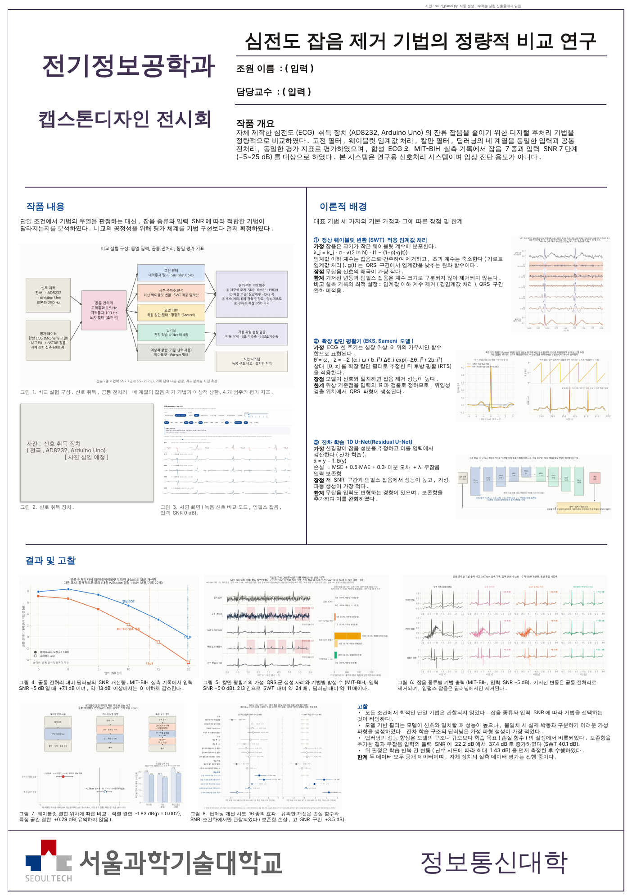
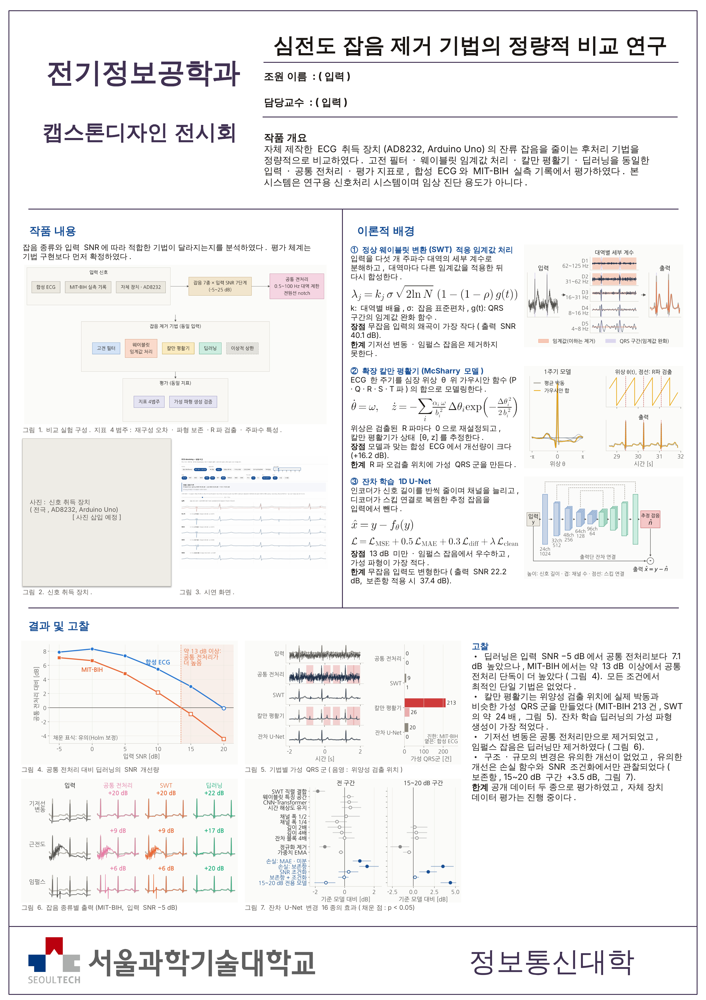
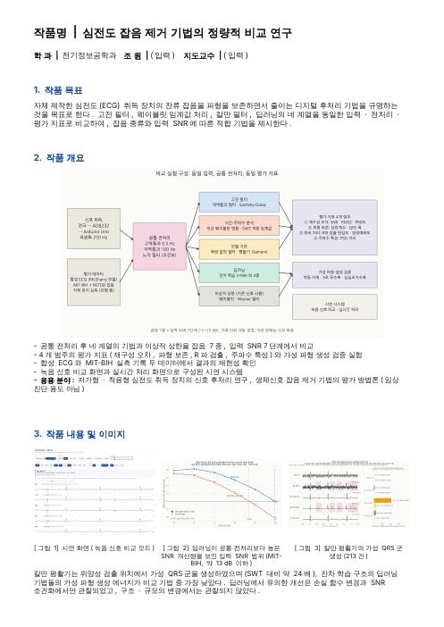

# 94. 졸업작품 판넬 · 브로셔 기획 — 핵심 정리와 시안

> **이 문서의 목적**: 전시 판넬(A1)과 브로셔(A4 1 쪽)에 **무엇을 어떤 순서로
> 싣는가**를 정한다. 수치는 전부 `91_report.md` 의 해당 절에서 왔고, 절 번호를
> 옆에 적었다 — 판넬에 옮길 때 **그 절의 값과 대조**한다(`17_checklists.md` §6).
> 그림 제작 자체는 `34_visual_plan.md` 의 기준(V1~V6)과 체크리스트 §3 을 따른다.
>
> 작성: 2026-11-01. 시안(`results/panel/`)과 신규 그림 일곱 장(`S15`~`S21`)까지 만들었다.
> 원래 진행하던 세션이 끊겨 새 세션이 저장소만 읽고 이어받았다.
> 그래서 이 문서의 「연구 흐름」은 **저장소 기록에서 복원한 것**이고, 기록에 없는
> 당시 판단은 싣지 않았다.

---

## 0. 양식 — 무엇을 채워야 하나

| | 판넬 (`A00_panel` 양식) | 브로셔 (`A00_brochure` 양식) |
|---|---|---|
| 크기 | **A1 세로 59.4 × 84.1 cm** | A4 1 쪽 |
| 머리 | 작품명 · 조원 · 담당교수 · **작품 개요** (우상단) | 작품명 · 학과 · 조원 · 지도교수 |
| 본문 | **작품 내용**(좌, 사진 필수) · **이론적 배경**(우, 수식·알고리즘) · **결과 및 고찰**(하단 전폭, 사진 필수) | ① 작품 목표 ② 작품 개요(+ 응용 분야) ③ 작품 내용 및 이미지 |
| 글꼴 | 맑은 고딕 | 굴림 10 pt |

2025 모음집의 다른 팀은 브로셔에서 **「작품 개요」 칸에 블록도 하나 + 3~5 줄 설명,
「작품 내용 및 이미지」 칸에 그림 3 장 가로 배치 + 캡션**을 쓴다. 판넬도 같은
문법으로 읽힌다.

---

## 1. 연구 흐름 — 남에게 설명할 때의 순서

판넬을 짜기 전에 **한 번에 말로 설명할 수 있어야** 한다. 아래가 그 대본이다.

### 1.1 출발점과 문제 재정의 (보고서 1 장)

- 자체 제작 취득계(Arduino + AD8232)의 ECG 에 아날로그 처리 뒤에도 광대역 잡음과
  **순간적인 큰 spike** 가 남았다. 처음 시도한 Sameni 칼만 필터는 기대보다 못했다.
- 그 상황에 **검증 안 된 전제가 셋** 있었다 — 「우리 신호는 15 dB 다」(참값 없이는
  못 잰다), 「칼만이 우리 조건에 안 맞는다」(구현부터 검증해야 한다), 「SNR 을
  올리면 좋다」(과평활도 SNR 을 올린다).
- 그래서 목표를 바꿨다: **ECG 형태를 보존하면서 잡음을 줄이는 기법들을 같은
  조건에서 정량 비교하고, 어떤 잡음 조건에서 무엇이 맞는지 규명한다.**
  **연구용 신호처리 시스템**이고 임상·진단을 주장하지 않는다(`01_design.md` 1.2).

### 1.2 「같은 자」를 먼저 만들었다 (2~4 장)

비교가 공정하려고 만든 장치들이 이 과제의 뼈대다.

| 장치 | 무엇을 막나 |
|---|---|
| **평가 엔진을 기법보다 먼저** | 자기 기법에 유리한 지표를 나중에 고르는 것 |
| **지표 4 층** (재구성 · 형태 · 하류 과제 · 주파수) + **SNR 3 분할** (strict / scaled / gain_bias) | 「크기만 눌린 출력」과 「모양이 틀린 출력」을 같게 벌하는 것 (3.2.2) |
| **지표 분해능(floor)** 을 먼저 잼 | 지표의 흔들림보다 작은 차이를 차이로 보고하는 것 (3.6) |
| **상한**: oracle wavelet `B01` · oracle Wiener `B02` | 「+8 dB 가 좋은가」를 못 읽는 것 (원칙 3) |
| **공통 front-end** (0.5 Hz HPF · 100 Hz LPF · 조건부 notch) + 필수 행 `M_FE` | 이득 중 전처리 몫을 기법 몫으로 세는 것 (F-10) |
| **안전성 프로브** (beat 지우기 · 3 s 심정지 · PVC) | 「없는 파형을 만드는가」를 안 재는 것 (4.4) |
| **baseline 을 약하게 두지 않는다** | Sameni 자가진단이 구현 버그 2 건을 찾아 +5.9 → **+16.2 dB** (원칙 2, F-6). SWT 도 교과서값 −3.47 → 튜닝 **11.39 dB** (4.6) |

데이터는 두 축이다: **D0** 합성(McSharry ODE — 칼만의 상태방정식과 같은 생성
모형), **D1** MIT-BIH 실기록 + NSTDB 실잡음(inter-patient split, 잡음도 시간축
분리). 실측 축 D3 은 **아직 열리지 않았다**(7.1).

### 1.3 비교 대상 — 계열마다 최선 하나씩 (4.6)

고전(`M01` bandpass · `M02` Savitzky-Golay · `M03` DWT · **`M04` SWT 적응 임계**),
모형 기반(**`M05` Sameni EKF/EKS**), 딥러닝(**`M06` Residual 1D U-Net**),
하이브리드(`M07` SWT → U-Net 직렬 · **`M08` SWT 대역을 채널로 쓰는 U-Net**),
대조군(`M09` CNN+Transformer · `M10` Dilated ResNet), 상한(`B01` · `B02`).

> **용어 주의** — 대화에서 「단순 ResNet」이라 부르던 것은 `M06` **Residual U-Net**
> 이다(U-Net 의 각 단에 잔차 블록 + 출력단 잔차 `x̂ = y − n̂`). 다운샘플이 없는
> 진짜 ResNet 계열은 `M10` 이다. 판넬에 둘을 섞어 쓰지 않는다.

### 1.4 결과 — 「무엇이 최고인가」는 잘못된 질문이었다 (5 장)

1. **입력 SNR 이 답을 바꾼다** (5.1 · 5.8.2). front-end 위에 딥러닝이 더하는 값이
   −5 dB 에서 D0 **+7.90** · D1 **+7.07 dB** 로 거의 같고, 입력이 깨끗해질수록 줄어
   **D1 에서는 13 dB 부근에서 0 을 지난다**(그 위는 front-end 만 쓰는 편이 낫다).
   「딥러닝이 실데이터에서 약해졌다」가 아니라 **「도움이 되는 구간이 좁아졌다」**.
2. **잡음 종류가 답을 바꾼다** (5.2 · 5.8.5, 두 축에서 재현). 기저선 변동은
   front-end 가 다 하고 wavelet 은 **oracle 조차 기여 0**, 전원선은 notch 가 최선,
   **임펄스는 딥러닝만** 푼다(D1 `M08` 13.69 > oracle `B01` 11.81).
3. **딥러닝이 가장 안전하다** (5.5 · 5.8.4). 지운 beat · 3 s 심정지 자리에 만드는
   에너지가 `M01` 대비 2.8~3.9 배, `M_FE` 대비 3.4~4.8 배 낮다. 출력단 잔차
   (`x̂ = y − n̂`)의 직접적 결과 — 신호가 없는 자리에는 뺄 것도 없다.
4. **칼만(Sameni)은 커널을 알 때만 강하다** (F-14 · F-17). 실제 파이프라인에서는
   D0 에서 bandpass 와 무승부, D1 에서 SNR −2.0 dB 에 **QRS 폭 +30.4 ms 훼손**
   (p = 4e-04), 계산은 `M04` 의 26 배(5.6).
5. **깨끗한 신호를 건드리는 정도**는 SWT 가 가장 작고 딥러닝이 크다 — 이것이
   딥러닝 개선의 출발점이 된다(5.3).

### 1.5 딥러닝을 끌어올리려던 시도와 그 수렴 (5.4 · 5.8.7 ~ 5.10 · 6 장)

| 순 | 물은 것 | 결과 | 근거 |
|---|---|---|---|
| 1 | wavelet 을 **어디에** 쓰나 — 안 씀 `M06` / 전처리 `M07` / 표현공간 `M08` | 직렬 `M07` 은 **유의하게 손해**(−1.827, p = 0.002), 표현공간 `M08` 은 +0.286 **못 잼** | 5.4 · 5.10.9 |
| 2 | 시간 해상도 유지 `M10` | 못 잼 + `beat_cc` 열세 + 연산 10 배 | 5.9 |
| 3 | 긴 문맥 `M09` · window 4 배 | 2×2 여덟 칸 전부 n.s. | 5.10 |
| 4 | 용량 · 데이터 · step 4 배 | 데이터 4 배 +0.141, step 4 배 +0.290 — 전부 산포 안 | 5.10.8 |
| 5 | **자를 다시 세웠다** — seed 만 바꿔도 1.43 dB 가 벌어졌고, 그 대부분은 val 잡음 뽑기였다 | 고정 평가 + 짝지은 seed 로 아홉 arm 재측정 | F-40 · F-41 · F-42 |
| 6 | 같은 자로 다시 재니 | **손실 둘만 유의**: `L6` +1.707 (p = 0.006), `L3` +1.029 (p = 0.032) | 5.10.9 |
| 7 | 왜 고 SNR 에서 지나 — **한 벌로 전 대역을 맡아서** | 15~20 dB 전담 모델이 +4.410 (p = 0.017) | F-43 · 5.10.10 |
| 8 | 동작점(SNR)을 FiLM 으로 알려 주면 | 15~20 dB **+1.778** (p = 0.0016), 대신 0~5 dB −0.431 | F-45 |
| 9 | 조건화 + `L6` 를 같이 쓰면 | `L6` 위에 +0.193 (n.s.) — **같은 고장의 두 처방** | F-47 |
| 10 | 깊이(등파라미터) · 정규화 빼기 · EMA | 깊이는 못 잼(저 SNR 은 손해), 정규화 빼기 −1.35, EMA ±0.06 | F-44 · F-57 |
| 11 | 용량이 왜 값을 못 하나 | 외울 수는 있다 — 바닥은 **과제(무엇을 맞추라고 시키나)** 쪽 | F-55 |
| 12 | `L6` 이 듣는 이유 | 깨끗한 입력 · MAE 로 재는 작은 오차 · 출력단 잔차 셋이 겹쳐서 | F-56 |

**수렴한 결론**: 구조 · 용량 · 데이터 · 깊이를 건드린 것은 전부 측정 산포 안이거나
손해였고, **움직인 것은 「무엇을 맞추게 하느냐」(손실 `L6`, 동작점 조건화)뿐이다.**
`L6` 으로 D1 20 dB 의 `M_FE` 대비 격차가 −4.84 → **−1.27 dB**(74 % 회수), 깨끗한
신호 보존이 22.22 → **37.35 dB**(SWT 40.14 에 근접)로 올랐다(5.8.9).

### 1.6 실시간 시연과 남은 일

- 실시간에서는 미래를 모르니 `filtfilt` 를 못 쓴다. front-end 세 방식(인과 ·
  블록 영위상 0.5 s · 중앙값)은 **평평함과 ST 충실도가 같은 방향이 아니다** —
  화면에서 바꿔 보게 했다(5.11, `S12`).
- 시연 화면 두 모드: **모드 B**(녹음본, 방법 비교, `demo/index.html` — 서버 불필요)
  와 **모드 A**(실보드 실시간, `demo/live.html`). 둘은 신호 경로가 달라 **한 화면에
  섞지 않는다**(`30_realtime_demo.md` 1 · `31_demo_design_review.md` 2.2).
- 실측 축 D3 은 보드 투입이 선행 조건이다(`99_status.md` 7.8).

---

## 2. 판넬의 이야기 — 권하는 한 줄과 3 막

> **한 줄**: 「어떤 잡음 제거 기법이 최고인가」는 잘못된 질문이다 — **잡음 종류와
> 입력 SNR 을 지정하고, 같은 자로 재야** 답이 나온다. (보고서 8 장의 한 문장)

| 막 | 판넬 구역 | 말할 것 하나 |
|---|---|---|
| 1. 문제 | 작품 개요 · 작품 내용 | 우리 장비의 잡음, 그리고 「같은 자」를 먼저 만들었다 |
| 2. 비교 | 결과 왼쪽 절반 | 답은 SNR 과 잡음 종류가 정한다. 그리고 **칼만은 그럴듯한 가짜를 그리고 딥러닝은 안 그린다** |
| 3. 개선 | 결과 오른쪽 절반 | 딥러닝을 끌어올리려던 열여섯 개의 시도가 **「모델이 아니라 목표」** 로 수렴했다 |

이 이야기를 고른 이유: 결과의 절반이 「지거나 같다」인데(`31_demo_design_review.md`
3.1), 우열 순위표로 짜면 그 절반을 버려야 한다. 「질문을 바로잡는 이야기」로 짜면
진 결과와 못 잰 결과가 **그대로 논거**가 된다(D-29 의 취지와도 맞다).

---

## 3. 연구의 핵심 열둘 — 각각을 무엇으로 보이나

연구 전체에서 **남에게 꼭 전해야 하는 것**을 열둘로 추렸다. 각 항목마다 「말할 것 한
문장 → 시각화 형태 → 그림 → 판넬 자리」를 정했다. 판넬에 다 못 싣는 것은 **예비**로
두고 발표·질의응답에서 꺼낸다. 그림 파일은 전부 `results/slides/` 에 있고 색인은
`docs/93_slides.md` 다.

| # | 핵심 (말할 것 한 문장) | 근거 | 시각화 형태 — 왜 이 형태인가 | 그림 | 판넬 자리 |
|---|---|---|---|---|---|
| K1 | **비교의 판** — 같은 입력 · 같은 전처리 · 같은 지표 | 2 · 4 장 | **블록도** — 흐름(취득 → 전처리 → 4 계열 → 평가)이 내용이라 그림이 표보다 짧다 | `S18_pipeline` **신규** | 작품 내용 그림 1 |
| K2 | **풀어야 할 잡음** — 실기록의 잡음은 성격이 다르다 | 1.1 | 파형 2×2 (축 × SNR), 참값 회색 | `S1_input` | 예비 |
| K3 | **SWT 는 단마다 임계를 다르게 둔다** | 4.6 · `05_swt_tuning` | **알고리즘 도해** — 세부계수 다섯 단 위에 임계 띠, QRS 자리에서 좁아지는 것을 그대로 | `S19_swt` **신규** | 이론 ① |
| K4 | **칼만은 위상 위의 template 으로 추정한다** — 위상은 검출 R-peak 로 맞춘다 | F-14 · F-17 · 코드 | **모형 + 톱니 위상** — 공식만으로는 「검출이 틀리면 왜 그리나」가 안 보인다 | `S20_kalman_model` **신규** | 이론 ② |
| K5 | **딥러닝은 잡음을 예측해 뺀다** + 손실 `L6` | 4.6 · 4.7 · F-56 | **구조도** — 채널 · 해상도는 체크포인트에서 읽는다 | `S21_resunet` **신규** | 이론 ③ |
| K6 | **입력 SNR 이 답을 정한다** — D1 에서 13 dB 위는 전처리만 | 5.8.2 | **곡선 2 개 + 0 선** — 교차점이 결론이라 선 그래프. 채운/빈 표식이 유의성 | `S5_crossover` | 결과 ① |
| K7 | **칼만은 없는 자리에 깨끗한 심박을 그린다** | F-58 · D-42 | **파형(대표 4 초) + 비율 막대** — 예시만 실으면 분포의 끝을 보이게 된다(F-24). 막대가 균형추 | `S15_kalman_phantom` **신규** | 결과 ② |
| K8 | **잡음 종류가 답을 바꾼다** — 임펄스는 딥러닝만 | 5.2 · 5.8.5 | **행 = 잡음, 열 = 방법의 파형 격자** — 「왜」가 파형에서 보인다 | `S4_noise_d1` | 결과 ③ |
| K9 | **wavelet 의 자리** — 직렬은 손해, 특성공간은 못 가림 | 5.4 · 5.10.9 | **블록도 셋 + 같은 자의 점 그림** — 차이가 자리 하나라는 것을 구조로, 판정을 seed 짝으로 | `S16_wavelet_placement` **신규** | 결과 ④ |
| K10 | **딥러닝 개선 16 시도가 「목표」로 수렴** | 5.10 · F-40~F-57 | **forest plot 두 열(전 구간 · 15~20 dB)** — 「0 에서 얼마나」가 질문이라 점, 조건화는 오른쪽 열에서만 서서 두 열이 필요 | `S17_dl_journey` **신규** | 결과 ⑤ |
| K11 | **딥러닝이 가장 안전하다**(에너지 기준) | 5.5 · 5.8.4 | 막대 2×2 (축 × 프로브) | `S6_safety` | 예비 — K7 과 짝으로 발표 |
| K12 | **실시간 front-end 는 무엇을 지킬지의 문제** | 5.11 | **산점도** — 두 기준이 같은 방향이 아님을 「빈 좌하단」으로 | `S12_fe_tradeoff` | 예비 |

예비로 둔 것 중 질의응답에 자주 쓸 것: `S7_loss_gap` · `S8_clean`(L6 의 기제), `S13_frontend_flip`
(front-end 하나로 결론 둘이 뒤집힘), `S14_measurement_traps`(측정 틀이 틀렸던 아홉 건),
지표 카드 `C1`~`C5`(「지표 하나로는 안 된다」).

> **판넬 결과 칸이 다섯인 이유** — K6 · K8 은 「비교」, K7 은 「안전」, K9 · K10 은
> 「개선」이다. 2 장의 3 막 중 2 · 3 막이 결과 칸 하나에 함께 들어가므로, 위 줄 셋을
> 비교 · 안전, 아래 줄 둘을 개선으로 가른다.

---

## 4. 판넬 시안 — 양식 위에 실제로 놓았다

`python scripts/build_panel.py --template <A00_panel 양식.pptx> --render`
→ `results/panel/panel_draft.pptx` · `panel_draft.png`. 양식 파일은 학과 자료라 저장소에
넣지 않고 경로로 준다. **문안의 숫자는 스크립트가 산출물에서 읽는다**(손으로 옮기지 않는다
— 체크리스트 §6).

### 4.1 구역별 배치 (cm, A1 세로 59.4 × 84.1)

| 구역 | 자리 | 들어간 것 |
|---|---|---|
| 머리 | 양식 그대로 | 작품명 「ECG 잡음 제거 기법 비교 연구」 · 조원 · 담당교수 (입력 칸) |
| 작품 개요 | x 21.6 · y 10.2 | 네 줄 — 무엇을 · 어떻게 같은 조건으로 · 두 데이터축 · 연구용 |
| 작품 내용 (좌) | x 1.9~27.6 · y 20~50 | 리드 두 줄 → 그림 1 `S18`(25.7 × 13.5) → **사진 틀**(장비) + 그림 3 시연 화면 캡처 |
| 이론적 배경 (우) | x 29.5~57.5 · y 20~50 | 카드 셋 — 왼쪽 글(가정 · 수식 · 강점 · 약점), 오른쪽 도해(`S19` · `S20` · `S21`) |
| 결과 및 고찰 | x 1.8~57.6 · y 54~77 | 위 줄 `S5` · `S15` · `S4_noise_d1`, 아래 줄 `S16` · `S17` · 고찰 글상자 |

**그림 면적 = 본문 구역의 49 %** (스크립트가 잰다, 빈 사진 틀 포함). 「절반 이상」에 닿으려면
장비 사진 · 실시간 화면 사진이 들어올 때 이론 카드의 도해를 키우면 된다 — 카드마다 글 아래
빈자리가 있다.

### 4.2 문안 원칙

> **문체는 `95_academic_style.md` 를 따른다** (D-43). `python scripts/check_academic_style.py` 가 판넬 · 브로셔 문안과
> 판넬 그림의 글자를 검사한다 — 도입 시 위반 192 건, 교정 후 0 건. 아래 원칙은 그 규칙의 판넬 적용분이다.

- **그림마다 캡션 한 문장 = 그 그림의 결론.** 번호(①~⑤)를 고찰 글이 다시 부른다.
- 수치 옆에 **축(D0/D1)과 조건**을 붙인다(F-28). 시안의 캡션이 그렇게 되어 있다.
- 결과 캡션의 수치: ① D1 −5 dB **+7.1 dB**, 교차 **약 13 dB** ② 심박 모양 가짜 **213 개**,
  SWT 의 **24 배** · 딥러닝의 **11 배** ④ 직렬 **−1.83 dB**, 특성공간 **+0.29 dB** ⑤ `L6`
  고 SNR **+3.5 dB** — 전부 `build_panel.py` 의 `numbers()` 출력이다.

### 4.3 알고리즘을 어떻게 표시하나

공식만 놓지 않는다. **카드 하나 = 「가정 한 줄 → 수식 두세 줄 → 도해 → 강점 · 약점」**.
약점 줄이 결과 칸의 그림을 가리키게 썼다.

| 카드 | 가정 | 수식 (판넬에 쓰는 형태) | 도해 | 약점 → 결과 칸 |
|---|---|---|---|---|
| ① SWT `M04` | 잡음은 작은 계수에 있다 | `λ_j = k_j·σ·√(2lnN)·(1−(1−ρ)g)` · garrote | 계수 다섯 단 + 임계 띠 | 기저선 · 임펄스는 못 지운다 → ③ |
| ② 칼만 `M05` | ECG 는 위상 위의 봉우리 합 | McSharry ODE 두 줄 · 상태 `[θ, z]` · RTS 평활 | 커널 합 + θ 톱니 | 틀린 R 에 심박을 그린다 → ② |
| ③ Res U-Net `M06` | 잡음을 예측해 뺀다 | `x̂ = y − f(y)` · `L6` | 구조도 | 깨끗한 입력을 건드린다 → `L6` → ⑤ |

> **SWT 수식의 단서** — 도해와 수식은 **D0 튜닝값**(garrote · QRS 보호 켬)이다. 실데이터(D1)
> 튜닝은 **hard · QRS 보호 끔**을 골랐다(`05_swt_tuning_d1.md`). `S19` 부제가 설정에서 그
> 사실을 읽어 적는다. 판넬에 「QRS 보호가 핵심」이라고 쓰면 D1 과 어긋난다.

### 4.4 사진 · 시연 캡처

| 자리 | 무엇 | 상태 |
|---|---|---|
| 그림 2 | 취득 장치 사진 (전극 · AD8232 · Uno) | **팀 보유분 필요** — 시안에는 빈 틀 |
| 그림 3 | 모드 B 시연 화면 — MIT-BIH · 임펄스 · 0 dB · `M_FE`/`M04`/`M05`/`M06` · 4 s | `results/panel/demo_mode_b.png` (`demo/index.html` 을 Playwright 로 캡처) |
| (추가) | 모드 A 실시간 화면 · attract 화면 · 시연 영상 스틸 | **팀 보유분 필요** — 저장소에 없다. `live.html` 은 `--replay synth` 로 띄워 캡처할 수 있지만 이 컨테이너 CPU 로는 처리 밀림(RTF 0.95)이 생겨 파형이 계단처럼 보인다 — 시연 노트북에서 캡처한다 |

---

### 4.1 최종판 (2026-11-03)

`python scripts/build_panel.py --template <양식.pptx> --final --render` 로 만든다. 시안 표지를 빼고
`results/panel/panel.pptx` · `panel.pdf` · `panel.png`(100 dpi), 브로셔는 `brochure.*`(200 dpi)로 저장한다.
시안 파일(`*_draft.*`)은 비교를 위해 그대로 둔다.

시안에서 바꾼 것:

| 위치 | 시안 | 최종판 | 이유 |
|---|---|---|---|
| 결과 아래 줄 왼쪽 | `S16_wavelet_placement` | `S17p_dl_journey_panel` | S17 의 16 행 이름표가 판넬 거리에서 읽히지 않았다(시각화 제안서 4 절). 웨이블릿 결합 위치의 결과(직렬 결합의 유의한 저하)는 S17p 의 「구조」 범주에 이름표로 남는다 |
| 결과 아래 줄 가운데 | `S17_dl_journey` | `S22_resolution` | 고찰의 「판정 전에 학습 반복 간 변동을 측정하였다」는 문장을 그림으로 바꾸었다(제안서 P1, 우선 A) |
| 고찰 글상자 | 24.0 cm · 14 pt | 20.2 cm · 13 pt | 그림 두 장을 넓혀 그림 면적 비율을 50 % 로 맞추었다(시안 47~48 %) |
| 장비 사진 틀 · 시연 화면 | 높이 9.2 cm | 11.0 cm | 같은 이유 |
| S5 | 교차점 표시만 | MIT-BIH 의 교차 구간을 칠하고 뜻을 적었다 | 제안서 4 절(V-16) |
| 실험 구성 블록선도 | `S18_pipeline`(matplotlib, 상자마다 2~4 줄) | `D1_pipeline`(mermaid, 상자에 핵심어만) | 사용자 피드백(2026-11-03): 상자 품질과 글의 양. 지표 4범주와 검증 조건 등 세부는 그림 1 캡션으로 옮겼다. 입력 → 잡음 → 공통 전처리를 한 줄, 기법 다섯과 평가를 아래 두 줄로 두어 판넬 칸의 가로 · 세로 비(약 1.9)에 맞추었다 |
| U-Net 블록선도 | `S21_resunet`(설명 글 · 손실 식 포함) | `D2_resunet`(mermaid, 상자 높이 = 해상도) | 같은 피드백. 블록 크기의 의미는 유지하고, 손실 식과 설명은 카드 본문의 수식 · 글과 겹쳐 그림에서 뺐다. 가로로 긴 그림이라 카드 ③ 의 글 아래에 칸 전체 폭으로 두었다 |
| 이론 카드의 수식 | 본문 글자와 같은 크기의 일반 문자열 | LaTeX 로 조판한 그림을 한 줄씩, 본문(14 pt)의 1.5 배(21 pt) | 사용자 피드백(2026-11-03). TeX 가 없는 환경이라 matplotlib mathtext(Computer Modern)로 조판하고 `results/panel/eq/` 에 600 dpi 로 둔다. 손실 함수 식만 칸 폭 때문에 97 % 로 줄었다 |

#### 4.1.1 글자 크기와 판넬 전용 그림 (2026-11-03)

판넬 크기는 양식 pptx 의 슬라이드 크기(59.4 × 84.1 cm, A1)를 따른다. 1~2 m 거리에서 읽는 학술 포스터 지침을
A1 에 맞추어(A0 기준값의 약 0.71 배) 다음과 같이 정하였다. 처음 판은 본문 13~16 pt, 그림 속 글자 2~8 pt 로
기준에 못 미쳤다(사용자 피드백).

| 요소 | 크기 | 근거 |
|---|---|---|
| 작품 개요 | 22 pt | 양식 안내문의 지정값 |
| 구역 제목 | 26 pt | 양식 안내문의 지정값 |
| 본문(작품 내용 · 이론 카드 · 고찰) | 18 pt | A1 본문 18~24 pt |
| 캡션 | 15 pt | A1 캡션 14~18 pt |
| 수식 | 27 pt | 본문의 1.5 배 |
| 그림 속 글자 | 14 pt 이상(눈금 13 pt) | A1 캡션 기준 |

그림 속 글자를 인쇄 크기로 맞추기 위해 판넬 그림은 `scripts/make_panel_figs.py` 가 **판넬 칸 크기(cm) 그대로**
그린다(`results/panel/figs/`). 축소가 없으므로 지정한 pt 가 그대로 인쇄된다. 제목 · 부제 · 범례 문장은 캡션으로
옮기고 그림에는 축 이름과 직접 표지만 두었다. 블록선도(D1 · D2)는 이 크기에서 그림 속 글자가 약 19~20 pt 이다.

| 판넬 그림 | 원래 그림 | 줄인 내용 |
|---|---|---|
| 그림 4 `F4_crossover` | `S5_crossover` | 제목 · 범례를 캡션으로. 교차 구간 표지만 남김 |
| 그림 5 `F5_phantom` | `S15_kalman_phantom` | 구성 유지(파형 5 행 + 두 데이터의 막대), 제목 · 설명문 삭제 |
| 그림 6 `F6_noise` | `S4_noise_d1` | 축 눈금 제거, 칸마다 SNR 개선량만 |
| 그림 7 `F7_journey` | `S17p_dl_journey_panel` | 16 행 점 그림, 행 이름을 짧게(예: 「손실: 보존항」) |
| 카드 ① `T1_swt` | `S19_swt` | 입력(왼쪽) → D1~D5 와 단별 임계값(가운데) → 출력(오른쪽). 위쪽 설명문은 카드 본문으로 옮기고 주황(임계값) · 보라(QRS 완화) 범례와 대역 표지만 남김 |
| 카드 ② `T2_kalman` | `S20_kalman_model` | 구성 유지: 1 주기 모델(가우시안 성분과 합), 위상 θ(t)의 R파 재설정, 출력. 제목 · 설명문 삭제 |
| 카드 ③ `T3_unet` | `S21_resunet` · `D2_resunet` | matplotlib 으로 다시 그림: 상자 높이 = 신호 길이(1024 → 64), 겹친 상자 수 = 채널 증가(단마다 한 겹), 점선 = 스킵 연결, 아래 경로 = 출력단 잔차 |

그림 8(판정 해상도, `S22_resolution`)은 판넬에서 뺐다(사용자 결정). 판정 해상도의 내용은 보고서 5.10.7 절과
`docs/97_research_figs.md` 에 남는다. 이론 카드는 세 카드 모두 그림(13.4 × 8.6 cm)을 글 오른쪽에 두어 세로로
정렬하였다(사용자 피드백: 첫 판의 세로 배치 선호). mermaid U-Net(`D2_resunet`)은 크기 · 채널 표현이 안 되어 판넬에서 뺐다.
결과 및 고찰은 왼쪽에 그림 4~7 을 2 × 2(각 18.2 × 10.4 cm)로, 오른쪽 18 cm 칸에 고찰(20 pt)을 두었다.
캡션은 한 줄 제목만 남기고 수치와 해석(교차점 13 dB, 칼만 213 건 등)은 고찰 본문으로 옮겼다. 본문 크기를 키운 만큼 문장을 줄였다. 그림 면적 비율은 50.8 % 이다.

블록선도는 `scripts/make_diagrams.py` 가 mermaid 원문(`results/slides/diagrams/*.mmd`)을 만들고 mermaid-cli 로 조판한다
(`MMDC` 환경 변수로 실행 파일 지정, 브라우저는 `CHROME_PATH`). U 자를 세로로 세운 U-Net 배치도 시험했으나
mermaid 에 역방향 화살표가 없어 디코더 순위가 어긋나 가로 배치로 두었다.

남은 것: 조원 · 담당교수 이름, 장비 사진(빈 틀), 맑은 고딕 글꼴 확인(이 환경에는 없어 대체 글꼴로 그려졌다).
제안서 P2(`S23_band_specialist`)는 S5 의 원인을 보여 주지만 지면이 없어 싣지 않았다. S4 와 바꿀지는 검토가 필요하다.

## 5. 브로셔 시안

`results/panel/brochure_draft.pptx` · `.png` (같은 스크립트). 양식(HWP)의 순서를 그대로 따른다.

| 절 | 내용 |
|---|---|
| 1. 작품 목표 | 세 줄 — 무엇을 찾나, 무엇을 같은 조건으로 비교하나 |
| 2. 작품 개요 | `S18` 블록도 + 네 줄 + **응용 분야**(저가 · 웨어러블 취득 장치의 후처리 연구, 평가 방법론 — 진단 용도 아님) |
| 3. 작품 내용 및 이미지 | 가로 세 장: 시연 화면 · `S5` · `S15` + 캡션, 아래 두 줄 요약 |

HWP 양식에 옮길 때는 PNG 를 넣고 글은 시안에서 복사한다(굴림 10 pt).

---

## 6. 신규 그림 일곱 장 — 만든 방법과 단서

전부 `scripts/make_slides.py` 의 함수이고 `python scripts/make_slides.py` 로 다시 그려진다.
부제의 수치 · 판정은 데이터에서 계산한다(O-27).

| 그림 | 데이터 | 단서 |
|---|---|---|
| `S15_kalman_phantom` | `results/{d0,d1}/phantom/` (D-42 · F-58) | 파형은 **「칼만의 심박 모양 가짜가 가장 많이 몰린 4 초」** 로 고른 예시이고, 그 규칙을 그림에 적었다. 처음 규칙(상관 최고 한 점)은 빈자리 가짜가 아니라 **진짜 beat 를 옮겨 그린** 경우를 골라 바꿨다. 가짜는 백색잡음에 몰린다(213 중 193) |
| `S16_wavelet_placement` | `results/ext/structure` (seed 4 짝) · EXP-C | D0 seed 0 한 판의 「M08 > M06 유의」는 D1 에서 사라졌다 — 그래서 판정은 seed 짝에 얹는다 |
| `S17_dl_journey` | `results/ext/*` 여덟 sweep | 각 행은 **자기 sweep 의 기준 arm** 과 같은 seed 끼리 짝짓는다. 정규화 빼기 · EMA 는 다른 환경(torch 판)의 기준이라, **같은 환경에서도 버티는 것만 채운 점**으로 그렸다(EMA 는 같은 환경 −0.06 → 빈 점, F-57) |
| `S18_pipeline` | — (도식) | |
| `S19_swt` | 실험과 같은 `M04` 인스턴스, D0 백색잡음 5 dB | D0 튜닝값으로 그렸고 D1 튜닝값을 부제에 적는다 |
| `S20_kalman_model` | D1 기록 하나에 `M05` 를 돌려 얻은 적합 커널과 위상 | |
| `S21_resunet` | `results/d1/m06_l1/best.pt` 에서 채널 · 파라미터 수를 읽는다 | |

---

## 7. 판넬에 쓰면 안 되는 문장 — 점검표

| 쓰고 싶어질 문장 | 왜 안 되나 | 대신 |
|---|---|---|
| 「딥러닝이 최고다」 | D1 전 구간 평균은 n.s.(5.8.1), 13 dB 위에서는 진다 | 「D1 −5~5 dB 에서 딥러닝이 front-end 위에 +4.8~7.1 dB (유의)」 |
| 「구조를 바꿔도 효과가 없다」 | 못 잰 것이다(5.10.7) | 「이 예산으로는 가리지 못했다」 |
| 「칼만이 부정맥을 훼손한다」 | D0 에서만, D1 에서 재현 안 됨(5.8.5) | 축을 밝히거나 빼기 |
| 「칼만은 위험하다」 만 | 에너지 지표로는 중간이다(5.8.4) — F-58 은 **모양**의 위험이다 | 「칼만은 틀릴 때 그럴듯하게 틀린다」 |
| 「wavelet 을 특성공간으로 쓰는 것이 낫다」 | D1 에서 n.s.(5.8.5 · 5.10.9) | 「해롭지 않지만 이 예산으로 이득을 가리지 못했다」 |
| 「SWT 의 핵심은 QRS 보호」 | D1 튜닝은 보호를 껐다(4.3 단서) | 「단마다 다른 임계」 |
| 「임상 · 진단 가능한 ECG 복원」 | 범위 밖(`01_design.md` 1.2) | 「연구용 신호처리 시스템」 |
| 「우리 장비 신호는 15 dB」 | 실측 축 미완, 추정기 천장 문제(F-13 · F-18) | 언급하지 않거나 「추정 진행 중」 |
| 「SNR 조건화는 우리가 고안했다」 | DRUNet 의 noise-level map 과 같은 발상(`36_related_work.md` §1) | 「선행 발상이 ECG 에서도 필요함을 통제 실험으로 확인」 |
| 숫자 하나에 축 표시 없음 | F-28 | 모든 수치 옆에 D0/D1 |

---

## 8. 이 기획 중에 드러나서 고친 것

1. **주 체크포인트가 현재 코드로 안 열렸다 → 고쳤다 (O-38).** 인코더 키 재매핑
   (`upgrade_state_dict`) + 시험(`tests/test_legacy_checkpoints.py`). 실시간 브리지가 `M06` ·
   `M08` 을 싣고 기동하는 것을 화면으로 확인했다.
2. **칼만의 심박 모양 가짜를 정식으로 쟀다 (D-42 → F-58).** 처음 스크래치 측정과 같은 값이
   재현됐고(213 대 216), 임계 셋 · 기록 집중도 모두 되돌림 조건에 걸리지 않았다.
3. **SWT 튜닝이 축마다 다르다는 것이 판넬 문안에 걸렸다** — D1 은 hard · 보호 끔(4.3).

---

## 9. 사용자 판단이 필요한 것

| # | 무엇 | 기본안 |
|---|---|---|
| 1 | 장비 사진 · attract 화면 · 시연 영상 원본 | 받으면 그림 2 와 결과 칸 하단에 넣는다 |
| 2 | 작품명 · 조원 · 담당교수 | 시안은 「ECG 잡음 제거 기법 비교 연구」 |
| 3 | 결과 칸 다섯 장 구성 — K11(안전성 막대)을 K7 옆에 붙일 것인가 | 붙이지 않는다 — K7 의 비율 막대가 그 역할을 한다 |
| 4 | 최종 제작 도구 | 시안 pptx 를 양식 파일에 옮겨 손으로 다듬는다(맑은 고딕은 Windows 에서 제대로 보인다) |

---

## 10. 발표자 해설 노트: 판넬에서 줄인 용어의 풀이

> 판넬에는 용어의 기능 서술과 용어 이름의 최소형만 싣는다(학술 서술 규칙 C2, `95_academic_style.md`).
> 아래는 판넬의 용어에 대한 질문에 답할 때 쓰는 풀이이며, 수치의 근거는 보고서의 해당 절이다.

### 10.1 핵심 용어

| 판넬의 표현 | 풀이 | 근거 |
|---|---|---|
| 가성 QRS군 | 기준 신호에 박동이 없는 위치에서 R파 검출기가 박동으로 판정하였고(위양성 검출), 그 위치의 출력 파형(±200 ms)과 해당 출력의 평균 박동 파형의 상관계수가 0.8을 넘는 경우이다. 잔류 잡음에 의한 검출과 박동 형태의 파형 생성을 구분하기 위해 도입하였다. 임계값을 0.7 · 0.9로 바꾸어도 기법 순위는 같다 | F-58 · D-42 |
| 위양성 검출 | 실제 R파에서 ±75 ms 밖의 위치를 검출기가 R파로 판정한 것 | 3.4.2 절 |
| 공통 전처리 | 모든 기법 앞에 같은 필터를 적용한다. 구성은 0.5 Hz 고역통과(기저선 변동 제거), 100 Hz 저역통과(대역 제한), 60 · 120 Hz notch(전원선 잡음이 검출될 때만)이다. 기법 간 차이를 전처리 효과와 분리하기 위한 조건이다 | 4.2 절 |
| 가성 파형 생성 검증 | 기준 신호에서 박동 하나를 지우거나(박동 삭제) 3초 구간을 평탄하게 만든 뒤(무수축) 잡음을 더하고, 그 구간에 출력이 만든 에너지를 측정한다. 심실조기수축(PVC) 박동의 형태 보존도 별도로 평가한다 | 4.4 · 5.5 절 |
| SNR 개선량 | 출력 SNR에서 입력 SNR을 뺀 값이다. 진폭 축소와 파형 왜곡을 분리하기 위해, 출력 진폭을 최적 배율로 맞춘 뒤 계산한다 | 3.2.2 절 |
| 무잡음 입력 시 출력 SNR | 잡음이 없는 신호를 기법에 통과시켰을 때 출력과 기준 신호의 SNR이다. 기법 자체가 만드는 왜곡의 크기를 나타낸다 | 4.4 · 5.3 절 |
| 이상적 상한(oracle) | 기준 신호를 안다고 가정한 최적 웨이블릿 임계값 처리와 최적 Wiener 필터이다. 실제로는 적용할 수 없으며, 각 계열이 도달할 수 있는 최대 성능의 기준으로 쓴다 | 2 장 원칙 3 |
| RMSE · PRDN · PSD 거리 | 재구성 오차 지표이다. RMSE는 평균제곱근오차, PRDN은 평균을 뺀 기준 신호로 정규화한 백분율 제곱근 차이, PSD 거리는 기준 신호와 출력의 전력 스펙트럼 밀도의 로그 차이이다 | 3.2.3 · 3.5 절 |

### 10.2 알고리즘: 이론 영역의 기호와 설정

| 판넬의 표현 | 풀이 |
|---|---|
| 정상 웨이블릿 변환(SWT) | 이산 웨이블릿 변환(DWT)과 달리 단계마다 신호를 절반으로 줄이지 않는다. 따라서 신호가 시간축에서 이동하면 계수도 같은 만큼 이동할 뿐 값이 변하지 않아, R파 위치에 따라 결과가 달라지지 않는다 |
| $\lambda_j = k_j\,\sigma\,\sqrt{2\ln N}\,\left(1-(1-\rho)\,g(t)\right)$ | λ_j는 j 단계의 임계값, k_j는 단계별 배율(탐색으로 결정), σ는 잡음 표준편차(최고주파 세부계수의 중앙절대편차 ÷ 0.6745), N은 신호 길이, g(t)는 QRS 구간에서 1이고 나머지에서 0인 완화 창, ρ는 QRS 구간의 임계값 비율(0.3이면 30 %)이다 |
| hard thresholding | 임계값 이하 계수는 0으로 만들고, 초과 계수는 그대로 둔다 |
| soft thresholding | 임계값 이하 계수는 0으로 만들고, 초과 계수는 임계값만큼 크기를 줄인다. 이 때문에 진폭이 체계적으로 작아진다 |
| garrote thresholding | 임계값 이하 계수는 0으로 만들고, 초과 계수는 d(1 − λ²/d²)로 줄인다. 큰 계수일수록 거의 그대로 남아 soft thresholding의 진폭 축소를 피한다 |
| QRS 구간 완화 | QRS 전후 ±60 ms에서 임계값을 낮추어 QRS의 고주파 계수를 보존하는 설정 |
| MIT-BIH 실측 기록에서는 hard thresholding이 최적 | 매개변수는 데이터마다 학습용 기록에서 따로 탐색하였다. 합성 ECG에서는 garrote thresholding과 QRS 구간 완화 적용이, MIT-BIH에서는 hard thresholding과 QRS 구간 완화 미적용이 가장 좋았다. 판넬에서는 QRS 구간 완화를 정의할 지면이 없어 이 설정을 생략하였다. 두 데이터의 잡음 특성과 박동 형태가 달라 최적 설정이 다른 것으로 추정되나, 원인은 별도로 검증하지 않았다(`05_swt_tuning_d1.md`) |
| 확장 칼만 필터 · 평활기(EKF · EKS) | 상태 [θ, z](심장 위상, ECG 진폭)를 비선형 모델로 예측하고 관측으로 보정한다. 평활기(EKS)는 시간 역방향 보정(RTS)을 한 번 더 적용해 과거 시점의 추정까지 보정한다 |
| $\dot{\theta} = \omega,\quad \dot{z} = -\sum_i \frac{\alpha_i\,\omega}{b_i^2}\,\Delta\theta_i \exp\left(-\frac{\Delta\theta_i^2}{2 b_i^2}\right)$ | McSharry 동역학 모델이다. 위상은 일정 속도 ω로 증가하고, P · Q · R · S · T파는 각각 위상 θ_i에 놓인 가우시안 함수(진폭 α_i, 폭 b_i)로 표현되며, 그 합이 한 주기의 파형이다 |
| 위상 기준점을 입력의 R파 검출로 정한다 | θ는 입력에서 검출한 R파마다 0으로 재설정된다. 잡음 때문에 검출기가 R파가 아닌 위치를 R파로 판정하면, 모델은 그 위치에서 QRS를 예측하고 출력에 QRS 파형이 나타난다. 이 과정이 가성 QRS군의 생성 기제이다 |
| 잔차 학습 | 신경망은 무잡음 신호를 직접 출력하지 않고, 잡음을 추정하여 입력에서 뺀다(x̂ = y − f(y)). 따라서 박동이 없는 구간의 출력은 입력에서 추정 잡음을 뺀 값에 머물러 가성 파형이 생기기 어렵다 |
| 무잡음 입력 보존항 | 학습 중에 잡음이 없는 입력도 함께 넣고, 그때의 출력이 입력과 다르면 손실을 더한다. 무잡음 입력에서 출력이 입력과 같도록 하는 목표를 손실 함수에 포함한 것이다. 이 항을 추가하자 무잡음 입력의 출력 SNR이 22.2 dB에서 37.4 dB로 높아졌다(MIT-BIH) |
| SNR 조건부 특징 변조(FiLM) | 입력의 SNR 값을 신경망의 각 블록에 전달해 특징의 크기와 위치를 조절한다. 고 SNR 구간의 SNR 개선량이 높아졌으나, 보존항과 같은 문제를 보완하는 방식이어서 함께 사용해도 추가 개선이 관찰되지 않았다 |

### 10.3 통계 · 실험 방법

| 판넬의 표현 | 풀이 |
|---|---|
| 고정 평가 집합 | 모든 모델을 같은 잡음 표본으로 평가한다. 초기 평가에서는 평가 잡음이 난수 시드마다 달라, 모델 간 차이와 평가 잡음의 차이가 섞여 있었다(F-41) |
| 동일 시드 대응 비교 | 비교하는 두 모델을 같은 난수 시드로 학습해 짝을 짓고, 짝별 차이를 대응 t-검정으로 판정한다 |
| 학습 반복 간 변동(최대 1.43 dB) | 같은 설정을 난수 시드만 바꾸어 다시 학습했을 때 SNR 개선량이 달라지는 폭이다. 이보다 작은 구조 간 차이는 한 번의 학습으로 판정할 수 없다 |
| 대응 Wilcoxon 검정 · Holm 보정 | 기록 22개 각각에서 두 기법의 차이를 짝지어 순위로 검정하고, 여러 기법을 동시에 비교하는 만큼 유의수준을 보정한다 |
| 입력 SNR 15~20 dB 전용 학습 모델(회수 가능한 개선량의 상한 추정) | 입력 SNR 15~20 dB의 데이터만으로 학습한 모델이다. 하나의 모델로 전 구간을 학습하면 고 SNR 구간에서 성능이 낮아진다는 가설을 검증하고, 그 손실의 상한을 측정하기 위한 대조군이다 |

### 10.4 판넬에 싣지 않은 보충 사항

- 칼만 평활기의 가성 QRS군 213건 중 193건이 백색 잡음 조건에서 발생하였다.
- 에너지 기준(가성 파형 생성 검증)으로는 칼만 평활기가 비교 기법 중 중간 수준이다. 가성 QRS군은 출력 오류가 실제 박동과 얼마나 비슷한 형태로 나타나는지를 측정한 별도 지표이다.
- 합성 ECG에서 관찰된 칼만 평활기의 심실조기수축 형태 훼손은 MIT-BIH에서 재현되지 않아 판넬에서 제외하였다.
